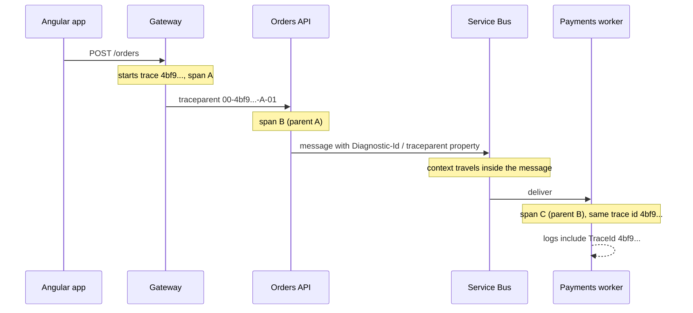
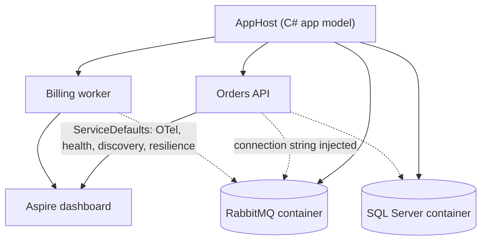

import { Tabs, TabItem, Aside } from '@astrojs/starlight/components';
import QuizBlock from '~/components/QuizBlock.astro';

## Why it matters in interviews

*"A request is slow and it touches six services. How do you find out why?"* There is only one good answer: **distributed tracing**, backed by structured logs and metrics that share the same trace id. Interviewers also check that you know the plumbing every service needs: health checks for the orchestrator, service discovery, central configuration and secrets. .NET Aspire bundles most of this, so expect a question about it in .NET shops.

## Core idea

### The three signals

| Signal | Answers | .NET API | Typical backend (Azure / AWS) |
|---|---|---|---|
| **Traces** | Where did the time go across services? Which call failed? | `System.Diagnostics.Activity` / `ActivitySource` | Application Insights via Azure Monitor (AWS: X-Ray), Jaeger, Tempo |
| **Metrics** | How many, how fast, how full, over time? Alerting | `System.Diagnostics.Metrics.Meter` | Azure Monitor metrics, Prometheus + Grafana (AWS: CloudWatch) |
| **Logs** | What exactly happened in this step? | `ILogger` (structured) | Log Analytics (AWS: CloudWatch Logs), Seq, Elastic, Loki |

**OpenTelemetry (OTel)** is the vendor-neutral standard for producing all three. .NET's built-in `Activity` and `Meter` APIs are the OTel API, so libraries (ASP.NET Core, `HttpClient`, EF Core, Azure SDK, MassTransit) emit telemetry that the OTel SDK collects and exports over **OTLP** to any backend, optionally through an **OpenTelemetry Collector**.

### Distributed tracing and W3C trace context

A **trace** is the whole journey of one request; it is a tree of **spans** (one `Activity` per operation). Each span has the trace id, its own span id and its parent's span id. Context crosses process boundaries in the **W3C `traceparent` header**:

`traceparent: 00-4bf92f3577b34da6a3ce929d0e0e4736-00f067aa0ba902b7-01` = version, 16-byte **trace id**, 8-byte **parent span id**, flags (01 = sampled). An optional `tracestate` header carries vendor data, and `baggage` carries user-defined key/values.



HTTP propagation is automatic with ASP.NET Core and `HttpClient` instrumentation. Messaging needs the context written into **message headers/properties**: the Azure SDK does it (`Diagnostic-Id` application property), MassTransit and NServiceBus do it, and for raw Kafka or RabbitMQ you inject and extract it yourself (code below).

**Sampling** keeps costs down: head-based sampling decides at the start (for example 10% of traces), tail-based sampling in a Collector keeps all slow or failed traces. Always keep errors.

### Correlation ids

The **trace id is your correlation id**: log it on every line (the OTel logging integration and `ILogger` scopes do this), return it to clients (for example as `traceId` in `ProblemDetails`), and search by it. A separate business correlation id (`OrderId`, `ConversationId`) is still useful for flows spanning several traces, such as a saga that resumes hours later.

### Centralised, structured logging

- Log **structured** messages: `log.LogInformation("Order {OrderId} paid {Amount}", id, amount)`, never string-concatenated, so fields are queryable.
- Ship logs from every instance to one place (Azure Monitor / Log Analytics; AWS: CloudWatch Logs). Containers write to stdout or export over OTLP; do not write files inside containers.
- Use levels deliberately, avoid logging secrets and personal data, and sample or rate-limit noisy debug logs.

### Metrics worth having

- **RED** for every service: **R**ate, **E**rrors, **D**uration (p50/p95/p99, not averages).
- **USE** for resources: Utilisation, Saturation, Errors (CPU, thread pool queue, connection pool).
- **Messaging**: queue depth / active message count, **DLQ count**, age of oldest message, Kafka **consumer lag** per partition, processing duration, retries.
- Business metrics: orders per minute, payment failures. Alert on symptoms users feel (error rate, latency SLO), not on every CPU spike.

### Health checks

| Probe | Question | Should check dependencies? | On failure |
|---|---|---|---|
| **Liveness** | Is the process stuck? | **No** (only the process itself) | Orchestrator restarts the container |
| **Readiness** | Can it take traffic now? | Yes, critical ones (DB, broker) | Removed from load balancing, not restarted |
| **Startup** | Has it finished starting? | Warm-up only | Delays liveness checks |

Putting the database in a liveness probe is a classic outage amplifier: a DB blip restarts every pod at once.

### Service discovery and configuration

- **Service discovery**: in Kubernetes and Azure Container Apps, a stable DNS name per service (`http://payments`) backed by the platform load balancer. In .NET, `Microsoft.Extensions.ServiceDiscovery` resolves logical names from configuration or DNS (it is what Aspire uses). Older stacks used Consul or Eureka. AWS: Cloud Map, ECS Service Connect.
- **Configuration**: environment-specific settings in Azure App Configuration with feature flags, secrets in Azure Key Vault accessed with **managed identity** (AWS: AppConfig / Systems Manager Parameter Store, Secrets Manager, IAM roles). Use the options pattern and reload on change where safe.

### .NET Aspire

Aspire is an opinionated stack for building distributed .NET apps:

- **AppHost**: a C# project describing the app model (projects, containers like RabbitMQ, Kafka, Redis, SQL Server, and Azure resources). `dotnet run` (or the `aspire` CLI) starts everything locally with connection strings and service discovery wired up.
- **ServiceDefaults**: a shared project that adds OpenTelemetry, health check endpoints, service discovery and standard HTTP resilience to every service in one call.
- **Dashboard**: local traces, metrics, structured logs and resource status, out of the box.
- **Integrations**: NuGet packages that register clients (Service Bus, RabbitMQ, Kafka, Redis, EF Core) with health checks and telemetry.
- **Deployment**: the app model can be published to Azure Container Apps (for example with the Azure Developer CLI) or to Kubernetes manifests.



## Code

**OpenTelemetry in each service** (`OpenTelemetry.Extensions.Hosting`, instrumentation packages and the OTLP exporter):

```csharp
builder.Services.AddOpenTelemetry()
    .ConfigureResource(r => r.AddService("orders-api"))
    .WithTracing(t => t
        .AddAspNetCoreInstrumentation()
        .AddHttpClientInstrumentation()
        .AddSource("MassTransit")                 // MassTransit's ActivitySource
        .AddSource("Azure.*")                     // Azure SDK (see note below)
        .AddSource(OrdersTelemetry.Name))
    .WithMetrics(m => m
        .AddAspNetCoreInstrumentation()
        .AddHttpClientInstrumentation()
        .AddMeter(OrdersTelemetry.Name))
    .WithLogging()                                // ILogger records exported with TraceId/SpanId
    .UseOtlpExporter();                           // endpoint from OTEL_EXPORTER_OTLP_ENDPOINT

public static class OrdersTelemetry
{
    public const string Name = "Orders";
    public static readonly ActivitySource Source = new(Name);
    private static readonly Meter Meter = new(Name);
    public static readonly Counter<long> OrdersPlaced = Meter.CreateCounter<long>("orders.placed");
}
```

Azure SDK `ActivitySource` support is still flagged experimental: enable it with `AppContext.SetSwitch("Azure.Experimental.EnableActivitySource", true)`. For Application Insights, the Azure Monitor OpenTelemetry distro (`Azure.Monitor.OpenTelemetry.AspNetCore`, `UseAzureMonitor()`) replaces the OTLP exporter.

**Propagating trace context through Kafka headers by hand** (libraries do this for you):

```csharp
private static readonly TextMapPropagator Propagator = Propagators.DefaultTextMapPropagator;

// Producer side: write traceparent (and baggage) into the record headers.
using var activity = OrdersTelemetry.Source.StartActivity("orders publish", ActivityKind.Producer);
var headers = new Headers();
Propagator.Inject(new PropagationContext(activity?.Context ?? default, Baggage.Current), headers,
    (h, key, value) => h.Add(key, Encoding.UTF8.GetBytes(value)));
await producer.ProduceAsync("orders", new Message<string, string> { Key = key, Value = json, Headers = headers }, ct);

// Consumer side: read it back and start a child span with the same trace id.
var parent = Propagator.Extract(default, cr.Message.Headers, (h, key) =>
    h.TryGetLastBytes(key, out var bytes) ? [Encoding.UTF8.GetString(bytes)] : []);
Baggage.Current = parent.Baggage;
using var consume = OrdersTelemetry.Source.StartActivity("orders process", ActivityKind.Consumer, parent.ActivityContext);
```

**Liveness vs readiness endpoints:**

```csharp
builder.Services.AddHealthChecks()
    .AddCheck("self", () => HealthCheckResult.Healthy(), tags: ["live"])
    .AddDbContextCheck<OrdersDbContext>(tags: ["ready"]); // Microsoft.Extensions.Diagnostics.HealthChecks.EntityFrameworkCore

var app = builder.Build();
app.MapHealthChecks("/health/live", new HealthCheckOptions { Predicate = r => r.Tags.Contains("live") });
app.MapHealthChecks("/health/ready", new HealthCheckOptions { Predicate = r => r.Tags.Contains("ready") });
```

**Aspire AppHost** (local orchestration of the whole system):

```csharp
var builder = DistributedApplication.CreateBuilder(args);

var sql = builder.AddSqlServer("sql").AddDatabase("ordersdb");
var bus = builder.AddRabbitMQ("messaging");

builder.AddProject<Projects.Orders_Api>("orders")
    .WithReference(sql).WithReference(bus)
    .WaitFor(sql).WaitFor(bus);

builder.AddProject<Projects.Billing_Worker>("billing")
    .WithReference(bus).WaitFor(bus);

builder.Build().Run();
```

Each service then calls `builder.AddServiceDefaults()` and `app.MapDefaultEndpoints()` from the generated ServiceDefaults project.

## Interview Q&A

<details>
<summary>How do you debug a slow request that crosses several services?</summary>

Find the trace (by trace id from the error response or logs, or by querying slow traces), open the waterfall view and look for the span that dominates the duration or for gaps between spans (queue wait, thread-pool starvation, retries). Then drill into that service's logs filtered by the same trace id and its metrics (DB duration, connection pool, CPU) to find the cause.
</details>

<details>
<summary>What is W3C trace context?</summary>

A standard for propagating trace identity between services. The `traceparent` header carries the version, trace id, parent span id and sampling flags; `tracestate` carries vendor-specific data. Because it is a standard, services in different languages and APM tools join the same trace.
</details>

<details>
<summary>How does trace context flow through a message broker?</summary>

The producer writes the current context into message headers or application properties (`traceparent`, or `Diagnostic-Id` in the Azure SDK), and the consumer extracts it and starts a consumer span with that parent. MassTransit, NServiceBus and the Azure SDK do this automatically; with raw Kafka or RabbitMQ clients you use the OTel propagator to inject and extract.
</details>

<details>
<summary>Liveness vs readiness probes?</summary>

Liveness asks "is the process healthy or should it be restarted?" and must not depend on external systems. Readiness asks "can this instance serve traffic right now?" and can check the database or broker; failing it removes the instance from the load balancer without restarting it. Mixing them causes restart storms during dependency outages.
</details>

<details>
<summary>Which metrics would you alert on for a message consumer?</summary>

Queue depth or Kafka consumer lag growing over time, age of the oldest message, DLQ count above zero (or increasing), processing error rate, and processing duration p95. These show both "we are falling behind" and "messages are failing".
</details>

<details>
<summary>What is .NET Aspire and what problem does it solve?</summary>

An opinionated stack for distributed .NET apps: an AppHost that models and runs all services and dependencies locally, ServiceDefaults that add OpenTelemetry, health checks, service discovery and resilience consistently, a dashboard for telemetry, client integrations, and a path to deploy to Azure Container Apps or Kubernetes. It mostly removes the "works on my machine" setup cost of microservices.
</details>

<details>
<summary>Why is a correlation id still useful when you have trace ids?</summary>

A trace covers one causal chain, typically seconds. Business flows like a saga, a retried message from the DLQ hours later, or a user's multi-step checkout span several traces. A business correlation id (order id, conversation id) in logs and message headers ties them together.
</details>

<details>
<summary>How do services find each other?</summary>

On Kubernetes or Azure Container Apps through platform DNS: each service has a stable name and the platform load-balances to healthy instances. The application uses logical names (`http://payments`) resolved via configuration or DNS, for example with `Microsoft.Extensions.ServiceDiscovery`. Hard-coded IPs or per-environment URLs scattered in code are the anti-pattern.
</details>

## Pitfalls

<Aside type="caution" title="Common mistakes">

- **Different log formats and no shared trace id** across services, so nobody can follow a request.
- **Database or broker checks in the liveness probe**, causing restart storms.
- **Averages instead of percentiles** for latency.
- **Not propagating context through messages**, so async flows show up as disconnected traces.
- **Logging secrets, tokens or personal data.**
- **100% trace sampling in high-traffic production** with no budget, or sampling that drops error traces.
- **Secrets in `appsettings.json`** instead of Key Vault with managed identity.

</Aside>

## Related

- [Logging & Observability in ASP.NET Core](../../aspnet/logging-observability/)
- [Rate Limiting & Health Checks](../../aspnet/rate-limiting-health-checks/)
- [Observability (DevOps)](../../testing-devops/observability/)
- [Scenario Questions](../microservices-scenarios/)

## Quick quiz

<QuizBlock section="microservices" topic="observability-cross-cutting" />
