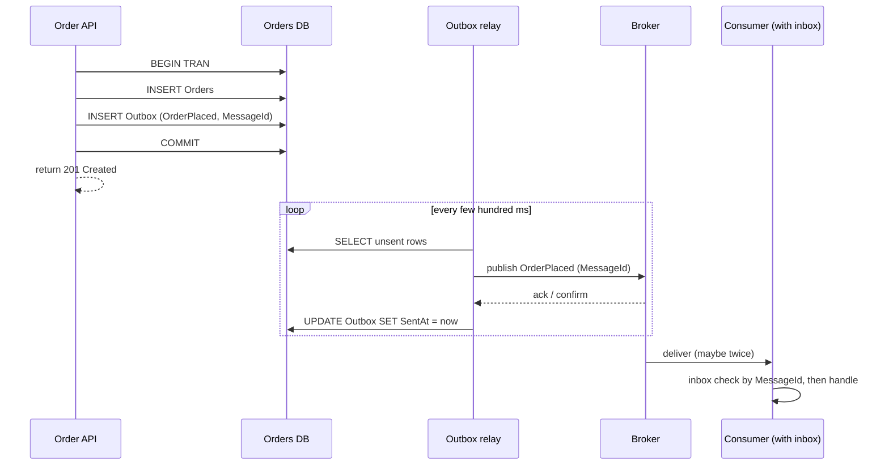
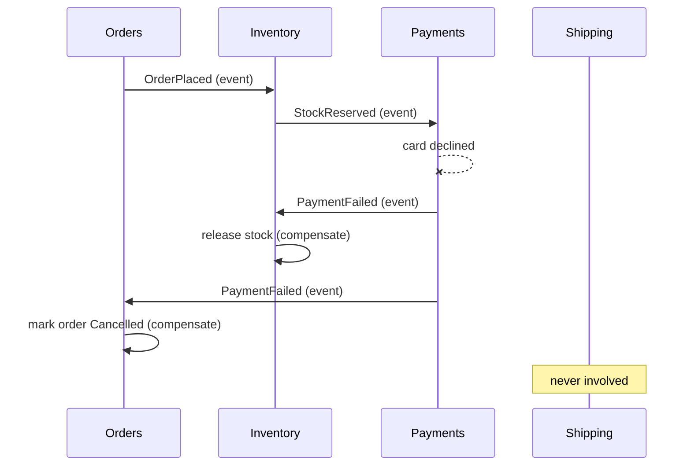
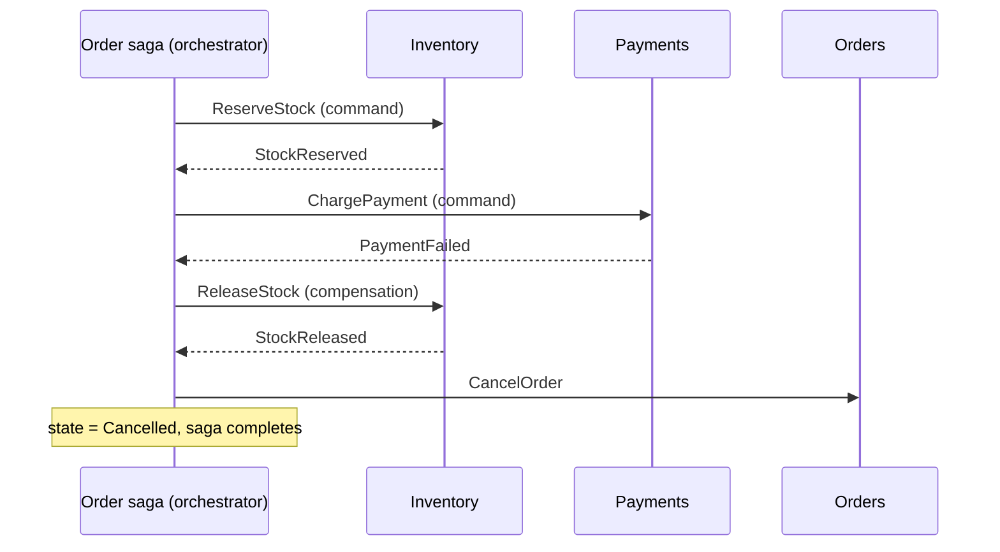
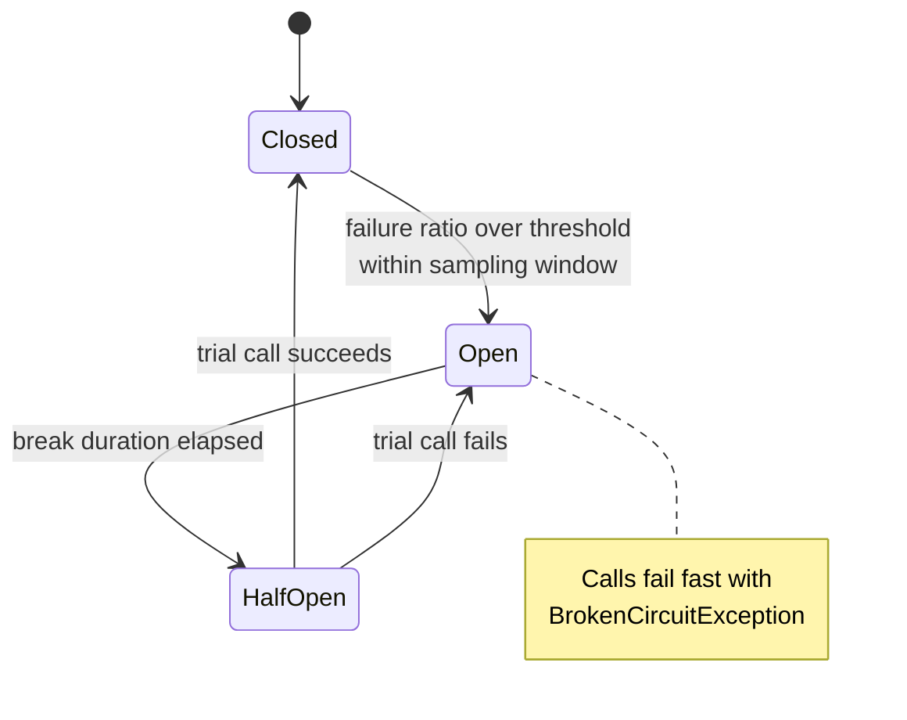

import { Tabs, TabItem, Aside } from '@astrojs/starlight/components';
import QuizBlock from '~/components/QuizBlock.astro';

## Why it matters in interviews

These patterns are what separate *"I have used a queue"* from *"I have built a reliable distributed system"*. Expect: *"You save the order and publish an event. What if the publish fails?"* (outbox), *"How do you keep order, payment and inventory consistent without a distributed transaction?"* (saga) and *"Payments is slow and your threads pile up. What do you do?"* (timeouts, circuit breaker, bulkhead).

## Core idea

### The dual-write problem

A handler that does `SaveChanges()` and then `Publish()` writes to **two systems** without a shared transaction. Crash between them and the order exists but nobody hears about it; publish first and the event announces an order that was rolled back. Distributed transactions (2PC / MSDTC) are not supported by most brokers and cloud databases and would couple availability anyway.

### Transactional outbox

Write the outgoing message to an **Outbox table in the same database transaction** as the business data. A separate **relay** (background service, or change data capture such as Debezium) reads the outbox and publishes to the broker, then marks rows as sent.



Properties to state in an interview:

- **Atomic**: either both the order and the event are stored, or neither.
- **At-least-once publishing**: the relay can crash after publishing but before marking the row, so it republishes. Consumers must be idempotent, which is exactly what the **inbox** provides.
- **Ordering**: publish in insertion order per aggregate if consumers depend on it.
- **Housekeeping**: delete sent rows after a retention period; with several relay instances, lock rows (for example `WITH (UPDLOCK, READPAST, ROWLOCK)`) or run a single active relay.

The **inbox** is the receiving-side twin: store each incoming `MessageId` in the consumer's database in the same transaction as the handler's changes, so redeliveries become no-ops (see [Delivery Guarantees](../delivery-guarantees/)). MassTransit and NServiceBus provide both out of the box.

### Saga: a long-running business transaction

A **saga** is a sequence of local transactions, one per service. Each step publishes a message that triggers the next. If a step fails, the saga runs **compensating actions** to semantically undo the steps already done. There is no rollback of committed work, only forward actions that cancel its effect.

| Step | Action | Compensation |
|---|---|---|
| 1. Orders | Create order (Pending) | Mark order Cancelled |
| 2. Inventory | Reserve stock | Release reservation |
| 3. Payments | Charge card | Refund charge |
| 4. Shipping | Create shipment | (pivot: after this, only forward recovery) |

Design compensations to be **idempotent** and **commutative where possible**, and identify the **pivot transaction**: the point after which the saga only moves forward (retry until it succeeds) because it can no longer be undone.

#### Choreography

No central coordinator. Each service listens for events and decides what to do next.



#### Orchestration

A **saga orchestrator** (a state machine with persisted state) sends commands and reacts to replies.



| | Choreography | Orchestration |
|---|---|---|
| Control | Distributed across services | Central state machine |
| Coupling | Services know events, not each other | Orchestrator knows every participant |
| Visibility | Flow is implicit; hard to see "where is order 42?" | One place shows saga state |
| Adding steps | Easy for simple flows, messy for complex ones | Change one state machine |
| Risk | Cyclic event dependencies, hard debugging | Orchestrator becomes a "god service" if it absorbs logic |
| Fits | 2-4 steps, independent teams | Many steps, timeouts, compensations, business-visible status |

Tools: MassTransit state machine sagas, NServiceBus sagas, Azure Durable Functions or Logic Apps for orchestration (AWS: Step Functions). Sagas also need **timeouts** ("payment not confirmed in 15 minutes, cancel"), done with scheduled messages.

Sagas give **ACD without I**: no isolation. Other requests can see intermediate state (stock reserved, order not paid). Countermeasures: a `Pending` status visible to users (semantic lock), reread values before acting, and commutative updates.

### Resilience for synchronous calls

| Pattern | Problem it solves | Key settings |
|---|---|---|
| **Timeout** | A slow dependency holds threads and connections forever | Per attempt and total; always set one |
| **Retry** | Transient faults (network blip, 503, 429) | Few attempts, exponential backoff + jitter, only idempotent operations |
| **Circuit breaker** | Hammering a dependency that is down; cascading failure | Failure ratio, sampling window, minimum throughput, break duration |
| **Bulkhead** | One slow dependency exhausting all threads | Concurrency limit + queue per dependency |
| **Fallback** | Degrade gracefully | Cached value, default, "try later" message |



Order matters: a typical pipeline from outside in is **total timeout → retry → circuit breaker → per-attempt timeout**. The retry sees circuit-breaker rejections, and each attempt has its own timeout so one hung call does not consume the whole retry budget.

## Code

**Hand-rolled outbox with EF Core** (the write side):

```csharp
public sealed class OutboxMessage
{
    public Guid Id { get; init; } = Guid.NewGuid();      // becomes the broker MessageId
    public required string Type { get; init; }
    public required string Payload { get; init; }
    public DateTime OccurredAt { get; init; } = DateTime.UtcNow;
    public DateTime? SentAt { get; set; }
}

public async Task<Guid> PlaceOrderAsync(PlaceOrder cmd, CancellationToken ct)
{
    var order = Order.Create(cmd.CustomerId, cmd.Lines);
    db.Orders.Add(order);
    db.Outbox.Add(new OutboxMessage
    {
        Type = nameof(OrderPlaced),
        Payload = JsonSerializer.Serialize(new OrderPlaced(order.Id, order.CustomerId, order.Total)),
    });
    await db.SaveChangesAsync(ct); // one transaction: order + outbox row
    return order.Id;
}
```

**The relay** as a `BackgroundService` (single instance; see the locking note above for scale-out):

```csharp
public sealed class OutboxRelay(IServiceScopeFactory scopes, ServiceBusSender sender, ILogger<OutboxRelay> log)
    : BackgroundService
{
    protected override async Task ExecuteAsync(CancellationToken stoppingToken)
    {
        using var timer = new PeriodicTimer(TimeSpan.FromMilliseconds(500));
        while (await timer.WaitForNextTickAsync(stoppingToken))
        {
            await using var scope = scopes.CreateAsyncScope();
            var db = scope.ServiceProvider.GetRequiredService<OrdersDbContext>();
            var batch = await db.Outbox.Where(m => m.SentAt == null)
                .OrderBy(m => m.OccurredAt).Take(50).ToListAsync(stoppingToken);

            foreach (var m in batch)
            {
                var msg = new ServiceBusMessage(m.Payload) { MessageId = m.Id.ToString(), Subject = m.Type };
                await sender.SendMessageAsync(msg, stoppingToken); // a crash after this = republish (fine)
                m.SentAt = DateTime.UtcNow;
                await db.SaveChangesAsync(stoppingToken);
            }
        }
    }
}
```

Production code also catches and logs per-message failures so one bad row does not stop the loop. Using the same `MessageId` means Service Bus duplicate detection (if enabled) drops republished copies.

**Polly v8 resilience pipeline** (`Polly.Core`, registered via `Polly.Extensions`):

```csharp
builder.Services.AddResiliencePipeline("payments", pipeline => pipeline
    .AddTimeout(TimeSpan.FromSeconds(10))                       // total
    .AddRetry(new RetryStrategyOptions
    {
        MaxRetryAttempts = 3,
        BackoffType = DelayBackoffType.Exponential,
        UseJitter = true,
        Delay = TimeSpan.FromMilliseconds(200),
        ShouldHandle = new PredicateBuilder().Handle<HttpRequestException>().Handle<TimeoutRejectedException>(),
    })
    .AddCircuitBreaker(new CircuitBreakerStrategyOptions
    {
        FailureRatio = 0.5,
        SamplingDuration = TimeSpan.FromSeconds(30),
        MinimumThroughput = 20,
        BreakDuration = TimeSpan.FromSeconds(15),
    })
    .AddTimeout(TimeSpan.FromSeconds(2)));                      // per attempt

// Usage
public sealed class PaymentGateway(ResiliencePipelineProvider<string> provider, HttpClient http)
{
    private readonly ResiliencePipeline _pipeline = provider.GetPipeline("payments");

    public ValueTask<HttpResponseMessage> ChargeAsync(ChargeRequest req, CancellationToken ct) =>
        _pipeline.ExecuteAsync(async token =>
            await http.PostAsJsonAsync("/charges", req, token), ct); // req carries an idempotency key
}
```

For `HttpClient`, prefer `AddStandardResilienceHandler()` or `AddResilienceHandler("name", ...)` from `Microsoft.Extensions.Http.Resilience`, which builds the same kind of pipeline around the handler. A **bulkhead** in Polly v8 is the concurrency limiter (`AddConcurrencyLimiter`, in the `Polly.RateLimiting` package).

## Interview Q&A

<details>
<summary>What problem does the transactional outbox solve?</summary>

The dual write: you cannot atomically commit a database change and publish to a broker. The outbox stores the message in the same database transaction as the business change, and a relay publishes it afterwards. The result is that an event is published if and only if the change committed, with at-least-once delivery.
</details>

<details>
<summary>Why not just publish inside a TransactionScope?</summary>

Most brokers (Kafka, RabbitMQ, Service Bus with SQL Server) cannot enlist in a distributed transaction with your database, and in the cloud MSDTC is generally unavailable. Even where 2PC works, it holds locks across systems and couples their availability. The outbox needs only a local transaction.
</details>

<details>
<summary>Orchestration or choreography: which would you pick for order → payment → inventory → shipping?</summary>

Orchestration, because there are four steps, compensations, timeouts and the business wants to see order status in one place. A state machine saga (MassTransit, NServiceBus, Durable Functions; AWS Step Functions) makes the flow explicit. For a simple two-step reaction (order placed, send email) choreography is fine.
</details>

<details>
<summary>What is a compensating transaction? Give an example.</summary>

A business action that semantically reverses a completed step, for example refunding a captured payment or releasing reserved stock. It is not a database rollback: the original step was committed and may have been seen by others. Compensations must be idempotent and retried until they succeed.
</details>

<details>
<summary>Explain the circuit breaker states.</summary>

Closed: calls pass through and failures are measured. Open: after the failure ratio crosses a threshold, calls fail fast without touching the dependency for the break duration. Half-open: a trial call is allowed; success closes the circuit, failure opens it again. It protects the caller's resources and gives the dependency room to recover.
</details>

<details>
<summary>When is retrying harmful?</summary>

For non-idempotent operations without an idempotency key (duplicate charges), for permanent errors (400, validation), when the dependency is overloaded (retries amplify load: a retry storm), and when retries are stacked at several layers (3 attempts at each of 3 layers = up to 27 calls to the bottom service). Use backoff with jitter, retry budgets and circuit breakers.
</details>

<details>
<summary>What is a bulkhead?</summary>

Isolating resources per dependency so one failure cannot sink everything, like watertight compartments in a ship. In practice: a concurrency limit per downstream (Polly concurrency limiter), separate connection pools or `HttpClient`s, or separate worker queues, so slow reporting calls cannot consume all threads needed by checkout.
</details>

<details>
<summary>How does a saga handle "payment never responds"?</summary>

The saga schedules a timeout message when it sends `ChargePayment`. If the timeout arrives first, it queries payment status or compensates (release stock, cancel order). Because the late reply may still arrive, the saga must ignore events for a finished instance or trigger a refund.
</details>

## Pitfalls

<Aside type="caution" title="Common mistakes">

- **Publishing after `SaveChanges` without an outbox** and calling it reliable.
- **Assuming the outbox gives exactly-once**: it gives at-least-once, so consumers still need an inbox or idempotency.
- **Compensations that can fail permanently**, leaving a saga stuck. Make them idempotent and retryable, and alert on stuck sagas.
- **No timeout** on HTTP calls (the default `HttpClient.Timeout` is 100 seconds).
- **Retrying inside a retry** across layers, multiplying load.
- **Circuit breaker per request** (new pipeline each call), so it never accumulates state. Create pipelines once and share them.
- **Choreography with ten steps** that nobody can trace end to end.

</Aside>

## Related

- [Delivery Guarantees & Idempotency](../delivery-guarantees/)
- [Messaging in .NET](../dotnet-messaging/) (MassTransit outbox and sagas)
- [Performance & Resilience in ASP.NET Core](../../aspnet/performance-resilience/)
- [E-commerce Order Processing case study](../../system-design/case-ecommerce-orders/)

## Quick quiz

<QuizBlock section="microservices" topic="reliability-patterns" />
