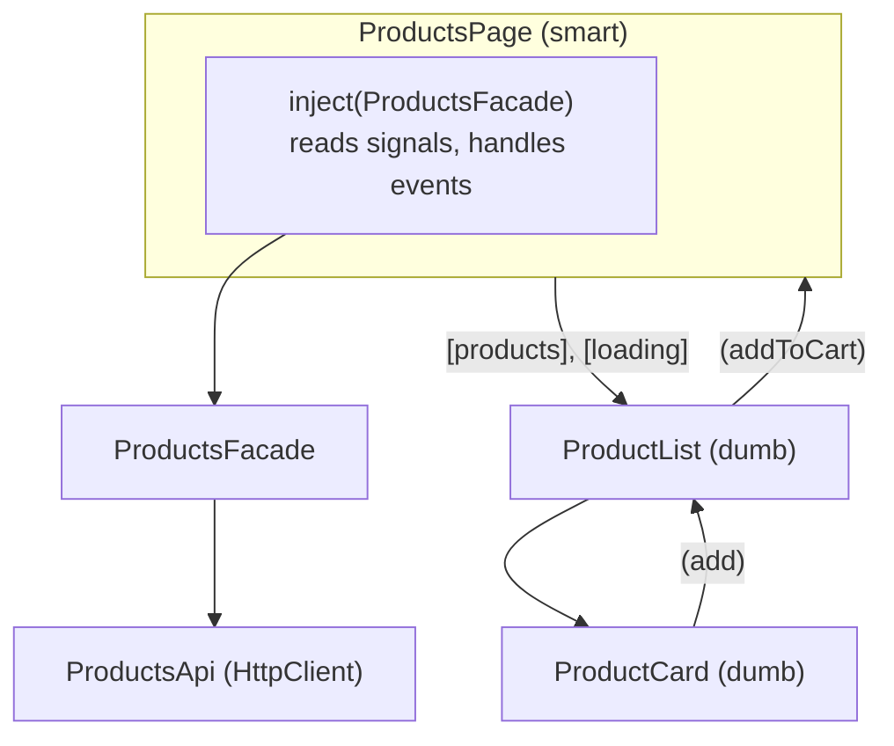
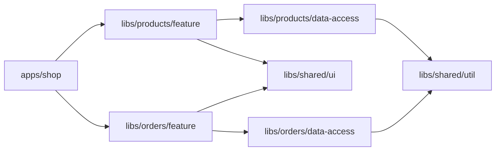

import { Tabs, TabItem, Aside } from '@astrojs/starlight/components';
import QuizBlock from '~/components/QuizBlock.astro';

## Why it matters in interviews

Full-stack .NET + Angular roles almost always ask *"how do you structure a large Angular app?"* or *"how do components share data?"*. The interviewer wants to hear about **component responsibilities, where state lives, and how features are isolated**, not a list of folders. These patterns are the front-end mirror of [SOLID](../solid/) and [Clean Architecture](../architecture-styles/): separate presentation from logic, depend on abstractions, keep features independent.

## Core idea

| Pattern | Intent in one line | Back-end equivalent |
|---|---|---|
| Smart / dumb components | Containers handle data and logic; presentational components only render inputs and emit outputs | Controller vs view model |
| Facade service | One service per feature hiding HTTP, state and caching from components | Application service / Facade |
| Feature-based folders | Group by business feature, not by file type | Vertical Slice |
| Core / shared | App-wide singletons in core; reusable dumb UI in shared | Infrastructure / shared kernel |
| State ownership | Every piece of state has one owner; others read it | Aggregate root |
| Libraries / monorepo (Nx) | Split code into libraries with enforced dependency rules | Projects with references |

### Smart (container) and dumb (presentational) components



- **Smart / container**: knows *where* data comes from. Injects services or a facade, holds or reads state, reacts to user intents. Usually a routed page. Few of them.
- **Dumb / presentational**: knows only *how* to display. Gets data through `input()`, reports intents through `output()`, no injected data services. Easy to reuse, test and render in Storybook; perfect for `OnPush`.

<Tabs syncKey="lang">
  <TabItem label="Dumb component">

```ts
import { ChangeDetectionStrategy, Component, input, output } from '@angular/core';
import { CurrencyPipe } from '@angular/common';

export interface Product { id: number; name: string; price: number; }

@Component({
  selector: 'app-product-list',
  imports: [CurrencyPipe],
  changeDetection: ChangeDetectionStrategy.OnPush,
  template: `
    @if (loading()) {
      <p>Loading…</p>
    } @else {
      @for (p of products(); track p.id) {
        <article>
          <h3>{{ p.name }}</h3>
          <span>{{ p.price | currency: 'INR' }}</span>
          <button (click)="addToCart.emit(p)">Add</button>
        </article>
      } @empty {
        <p>No products found.</p>
      }
    }
  `,
})
export class ProductList {
  readonly products = input.required<Product[]>();
  readonly loading = input(false);
  readonly addToCart = output<Product>();
}
```

  </TabItem>
  <TabItem label="Smart component">

```ts
import { Component, inject } from '@angular/core';
import { ProductList, Product } from './product-list';
import { ProductsFacade } from './products.facade';

@Component({
  selector: 'app-products-page',
  imports: [ProductList],
  template: `
    <input placeholder="Search" (input)="facade.search($any($event.target).value)" />
    <app-product-list
      [products]="facade.products()"
      [loading]="facade.loading()"
      (addToCart)="onAdd($event)" />
  `,
})
export class ProductsPage {
  protected readonly facade = inject(ProductsFacade);

  onAdd(product: Product): void {
    this.facade.addToCart(product);
  }
}
```

  </TabItem>
</Tabs>

**When not to use:** don't split a tiny one-off component into two just for the pattern. The rule of thumb is that leaf UI pieces should be dumb; one smart component per route or major section is enough.

### Facade services

**Problem:** components that inject `HttpClient`, a cart service, a toast service and a store, and orchestrate them, are hard to test and change. A **facade** gives each feature one small API: *signals to read, methods to call*. Components don't know whether data comes from HTTP, a cache, NgRx or a signal store, so you can swap that later.

```ts
import { Injectable, computed, inject, signal } from '@angular/core';
import { HttpClient } from '@angular/common/http';
import { firstValueFrom } from 'rxjs';
import { Product } from './product-list';

@Injectable({ providedIn: 'root' })
export class ProductsFacade {
  private readonly http = inject(HttpClient);

  // Private writable state: only the facade can change it.
  private readonly state = signal({ products: [] as Product[], loading: false, query: '' });
  private readonly cart = signal<Product[]>([]);

  // Public read-only API for components.
  readonly products = computed(() => {
    const { products, query } = this.state();
    return products.filter((p) => p.name.toLowerCase().includes(query.toLowerCase()));
  });
  readonly loading = computed(() => this.state().loading);
  readonly cartCount = computed(() => this.cart().length);

  async load(): Promise<void> {
    this.state.update((s) => ({ ...s, loading: true }));
    const products = await firstValueFrom(this.http.get<Product[]>('/api/products'));
    this.state.update((s) => ({ ...s, products, loading: false }));
  }

  search(query: string): void {
    this.state.update((s) => ({ ...s, query }));
  }

  addToCart(product: Product): void {
    this.cart.update((items) => [...items, product]);
  }
}
```

**When not to use:** a facade that just forwards every call to one service adds a layer with no simplification. Also avoid one giant app-wide facade; keep one per feature.

### Feature-based folders, core and shared

Group by **business feature** (like [vertical slices](../architecture-styles/)) instead of `components/`, `services/`, `models/` folders that grow to hundreds of files.

```text
src/app/
  core/                 app-wide singletons, loaded once
    auth/               auth.service.ts, auth.interceptor.ts, auth.guard.ts
    layout/             shell, header, footer
    error-handling/
  shared/               reusable, dumb, no business logic
    ui/                 button, modal, data-table
    pipes/  directives/
  features/
    products/           products.routes.ts, products-page.ts, product-list.ts, products.facade.ts, products.api.ts
    orders/
    checkout/
  app.routes.ts         lazy-loads each feature: loadChildren: () => import('./features/orders/orders.routes')
  app.config.ts         provideRouter, provideHttpClient(withInterceptors([...]))
```

Rules that keep this healthy:

- **core** is imported by the app shell only; it holds `providedIn: 'root'` services, interceptors, guards and layout.
- **shared** must not depend on features or call APIs; everything there is presentational and reusable.
- **features** don't import from each other's internals. If two features need the same thing, move it to shared (UI) or a shared data-access service.
- Each feature is **lazy-loaded** through its routes file, which keeps the initial bundle small.

With standalone components there are no `CoreModule`/`SharedModule` classes any more; the folders remain as a convention, and providers move to `app.config.ts` or route-level `providers`.

### State ownership

Every piece of state needs **one owner**, the only place that can change it. Everyone else reads it.

| State | Owner | Tool |
|---|---|---|
| Local UI (is the dropdown open, form draft) | The component | `signal()` in the component |
| Feature state (product list, filters) | The feature facade or store, provided at route level | Signal-based service, NgRx Signal Store |
| App-wide (current user, cart, theme) | A root service in core | `providedIn: 'root'` signal service, NgRx Store for complex flows |
| Server cache (data from APIs) | The data-access layer | `httpResource` / `resource`, or a cache in the facade |
| URL state (page, sort, search) | The router | Route params / query params, `withComponentInputBinding()` |

Expose state as **read-only** (`computed()` or `signal.asReadonly()`), and change it only through methods on the owner. That is [tell, don't ask](../design-principles/) in the front-end. Choosing between plain signal services and NgRx is covered in [State Management](../../angular/state-management/).

### Libraries and monorepos (Nx)

In large codebases (or several apps sharing code) the folder conventions become **libraries** with enforced boundaries. Nx (or Angular CLI workspaces with `ng generate library`) is the common choice.



Typical library types: **feature** (smart components, routes), **ui** (dumb components), **data-access** (facades, API services, state), **util** (pure functions, models). Nx tags plus the `@nx/enforce-module-boundaries` lint rule stop a `ui` library importing `data-access`, or `orders` importing `products` internals. Nx also gives `nx affected` so CI only builds and tests what changed. In a full-stack monorepo you can share generated API DTO types between the .NET OpenAPI spec and Angular libraries.

**When not to use:** a single small app with one team. A monorepo tool adds configuration and learning cost; feature folders are enough.

## Interview Q&A

<details>
<summary>What is the difference between smart and dumb components?</summary>

Smart (container) components know where data comes from: they inject services or facades, hold state and handle events. Dumb (presentational) components only receive data via `input()` and emit events via `output()`. Dumb components are reusable, easy to test, and work naturally with `OnPush` because they only change when their inputs change.
</details>

<details>
<summary>Why use a facade service in Angular?</summary>

It decouples components from how state is managed. Components read signals and call methods like `load()` or `addToCart()`; the facade hides HttpClient calls, caching and the store. You can move from a plain signal service to NgRx later without touching components, and component tests only need to mock one facade.
</details>

<details>
<summary>How would you structure a large Angular application?</summary>

Feature folders (or Nx libraries) per business area, each lazy-loaded via its own routes file; a `core` folder for app-wide singletons (auth, interceptors, layout); a `shared` folder for reusable presentational UI, pipes and directives. Within a feature, split smart and dumb components and use a facade for data. Enforce that features don't import each other's internals.
</details>

<details>
<summary>Where should state live in an Angular app?</summary>

With its single owner at the narrowest scope that needs it: local UI state in the component, feature state in a feature facade/store (often provided on the route), global state like the current user in a root service, and navigational state in the URL. Expose it read-only and change it through methods.
</details>

<details>
<summary>Do we still need CoreModule and SharedModule with standalone components?</summary>

No NgModules are needed. Standalone components import exactly what they use, and app-wide providers go in `app.config.ts`. The **folder conventions** (core, shared, features) are still useful for organisation and for lint rules about who may import what.
</details>

<details>
<summary>What does Nx add to an Angular project?</summary>

Libraries with tags and enforced module boundaries, a dependency graph, generators, computation caching and `nx affected` to build/test only what changed. It's valuable for multiple apps, many teams, or very large codebases; overkill for one small app.
</details>

<details>
<summary>How do sibling components communicate?</summary>

Through their common parent (inputs down, outputs up) if they're close, or through a shared service/facade that owns the state (signals or a `Subject`) when they're far apart. The shared service acts as a mediator, so neither component references the other.
</details>

## Pitfalls

<Aside type="caution" title="Common mistakes">

- **Dumb components that inject `HttpClient`** or a store, so they can't be reused.
- **Exposing writable signals or Subjects** from services, letting any component change shared state.
- **A `shared` folder full of business logic** that every feature depends on, which becomes the new monolith.
- **Features importing each other's internals**, making lazy loading and refactoring painful.
- **Global store for everything**, including local UI flags that belong in the component.
- **Deep input/output chains** through five levels of components instead of a feature service.
- **Monorepo tooling for a single small app.**

</Aside>

## Related

- [Angular State Management](../../angular/state-management/)
- [Angular Architecture & Bootstrapping](../../angular/architecture-bootstrap/)
- [Structural Patterns (Facade)](../structural-patterns/)
- [Architecture Styles](../architecture-styles/)

## Quick quiz

<QuizBlock section="patterns" topic="angular-patterns" />
