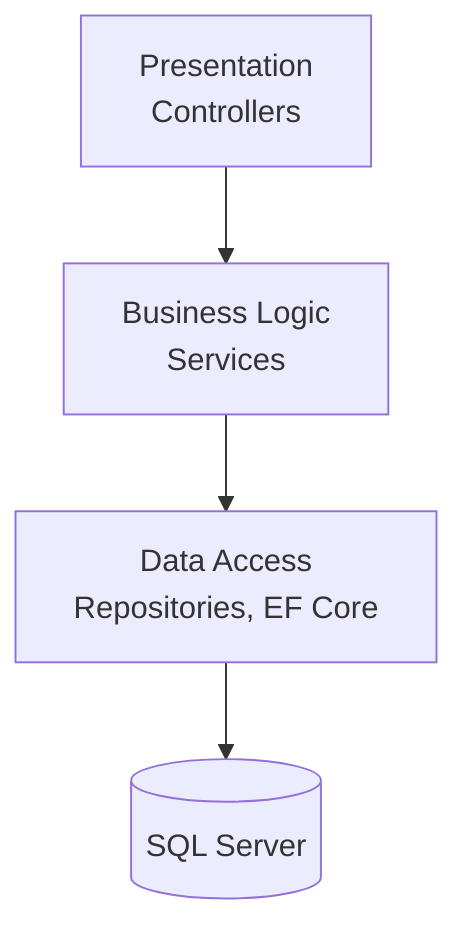
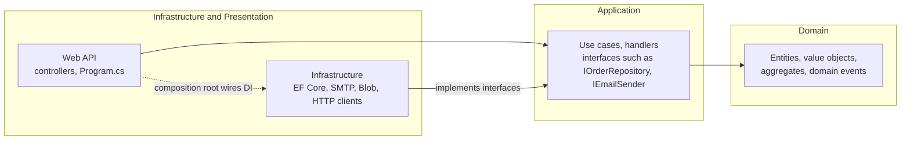
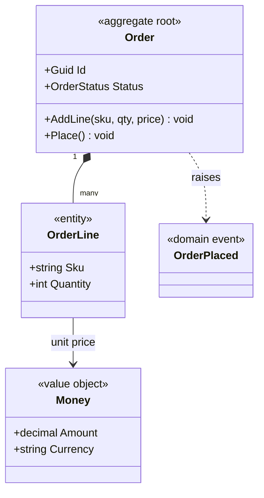
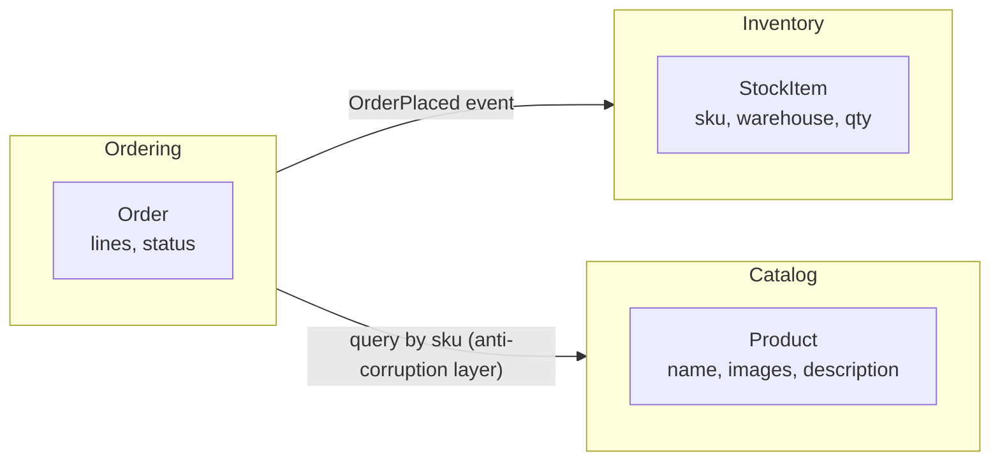

import { Tabs, TabItem, Aside } from '@astrojs/starlight/components';
import QuizBlock from '~/components/QuizBlock.astro';

## Why it matters in interviews

*"Walk me through the architecture of your current project"* is asked in almost every round. Interviewers listen for whether you understand **why** the projects are split the way they are: which way dependencies point, where business rules live, and what you'd change. Being able to compare N-layer, Clean and Vertical Slice, and to explain an aggregate, separates a 4-year engineer from someone who only followed a template.

## Core idea

Every style answers two questions: **how is code grouped** (by technical layer or by feature) and **which way do dependencies point** (towards the database or towards the domain).

| Style | Grouping | Dependency direction | Good for |
|---|---|---|---|
| N-layer (3-tier) | Technical layers: UI, BLL, DAL | Top-down, business depends on data access | Simple CRUD, small teams |
| Clean / Onion / Hexagonal | Layers in rings around the domain | **Inward**: infrastructure depends on the core | Long-lived apps with real business rules |
| Vertical Slice | By feature / use case | Each slice owns its own stack | Many independent features, CQRS-style APIs |
| Modular monolith | By business module (bounded context) | Modules talk via public contracts | Growing systems, a step before microservices |

### N-layer architecture



Simple and familiar. The weakness: the business layer **depends on** the data layer, so domain code references EF entities and database concerns, and tests need the database or heavy mocking. It tends to produce an **anemic domain** where services hold all logic.

### Clean, Onion and Hexagonal

These three are variations of one idea: put the **domain at the centre** and make everything else depend on it (the [Dependency Inversion Principle](../solid/) applied to whole projects).



Typical .NET solution and project references:

| Project | Contains | References |
|---|---|---|
| `Shop.Domain` | Entities, value objects, domain events, domain exceptions | nothing |
| `Shop.Application` | Use cases/handlers, DTOs, interfaces (`IOrderRepository`, `IClock`), validators | Domain |
| `Shop.Infrastructure` | `AppDbContext`, EF configurations, repositories, email/blob adapters | Application, Domain |
| `Shop.Api` | Controllers or endpoints, middleware, `Program.cs` (composition root) | Application, Infrastructure (only for DI wiring) |

- **Onion** (Jeffrey Palermo) draws the same rings: Domain Model → Domain Services → Application Services → outer ring of UI, tests, infrastructure.
- **Hexagonal / Ports and Adapters** (Alistair Cockburn) names the interfaces: **ports** (`IOrderRepository`, `IPaymentGateway`, and the use cases themselves) and **adapters** that plug into them, both driving (REST controller, message consumer, test) and driven (EF repository, Stripe client).
- **Clean Architecture** (Robert C. Martin) is the synthesis with the **Dependency Rule**: source code dependencies only point inwards.

Benefit: domain and application logic are testable without a database or web server, and infrastructure can change (SQL to Cosmos, SMTP to SendGrid) without touching rules. Cost: more projects, mapping between layers, and ceremony for simple features.

### Vertical Slice architecture

Instead of spreading one feature across four projects, keep **everything for one use case together**: request, validator, handler, endpoint. Slices may share the domain model and `DbContext`, but each can choose its own approach (EF for writes, Dapper for a heavy report).

```csharp
using FluentValidation;
// Features/Orders/CancelOrder.cs : one file, one use case.
public static class CancelOrder
{
    public record Command(int OrderId, string Reason);

    public class Validator : AbstractValidator<Command>
    {
        public Validator() => RuleFor(c => c.Reason).NotEmpty().MaximumLength(200);
    }

    public static async Task<IResult> Handle(int id, Command cmd, AppDbContext db, CancellationToken ct)
    {
        var order = await db.Orders.FindAsync([id], ct);
        if (order is null) return Results.NotFound();
        if (order.Status == "Shipped") return Results.Conflict("Already shipped");

        order.Status = "Cancelled";
        await db.SaveChangesAsync(ct);
        return Results.NoContent();
    }

    public static void Map(IEndpointRouteBuilder app) =>
        app.MapPost("/orders/{id:int}/cancel", Handle);
}
```

Trade-offs: adding or deleting a feature touches one folder, and there's little cross-feature coupling. Risk: duplicated logic between slices; push shared business rules down into the domain model. Clean and Vertical Slice combine well: domain at the centre, application organised by feature folders.

### DDD tactical patterns

Domain-Driven Design gives building blocks for a **rich domain model** where rules live inside the objects that own the data.

| Building block | What it is | .NET shape |
|---|---|---|
| Entity | Has identity that persists over time; equality by id | class with `Id`, private setters |
| Value object | Defined by its values, immutable, no identity | `record` / `record struct` (`Money`, `Address`, `Email`) |
| Aggregate | Cluster of objects changed as one consistency boundary | Root entity owns children; outsiders hold only the root's id |
| Aggregate root | The only entry point for changes; enforces invariants | `Order` with `AddLine()`, not public `Lines.Add` |
| Domain event | Something that happened in the domain | `record OrderPlaced(...)` raised by the aggregate, dispatched after save |
| Domain service | Logic that doesn't belong to one entity | `PricingService` using several aggregates |
| Repository | Loads and saves whole aggregates | one per aggregate root |



```csharp
public record Money(decimal Amount, string Currency)
{
    public static Money Zero(string currency) => new(0, currency);
    public Money Add(Money other) => other.Currency == Currency
        ? this with { Amount = Amount + other.Amount }
        : throw new InvalidOperationException("Currency mismatch");
    public Money Times(int qty) => this with { Amount = Amount * qty };
}

public record OrderPlaced(Guid OrderId, Money Total);
```

The aggregate root guards its invariants and records what happened:

```csharp
public class DddOrderLine(string sku, int quantity, Money unitPrice)
{
    public string Sku { get; } = sku;
    public int Quantity { get; private set; } = quantity;
    public Money LineTotal => unitPrice.Times(Quantity);
}

public class DddOrder
{
    private readonly List<DddOrderLine> _lines = [];
    private readonly List<object> _events = [];

    public Guid Id { get; } = Guid.NewGuid();
    public string Status { get; private set; } = "Draft";
    public IReadOnlyList<DddOrderLine> Lines => _lines;      // no outside Add/Remove
    public IReadOnlyList<object> DomainEvents => _events;

    public void AddLine(string sku, int qty, Money price)
    {
        if (Status != "Draft") throw new InvalidOperationException("Order is locked");
        if (qty <= 0) throw new ArgumentOutOfRangeException(nameof(qty));
        _lines.Add(new DddOrderLine(sku, qty, price));
    }

    public void Place()
    {
        if (_lines.Count == 0) throw new InvalidOperationException("Empty order");
        Status = "Placed";
        var total = _lines.Aggregate(Money.Zero("INR"), (sum, l) => sum.Add(l.LineTotal));
        _events.Add(new OrderPlaced(Id, total)); // dispatched after SaveChanges succeeds
    }
}
```

Aggregate design rules worth quoting: keep aggregates **small**; reference other aggregates **by id**, not navigation properties; change **one aggregate per transaction** and use domain events for the rest (eventual consistency). In EF Core, value objects map as owned types or complex types (`ComplexProperty` in EF Core 8+).

### Bounded contexts

A **bounded context** is a boundary inside which a model and its language (the *ubiquitous language*) are consistent. "Product" in *Catalog* (description, images, SEO) is not the same model as "Product" in *Inventory* (SKU, warehouse, quantity) or *Billing* (tax code, price). Forcing one giant `Product` class across all of them creates a model nobody can change.



Contexts integrate through published contracts: events, APIs, and an **anti-corruption layer** (an adapter translating another context's model into yours). A bounded context is the natural boundary for a module in a modular monolith or for a microservice (see [Monolith vs Microservices](../../microservices/monolith-vs-microservices/)).

**When not to use DDD:** CRUD-heavy apps with few rules (admin screens, reporting). Tactical DDD there is ceremony. Strategic DDD (bounded contexts, ubiquitous language) is useful almost everywhere.

## Interview Q&A

<details>
<summary>Explain Clean Architecture and the Dependency Rule.</summary>

The domain and application logic are at the centre; infrastructure and UI are outer rings. Source code dependencies point **inwards only**: Domain references nothing, Application references Domain and defines interfaces, Infrastructure implements those interfaces, and the API project wires everything in `Program.cs`. Business rules can then be tested and changed without touching EF Core or ASP.NET.
</details>

<details>
<summary>Clean vs Onion vs Hexagonal: what's the difference?</summary>

Mostly vocabulary and diagrams. All three put the domain at the centre and invert dependencies on infrastructure. Hexagonal emphasises ports (interfaces) and adapters (implementations, both driving and driven). Onion emphasises concentric rings. Clean combines them and names the Dependency Rule. In a .NET solution they usually produce the same Domain/Application/Infrastructure/Api projects.
</details>

<details>
<summary>N-layer vs Clean Architecture?</summary>

In N-layer the business layer depends on the data access layer, so domain code knows about persistence. In Clean the data access layer depends on interfaces defined by the core, so the core has no infrastructure references. Same number of projects, opposite dependency direction for persistence.
</details>

<details>
<summary>What is Vertical Slice architecture and when would you choose it over Clean?</summary>

Code is organised by feature (request, validator, handler, endpoint together) instead of by layer. Each slice can use the simplest approach that fits. It suits APIs with many independent use cases and teams that want low coupling between features. Clean's layering is stronger when there's a rich shared domain; the two are often combined.
</details>

<details>
<summary>Entity vs value object?</summary>

An entity has an identity that stays the same while its attributes change (an `Order` with id 42). A value object is defined only by its values and is immutable (`Money(100, "INR")`); two with the same values are equal. In C#, records are a natural fit for value objects because of value equality and `with`.
</details>

<details>
<summary>What is an aggregate, and why should it be small?</summary>

A cluster of entities and value objects treated as one unit for changes, with a root that enforces invariants (e.g. an `Order` and its lines; total can't be negative, lines can't change after placing). Everything inside is saved in one transaction, so large aggregates mean big loads, lock contention and concurrency conflicts. Reference other aggregates by id.
</details>

<details>
<summary>How do you dispatch domain events with EF Core?</summary>

Aggregates collect events in a list. In an overridden `SaveChangesAsync` or an EF `SaveChangesInterceptor`, gather events from tracked entities, save, then dispatch them (e.g. via MediatR `Publish`) and clear the lists. For events leaving the service, write them to an outbox table in the same transaction instead of publishing directly.
</details>

<details>
<summary>What is a bounded context?</summary>

A boundary within which a domain model and its terms have one consistent meaning. "Customer" in Sales and in Support can be different models. Contexts communicate through explicit contracts and anti-corruption layers. They are the best guide for module or microservice boundaries.
</details>

## Pitfalls

<Aside type="caution" title="Common mistakes">

- **EF Core attributes or `DbContext` in the Domain project**, breaking the Dependency Rule.
- **Clean Architecture for a 5-table CRUD app**, with four projects and mapping layers for every field.
- **Anemic entities with public setters**, so "DDD" is only folder names.
- **Huge aggregates** loaded with every navigation property, causing slow saves and concurrency conflicts.
- **One shared model across contexts** (a 60-property `Product` everyone depends on).
- **Infrastructure referenced from Application** "just for one helper".
- **Vertical slices copying business rules** instead of pushing shared rules into the domain.

</Aside>

## Related

- [SOLID Principles (DIP)](../solid/)
- [Enterprise Patterns](../enterprise-patterns/)
- [Monolith, Modular Monolith & Microservices](../../microservices/monolith-vs-microservices/)
- [Event-Driven Design](../../microservices/event-driven-design/)

## Quick quiz

<QuizBlock section="patterns" topic="architecture-styles" />
