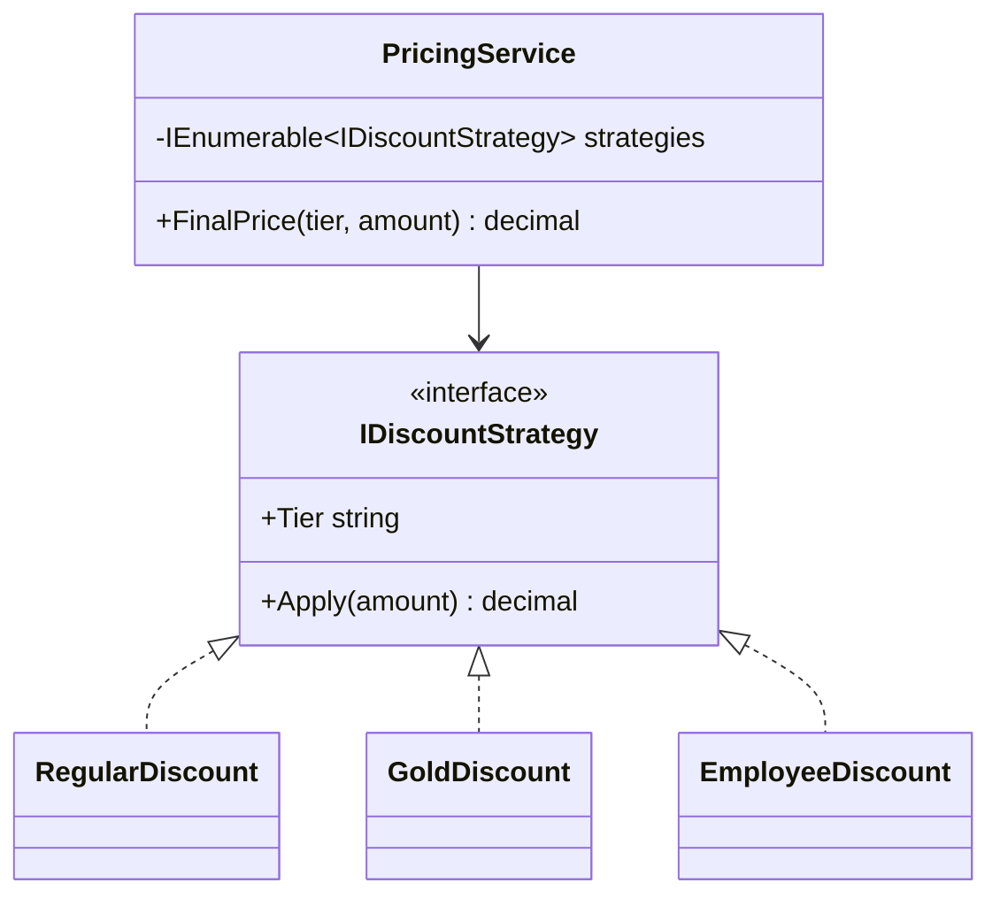
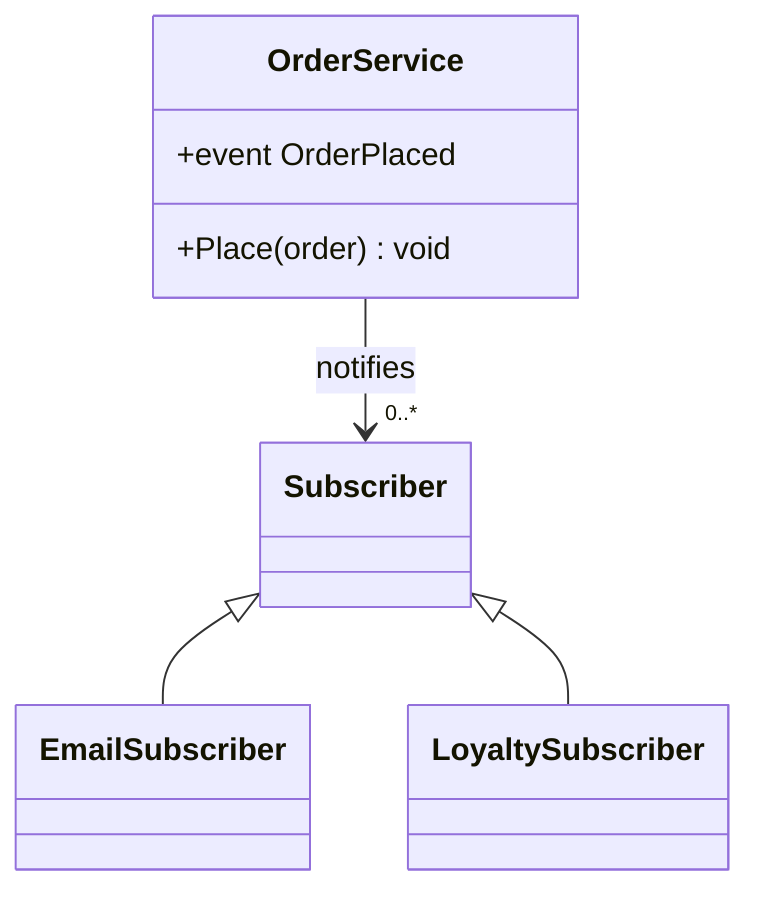
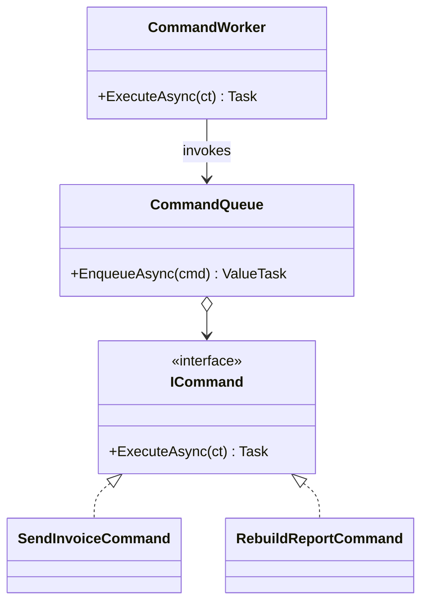
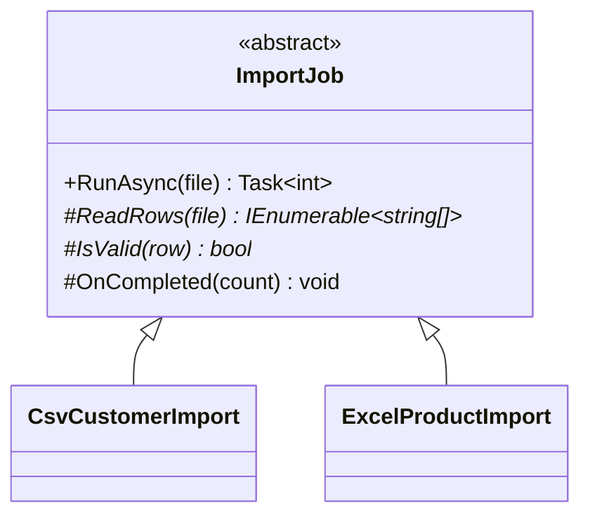
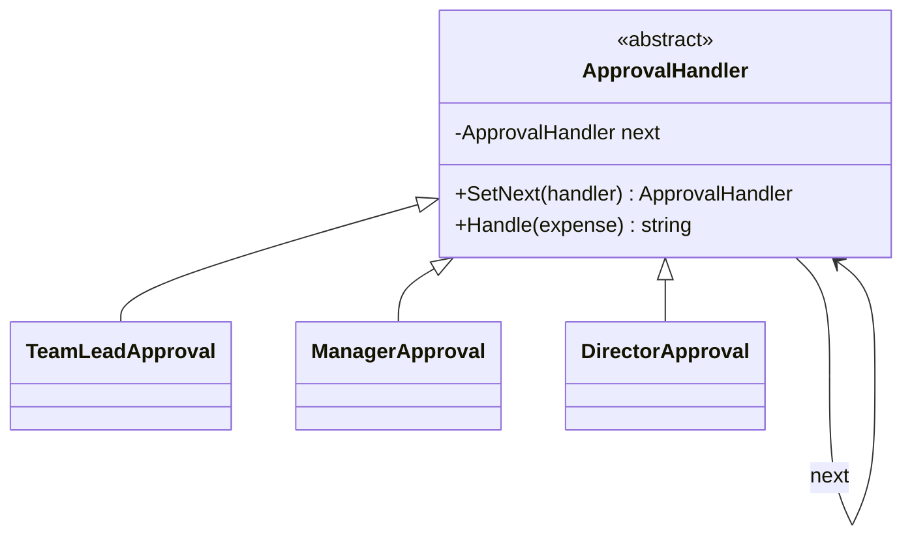
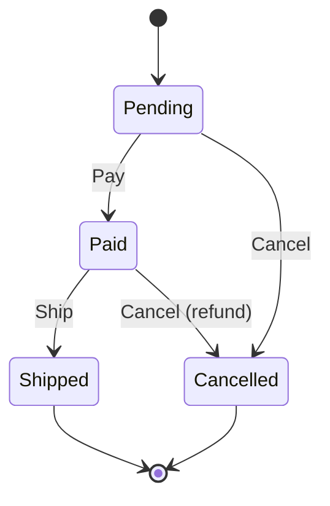
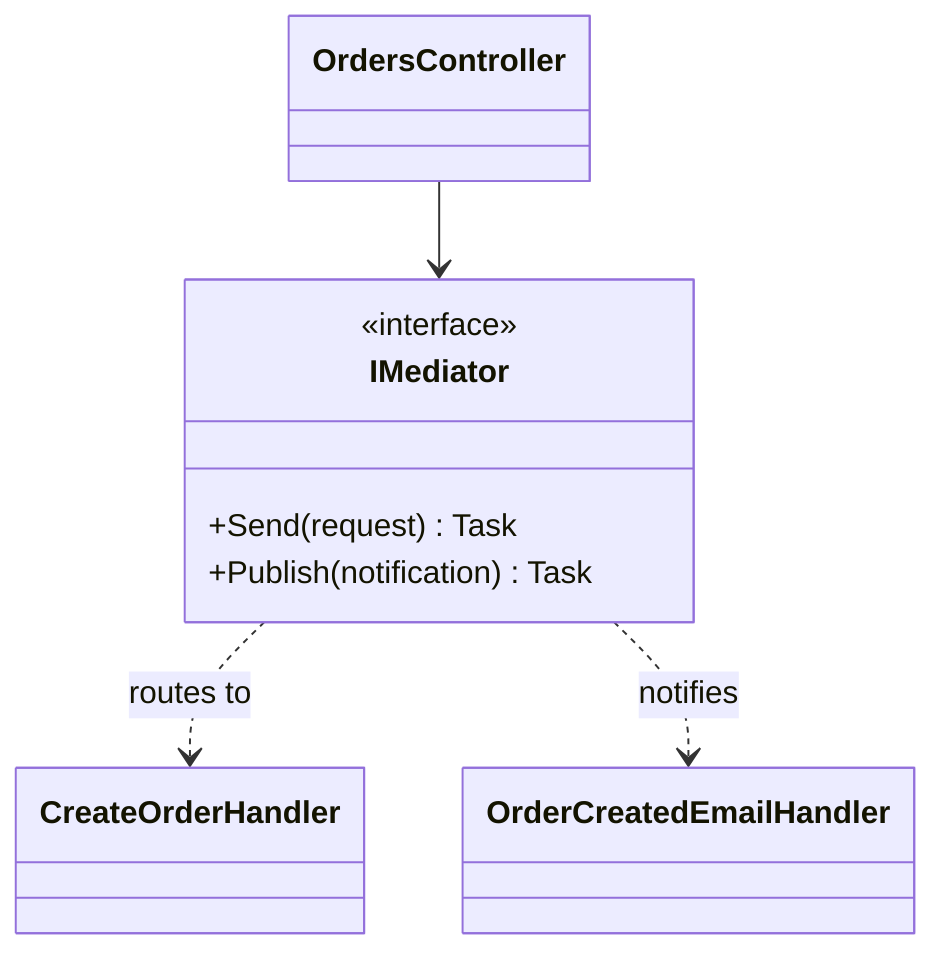
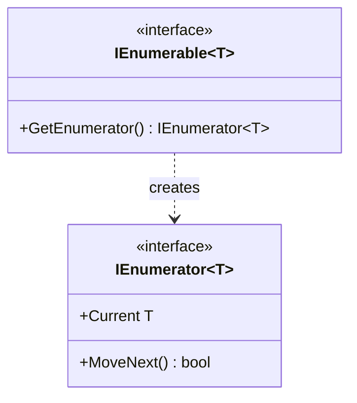

import { Tabs, TabItem, Aside } from '@astrojs/starlight/components';
import QuizBlock from '~/components/QuizBlock.astro';

## Why it matters in interviews

Behavioral patterns are the ones you **actually use weekly**: Strategy for payment or discount rules, Observer for events and RxJS, Chain of Responsibility every time you write middleware, Iterator every time you `yield return`. Interviewers ask *"which patterns have you used?"* and then drill into one. They also show you code and ask *"which pattern is this?"*, so learn to recognise the shapes.

## Core idea

Behavioral patterns are about **how objects collaborate and divide responsibility**.

| Pattern | Intent in one line | .NET / Angular example |
|---|---|---|
| Strategy | Swap an algorithm behind an interface at runtime | `IComparer<T>`, authentication schemes, `IPasswordHasher<T>` |
| Observer | Notify many subscribers when something happens | C# `event`, `IObservable<T>`, `IOptionsMonitor.OnChange`, RxJS |
| Command | Turn a request into an object you can queue, log or undo | MediatR requests, Hangfire jobs, MAUI `ICommand` |
| Template Method | Base class fixes the algorithm's steps; subclasses fill in some | `BackgroundService.ExecuteAsync`, `AuthenticationHandler` |
| Chain of Responsibility | Pass a request along handlers until one handles it | ASP.NET Core middleware, `DelegatingHandler`, Angular interceptors |
| State | Change behaviour when internal state changes, one class per state | Order/workflow lifecycles, `Stateless` library |
| Mediator | Objects talk through a central mediator, not to each other | MediatR `IMediator`, an Angular shared service |
| Iterator | Traverse a collection without exposing its structure | `IEnumerable<T>`, `yield return`, `IAsyncEnumerable<T>` |

### Strategy

**Problem:** discount rules differ per customer tier and change often. An `if/else` ladder in `PricingService` grows forever.



```csharp
public interface IDiscountStrategy
{
    string Tier { get; }
    decimal Apply(decimal amount);
}

public class RegularDiscount : IDiscountStrategy { public string Tier => "regular"; public decimal Apply(decimal a) => a; }
public class GoldDiscount : IDiscountStrategy { public string Tier => "gold"; public decimal Apply(decimal a) => a * 0.90m; }
public class EmployeeDiscount : IDiscountStrategy { public string Tier => "employee"; public decimal Apply(decimal a) => a * 0.70m; }

public class PricingService(IEnumerable<IDiscountStrategy> strategies)
{
    public decimal FinalPrice(string tier, decimal amount)
    {
        var strategy = strategies.FirstOrDefault(s => s.Tier == tier)
                       ?? strategies.First(s => s.Tier == "regular");
        return strategy.Apply(amount);
    }
}
// Program.cs: services.AddSingleton<IDiscountStrategy, GoldDiscount>(); ... one line per strategy
```

For tiny algorithms a delegate is a perfectly good strategy: `list.Sort((a, b) => a.Price.CompareTo(b.Price))` passes a `Comparison<T>`.

**When not to use:** two branches that never change. A `switch` expression is clearer than three classes and a registration.

### Observer

**Problem:** when an order is placed, email, analytics and loyalty points must react, but `OrderService` shouldn't know about them.



<Tabs syncKey="lang">
  <TabItem label="C#">

```csharp
public record OrderPlacedEventArgs(int OrderId, decimal Total);

public class OrderEvents
{
    // Subject: keeps a list of handlers (a multicast delegate).
    public event EventHandler<OrderPlacedEventArgs>? OrderPlaced;

    public void Place(int orderId, decimal total)
    {
        // ... save order ...
        OrderPlaced?.Invoke(this, new OrderPlacedEventArgs(orderId, total));
    }
}

public static class ObserverDemo
{
    public static void Run()
    {
        var events = new OrderEvents();
        EventHandler<OrderPlacedEventArgs> email = (_, e) => Console.WriteLine($"Email for {e.OrderId}");
        events.OrderPlaced += email;
        events.OrderPlaced += (_, e) => Console.WriteLine($"Points: {(int)(e.Total / 100)}");

        events.Place(42, 1500m);
        events.OrderPlaced -= email; // unsubscribe, or the subject keeps the subscriber alive
    }
}
```

  </TabItem>
  <TabItem label="TypeScript">

```ts
import { Injectable } from '@angular/core';
import { Subject } from 'rxjs';

export interface OrderPlaced { orderId: number; total: number; }

@Injectable({ providedIn: 'root' })
export class OrderEventsService {
  private readonly placed = new Subject<OrderPlaced>();
  readonly placed$ = this.placed.asObservable(); // subscribers can't call next()

  place(orderId: number, total: number): void {
    this.placed.next({ orderId, total });
  }
}

// In a component: this.events.placed$.pipe(takeUntilDestroyed()).subscribe(e => ...);
```

  </TabItem>
</Tabs>

**In .NET:** C# `event`, `IObservable<T>`/`IObserver<T>` (the push counterpart of `IEnumerable<T>`, used by Rx.NET), `IOptionsMonitor<T>.OnChange`, `IChangeToken`, `INotifyPropertyChanged`, MediatR `INotification` with several handlers. Across services, the same idea becomes **pub/sub** over a broker (Azure Service Bus topics, AWS SNS).

**When not to use:** when the order of reactions matters or the caller needs their results. Events also hide control flow, so a chain of events triggering events is hard to debug. Forgotten unsubscriptions cause memory leaks.

### Command

**Problem:** you want to queue work, retry it, log it, or undo it. A method call can't be stored; an object can.



```csharp
using System.Threading.Channels;

public interface ICommand { Task ExecuteAsync(CancellationToken ct); }

public record SendInvoiceCommand(int InvoiceId) : ICommand
{
    public Task ExecuteAsync(CancellationToken ct) => Task.CompletedTask; // send it
}

public class CommandQueue
{
    private readonly Channel<ICommand> _channel = Channel.CreateUnbounded<ICommand>();
    public ValueTask EnqueueAsync(ICommand command) => _channel.Writer.WriteAsync(command);
    public IAsyncEnumerable<ICommand> ReadAllAsync(CancellationToken ct) => _channel.Reader.ReadAllAsync(ct);
}

// Invoker: runs commands without knowing what they do.
public class CommandWorker(CommandQueue queue, ILogger<CommandWorker> log) : BackgroundService
{
    protected override async Task ExecuteAsync(CancellationToken stoppingToken)
    {
        await foreach (var command in queue.ReadAllAsync(stoppingToken))
        {
            try { await command.ExecuteAsync(stoppingToken); }
            catch (Exception ex) { log.LogError(ex, "Command {Command} failed", command); }
        }
    }
}
```

Add an `UndoAsync()` method and keep executed commands on a stack and you have undo/redo for an editor.

**In .NET:** MediatR `IRequest` objects and CQRS commands (data-only commands with a separate handler), Hangfire and Azure Functions queue messages, WPF/MAUI `ICommand` bound to buttons.

**When not to use:** for a direct synchronous call with no need to queue, log or undo; it's just indirection.

### Template Method

**Problem:** every import job reads a file, validates rows, saves and reports. Only reading and validation differ between CSV and Excel.



```csharp
public abstract class ImportJob
{
    // The template: fixed order of steps, not overridable.
    public async Task<int> RunAsync(Stream file)
    {
        var valid = ReadRows(file).Where(IsValid).ToList();
        await SaveAsync(valid);
        OnCompleted(valid.Count);
        return valid.Count;
    }

    protected abstract IEnumerable<string[]> ReadRows(Stream file); // required step
    protected abstract bool IsValid(string[] row);                  // required step
    protected virtual void OnCompleted(int count) { }               // optional hook

    private Task SaveAsync(List<string[]> rows) => Task.CompletedTask;
}

public class CsvCustomerImport : ImportJob
{
    protected override IEnumerable<string[]> ReadRows(Stream file)
    {
        using var reader = new StreamReader(file);
        while (reader.ReadLine() is { } line) yield return line.Split(',');
    }

    protected override bool IsValid(string[] row) => row.Length == 3 && row[2].Contains('@');
}
```

**In .NET:** `BackgroundService` (its `StartAsync` calls your `ExecuteAsync`), `AuthenticationHandler<TOptions>` (you override `HandleAuthenticateAsync`), `DbContext.OnModelCreating`, `Stream` (the async methods call overridable core methods), `JsonConverter<T>.Read/Write`.

**When not to use:** when variations multiply (CSV + validation A, Excel + validation B...). Inheritance can't combine steps; switch to Strategy (composition).

### Chain of Responsibility

**Problem:** a request passes through several checks or handlers; each one either handles it, passes it on, or both. The sender shouldn't know which handler deals with it.



```csharp
public record Expense(string Employee, decimal Amount);

public abstract class ApprovalHandler
{
    private ApprovalHandler? _next;
    public ApprovalHandler SetNext(ApprovalHandler next) { _next = next; return next; }

    public virtual string Handle(Expense e) =>
        _next?.Handle(e) ?? $"Rejected: {e.Amount} needs board approval";
}

public class TeamLeadApproval : ApprovalHandler
{
    public override string Handle(Expense e) => e.Amount <= 5_000 ? "Approved by team lead" : base.Handle(e);
}

public class ManagerApproval : ApprovalHandler
{
    public override string Handle(Expense e) => e.Amount <= 50_000 ? "Approved by manager" : base.Handle(e);
}

// var chain = new TeamLeadApproval();
// chain.SetNext(new ManagerApproval());
// chain.Handle(new Expense("Asha", 20_000)); // "Approved by manager"
```

**ASP.NET Core middleware is this pattern.** Each component gets `next` and decides whether to call it:

```csharp
public class ApiKeyMiddleware(RequestDelegate next, IConfiguration config)
{
    public async Task InvokeAsync(HttpContext context)
    {
        if (context.Request.Headers["X-Api-Key"] != config["ApiKey"])
        {
            context.Response.StatusCode = StatusCodes.Status401Unauthorized;
            return; // short-circuit: later handlers never run
        }
        await next(context); // pass along the chain
    }
}
// app.UseMiddleware<ApiKeyMiddleware>();
```

Also: `DelegatingHandler` chains for `HttpClient`, MVC filters, Angular `HttpInterceptorFn` chains, MediatR pipeline behaviours.

**When not to use:** when exactly one handler is always chosen by a simple key (use a dictionary of strategies), or when silent "nobody handled it" outcomes would be dangerous.

### State

**Problem:** an order behaves differently when Pending, Paid, Shipped or Cancelled. Every method has a `switch (Status)` and new states break them all.



```csharp
public abstract class OrderState
{
    public abstract string Name { get; }
    public virtual OrderState Pay() => throw Invalid("pay");
    public virtual OrderState Ship() => throw Invalid("ship");
    public virtual OrderState Cancel() => throw Invalid("cancel");
    private InvalidOperationException Invalid(string action) => new($"Cannot {action} when {Name}");
}

public class PendingState : OrderState
{
    public override string Name => "Pending";
    public override OrderState Pay() => new PaidState();
    public override OrderState Cancel() => new CancelledState();
}

public class PaidState : OrderState
{
    public override string Name => "Paid";
    public override OrderState Ship() => new ShippedState();
    public override OrderState Cancel() => new CancelledState(); // plus refund
}

public class ShippedState : OrderState { public override string Name => "Shipped"; }
public class CancelledState : OrderState { public override string Name => "Cancelled"; }

public class OrderWorkflow
{
    public OrderState State { get; private set; } = new PendingState();
    public void Pay() => State = State.Pay();   // context delegates to the current state
    public void Ship() => State = State.Ship();
    public void Cancel() => State = State.Cancel();
}
```

**State vs Strategy:** same structure. Strategy is chosen **by the client** and rarely changes; State objects **switch themselves** as the object moves through its lifecycle. See the [vending machine LLD](../../system-design/lld-vending-machine/) for a full example.

**When not to use:** two or three states with simple rules. A `switch` expression on an enum, or a small transition table, is easier. Persist the state name (enum/string) in the database, not the object.

### Mediator

**Problem:** many objects talk to each other directly and form a web of dependencies. A mediator centralises the interaction so each object only knows the mediator.



```csharp
using MediatR;
using Microsoft.AspNetCore.Mvc;

public record CreateOrder(int CustomerId, decimal Total) : IRequest<int>;

public class CreateOrderHandler : IRequestHandler<CreateOrder, int>
{
    public Task<int> Handle(CreateOrder request, CancellationToken ct) => Task.FromResult(101);
}

[ApiController, Route("orders")]
public class OrdersController(IMediator mediator) : ControllerBase
{
    // The controller knows only the mediator, not the handler or its dependencies.
    [HttpPost]
    public async Task<IActionResult> Create(CreateOrder cmd, CancellationToken ct) =>
        Ok(await mediator.Send(cmd, ct));
}
```

MediatR is in-process messaging inspired by Mediator; it's covered in depth (with pipeline behaviours and licensing notes) in [Enterprise Patterns](../enterprise-patterns/). In Angular, a shared service with signals that sibling components use instead of referencing each other is a mediator.

**When not to use:** when it becomes a god object containing all the logic, or when MediatR is added only to call one handler from one controller. Indirection makes "go to definition" stop working.

### Iterator

**Problem:** callers should loop over items without knowing whether they come from a list, a tree, a file or a paged API.



```csharp
public record CustomerDto(int Id, string Name);
public record Page(List<CustomerDto> Items, bool HasMore);

public class CrmClient(HttpClient http)
{
    // Iterator over a paged API: callers just `await foreach`, paging is hidden.
    public async IAsyncEnumerable<CustomerDto> GetAllCustomersAsync(
        [System.Runtime.CompilerServices.EnumeratorCancellation] CancellationToken ct = default)
    {
        var page = 1;
        while (true)
        {
            var result = await http.GetFromJsonAsync<Page>($"/customers?page={page}", ct);
            if (result is null) yield break;
            foreach (var c in result.Items) yield return c;
            if (!result.HasMore) yield break;
            page++;
        }
    }
}
// await foreach (var c in crm.GetAllCustomersAsync(ct)) { ... }
```

`yield return` makes the compiler generate the `IEnumerator<T>` state machine for you. Execution is **deferred**: nothing runs until the caller iterates, which is also why LINQ queries re-run on every enumeration.

**When not to use:** rarely hand-write `IEnumerator<T>` classes; `yield` and LINQ cover nearly every case.

## Interview Q&A

<details>
<summary>Which behavioral patterns have you used, and where?</summary>

A strong answer names 2-3 with context: *"Strategy for payment providers resolved from DI by key; Chain of Responsibility through custom middleware for API-key checks and correlation IDs; Observer through C# events and RxJS Subjects in a shared Angular service; Template Method when subclassing `BackgroundService`."* Then be ready to sketch one.
</details>

<details>
<summary>Strategy vs State?</summary>

Same class structure (context holds an interface, implementations vary). In Strategy the client picks the algorithm and it usually stays fixed. In State the state objects decide the next state themselves, so behaviour changes as the object moves through its lifecycle.
</details>

<details>
<summary>Strategy vs Template Method?</summary>

Both vary part of an algorithm. Template Method uses **inheritance**: the base class fixes the steps and subclasses override some of them (compile-time). Strategy uses **composition**: the whole algorithm is injected and can be swapped at runtime. Prefer Strategy when variations combine or need testing in isolation.
</details>

<details>
<summary>Why is middleware called Chain of Responsibility?</summary>

Each middleware receives the next delegate and decides to handle the request, pass it on, or do both (work before and after `next`). Authentication, CORS, static files and exception handling are all links. A middleware that doesn't call `next` short-circuits the chain, which is why order in `Program.cs` matters.
</details>

<details>
<summary>C# events vs `IObservable<T>` vs RxJS?</summary>

All are Observer. C# events are the simplest: a multicast delegate with `+=`/`-=`, no completion or error signal. `IObservable<T>` adds `OnError`/`OnCompleted` and composable operators via Rx.NET. RxJS is the same model in TypeScript and is central to Angular (`HttpClient`, router events), though signals now cover a lot of state use cases.
</details>

<details>
<summary>How can events cause memory leaks?</summary>

The publisher's delegate list holds a reference to every subscriber. If a long-lived publisher (a singleton) has a short-lived subscriber that never unsubscribes, the subscriber can't be garbage collected. Fix: unsubscribe (`-=`), use `IDisposable` subscriptions, or in Angular `takeUntilDestroyed()`.
</details>

<details>
<summary>What does `yield return` compile to?</summary>

A compiler-generated class implementing `IEnumerable<T>` and `IEnumerator<T>`, with a state machine that remembers where it stopped. `MoveNext()` runs code until the next `yield return`. Execution is deferred and restarts on each new enumeration.
</details>

<details>
<summary>Command pattern vs a CQRS command?</summary>

A GoF command contains its own `Execute` logic and can support undo. A CQRS/MediatR command is usually a **data-only message** (a record) with a separate handler; the mediator plays the invoker. Both turn "a request" into an object that can be queued, logged, validated or retried.
</details>

## Pitfalls

<Aside type="caution" title="Common mistakes">

- **Strategy explosion** for two stable branches. A `switch` expression is fine.
- **Forgetting to unsubscribe** from events or observables, leaking memory.
- **Event chains** that trigger other events until nobody can follow the flow.
- **Wrong middleware order** (e.g. authorization before routing or authentication) because the chain is order-dependent.
- **Deep Template Method hierarchies** where subclasses override half the steps; switch to composition.
- **Mediator as a god object**, or MediatR wrapping every single call "for decoupling".
- **Enumerating a lazy `IEnumerable` twice**, running the query or API calls twice.

</Aside>

## Related

- [Structural Patterns](../structural-patterns/)
- [Enterprise Patterns (MediatR)](../enterprise-patterns/)
- [Request Pipeline & Middleware](../../aspnet/middleware-pipeline/)
- [Delegates, Events & Lambdas](../../csharp/delegates-events/)

## Quick quiz

<QuizBlock section="patterns" topic="behavioral-patterns" />
