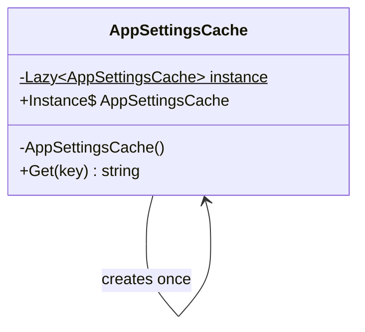
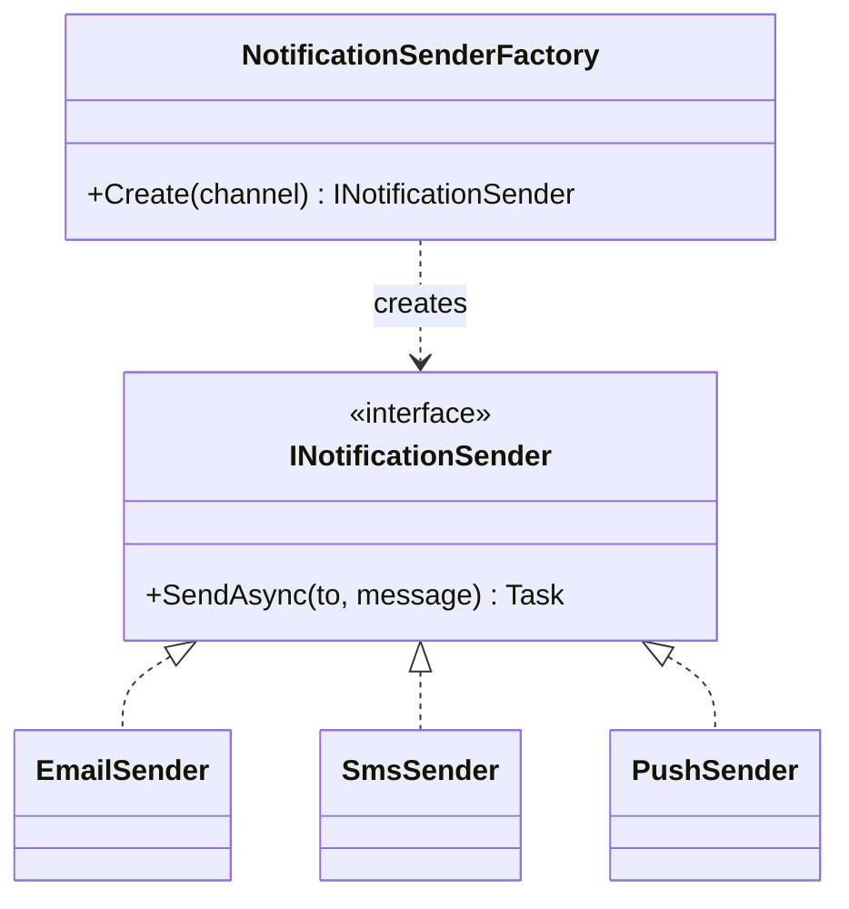
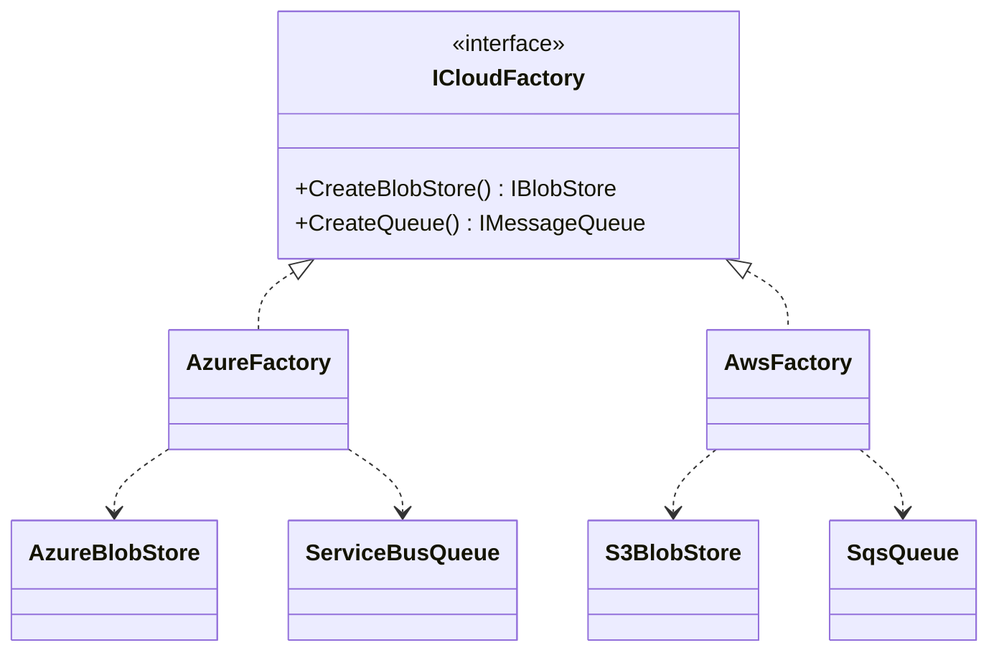
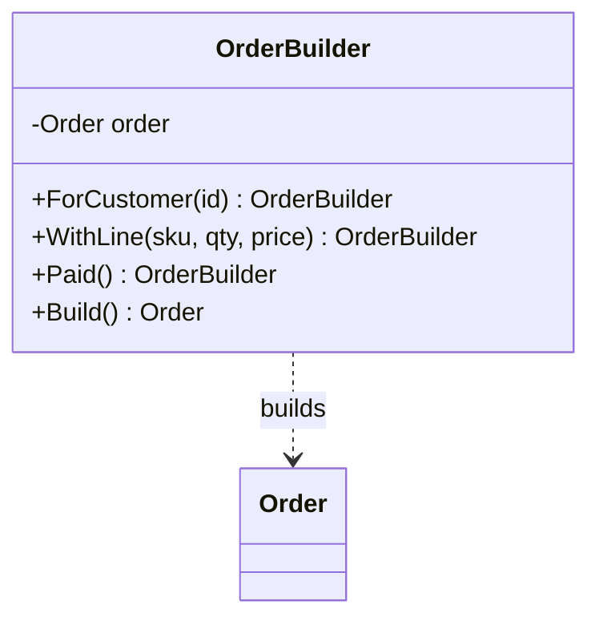
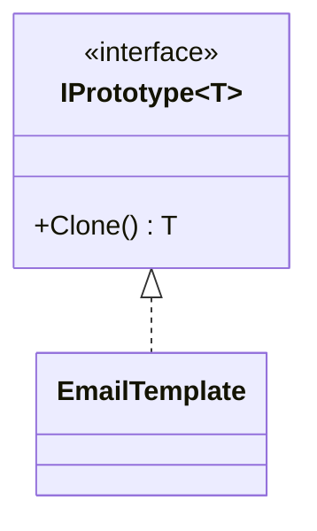

import { Tabs, TabItem, Aside } from '@astrojs/starlight/components';
import QuizBlock from '~/components/QuizBlock.astro';

## Why it matters in interviews

*"Write a thread-safe Singleton"* is still a favourite live-coding warm-up, usually followed by *"why would you not do this in ASP.NET Core?"*. Factory and Builder come up when you describe your own code: *"how do you pick the right notification sender at runtime?"* or *"how do you build test data?"*. Know each pattern's intent, one realistic example, and where the framework already does it for you.

## Core idea

Creational patterns separate **how objects are created** from **how they are used**, so callers don't depend on concrete classes or complex construction steps.

| Pattern | Intent in one line | .NET example |
|---|---|---|
| Singleton | Exactly one instance with a global access point | `AddSingleton`, `ArrayPool<T>.Shared`, `EqualityComparer<T>.Default` |
| Factory Method | Let a method (often overridden or keyed) decide which concrete class to create | `IHttpClientFactory.CreateClient`, `ILoggerFactory.CreateLogger` |
| Abstract Factory | Create **families** of related objects without naming concrete classes | `DbProviderFactory` (connection + command + parameter) |
| Builder | Construct a complex object step by step | `WebApplicationBuilder`, `StringBuilder`, `SqlConnectionStringBuilder` |
| Prototype | Create new objects by copying an existing one | record `with` expressions, `ICloneable`, `MemberwiseClone` |

In modern .NET the **DI container is the main creational mechanism**. Most of these patterns appear as registrations and small factories rather than hand-rolled classes.

### Singleton

**Problem:** some objects must be shared (configuration cache, connection multiplexer, `HttpClient` handler pool) and creating many is wasteful or wrong.



<Tabs>
  <TabItem label="Classic (Lazy)">

```csharp
public sealed class AppSettingsCache
{
    // Lazy<T> is thread-safe by default (ExecutionAndPublication).
    private static readonly Lazy<AppSettingsCache> _instance = new(() => new AppSettingsCache());
    public static AppSettingsCache Instance => _instance.Value;

    private readonly ConcurrentDictionary<string, string> _values = new();
    private AppSettingsCache() { } // nobody else can new it up

    public string? Get(string key) => _values.GetValueOrDefault(key);
    public void Set(string key, string value) => _values[key] = value;
}
```

  </TabItem>
  <TabItem label="Double-checked lock">

```csharp
public sealed class LegacySingleton
{
    private static volatile LegacySingleton? _instance;
    private static readonly Lock _sync = new(); // .NET 9+ Lock type

    private LegacySingleton() { }

    public static LegacySingleton Instance
    {
        get
        {
            if (_instance is null)               // 1st check: no lock on the hot path
            {
                lock (_sync)
                {
                    _instance ??= new LegacySingleton(); // 2nd check inside the lock
                }
            }
            return _instance;
        }
    }
}
```

  </TabItem>
  <TabItem label="DI (preferred)">

```csharp
public interface ISettingsCache
{
    string? Get(string key);
}

public sealed class SettingsCache : ISettingsCache
{
    private readonly ConcurrentDictionary<string, string> _values = new();
    public string? Get(string key) => _values.GetValueOrDefault(key);
}

// Program.cs: one instance per app, but an ordinary class.
// builder.Services.AddSingleton<ISettingsCache, SettingsCache>();
// Consumers: public class PriceService(ISettingsCache cache) { ... }
```

  </TabItem>
</Tabs>

A plain `static readonly` field initialiser is also thread-safe (the CLR runs the static constructor once), but it is not lazy in a controllable way.

**Why DI is better:** a static `Instance` is a hidden global dependency. You can't swap it in tests, its lifetime is fixed, and it encourages mutable shared state. With `AddSingleton` the class stays normal, is injected through its constructor, and the container controls the lifetime.

**When not to use:** for anything that holds per-request or per-user state, or that depends on scoped services (a singleton capturing a `DbContext` is the classic **captive dependency** bug). Singletons must be thread-safe.

### Factory Method

**Problem:** the caller knows *what* it needs (a sender for "sms") but should not know *which class* to `new`, or the choice depends on runtime data.



```csharp
public interface INotificationSender { Task SendAsync(string to, string message, CancellationToken ct); }
public class EmailSender : INotificationSender { public Task SendAsync(string to, string m, CancellationToken ct) => Task.CompletedTask; }
public class SmsSender : INotificationSender { public Task SendAsync(string to, string m, CancellationToken ct) => Task.CompletedTask; }

public enum Channel { Email, Sms }

public interface INotificationSenderFactory { INotificationSender Create(Channel channel); }

// Uses .NET 8+ keyed services so the factory doesn't call `new` itself.
public class NotificationSenderFactory(IServiceProvider sp) : INotificationSenderFactory
{
    public INotificationSender Create(Channel channel) =>
        sp.GetRequiredKeyedService<INotificationSender>(channel);
}

public class AlertService(INotificationSenderFactory factory)
{
    public Task AlertAsync(Channel preferred, string to, string text, CancellationToken ct) =>
        factory.Create(preferred).SendAsync(to, text, ct);
}

// Program.cs
// builder.Services.AddKeyedScoped<INotificationSender, EmailSender>(Channel.Email);
// builder.Services.AddKeyedScoped<INotificationSender, SmsSender>(Channel.Sms);
// builder.Services.AddScoped<INotificationSenderFactory, NotificationSenderFactory>();
```

Strictly, GoF Factory Method is a **virtual creation method that subclasses override** (for example `protected abstract IExporter CreateExporter()` in a base `ReportJob`). The class above is a "simple factory"; interviewers accept both if you can explain the difference. Injecting a `Func<Channel, INotificationSender>` is another lightweight option.

**In .NET:** `IHttpClientFactory.CreateClient("github")`, `ILoggerFactory.CreateLogger<T>()`, `IDbContextFactory<T>.CreateDbContext()`, `WebApplication.CreateBuilder()`.

**When not to use:** when there is only one implementation, or when plain constructor injection already gives you the object. A factory wrapping `new Foo()` adds nothing.

### Abstract Factory

**Problem:** you need several related objects that **must match** (an Azure blob store with an Azure queue, never an Azure blob with an AWS queue).



```csharp
public interface IBlobStore { Task UploadAsync(string name, Stream content); }
public interface IMessageQueue { Task PublishAsync(string message); }

public interface ICloudFactory
{
    IBlobStore CreateBlobStore();
    IMessageQueue CreateQueue();
}

public class AzureFactory : ICloudFactory
{
    public IBlobStore CreateBlobStore() => new AzureBlobStore();
    public IMessageQueue CreateQueue() => new ServiceBusQueue();
}

public class AwsFactory : ICloudFactory
{
    public IBlobStore CreateBlobStore() => new S3BlobStore();
    public IMessageQueue CreateQueue() => new SqsQueue();
}

public class AzureBlobStore : IBlobStore { public Task UploadAsync(string n, Stream c) => Task.CompletedTask; }
public class ServiceBusQueue : IMessageQueue { public Task PublishAsync(string m) => Task.CompletedTask; }
public class S3BlobStore : IBlobStore { public Task UploadAsync(string n, Stream c) => Task.CompletedTask; }
public class SqsQueue : IMessageQueue { public Task PublishAsync(string m) => Task.CompletedTask; }

// Program.cs picks the family once, from configuration:
// builder.Services.AddSingleton<ICloudFactory>(cfg["Cloud"] == "aws" ? new AwsFactory() : new AzureFactory());
```

**In .NET:** `DbProviderFactory` (`SqlClientFactory.Instance.CreateConnection()`, `CreateCommand()`, `CreateParameter()`) is the textbook family factory.

**When not to use:** if there is only one family, or the objects don't need to match. In DI-heavy code you often just register the matching implementations per environment instead.

### Builder

**Problem:** an object has many optional parts or must be assembled in steps, and a constructor with 9 parameters is unreadable. Very common for **test data**.



```csharp
public class OrderBuilder
{
    private int _customerId = 1;
    private readonly List<OrderLine> _lines = [];
    private string _status = "Pending";

    public OrderBuilder ForCustomer(int id) { _customerId = id; return this; }

    public OrderBuilder WithLine(string sku, int qty, decimal price)
    {
        _lines.Add(new OrderLine { Sku = sku, Quantity = qty, UnitPrice = price });
        return this;
    }

    public OrderBuilder Paid() { _status = "Paid"; return this; }

    public Order Build()
    {
        if (_lines.Count == 0) WithLine("DEFAULT-SKU", 1, 100m); // sensible default
        return new Order
        {
            CustomerId = _customerId,
            Status = _status,
            Lines = [.. _lines],
            Total = _lines.Sum(l => l.Quantity * l.UnitPrice)
        };
    }
}

// In a test: only the details that matter for this test are visible.
// var order = new OrderBuilder().WithLine("BOOK-1", 2, 250m).Paid().Build();
```

**In .NET:** `WebApplication.CreateBuilder(args)` then `builder.Build()`, `StringBuilder`, `UriBuilder`, `SqlConnectionStringBuilder`, EF Core's `ModelBuilder`, and every `services.AddX(o => ...)` fluent configuration.

**When not to use:** for small objects. With C# `required` / `init` properties and object initialisers, many builders are unnecessary in production code. Keep them for test data and for objects with real construction rules.

### Prototype

**Problem:** creating an object from scratch is expensive or verbose, and a near-identical copy of an existing one is what you want (a quote copied into a new order, a default configuration tweaked per tenant).



```csharp
public record Address(string City, string Pin);

public record EmailTemplate(string Subject, string Body, Address ReplyTo, List<string> Cc);

public static class PrototypeDemo
{
    public static void Run()
    {
        var baseTemplate = new EmailTemplate("Welcome", "Hi {name}", new Address("Pune", "411001"), ["ops@shop.in"]);

        // `with` = shallow copy + changes. Records with immutable members are safe to copy.
        var festive = baseTemplate with { Subject = "Diwali offers" };

        // Shallow copy trap: both records share the same List instance.
        festive.Cc.Add("marketing@shop.in");
        Console.WriteLine(baseTemplate.Cc.Count); // 2, the original changed too

        // Deep copy the mutable parts explicitly.
        var safe = baseTemplate with { Cc = [.. baseTemplate.Cc] };
    }
}
```

**In .NET:** `ICloneable` (avoid it in public APIs: it doesn't say shallow or deep), `object.MemberwiseClone()` (shallow), record `with` expressions, `JsonSerializer` round-trips for quick deep copies.

**When not to use:** when objects are cheap to construct, or have identity and external resources (a `DbContext`, an open stream) that can't be meaningfully copied.

## Interview Q&A

<details>
<summary>Write a thread-safe Singleton in C#. Which version do you prefer?</summary>

`private static readonly Lazy<T> _instance = new(() => new T());` with a private constructor and `public static T Instance => _instance.Value;`. `Lazy<T>` is thread-safe and lazy by default. Double-checked locking also works (with `volatile`) but is easy to get wrong. In ASP.NET Core I'd prefer `AddSingleton<IService, Service>()` instead of a static instance.
</details>

<details>
<summary>Why is a DI singleton better than the classic Singleton pattern?</summary>

The class stays an ordinary class with a public constructor and injected dependencies, so it can be unit tested and replaced with a fake. Callers depend on an interface, not a static `Instance` (a hidden global). Lifetime becomes a registration decision you can change in one place.
</details>

<details>
<summary>What is a captive dependency?</summary>

A longer-lived service holding a shorter-lived one, e.g. a singleton that takes a scoped `DbContext` in its constructor. The `DbContext` then lives for the whole app and is shared across threads. ASP.NET Core's scope validation (on in Development) throws at startup. Fix: inject `IServiceScopeFactory` or `IDbContextFactory<T>` and create a scope per operation.
</details>

<details>
<summary>Factory Method vs Abstract Factory?</summary>

Factory Method creates **one** product, and the choice of concrete class is made by a method (overridden in a subclass in the GoF version, or keyed by a parameter). Abstract Factory is an object with **several** creation methods producing a **family** of related products that must be used together (`DbProviderFactory` creates matching connection, command and parameter).
</details>

<details>
<summary>How do you choose an implementation at runtime in ASP.NET Core?</summary>

Options from simplest: inject `IEnumerable<IService>` and pick by a property; use keyed services (`AddKeyedScoped` + `GetRequiredKeyedService` or `[FromKeyedServices]`); register a `Func<key, IService>` factory; or write a small factory class. Avoid `switch` with `new` in business code, because it bypasses DI and its lifetimes.
</details>

<details>
<summary>When do you use the Builder pattern in real projects?</summary>

Most often for **test data builders**, so each test sets only the fields that matter. In production, framework builders (`WebApplicationBuilder`, `ModelBuilder`, `HostBuilder`) and for objects with validation rules across several steps. For simple DTOs, object initialisers with `required` properties are enough.
</details>

<details>
<summary>Is a record `with` expression a deep copy?</summary>

No, it's a shallow copy: value-type and string members are copied, but reference-type members (lists, nested classes) are shared. Changing the list through the copy also changes it in the original. Use immutable collections or copy mutable members explicitly.
</details>

<details>
<summary>Why is Singleton sometimes called an anti-pattern?</summary>

Global mutable state, hidden dependencies (the constructor doesn't show it), hard to test, and it mixes "what it does" with "how many exist". Lifetime should be a composition-root decision, which DI provides.
</details>

## Pitfalls

<Aside type="caution" title="Common mistakes">

- **Non-thread-safe lazy singleton** (`if (_instance == null) _instance = new()`) creating two instances under load.
- **Singleton holding scoped services** (captive dependency) or per-user state, leaking data between requests.
- **Mutable state in a singleton** without synchronisation. Use `ConcurrentDictionary` or immutable data.
- **Factories that `new` up services** and so bypass DI lifetimes and disposal.
- **Shallow copies** via `with` or `MemberwiseClone` sharing mutable lists.
- **Builders for trivial objects** that object initialisers already handle.

</Aside>

## Related

- [Dependency Injection in ASP.NET Core](../../aspnet/dependency-injection/)
- [Structural Patterns](../structural-patterns/)
- [Behavioral Patterns](../behavioral-patterns/)
- [Unit Testing in .NET](../../testing-devops/dotnet-unit-testing/)

## Quick quiz

<QuizBlock section="patterns" topic="creational-patterns" />
