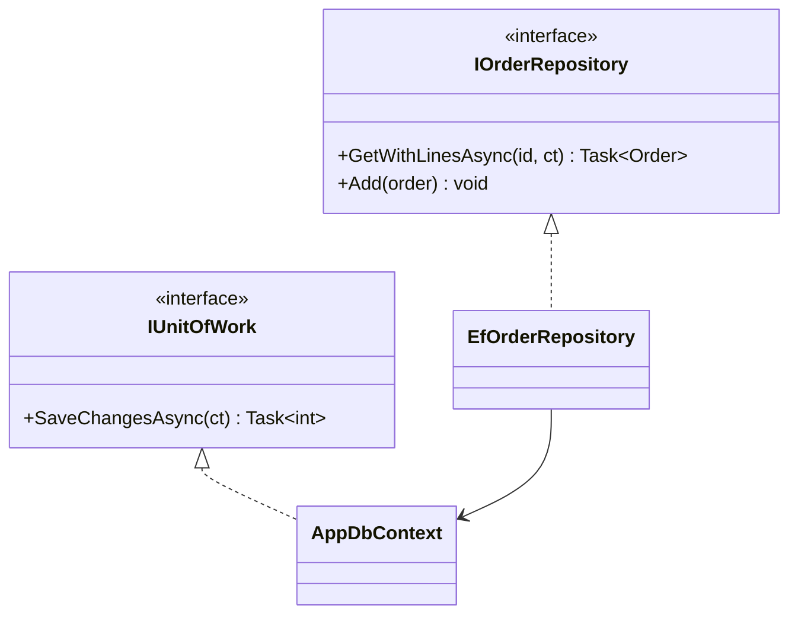
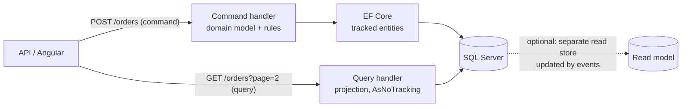
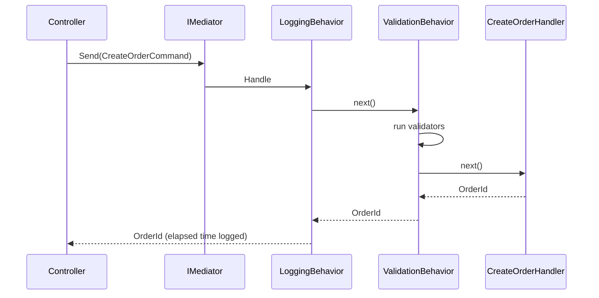

import { Tabs, TabItem, Aside } from '@astrojs/starlight/components';
import QuizBlock from '~/components/QuizBlock.astro';

## Why it matters in interviews

These are the patterns in **your actual project structure**: repositories over EF Core, MediatR handlers, `IOptions<T>` classes, maybe CQRS. Expect pointed questions: *"EF Core's `DbContext` is already a repository and unit of work, so why add one?"*, *"how do you validate every command without repeating code?"*, *"exceptions or Result objects?"*. Have an opinion with trade-offs, not just definitions.

## Core idea

| Pattern | Intent in one line | Where it lives |
|---|---|---|
| Repository | Collection-like access to aggregates, hiding persistence | Infrastructure implements, application/domain owns the interface |
| Unit of Work | Track changes across repositories and commit them in one transaction | `DbContext.SaveChangesAsync()` |
| Specification | Encapsulate a query rule as a reusable, testable object | Domain or application layer |
| CQRS | Separate models for writes (commands) and reads (queries) | Application layer, sometimes separate stores |
| Mediator + pipeline behaviours | Dispatch requests to handlers; wrap all of them with cross-cutting steps | Application layer (MediatR or hand-rolled) |
| Result pattern | Return success or failure as a value instead of throwing for expected errors | Application/domain boundaries |
| Options pattern | Bind configuration sections to typed, validated classes | `IOptions<T>` family |
| Outbox | Save the outgoing message in the same DB transaction as the state change | Infrastructure + background publisher |

### Repository

**Problem:** business code full of EF queries is hard to test and duplicates query logic; you want a domain-friendly API like `GetWithLinesAsync(id)`.



```csharp
public interface IOrderRepository
{
    Task<Order?> GetWithLinesAsync(int id, CancellationToken ct);
    Task<bool> ExistsForCustomerAsync(int customerId, CancellationToken ct);
    void Add(Order order);
}

public interface IUnitOfWork { Task<int> SaveChangesAsync(CancellationToken ct = default); }

public class EfOrderRepository(AppDbContext db) : IOrderRepository
{
    public Task<Order?> GetWithLinesAsync(int id, CancellationToken ct) =>
        db.Orders.Include(o => o.Lines).FirstOrDefaultAsync(o => o.Id == id, ct);

    public Task<bool> ExistsForCustomerAsync(int customerId, CancellationToken ct) =>
        db.Orders.AnyAsync(o => o.CustomerId == customerId, ct);

    public void Add(Order order) => db.Orders.Add(order); // no SaveChanges here
}

// Unit of Work: the use case decides when to commit, once, for all repositories.
public class PlaceOrderService(IOrderRepository orders, IUnitOfWork uow)
{
    public async Task<int> PlaceAsync(Order order, CancellationToken ct)
    {
        orders.Add(order);
        await uow.SaveChangesAsync(ct); // one transaction for every tracked change
        return order.Id;
    }
}
// AppDbContext : DbContext, IUnitOfWork (SaveChangesAsync already matches)
```

**Generic vs specific repositories:** a generic `IRepository<T>` with `GetAll()` returning `IQueryable<T>` leaks EF (callers write LINQ that may not translate) and adds little over `DbSet<T>`. Specific, aggregate-focused repositories (`IOrderRepository`) with intention-revealing methods are the defensible version.

**Is DbContext already a repository and UoW?** Yes: `DbSet<T>` is a repository and `DbContext` is a unit of work. Adding your own layer is worth it when you want domain-shaped methods, to keep EF out of the domain project (Clean Architecture), or to centralise complex queries. It's not worth it for simple CRUD where it only forwards calls. Details: [Repository & Unit of Work with EF](../../data/repository-uow-ef/).

**When not to use:** small CRUD apps, or query-heavy read paths (use projections directly, see CQRS).

### Specification

**Problem:** the same filter ("active products in a category, cheapest first") appears in several queries; you want it named, reusable and unit-testable, while still translating to SQL.

```csharp
public abstract class Specification<T>
{
    public abstract Expression<Func<T, bool>> Criteria { get; }
    public Expression<Func<T, object>>? OrderBy { get; protected init; }

    // In-memory check, handy for unit tests and domain rules.
    public bool IsSatisfiedBy(T entity) => Criteria.Compile()(entity);
}

public class ActiveProductsInCategory(string category) : Specification<Product>
{
    public override Expression<Func<Product, bool>> Criteria =>
        p => p.IsActive && p.Category == category && p.Stock > 0;
}

public static class SpecificationEvaluator
{
    public static IQueryable<T> Apply<T>(this IQueryable<T> query, Specification<T> spec)
    {
        query = query.Where(spec.Criteria); // Expression, so EF Core translates it to SQL
        return spec.OrderBy is null ? query : query.OrderBy(spec.OrderBy);
    }
}

// var products = await db.Products.Apply(new ActiveProductsInCategory("books")).ToListAsync(ct);
```

The key detail: criteria must be `Expression<Func<T, bool>>`, not `Func<T, bool>`. A `Func` forces EF to load everything and filter in memory. The Ardalis.Specification library offers a complete implementation with includes and paging.

**When not to use:** when each query is used once; a well-named repository method is simpler.

### CQRS

**Problem:** one model serves both writes (rich rules, validation, aggregates) and reads (flat, joined, paged screens). It's awkward for both.



- **Commands** change state, return little (an id or a Result), go through the domain model and validation.
- **Queries** never change state, return DTOs shaped for the screen, use `AsNoTracking().Select(...)`, Dapper, views or a separate read store.

```csharp
public record OrderSummaryDto(int Id, string CustomerName, decimal Total, int LineCount);

public class GetOrderSummariesHandler(AppDbContext db)
{
    public Task<List<OrderSummaryDto>> HandleAsync(int page, CancellationToken ct) =>
        db.Orders
          .AsNoTracking()
          .OrderByDescending(o => o.CreatedAt)
          .Skip((page - 1) * 20).Take(20)
          .Select(o => new OrderSummaryDto(o.Id, o.Customer.Name, o.Total, o.Lines.Count))
          .ToListAsync(ct); // only the needed columns, one SQL query
}
```

CQRS does **not** require two databases, event sourcing or MediatR. Separate handlers on one database is the common, pragmatic level. Separate read stores bring eventual consistency, which the UI must handle.

**When not to use:** simple CRUD where read and write shapes are the same.

### MediatR and pipeline behaviours

MediatR dispatches a request object to exactly one handler (`Send`) or a notification to many (`Publish`). Its biggest value is **pipeline behaviours**: decorators that wrap every handler for validation, logging, transactions or caching.



```csharp
using FluentValidation;
using MediatR;

public class ValidationBehavior<TRequest, TResponse>(IEnumerable<IValidator<TRequest>> validators)
    : IPipelineBehavior<TRequest, TResponse> where TRequest : notnull
{
    public async Task<TResponse> Handle(TRequest request, RequestHandlerDelegate<TResponse> next,
        CancellationToken ct)
    {
        var failures = (await Task.WhenAll(validators.Select(v => v.ValidateAsync(request, ct))))
            .SelectMany(r => r.Errors)
            .ToList();

        if (failures.Count > 0) throw new ValidationException(failures);
        return await next(); // continue to the next behavior or the handler
    }
}

// Program.cs
// builder.Services.AddMediatR(cfg =>
// {
//     cfg.RegisterServicesFromAssemblyContaining<Program>();
//     cfg.AddOpenBehavior(typeof(LoggingBehavior<,>));
//     cfg.AddOpenBehavior(typeof(ValidationBehavior<,>)); // registration order = wrapping order
// });
// builder.Services.AddValidatorsFromAssemblyContaining<Program>();
```

<Aside type="note" title="Licensing">
MediatR moved to a commercial licence from v13 (2025), with a free tier for smaller companies; v12 and earlier stay Apache 2.0. Teams increasingly use a small hand-rolled dispatcher, source-generated alternatives, or Wolverine. Knowing the pattern matters more than the library.
</Aside>

**When not to use:** a controller calling one handler that calls one repository with no behaviours: that's indirection without benefit. It also hides call paths ("go to definition" lands on `Send`).

### Result pattern

**Problem:** using exceptions for expected outcomes (validation failed, not found, insufficient stock) is slow, hides failure paths from the method signature, and turns control flow into `try/catch`.

```csharp
public record Error(string Code, string Message);

public record Result<T>
{
    public T? Value { get; }
    public Error? Error { get; }
    public bool IsSuccess => Error is null;

    private Result(T? value, Error? error) { Value = value; Error = error; }
    public static Result<T> Ok(T value) => new(value, null);
    public static Result<T> Fail(string code, string message) => new(default, new Error(code, message));
}

public class StockService(AppDbContext db)
{
    public async Task<Result<int>> ReserveAsync(int productId, int qty, CancellationToken ct)
    {
        var product = await db.Products.FindAsync([productId], ct);
        if (product is null) return Result<int>.Fail("product.not_found", $"Product {productId}");
        if (product.Stock < qty) return Result<int>.Fail("stock.insufficient", "Not enough stock");

        product.Stock -= qty;
        await db.SaveChangesAsync(ct);
        return Result<int>.Ok(product.Stock);
    }
}

// Minimal API endpoint maps failures to HTTP status codes in one place:
// var r = await stock.ReserveAsync(id, qty, ct);
// return r.IsSuccess ? Results.Ok(r.Value)
//      : r.Error!.Code.EndsWith("not_found") ? Results.NotFound(r.Error) : Results.BadRequest(r.Error);
```

Keep exceptions for **unexpected** failures (database down, bugs) and let global error handling turn them into 500 ProblemDetails. Libraries: FluentResults, ErrorOr, Ardalis.Result.

**When not to use:** if every layer just checks and re-wraps results without adding anything, or when the team mixes both styles inconsistently.

### Options pattern

Bind a configuration section to a class, validate it at startup, and inject it typed.

```csharp
using System.ComponentModel.DataAnnotations;

public class SmtpOptions
{
    public const string Section = "Smtp";
    [Required] public string Host { get; set; } = "";
    [Range(1, 65535)] public int Port { get; set; } = 587;
}

public class EmailSender(IOptionsMonitor<SmtpOptions> options)
{
    // CurrentValue reflects appsettings changes without a restart.
    public string Describe() => $"{options.CurrentValue.Host}:{options.CurrentValue.Port}";
}

// Program.cs
// builder.Services.AddOptions<SmtpOptions>()
//     .BindConfiguration(SmtpOptions.Section)
//     .ValidateDataAnnotations()
//     .ValidateOnStart(); // fail at startup, not on the first email
```

| Interface | Lifetime | Reloads config changes? | Use from |
|---|---|---|---|
| `IOptions<T>` | Singleton, read once | No | Anywhere, when values never change |
| `IOptionsSnapshot<T>` | Scoped, recomputed per request | Yes, per request | Scoped/transient services |
| `IOptionsMonitor<T>` | Singleton, with `OnChange` | Yes, immediately | Singletons, background services |

More in [Configuration & Options Pattern](../../aspnet/configuration-options/).

### Outbox (preview)

**Problem:** you save an order and then publish `OrderPlaced` to a broker. If the publish fails after the commit (or the commit fails after the publish), systems disagree. The **transactional outbox** writes the message into an `OutboxMessages` table **in the same transaction** as the order; a background worker publishes pending rows and marks them sent. Delivery becomes at-least-once, so consumers must be idempotent. Full treatment: [Outbox, Saga & Resilience](../../microservices/reliability-patterns/).

## Interview Q&A

<details>
<summary>EF Core's DbContext is already a Repository and Unit of Work. Why add your own?</summary>

You often shouldn't for simple CRUD. Reasons to add it: domain-shaped methods (`GetWithLinesAsync`) that centralise includes and filters; keeping EF types out of the domain/application projects in Clean Architecture; easier mocking (though EF's in-memory provider or SQLite and Testcontainers are often better for tests). Avoid generic repositories that just re-expose `IQueryable`.
</details>

<details>
<summary>Why shouldn't a repository method call SaveChanges?</summary>

Because a use case often touches several repositories and must commit atomically. If each repository saves on its own you get partial writes. The unit of work (`DbContext.SaveChangesAsync` behind `IUnitOfWork`) is called once at the end of the use case, in one transaction.
</details>

<details>
<summary>What is CQRS, and does it require two databases or event sourcing?</summary>

Command Query Responsibility Segregation: writes go through a command model with business rules; reads use a separate query model optimised for display. It does not require separate databases, event sourcing or MediatR. Most teams start with separate command/query handlers over one database, with projections and `AsNoTracking` for reads.
</details>

<details>
<summary>How do you add validation to every command without repeating code?</summary>

A MediatR `IPipelineBehavior<TRequest, TResponse>` that resolves all `IValidator<TRequest>` (FluentValidation), runs them, and throws or returns a failure Result before calling `next()`. Registered once as an open generic, it wraps every handler. Without MediatR, an endpoint filter or action filter does the same at the HTTP layer.
</details>

<details>
<summary>Exceptions vs the Result pattern?</summary>

Use Results for **expected** business outcomes (validation errors, not found, insufficient balance): they're explicit in the signature, cheap, and easy to map to 400/404. Use exceptions for **unexpected** failures (bugs, infrastructure down) and handle them globally with `IExceptionHandler` and ProblemDetails. Throwing for validation is common and acceptable in many codebases; be consistent.
</details>

<details>
<summary>`IOptions` vs `IOptionsSnapshot` vs `IOptionsMonitor`?</summary>

`IOptions<T>` is a singleton computed once. `IOptionsSnapshot<T>` is scoped and re-reads per request, so it can't be injected into singletons. `IOptionsMonitor<T>` is a singleton that always returns the current value and supports `OnChange`, which makes it the choice for singletons and background services.
</details>

<details>
<summary>Why must a specification's criteria be an Expression and not a Func?</summary>

EF Core translates expression trees into SQL. A `Func<T, bool>` is compiled code, so `Where(func)` binds to `Enumerable.Where`: EF loads the whole table and filters in memory. Using `Expression<Func<T, bool>>` keeps the filter in the SQL `WHERE` clause.
</details>

<details>
<summary>What problem does the Outbox pattern solve?</summary>

The dual-write problem: updating the database and publishing a message are two systems with no shared transaction. The outbox stores the message in the same database transaction as the business change, and a background process publishes it afterwards, guaranteeing at-least-once delivery. Consumers deduplicate using the message id.
</details>

## Pitfalls

<Aside type="caution" title="Common mistakes">

- **Generic repository returning `IQueryable<T>`** everywhere: leaks EF, gives no real abstraction.
- **`SaveChanges` inside each repository method**, losing atomicity across repositories.
- **`Func<T, bool>` in specifications or repository filters**, silently filtering in memory.
- **Full CQRS with separate stores and event sourcing** for a CRUD admin app.
- **MediatR for everything**, including trivial calls, making navigation and debugging harder.
- **Mixing Result and exceptions randomly** so callers must handle both for the same failure.
- **Injecting `IOptionsSnapshot<T>` into a singleton** (scope validation error) or skipping `ValidateOnStart`.

</Aside>

## Related

- [Repository & Unit of Work with EF](../../data/repository-uow-ef/)
- [Architecture Styles](../architecture-styles/)
- [Configuration & Options Pattern](../../aspnet/configuration-options/)
- [Outbox, Saga & Resilience](../../microservices/reliability-patterns/)

## Quick quiz

<QuizBlock section="patterns" topic="enterprise-patterns" />
