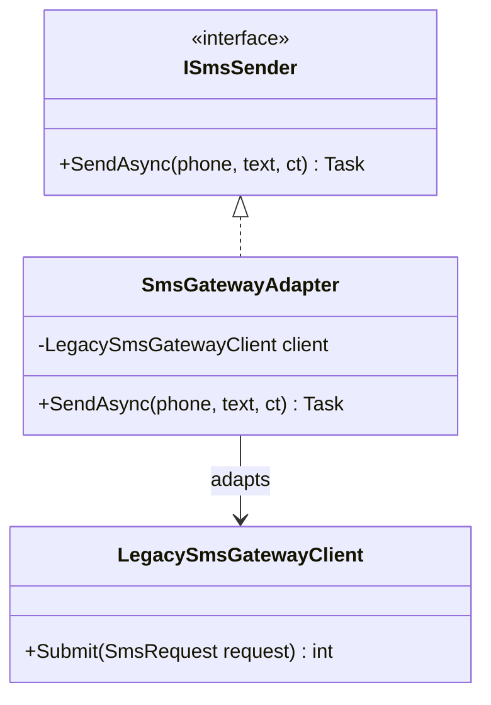
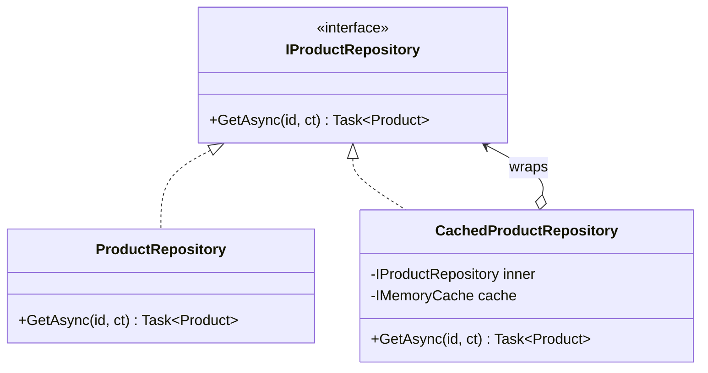
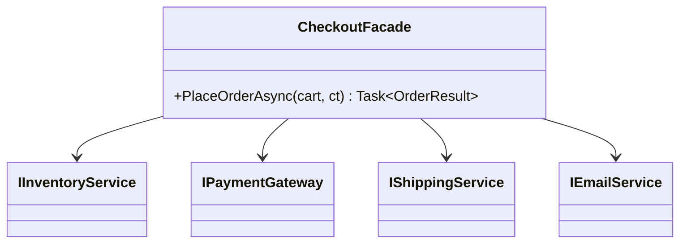
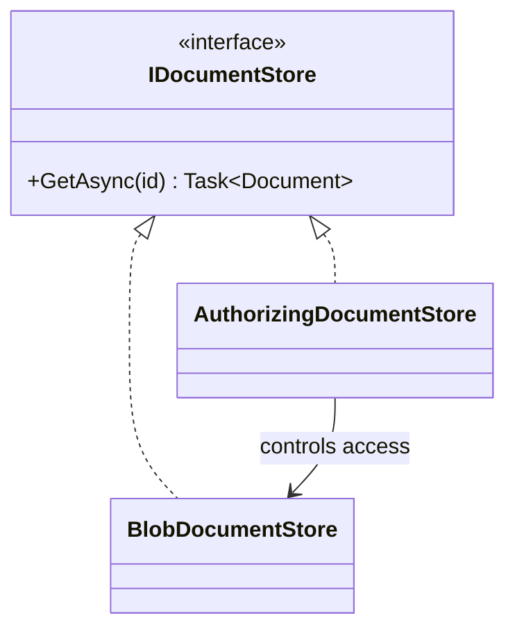
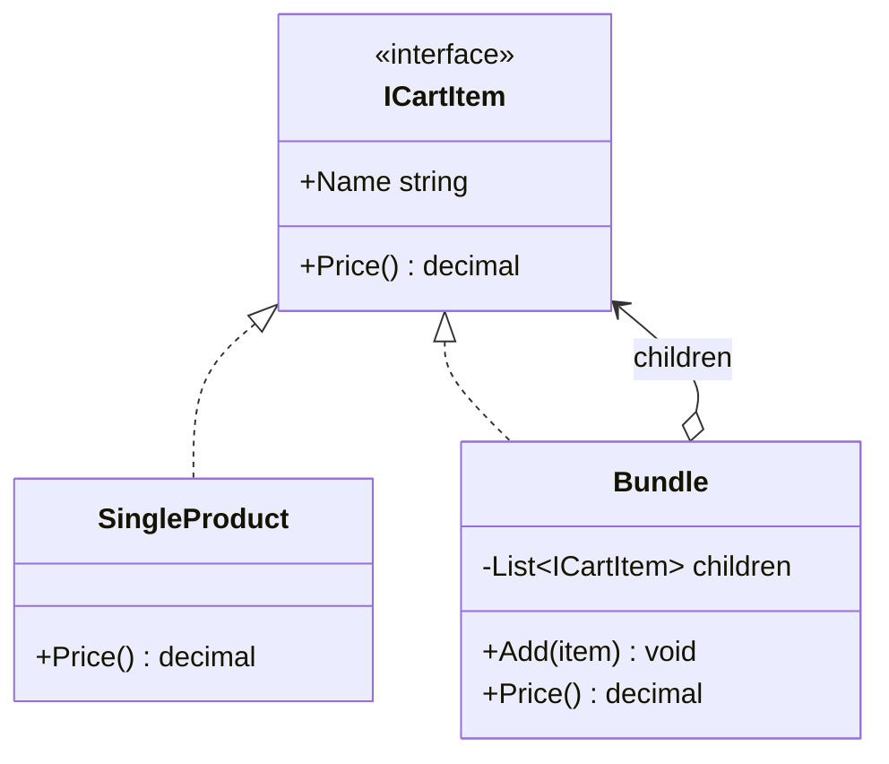

import { Tabs, TabItem, Aside } from '@astrojs/starlight/components';
import QuizBlock from '~/components/QuizBlock.astro';

## Why it matters in interviews

Structural patterns are about **wrapping and combining objects**, and .NET is full of them: every `Stream` you wrap, every `DelegatingHandler`, every middleware. A strong answer ties a pattern to code you wrote: *"we added caching to the product repository with a decorator, registered via Scrutor, without touching the repository or its callers"*. Expect the follow-up *"Decorator vs Proxy vs Adapter: they all wrap, so what's the difference?"*.

## Core idea

| Pattern | Intent in one line | Changes the interface? | .NET example |
|---|---|---|---|
| Adapter | Make an incompatible interface fit the one clients expect | **Yes** (converts it) | `StreamReader` (Stream to `TextReader`) |
| Decorator | Add behaviour by wrapping an object with the **same** interface | No | `GZipStream`, `BufferedStream`, `DelegatingHandler`, middleware |
| Facade | One simple entry point over a complex subsystem | New, simpler interface | `File.ReadAllText`, `HttpClient`, `WebApplication` |
| Proxy | A stand-in that **controls access** to the real object | No | EF Core lazy-loading proxies, gRPC client stubs, `DispatchProxy` |
| Composite | Treat a tree of objects and single objects uniformly | No | `CompositeFileProvider`, `CompositeChangeToken`, UI component trees |

All five rely on **composition over inheritance**: the wrapper holds a reference to the wrapped object.

### Adapter

**Problem:** a third-party or legacy API has the wrong shape for your code (different method names, sync instead of async, different types). You don't want that shape leaking into business logic.



```csharp
// Our port: what the application wants.
public interface ISmsSender { Task SendAsync(string phone, string text, CancellationToken ct); }

// Vendor SDK we cannot change: sync, its own request type, numeric status codes.
public class SmsRequest { public string Msisdn { get; set; } = ""; public string Body { get; set; } = ""; }
public class LegacySmsGatewayClient { public int Submit(SmsRequest request) => 0; }

public class SmsGatewayAdapter(LegacySmsGatewayClient client, ILogger<SmsGatewayAdapter> log) : ISmsSender
{
    public Task SendAsync(string phone, string text, CancellationToken ct)
    {
        var status = client.Submit(new SmsRequest { Msisdn = "+91" + phone, Body = text });
        if (status != 0)
        {
            log.LogWarning("SMS gateway returned {Status}", status);
            throw new InvalidOperationException($"SMS failed with status {status}");
        }
        return Task.CompletedTask;
    }
}
```

**In .NET:** `StreamReader`/`StreamWriter` adapt a byte `Stream` to text; `Task.FromResult` and `TaskCompletionSource` adapt sync or callback APIs to tasks; `ToObservable()`/`ToAsyncEnumerable()` adapt between async models. In Hexagonal architecture, infrastructure **adapters** implement core **ports**: this is the same idea at architecture level.

**When not to use:** when you own both sides; change one of them instead of adding a translation layer.

### Decorator

**Problem:** you want to add caching, logging, retries or metrics to a service **without editing it** and without every caller knowing.



```csharp
using Microsoft.Extensions.Caching.Memory;

public interface IProductRepository { Task<Product?> GetAsync(int id, CancellationToken ct); }

public class ProductRepository(AppDbContext db) : IProductRepository
{
    public Task<Product?> GetAsync(int id, CancellationToken ct) =>
        db.Products.AsNoTracking().FirstOrDefaultAsync(p => p.Id == id, ct);
}

// Same interface, wraps the real one, adds caching.
public class CachedProductRepository(IProductRepository inner, IMemoryCache cache) : IProductRepository
{
    public async Task<Product?> GetAsync(int id, CancellationToken ct) =>
        await cache.GetOrCreateAsync($"product:{id}", entry =>
        {
            entry.AbsoluteExpirationRelativeToNow = TimeSpan.FromMinutes(5);
            return inner.GetAsync(id, ct);
        });
}
```

**Registering decorators in DI:** the built-in container has no `Decorate` method. Use Scrutor, or wire it by hand:

```csharp
// Option 1: Scrutor (NuGet) - registration order defines wrapping order.
services.AddScoped<IProductRepository, ProductRepository>();
services.Decorate<IProductRepository, CachedProductRepository>();

// Option 2: manual, no extra package.
services.AddScoped<ProductRepository>();
services.AddScoped<IProductRepository>(sp =>
    new CachedProductRepository(
        sp.GetRequiredService<ProductRepository>(),
        sp.GetRequiredService<Microsoft.Extensions.Caching.Memory.IMemoryCache>()));
```

**In .NET:**

- **Streams**: `new GZipStream(new BufferedStream(fileStream), CompressionMode.Compress)`. Each layer is a `Stream` adding one behaviour.
- **HttpClient handlers**: `DelegatingHandler` subclasses wrap the inner handler (auth header, logging, Polly retry via `AddStandardResilienceHandler`).
- **Middleware**: each middleware receives `next` (a `RequestDelegate`) and returns a new `RequestDelegate` that wraps it. The pipeline is a stack of decorators around the endpoint. Because each can also short-circuit, it is equally described as [Chain of Responsibility](../behavioral-patterns/).
- **MediatR pipeline behaviours** decorate every handler (see [Enterprise Patterns](../enterprise-patterns/)).

**When not to use:** when the behaviour belongs to every call site of the framework anyway (use middleware or filters), or when stacking five decorators makes the order and debugging confusing. Caching decorators also need a clear invalidation story.

### Facade

**Problem:** placing an order touches inventory, payment, shipping and email. Controllers shouldn't orchestrate four services and know their order.



```csharp
public record Cart(int CustomerId, string Email, decimal Total, List<string> Skus);
public record OrderResult(bool Success, string? TrackingId, string? Error);

public interface IInventoryService { Task<bool> ReserveAsync(List<string> skus, CancellationToken ct); }
public interface IPaymentGateway { Task<bool> ChargeAsync(int customerId, decimal amount, CancellationToken ct); }
public interface IShippingService { Task<string> CreateShipmentAsync(Cart cart, CancellationToken ct); }
public interface IEmailService { Task SendAsync(string to, string body, CancellationToken ct); }

public class CheckoutFacade(IInventoryService inventory, IPaymentGateway payments,
    IShippingService shipping, IEmailService email)
{
    public async Task<OrderResult> PlaceOrderAsync(Cart cart, CancellationToken ct)
    {
        if (!await inventory.ReserveAsync(cart.Skus, ct))
            return new(false, null, "Out of stock");

        if (!await payments.ChargeAsync(cart.CustomerId, cart.Total, ct))
            return new(false, null, "Payment declined");

        var trackingId = await shipping.CreateShipmentAsync(cart, ct);
        await email.SendAsync(cart.Email, $"Shipped: {trackingId}", ct);
        return new(true, trackingId, null);
    }
}
// Controller: return Ok(await checkout.PlaceOrderAsync(cart, ct));
```

**In .NET:** `File.ReadAllTextAsync` hides `FileStream` + `StreamReader` + encoding detection; `HttpClient` hides the handler pipeline and connection pooling; `WebApplication.CreateBuilder` hides host, configuration, logging and DI setup. In Angular, a **facade service** hides the store, HTTP and caching from components (see [Front-end Architecture Patterns](../angular-patterns/)).

**When not to use:** when it becomes a "god facade" with fifty methods, or when it merely forwards one call to one service. A facade should simplify, not just add a layer.

### Proxy

**Problem:** you need to control access to an object (authorisation, lazy creation, remote call, rate limiting) while callers keep using the same interface.



```csharp
public record Document(int Id, int OwnerId, string Content);

public interface IDocumentStore { Task<Document?> GetAsync(int id); }

public class BlobDocumentStore : IDocumentStore
{
    public Task<Document?> GetAsync(int id) => Task.FromResult<Document?>(new(id, 7, "..."));
}

public interface ICurrentUser { int Id { get; } bool IsAdmin { get; } }

// Protection proxy: same interface, decides whether the real call may happen.
public class AuthorizingDocumentStore(BlobDocumentStore real, ICurrentUser user) : IDocumentStore
{
    public async Task<Document?> GetAsync(int id)
    {
        var doc = await real.GetAsync(id);
        if (doc is not null && doc.OwnerId != user.Id && !user.IsAdmin)
            throw new UnauthorizedAccessException($"Document {id}");
        return doc;
    }
}
```

Kinds of proxy: **virtual** (create the expensive object lazily, like `Lazy<T>`), **protection** (above), **remote** (a local object standing in for a remote one), **caching**, **smart reference** (counting or logging).

**In .NET:** EF Core lazy-loading proxies (`UseLazyLoadingProxies()` generates subclasses whose navigation properties load on first access), gRPC and WCF generated client stubs and typed `HttpClient` clients (remote proxies), `System.Reflection.DispatchProxy` for runtime proxies, Castle DynamicProxy (used by Moq).

**Decorator vs Proxy:** structurally identical. The difference is **intent**: a decorator *adds* behaviour and is usually stacked by the client; a proxy *controls access* to the subject and usually manages its lifetime or location.

**When not to use:** lazy-loading proxies in web APIs often cause N+1 queries; prefer explicit `Include` or projections.

### Composite

**Problem:** you have a tree (product bundles, menu items, permission groups, org charts) and want to treat a single item and a group the same way.



```csharp
public interface ICartItem
{
    string Name { get; }
    decimal Price();
}

public record SingleProduct(string Name, decimal UnitPrice) : ICartItem
{
    public decimal Price() => UnitPrice;
}

public class Bundle(string name, decimal discountPercent) : ICartItem
{
    private readonly List<ICartItem> _children = [];
    public string Name => name;

    public Bundle Add(ICartItem item) { _children.Add(item); return this; }

    // Recurses through nested bundles; callers don't care which kind they hold.
    public decimal Price() => _children.Sum(c => c.Price()) * (1 - discountPercent / 100);
}

// var laptopKit = new Bundle("Laptop kit", 10)
//     .Add(new SingleProduct("Laptop", 60000))
//     .Add(new Bundle("Accessories", 5).Add(new SingleProduct("Mouse", 800)).Add(new SingleProduct("Bag", 1200)));
// laptopKit.Price(); // works the same for one product or a nested bundle
```

**In .NET:** `CompositeFileProvider`, `CompositeChangeToken`, `IConfiguration` sections (a section contains sections), expression trees, and the Angular component tree.

**When not to use:** when the data is not really a tree, or when leaves and groups need very different operations. Forcing `Add()` onto leaves (which throw) is also an LSP smell.

## Interview Q&A

<details>
<summary>Decorator, Proxy and Adapter all wrap an object. What's the difference?</summary>

**Adapter** changes the interface so an incompatible class fits. **Decorator** keeps the interface and adds behaviour; decorators are designed to stack. **Proxy** keeps the interface and controls access (lazy creation, authorisation, remote calls). Decorator and Proxy look the same in code; the intent differs.
</details>

<details>
<summary>How do you register a decorator in ASP.NET Core DI?</summary>

The built-in container doesn't support decoration directly. Use Scrutor's `services.Decorate<IService, Decorator>()` after registering the real implementation, or register the concrete class and then a factory lambda: `services.AddScoped<IService>(sp => new Decorator(sp.GetRequiredService<RealService>(), ...))`.
</details>

<details>
<summary>Is ASP.NET Core middleware a Decorator or Chain of Responsibility?</summary>

Both descriptions fit. Each middleware wraps `next` and can run code before and after it, like a decorator around the rest of the pipeline. Each one can also handle the request and short-circuit without calling `next`, which is Chain of Responsibility. Most people call it a chain; mentioning both shows depth.
</details>

<details>
<summary>Where does .NET use the Decorator pattern?</summary>

`Stream` (`BufferedStream`, `GZipStream`, `CryptoStream` wrap another stream), `DelegatingHandler` in `HttpClient`, middleware, and MediatR pipeline behaviours. They all keep the same abstraction and add one concern.
</details>

<details>
<summary>What's the difference between a Facade and a service layer?</summary>

They overlap. A facade's purpose is **simplification**: one entry point that hides several subsystems and their order of calls. An application service often does exactly that for one use case. The facade becomes an anti-pattern when it grows into a god class or only forwards calls.
</details>

<details>
<summary>How do EF Core lazy-loading proxies work and why are they risky?</summary>

With `UseLazyLoadingProxies()` EF Core generates a runtime subclass of your entity that overrides `virtual` navigation properties. The first access triggers a query. That's a virtual proxy. The risk is N+1 queries (a loop over 100 orders runs 100 extra queries) and queries firing after the context is disposed or during JSON serialisation.
</details>

<details>
<summary>Give an example of the Composite pattern you could build.</summary>

Product bundles in an e-commerce cart: `ICartItem.Price()` is implemented by a single product and by a `Bundle` that sums its children and applies a discount. Nested bundles work automatically, and the cart total code doesn't need `if` checks for bundles.
</details>

## Pitfalls

<Aside type="caution" title="Common mistakes">

- **Decorator order surprises**: caching outside retry behaves differently from retry outside caching. Document the order.
- **Forgetting decorators have the same lifetime issues**: a singleton caching decorator wrapping a scoped repository is a captive dependency.
- **Adapters that leak the vendor's types** (exceptions, enums) into the core, defeating the purpose.
- **God facades** that grow to cover every use case.
- **Lazy-loading proxies in APIs** causing N+1 queries and serialisation loops.
- **Composite leaves that throw on `Add`**, forcing callers to type-check.

</Aside>

## Related

- [Creational Patterns](../creational-patterns/)
- [Behavioral Patterns](../behavioral-patterns/)
- [Request Pipeline & Middleware](../../aspnet/middleware-pipeline/)
- [Eager, Lazy & Explicit Loading](../../data/loading-strategies/)

## Quick quiz

<QuizBlock section="patterns" topic="structural-patterns" />
