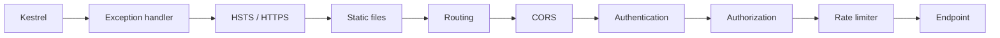

## Request pipeline

- Order matters: middleware runs top to bottom on the way in, bottom to top on the way out. [More](../../aspnet/middleware-pipeline/)
- `Use` calls next, `Run` terminates, `Map` branches by path.
- **Middleware vs filters:** middleware sees every request. Filters see only MVC/endpoint actions and have the action context (model, result). [More](../../aspnet/filters/)

## Dependency injection

| Lifetime | One instance per | Typical use |
|---|---|---|
| Singleton | App | Config, caches, `HttpClient` handlers |
| Scoped | Request | `DbContext`, unit of work, current user |
| Transient | Resolution | Lightweight stateless services |

- **Captive dependency:** a singleton holding a scoped service keeps it alive forever. Scope validation catches this in Development. [More](../../aspnet/dependency-injection/)
- Inside a singleton or background service, use `IServiceScopeFactory.CreateScope()` to get scoped services.

## Configuration and logging

- Precedence: later providers win. appsettings.json → appsettings.\{Env\}.json → user secrets → environment variables → command line.
- `IOptions` (singleton, read once), `IOptionsSnapshot` (per request), `IOptionsMonitor` (live reload + change callbacks). [More](../../aspnet/configuration-options/)
- Use structured logging with message templates, `logger.LogInformation("Order {OrderId}", id)`, not string interpolation. [More](../../aspnet/logging-observability/)

## Security

- **AuthN** = who you are. **AuthZ** = what you may do. [More](../../aspnet/authentication-authorization/)
- JWT bearer: validate issuer, audience, lifetime and signing key. Keep access tokens short-lived and rotate refresh tokens.
- Use policies (`RequireClaim`, custom requirements) rather than scattering role strings. Use resource-based authorization for "owner only".
- CORS is a browser rule, not server security. The preflight is an `OPTIONS` request.

## Errors, caching, performance

- Global errors: `UseExceptionHandler` + `IExceptionHandler` + ProblemDetails. Never leak stack traces. [More](../../aspnet/error-handling/)
- Caching: `IMemoryCache` (one server), `IDistributedCache`/Redis (many servers), `HybridCache` (both, stampede protection), output caching (whole responses). [More](../../aspnet/caching/)
- Use `IHttpClientFactory` to avoid socket exhaustion, plus a resilience handler (retry, timeout, circuit breaker). [More](../../aspnet/performance-resilience/)
- Background work runs in a `BackgroundService` fed by a `Channel<T>`; use a durable queue when it must survive restarts. [More](../../aspnet/background-services/)

## REST API design

| Verb | Use | Idempotent |
|---|---|---|
| GET | Read | Yes |
| POST | Create / action | No (use an idempotency key) |
| PUT | Replace | Yes |
| PATCH | Partial update | Not guaranteed |
| DELETE | Remove | Yes |

Status codes: 200 OK, 201 Created (+ Location), 204 No Content, 400 validation, 401 not authenticated, 403 forbidden, 404, 409 conflict, 422 semantic error, 429 too many requests, 500. [More](../../aspnet/rest-api-design/)
