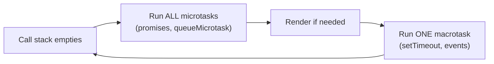

## TypeScript

| Concept | Remember |
|---|---|
| `any` vs `unknown` vs `never` | `any` turns checking off. `unknown` must be narrowed before use. `never` is the impossible type, used for exhaustive checks. [More](../../web/typescript-types/) |
| `interface` vs `type` | Interfaces can be extended and merged. Type aliases can express unions, tuples and mapped types. |
| Narrowing | `typeof`, `instanceof`, `in`, discriminant property, custom `x is T` guard. |
| Literal widening | `const o = { m: 'GET' }` gives `m: string`. Use `as const` or a type annotation to keep the literal. |
| Utility types | `Partial`, `Required`, `Readonly`, `Pick`, `Omit`, `Record`, `ReturnType`, `Awaited`, `NonNullable`. [More](../../web/typescript-advanced/) |
| Conditional types | Distribute over unions: `T extends unknown ? T[] : never` turns `string \| number` into `string[] \| number[]`. |
| `satisfies` | Checks the value against a type but keeps the narrower inferred type. |

## JavaScript runtime



```js
console.log(1);
setTimeout(() => console.log(2));
Promise.resolve().then(() => console.log(3));
console.log(4);
// 1 4 3 2
```

- `await` splits the function: the rest runs as a microtask. [More](../../web/js-event-loop/)
- `Promise.all` fails fast, `allSettled` never rejects, `race` takes the first to settle, and `any` takes the first fulfilled.
- **Closures** capture variables, not values. `var` in a loop shares one binding; `let` creates one binding per iteration. [More](../../web/js-core/)
- **`this`** depends on the call site: method call → the object, plain call → `undefined` (strict mode), `new` → the new object, arrow functions → lexical `this`. `bind`/`call`/`apply` set it explicitly.
- **Copying:** spread copies one level (shallow). Use `structuredClone` for a deep copy. `==` coerces types; use `===`. [More](../../web/js-practical/)
- **Debounce** waits for a pause; **throttle** runs at most once per interval.

## Browser

- Events capture down, then bubble up. Delegation puts one listener on a parent and reads `event.target`. [More](../../web/browser-dom/)
- Storage: `localStorage` persists, `sessionStorage` lasts for the tab, cookies are sent with every request (`HttpOnly`, `Secure`, `SameSite`), IndexedDB holds large structured data.
- Critical rendering path: DOM + CSSOM → render tree → layout → paint → composite. Changing layout properties triggers reflow; `transform`/`opacity` only composite.

## HTML and CSS

- Semantic elements (`header`, `nav`, `main`, `button`) give accessibility for free. Every input needs a label. [More](../../web/html-accessibility/)
- Specificity: inline style > id > class/attribute/pseudo-class > element. `!important` overrides; avoid it. [More](../../web/css-layout/)
- `box-sizing: border-box` includes padding and border in the width.
- **Flexbox** for one dimension (a row or a column). **Grid** for two dimensions (rows and columns).
- Positioning: `relative` (offset, keeps its space), `absolute` (relative to the nearest positioned ancestor), `fixed` (viewport), `sticky`.
