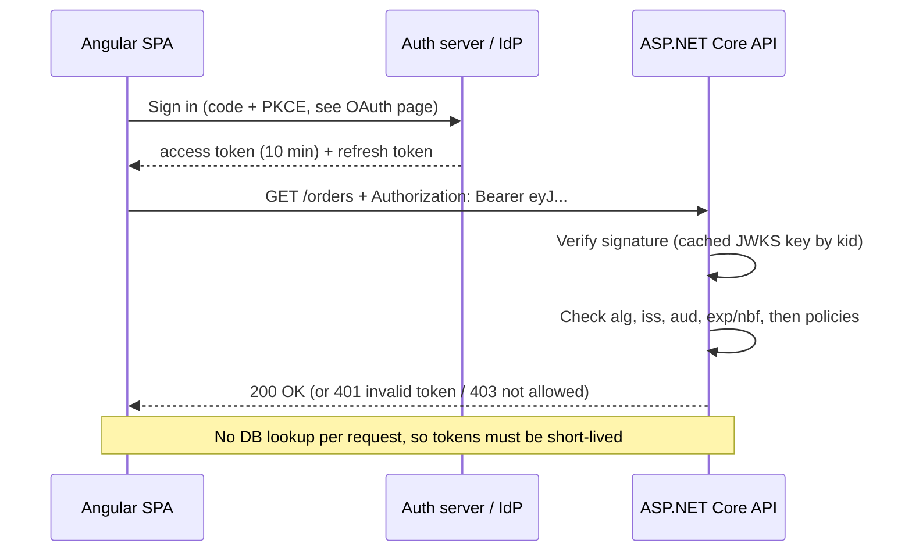
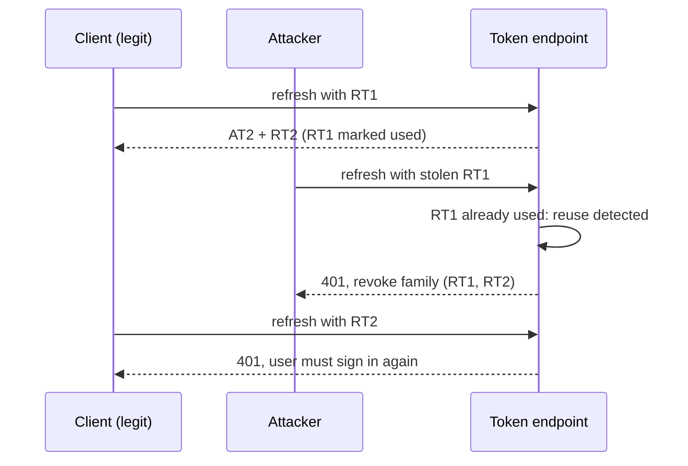
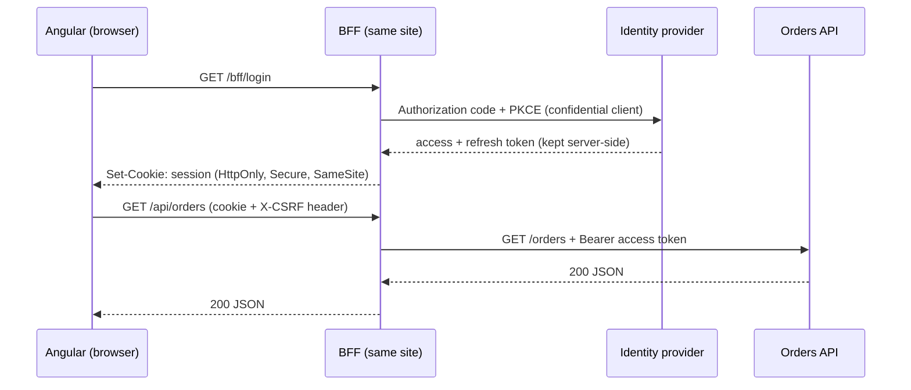

import { Tabs, TabItem, Aside } from '@astrojs/starlight/components';
import QuizBlock from '~/components/QuizBlock.astro';

## Why it matters in interviews

*"Walk me through JWT authentication"*, *"what's inside a JWT and how is it validated?"*, *"how do you log a user out if JWTs are stateless?"* and above all *"where do you store the token in Angular?"* come up in nearly every full-stack interview. A strong answer compares options and their trade-offs (XSS vs CSRF exposure) instead of declaring one "the secure way".

## Core idea

- **Authentication (authN)**: *who are you?* Verifying identity (password, MFA, SSO). Failure: **401 Unauthorized** (the name is historical; it means unauthenticated).
- **Authorization (authZ)**: *what may you do?* Roles, scopes, policies, ownership. Failure: **403 Forbidden**.

In ASP.NET Core, `UseAuthentication()` builds `HttpContext.User` from a cookie or token; `UseAuthorization()` evaluates policies against it. Order matters: authentication first.

### Session cookie vs JWT

| | Server session + cookie | JWT (bearer token) |
|---|---|---|
| What the client holds | Opaque random session id | Self-contained signed claims |
| Where state lives | Server (memory, Redis, SQL) | In the token itself |
| Validation | Look up session store | Verify signature + claims locally, no DB call |
| Revocation / logout | Delete the session: instant | Hard: valid until `exp` unless you keep a denylist |
| Scaling | Needs a shared store across instances | Any instance with the public key can validate |
| Sent how | Browser sends cookie automatically | Client adds `Authorization: Bearer ...` |
| Main browser risk | **CSRF** (automatic sending) | **XSS** token theft if JS can read it |
| Best for | Server-rendered apps, BFF for SPAs | APIs called by many clients, service-to-service, mobile |

JWT is not "more secure" than sessions. It trades **easy revocation** for **stateless validation**. That's why access tokens are short-lived and paired with refresh tokens.

### JWT structure

A JWT (JWS, really) is three base64url parts: `header.payload.signature`.

- **Header**: `alg` (`RS256`, `HS256`...), `typ`, `kid` (which key signed it).
- **Payload (claims)**: `iss` issuer, `sub` subject (user id), `aud` audience (which API), `exp` expiry, `nbf`, `iat`, `jti` unique id, plus `roles`, `scp`, `email`...
- **Signature**: over `header.payload` with the issuer's key.

The payload is **encoded, not encrypted**. Anyone can read it on jwt.io. Never put secrets or sensitive PII in it. (JWE encrypts tokens, but it's rarely needed.)

**HS256** uses one shared secret for signing and verifying, so every API that validates can also *forge* tokens. **RS256/ES256** sign with a private key held only by the identity provider; APIs verify with the public key fetched from the JWKS endpoint. Prefer asymmetric once more than one service validates tokens.

### JWT authentication flow



### What the API must validate

Signature with the expected key, **algorithm pinned** (never accept `alg: none` or an RS256 → HS256 switch), **issuer**, **audience** (a token for another API must be rejected), **lifetime** with small clock skew. Then authorization: roles, scopes, ownership.

### Refresh tokens and rotation

Short access tokens limit damage, but users can't log in every 10 minutes. A **refresh token** is a long-lived credential used only against the token endpoint to get a new access token.

**Rotation**: every refresh returns a **new** refresh token and invalidates the old one. If an old token is ever presented again, someone has a copy (attacker or victim). The server can't tell which, so it **revokes the whole token family** and forces a new login. This is **reuse detection**, recommended by the OAuth security BCP for public clients like SPAs.



### Where to store tokens in an SPA

| Option | XSS can steal it? | CSRF risk? | Survives reload? | Notes |
|---|---|---|---|---|
| `localStorage` | **Yes**, any script reads it | No | Yes | Common in tutorials; one XSS = full token theft for its lifetime |
| `sessionStorage` | **Yes** | No | Per tab | Same XSS exposure, slightly shorter life |
| In-memory (JS variable / signal) | Not directly, but XSS can still **use** it while the page is open | No | No (re-acquire via silent refresh) | Good with a refresh token in an HttpOnly cookie |
| HttpOnly + Secure + SameSite cookie | **No** (JS can't read) | Yes, mitigate with SameSite + antiforgery | Yes | Requires API on same site or careful CORS |
| **BFF** (tokens server-side, session cookie to SPA) | No tokens in the browser at all | Mitigated with SameSite + custom header/antiforgery | Yes | Current recommendation for sensitive SPAs |

No storage survives a working XSS: the attacker can always make requests *as the user* from the page. HttpOnly cookies and BFF prevent **exfiltrating** the token for later use elsewhere. So: fix XSS first, then choose storage.

### The BFF pattern

**Backend for Frontend**: a small server (ASP.NET Core, often with YARP or Duende.BFF) on the same site as the SPA does the OAuth flow as a **confidential client**, keeps tokens server-side, and gives the browser only an HttpOnly session cookie. API calls go through the BFF, which attaches the access token.



## Code

### Validating JWTs in ASP.NET Core

```csharp
builder.Services.AddAuthentication(JwtBearerDefaults.AuthenticationScheme)
    .AddJwtBearer(o =>
    {
        o.Authority = "https://login.microsoftonline.com/<tenant-id>/v2.0"; // metadata + JWKS
        o.Audience = "api://orders-api";
        o.MapInboundClaims = false; // keep "sub", "roles" as-is
        o.TokenValidationParameters = new TokenValidationParameters
        {
            ValidateIssuer = true,
            ValidateAudience = true,
            ValidateLifetime = true,
            ValidateIssuerSigningKey = true,
            ValidAlgorithms = [SecurityAlgorithms.RsaSha256], // pin the algorithm
            ClockSkew = TimeSpan.FromSeconds(30),             // default is 5 minutes
            RoleClaimType = "roles",
        };
    });
builder.Services.AddAuthorization();
// app.UseAuthentication(); app.UseAuthorization();
```

### Issuing a short-lived token (own auth server)

```csharp
public sealed class JwtIssuer(IOptions<JwtOptions> options, TimeProvider clock) : IJwtIssuer
{
    public string CreateAccessToken(string userId)
    {
        var o = options.Value;
        var key = new SymmetricSecurityKey(Convert.FromBase64String(o.SigningKey)); // 256-bit+, from Key Vault
        var now = clock.GetUtcNow().UtcDateTime;
        return new JsonWebTokenHandler().CreateToken(new SecurityTokenDescriptor
        {
            Issuer = o.Issuer,
            Audience = o.Audience,
            Subject = new ClaimsIdentity([new Claim(JwtRegisteredClaimNames.Sub, userId),
                                          new Claim(JwtRegisteredClaimNames.Jti, Guid.NewGuid().ToString())]),
            IssuedAt = now,
            NotBefore = now,
            Expires = now.AddMinutes(10), // short-lived
            SigningCredentials = new SigningCredentials(key, SecurityAlgorithms.HmacSha256),
        });
    }
}
```

HS256 is fine when the **same** service issues and validates. In most real systems you'd use Entra ID, Auth0, Cognito or Duende IdentityServer instead of writing token issuance yourself.

### Refresh token rotation with reuse detection

```csharp
public class TokenService(AppDb db, IJwtIssuer jwt, TimeProvider clock)
{
    public async Task<TokenPair?> RefreshAsync(string presented, CancellationToken ct)
    {
        var now = clock.GetUtcNow();
        var hash = Hash(presented);
        var current = await db.RefreshTokens.SingleOrDefaultAsync(t => t.TokenHash == hash, ct);
        if (current is null || current.RevokedAt is not null || current.ExpiresAt <= now)
            return null;

        if (current.UsedAt is not null) // already rotated: this is a replay
        {
            await db.RefreshTokens.Where(t => t.FamilyId == current.FamilyId)
                .ExecuteUpdateAsync(s => s.SetProperty(t => t.RevokedAt, now), ct);
            return null; // whole family revoked, user must sign in again
        }

        current.UsedAt = now; // one-time use
        var raw = Convert.ToBase64String(RandomNumberGenerator.GetBytes(32));
        db.RefreshTokens.Add(new RefreshToken
        {
            UserId = current.UserId, FamilyId = current.FamilyId,
            TokenHash = Hash(raw), ExpiresAt = now.AddDays(14),
        });
        await db.SaveChangesAsync(ct); // add a concurrency token so two parallel refreshes can't both win
        return new TokenPair(jwt.CreateAccessToken(current.UserId), raw);
    }

    // Store only a hash: a DB leak must not hand out live refresh tokens.
    private static string Hash(string raw) => Convert.ToHexString(SHA256.HashData(Encoding.UTF8.GetBytes(raw)));
}
```

The refresh token travels in an HttpOnly cookie scoped to the refresh endpoint:

```csharp
ctx.Response.Cookies.Append("rt", pair.RefreshToken, new CookieOptions
{
    HttpOnly = true,                // JavaScript can't read it
    Secure = true,                  // HTTPS only
    SameSite = SameSiteMode.Strict, // not sent on cross-site requests
    Path = "/auth/refresh",         // only sent to this endpoint
    MaxAge = TimeSpan.FromDays(14),
});
return Results.Ok(new { accessToken = pair.AccessToken }); // SPA keeps it in memory
```

### Angular: token storage

<Tabs syncKey="lang">
  <TabItem label="Vulnerable (TS)">

```ts
// Token in localStorage: any injected script can read and exfiltrate it.
// And it is attached to EVERY request, including third-party URLs.
export const authInterceptor: HttpInterceptorFn = (req, next) => {
  const token = localStorage.getItem('access_token');
  return next(token ? req.clone({ setHeaders: { Authorization: `Bearer ${token}` } }) : req);
};
```

  </TabItem>
  <TabItem label="Better (TS)">

```ts
@Injectable({ providedIn: 'root' })
export class TokenStore {
  private readonly token = signal<string | null>(null); // memory only, gone on reload
  readonly accessToken = this.token.asReadonly();
  set(value: string | null) { this.token.set(value); }
}

export const authInterceptor: HttpInterceptorFn = (req, next) => {
  const token = inject(TokenStore).accessToken();
  const isOwnApi = req.url.startsWith('/api/'); // never leak the token to other hosts
  return next(token && isOwnApi
    ? req.clone({ setHeaders: { Authorization: `Bearer ${token}` } })
    : req);
};
// On app start / 401: POST /auth/refresh (HttpOnly cookie) to get a new access token.
```

  </TabItem>
  <TabItem label="BFF (TS)">

```ts
// No tokens in the browser. The session cookie is sent automatically (same site).
// A custom header forces a CORS preflight for cross-site callers, a simple CSRF defence.
export const bffInterceptor: HttpInterceptorFn = (req, next) =>
  next(req.url.startsWith('/api/')
    ? req.clone({ setHeaders: { 'X-CSRF': '1' }, withCredentials: true })
    : req);
```

  </TabItem>
</Tabs>

## Interview Q&A

<details>
<summary>What is the difference between authentication and authorization? Which status codes go with them?</summary>

Authentication proves identity; authorization decides permissions for that identity. A missing or invalid token gives **401** (with a `WWW-Authenticate` header); a valid user lacking permission gets **403**. For resources the user shouldn't even know exist, returning **404** instead of 403 avoids leaking existence.
</details>

<details>
<summary>How do you log out a user, or revoke access, with JWTs?</summary>

You can't "delete" a JWT. Options: keep access tokens **short** (5-15 min) and revoke the **refresh token** server-side so no new ones are issued; for immediate revocation keep a **denylist of `jti`** (or a per-user "tokens valid after" timestamp) in a fast cache and check it in `OnTokenValidated`; or use reference (opaque) tokens with introspection. Each step back toward state costs some of JWT's benefit.
</details>

<details>
<summary>Where would you store the JWT in an Angular app?</summary>

Default answer: **not in `localStorage`**. Keep the access token **in memory**, and the refresh token in an **HttpOnly, Secure, SameSite** cookie scoped to the refresh endpoint; on reload, call refresh silently. For higher-risk apps, use a **BFF** so no tokens reach the browser. Always pair it with XSS prevention (CSP, no `bypassSecurityTrust*`), because XSS can act as the user regardless of storage.
</details>

<details>
<summary>Why is a JWT signed but usually not encrypted? What does that mean for its contents?</summary>

The signature guarantees **integrity and origin**: nobody can change the claims without the key. It does not hide them; base64url is just encoding. So no passwords, secrets or sensitive personal data in claims, and remember tokens appear in browser memory, logs and proxies.
</details>

<details>
<summary>Explain refresh token rotation and reuse detection.</summary>

Each refresh call returns a new refresh token and marks the old one used. If a used token is presented again, either the attacker or the real user is replaying a stolen copy. The server revokes the entire token **family**, which cuts off the attacker even if they refreshed first. Store tokens **hashed**, give them an absolute lifetime, and handle concurrent refreshes (two tabs) with a short grace period or a concurrency token.
</details>

<details>
<summary>What is the `alg: none` / algorithm confusion attack?</summary>

Old libraries trusted the token's own `alg` header. With `none` they skipped verification. With RS256 → HS256 confusion, the attacker signed an HS256 token using the **public** RSA key as the HMAC secret, and a naive library verified it with that same public key. Defences: use maintained libraries, **pin `ValidAlgorithms`**, and keep issuer signing keys strictly typed.
</details>

<details>
<summary>Session cookies or JWT for a new Angular + ASP.NET Core app?</summary>

If the SPA and API share a site and there is one API, **cookie auth (or a BFF)** is simpler and safer: HttpOnly cookies, instant logout, antiforgery support built in. Use **JWT bearer** when the API serves many clients (mobile, partners, other services) or sits behind an external IdP. A common hybrid: BFF with a cookie for the browser, JWTs from the BFF to downstream APIs.
</details>

<details>
<summary>What claims would you validate on an incoming access token, and why the audience?</summary>

Signature and algorithm, `iss` (from your IdP/tenant), `aud` (your API's identifier), `exp`/`nbf` with small skew, then scopes/roles for authorization. Audience matters because an IdP issues tokens for many APIs; without the check, a token meant for a low-trust API could be replayed against yours.
</details>

## Pitfalls

<Aside type="caution" title="Common mistakes">

- Storing tokens in **`localStorage`** and attaching them to every outgoing request, including third-party hosts.
- **Long-lived access tokens** (days) with no refresh or revocation story.
- Accepting tokens without checking **audience** or with the default 5-minute `ClockSkew` on very short tokens.
- Putting **PII or secrets** in the JWT payload.
- Storing refresh tokens **in plain text**, or not rotating them.
- Using one **HS256 secret** shared by many services: any of them can mint tokens.
- Treating the **ID token** as an API access token (see [OAuth & OIDC](../oauth-oidc/)).
- Cookie auth for an API **without CSRF protection** (SameSite + antiforgery or custom header).

</Aside>

## Related

- [OAuth 2.0 & OpenID Connect](../oauth-oidc/)
- [SQLi, XSS, CSRF, CORS & SSRF](../web-attacks/)
- [ASP.NET Core Authentication & Authorization](../../aspnet/authentication-authorization/)
- [Angular HttpClient & Interceptors](../../angular/http-interceptors/)

## Quick quiz

<QuizBlock section="security" topic="authn-authz-tokens" />
