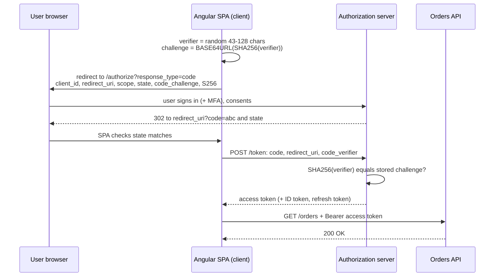

import { Tabs, TabItem, Aside } from '@astrojs/starlight/components';
import QuizBlock from '~/components/QuizBlock.astro';

## Why it matters in interviews

Most product companies use an external identity provider (Entra ID, Auth0, Okta, Cognito) rather than home-made login. Expect *"explain the OAuth authorization code flow"*, *"why PKCE?"*, *"ID token vs access token?"*, *"how does service A call service B securely?"*. Saying **"OAuth is for authorization, OIDC adds authentication"** and drawing the code + PKCE flow correctly puts you ahead of most candidates.

## Core idea

**OAuth 2.0** is a **delegated authorization** framework: it lets a client get an **access token** to call an API on behalf of a user (or itself), without ever seeing the user's password. It says nothing standard about *who* the user is.

**OpenID Connect (OIDC)** is an identity layer on top of OAuth 2.0. Asking for the `openid` scope returns an **ID token** (a JWT about the user's login), plus a standard `/userinfo` endpoint and discovery document (`/.well-known/openid-configuration`). OIDC is what gives you **SSO**.

### The four roles

| Role | Meaning | In a .NET + Angular app |
|---|---|---|
| **Resource owner** | The user who owns the data | The signed-in person |
| **Client** | The app requesting access | Angular SPA (public client) or BFF/back end (confidential client) |
| **Authorization server** | Authenticates the user, issues tokens | Entra ID, Auth0, Okta, Cognito, Duende IdentityServer, Keycloak |
| **Resource server** | API that accepts access tokens | Your ASP.NET Core API |

**Public** clients (SPAs, mobile apps) can't keep a secret, because the code ships to users. **Confidential** clients (servers) can hold a secret or certificate.

### Authorization code flow + PKCE

The client never receives the password, and tokens are fetched over a back channel. **PKCE** (Proof Key for Code Exchange, RFC 7636) binds the code to the client instance that started the flow: if an attacker intercepts the authorization code (malicious app, logs, referrer), they can't redeem it without the **code verifier**.



- `state` protects the redirect against CSRF (login CSRF); OIDC's `nonce` binds the ID token to this request.
- `redirect_uri` must **exactly match** a registered URI.
- `S256` is the challenge method to use; `plain` exists only for constrained clients.

### OAuth 2.1 direction and current guidance

The **OAuth 2.0 Security Best Current Practice** (RFC 9700, published January 2025) and the **OAuth 2.1** draft consolidate a decade of lessons:

- **PKCE for all clients** using the code flow, including confidential ones.
- **Implicit flow** (`response_type=token`, token in the URL fragment) is **deprecated**. SPAs use code + PKCE.
- **Resource Owner Password Credentials** (client collects the password) is **removed**.
- **Exact redirect URI matching**, no wildcards.
- Refresh tokens for public clients must be **sender-constrained** (for example DPoP) **or rotated**.
- Bearer tokens never in query strings.

For browser apps specifically, the IETF draft *"OAuth 2.0 for Browser-Based Applications"* ranks the **BFF** pattern as the most secure architecture, ahead of a pure SPA holding tokens.

### Other flows you should know

| Flow | Who uses it | Notes |
|---|---|---|
| **Authorization code + PKCE** | SPAs, mobile, web apps, BFF | The default for anything with a user |
| **Client credentials** | Service-to-service, daemons, background jobs | No user; the client authenticates with a secret, certificate or **managed identity**; app permissions/roles, not delegated scopes |
| **Device code** | TVs, CLIs (`az login --use-device-code`) | User approves on another device |
| **Refresh token** | Any client allowed offline access | Request `offline_access`; rotate for public clients |
| **On-behalf-of** (Entra) / token exchange (RFC 8693) | API calling a downstream API as the same user | Keeps the user identity across hops |
| Implicit, ROPC | Legacy | Don't use for new apps |

### Scopes vs claims, ID token vs access token

- **Scope**: a permission the client *requests* (`Orders.Read`, `openid`, `profile`). Granted scopes appear in the access token (`scp` in Entra, `scope` elsewhere).
- **Claim**: a statement *in* a token (`sub`, `email`, `roles`, `tid`). Roles are claims assigned to the user or app; scopes describe what the client was allowed to do on the user's behalf.

| | ID token | Access token |
|---|---|---|
| Purpose | Tells the **client** who logged in | Lets the client call an **API** |
| Audience (`aud`) | The client id | The API (e.g. `api://orders-api`) |
| Format | Always a JWT (OIDC) | JWT or opaque; the client must treat it as opaque |
| Who validates | The client | The resource server |
| Send to the API? | **No** | Yes, as a Bearer token |

### Provider notes

- **Microsoft Entra ID** (formerly Azure AD): app registrations, "Expose an API" defines scopes (`api://<app-id>/Orders.Read`), app roles appear in `roles`. Client credentials use the `/.default` scope. **Microsoft.Identity.Web** for ASP.NET Core, **MSAL Angular** for the SPA. Entra External ID covers customer (B2C-style) scenarios.
- **Auth0 / Okta**: hosted login, rules/actions, `audience` parameter selects the API.
- **Amazon Cognito** (AWS): user pools issue OIDC tokens, app clients, resource servers with custom scopes; identity pools exchange tokens for AWS credentials.

## Code

### Resource server (API) with Entra ID

```csharp
// appsettings: "AzureAd": { "Instance", "TenantId", "ClientId", "Audience" }
builder.Services.AddAuthentication()
    .AddMicrosoftIdentityWebApi(builder.Configuration.GetSection("AzureAd"));

builder.Services.AddAuthorizationBuilder()
    .AddPolicy("orders.read", p => p.RequireScope("Orders.Read"))   // delegated: scp claim
    .AddPolicy("orders.admin", p => p.RequireRole("Orders.Admin")); // app or user role: roles claim

app.MapGet("/orders", () => Results.Ok()).RequireAuthorization("orders.read");
```

### Clients: SPA vs BFF

<Tabs syncKey="lang">
  <TabItem label="SPA PKCE (TS)">

```ts
// What an OIDC library does for you. Don't hand-roll it in production.
function base64Url(bytes: Uint8Array): string {
  return btoa(String.fromCharCode(...bytes))
    .replace(/\+/g, '-').replace(/\//g, '_').replace(/=+$/, '');
}

export async function createPkcePair() {
  const verifier = base64Url(crypto.getRandomValues(new Uint8Array(32))); // 43 chars
  const digest = await crypto.subtle.digest('SHA-256', new TextEncoder().encode(verifier));
  return { verifier, challenge: base64Url(new Uint8Array(digest)) };
}
```

  </TabItem>
  <TabItem label="SPA library (TS)">

```ts
// app.config.ts with angular-auth-oidc-client (MSAL Angular is the Entra-specific option)
export const appConfig: ApplicationConfig = {
  providers: [
    provideHttpClient(),
    provideAuth({
      config: {
        authority: 'https://login.microsoftonline.com/<tenant-id>/v2.0',
        clientId: '<spa-client-id>',
        redirectUrl: window.location.origin,
        postLogoutRedirectUri: window.location.origin,
        scope: 'openid profile offline_access api://orders-api/Orders.Read',
        responseType: 'code', // code flow + PKCE
        silentRenew: true,
        useRefreshToken: true, // rotated refresh tokens instead of iframes
      },
    }),
  ],
};
```

  </TabItem>
  <TabItem label="BFF (C#)">

```csharp
builder.Services.AddAuthentication(o =>
    {
        o.DefaultScheme = CookieAuthenticationDefaults.AuthenticationScheme;
        o.DefaultChallengeScheme = OpenIdConnectDefaults.AuthenticationScheme;
    })
    .AddCookie(o =>
    {
        o.Cookie.HttpOnly = true;
        o.Cookie.SecurePolicy = CookieSecurePolicy.Always;
        o.Cookie.SameSite = SameSiteMode.Lax;
    })
    .AddOpenIdConnect(o =>
    {
        o.Authority = "https://login.microsoftonline.com/<tenant-id>/v2.0";
        o.ClientId = builder.Configuration["Oidc:ClientId"];
        o.ClientSecret = builder.Configuration["Oidc:ClientSecret"]; // from Key Vault
        o.ResponseType = OpenIdConnectResponseType.Code; // authorization code flow
        o.UsePkce = true;      // the default; PKCE even for confidential clients
        o.SaveTokens = true;   // tokens stay server-side in the auth ticket
        o.MapInboundClaims = false;
        o.Scope.Add("offline_access");
        o.Scope.Add("api://orders-api/Orders.Read");
    });
```

  </TabItem>
</Tabs>

### Client credentials with managed identity

```csharp
// Managed identity in Azure, developer sign-in locally. No secret in config.
var credential = new DefaultAzureCredential();
AccessToken token = await credential.GetTokenAsync(
    new TokenRequestContext(["api://orders-api/.default"]), ct);

using var req = new HttpRequestMessage(HttpMethod.Get, "https://orders.internal/api/orders");
req.Headers.Authorization = new("Bearer", token.Token);
using var res = await http.SendAsync(req, ct);
```

In AWS the equivalent is an IAM role for the workload calling Cognito's token endpoint with a client secret from Secrets Manager, or IAM (SigV4) auth for AWS-native APIs.

## Interview Q&A

<details>
<summary>Is OAuth 2.0 an authentication protocol?</summary>

No. OAuth is **delegated authorization**: an access token says "this client may do X", not reliably "this is user Y". Using a bare access token as proof of login led to real account-takeover bugs. **OIDC** adds authentication: the ID token with `iss`, `sub`, `aud`, `nonce` and `auth_time`, validated by the client.
</details>

<details>
<summary>What problem does PKCE solve, and why is it now recommended even for confidential clients?</summary>

It prevents **authorization code interception and injection**. The code is useless without the verifier that only the original client instance knows. Public clients have no secret, so PKCE is essential. For confidential clients it still stops an attacker from injecting a stolen code into the victim's session, which a client secret alone doesn't prevent. Hence RFC 9700 and OAuth 2.1 recommend PKCE for everyone.
</details>

<details>
<summary>Why was the implicit flow deprecated?</summary>

It returned the access token directly in the URL fragment: exposed in browser history, referrers and to any script on the redirect page, with no way to bind it to the client and no refresh tokens. Browsers now support CORS and Web Crypto, so SPAs can run code + PKCE, which is strictly better.
</details>

<details>
<summary>ID token vs access token: which one do you send to your API?</summary>

The **access token**. The ID token's audience is the client app; it describes the login event for the client. The API validates an access token whose `aud` is the API. Sending ID tokens to APIs breaks audience validation and scope-based authorization.
</details>

<details>
<summary>How does a background service call another API securely?</summary>

**Client credentials** flow: the service authenticates as itself and gets a token with **application permissions** (app roles in Entra). Best practice in Azure is a **managed identity** (`DefaultAzureCredential`) so there's no secret to store or rotate; otherwise a certificate over a client secret. The receiving API checks the `roles` claim. (AWS: IAM roles.)
</details>

<details>
<summary>Scopes vs roles: when do you use which?</summary>

**Scopes** limit what a *client* can do on a user's behalf (delegated): a reporting app might only get `Orders.Read` even if the user could write. **Roles** describe what the *user or app* is allowed to do. An API typically checks both: the client has the scope **and** the user has the role or owns the resource.
</details>

<details>
<summary>What are `state` and `nonce` for?</summary>

`state` is a random value the client sends to `/authorize` and checks on the callback, preventing **CSRF on the redirect** (an attacker logging you into their account). `nonce` is put into the ID token by the server, so the client can detect a **replayed ID token**. Libraries generate and check both.
</details>

<details>
<summary>What would you choose for an Angular app with an ASP.NET Core API and Entra ID?</summary>

For most business apps: authorization code + PKCE through **MSAL Angular** (or a BFF if handling sensitive data), the API using **Microsoft.Identity.Web** with scope and role policies, app roles defined in the app registration, and downstream calls through **on-behalf-of** or managed identity. Tokens short-lived, refresh tokens rotated, no implicit flow.
</details>

## Pitfalls

<Aside type="caution" title="Common mistakes">

- Using the **implicit flow** or **ROPC** in new apps.
- Sending the **ID token** to the API, or not validating the API **audience**.
- **Wildcard or loose redirect URIs** in the app registration (open redirect means stolen codes).
- Storing a **client secret** in the Angular bundle. An SPA is a public client; it has no secrets.
- Skipping `state` or `nonce` validation when writing a custom integration.
- Requesting **broad scopes** "just in case" instead of least privilege.
- Confusing **delegated scopes** with **app roles** in client credentials scenarios (`scp` is absent from app-only tokens).

</Aside>

## Related

- [Sessions, JWT & Refresh Tokens](../authn-authz-tokens/)
- [Hashing, Encryption & Secrets](../crypto-secrets/)
- [ASP.NET Core Authentication & Authorization](../../aspnet/authentication-authorization/)
- [Angular Security](../../angular/security/)

## Quick quiz

<QuizBlock section="security" topic="oauth-oidc" />
