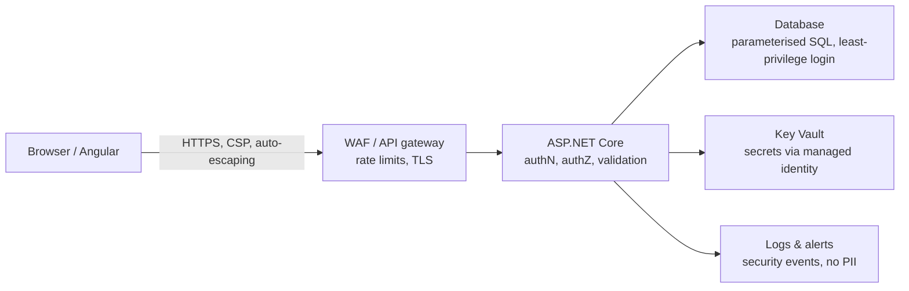

import { Tabs, TabItem, Aside } from '@astrojs/starlight/components';
import QuizBlock from '~/components/QuizBlock.astro';

## Why it matters in interviews

*"Have you heard of the OWASP Top 10? Name a few and how you'd prevent them in your API."* is one of the most common security questions in a .NET or full-stack round. The interviewer doesn't want the list recited. They want to hear that for each risk you know **what the bug looks like in your own code** (an IDOR in a controller, a `FromSqlRaw` with concatenation, `bypassSecurityTrustHtml` in Angular) and **which framework feature fixes it**.

## Core idea

OWASP (Open Worldwide Application Security Project) publishes the **Top 10**: a ranked awareness list of the most common and impactful web application risk *categories*, built from vulnerability data and a community survey. It is not a standard or a checklist. Each category groups many CWEs (concrete weakness types).

The **2021** edition is the one most interviewers and most existing material use, so learn it first. OWASP published a **2025 update**; see the note below the table.

### The 2021 list mapped to .NET and Angular

| # | Category (2021) | What it looks like | ASP.NET Core mitigation | Angular mitigation |
|---|---|---|---|---|
| A01 | **Broken Access Control** | IDOR (`/orders/42` returns someone else's order), missing `[Authorize]`, privilege escalation, CORS too open | `[Authorize]` / `RequireAuthorization()` as default (fallback policy), policies, resource-based checks, filter by owner in the query | Route guards are **UX only**; never trust hidden buttons. The API decides |
| A02 | **Cryptographic Failures** | HTTP instead of HTTPS, MD5/SHA-1 passwords, secrets in code, weak keys | HTTPS + HSTS, Identity `PasswordHasher` (PBKDF2), `AesGcm`, Data Protection API, Key Vault | No secrets in `environment.ts`; HTTPS only; don't store tokens in `localStorage` |
| A03 | **Injection** (incl. XSS) | SQL injection, command injection, LDAP, XSS | Parameterised queries, EF Core LINQ / `FromSql` interpolation, Razor auto-encoding | Angular auto-escapes bindings; avoid `bypassSecurityTrust*`; never build templates from user input |
| A04 | **Insecure Design** | No rate limit on OTP, business-logic flaws (negative quantity), no threat model | Threat modelling, rate limiting, server-side business rules, abuse cases in tests | Don't put business rules only in the client |
| A05 | **Security Misconfiguration** | Stack traces in prod, default creds, verbose errors, open storage, missing headers | `UseExceptionHandler` + ProblemDetails, environment-specific config, security headers, disable unused endpoints | Production build, CSP, no source maps with secrets, no debug tools in prod |
| A06 | **Vulnerable & Outdated Components** | Old NuGet/npm package with a known CVE | NuGet audit on restore, `dotnet list package --vulnerable`, Dependabot/Renovate | `npm audit`, keep Angular on a supported version (`ng update`) |
| A07 | **Identification & Authentication Failures** | Credential stuffing, weak passwords, no MFA, session fixation, long-lived tokens | ASP.NET Core Identity (lockout, MFA), short JWT lifetime, refresh rotation, rate limit login | OIDC library with code + PKCE; don't roll your own login |
| A08 | **Software & Data Integrity Failures** | Unsigned packages/updates, insecure deserialization, compromised CI pipeline | Avoid `BinaryFormatter` (removed in .NET 9) and `TypeNameHandling.All`; signed packages; protected pipelines | Subresource Integrity for CDN scripts, lock files (`package-lock.json`) |
| A09 | **Security Logging & Monitoring Failures** | Failed logins not logged, no alerts, logs with passwords | Structured logging of security events, App Insights alerts (AWS: CloudWatch alarms), no PII/secrets in logs | Report client errors to the backend; never log tokens |
| A10 | **Server-Side Request Forgery (SSRF)** | "Fetch this URL" feature hits `169.254.169.254` or internal admin APIs | Allowlist hosts, block private IP ranges, disable redirects, network egress rules | N/A (server-side), but don't proxy arbitrary URLs through your API |

### The 2025 update

OWASP published the **Top 10:2025** at the end of 2025. The headline changes that are widely reported:

- **Broken Access Control stays at #1**, and **SSRF is folded into it** instead of having its own slot.
- **Security Misconfiguration** moves up to #2.
- **Vulnerable & Outdated Components** is broadened into **Software Supply Chain Failures** (compromised packages, build pipelines, dependencies, not just old versions).
- A new category, **Mishandling of Exceptional Conditions**, covers bad error handling, failing open, and leaking details in errors.
- Logging is renamed toward **Security Logging & Alerting Failures**, stressing that logs without alerts don't help.

The 2025 ranking: **A01** Broken Access Control, **A02** Security Misconfiguration, **A03** Software Supply Chain Failures, **A04** Cryptographic Failures, **A05** Injection, **A06** Insecure Design, **A07** Authentication Failures, **A08** Software or Data Integrity Failures, **A09** Security Logging & Alerting Failures, **A10** Mishandling of Exceptional Conditions.

In an interview: *"I know the 2021 list best; the 2025 update keeps access control first, folds SSRF into it, and adds supply chain and exception handling categories."* That is accurate and shows you keep up. Check the exact 2025 names and ranking on owasp.org before quoting them verbatim.

### Defence in depth

No single layer stops everything. A typical .NET + Angular app layers controls like this:



## Code

### A01 Broken Access Control: the IDOR

The single most common real-world bug: the endpoint checks *"is someone logged in?"* but not *"is this **their** order?"*.

<Tabs syncKey="lang">
  <TabItem label="Vulnerable (C#)">

```csharp
// Any signed-in user can read ANY order by changing the id (IDOR).
// Also returns the full entity, leaking internal fields.
app.MapGet("/orders/{id:int}", async (int id, AppDb db) =>
    await db.Orders.FindAsync(id) is { } order ? Results.Ok(order) : Results.NotFound())
   .RequireAuthorization();
```

  </TabItem>
  <TabItem label="Fixed (C#)">

```csharp
app.MapGet("/orders/{id:int}", async (int id, ClaimsPrincipal user, AppDb db, CancellationToken ct) =>
{
    var userId = user.FindFirstValue(ClaimTypes.NameIdentifier);
    var order = await db.Orders.AsNoTracking()
        .Where(o => o.Id == id && o.CustomerId == userId)   // ownership in the query
        .Select(o => new OrderDto(o.Id, o.Total, o.Status)) // DTO, not the entity
        .FirstOrDefaultAsync(ct);
    return order is null ? Results.NotFound() : Results.Ok(order); // 404 hides existence
}).RequireAuthorization();
```

  </TabItem>
</Tabs>

Make "authenticated by default" the rule, so a forgotten attribute fails closed:

```csharp
builder.Services.AddAuthorizationBuilder()
    .SetFallbackPolicy(new AuthorizationPolicyBuilder().RequireAuthenticatedUser().Build());
// Public endpoints then opt out explicitly with [AllowAnonymous] / .AllowAnonymous().
```

### Angular: guards are not security

<Tabs syncKey="lang">
  <TabItem label="Wrong assumption (TS)">

```ts
// "The admin page is protected because of this guard."
export const adminGuard: CanActivateFn = () => inject(AuthService).isAdmin();

// Anyone can open DevTools, flip isAdmin, or call the API directly with curl.
// If /api/admin/users doesn't check the role server-side, the data is exposed.
```

  </TabItem>
  <TabItem label="Correct model (TS)">

```ts
// Guard = UX: hide screens the user can't use and avoid pointless 403s.
export const adminGuard: CanActivateFn = () => {
  const auth = inject(AuthService);
  return auth.isAdmin() || inject(Router).createUrlTree(['/forbidden']);
};
// Security = the API: [Authorize(Policy = "Admin")] on every admin endpoint.
// The client only reflects decisions the server enforces.
```

  </TabItem>
</Tabs>

### A05 / exceptional conditions: don't leak internals

<Tabs syncKey="lang">
  <TabItem label="Vulnerable (C#)">

```csharp
app.UseExceptionHandler(e => e.Run(async ctx =>
{
    var ex = ctx.Features.Get<IExceptionHandlerFeature>()?.Error;
    await ctx.Response.WriteAsync(ex?.ToString() ?? ""); // stack trace, SQL, file paths
}));
```

  </TabItem>
  <TabItem label="Fixed (C#)">

```csharp
builder.Services.AddProblemDetails();
// ...
if (!app.Environment.IsDevelopment())
{
    app.UseExceptionHandler(); // generic ProblemDetails; details go to logs only
    app.UseHsts();
}
app.UseHttpsRedirection();
```

  </TabItem>
</Tabs>

The other categories have their own deep dives: injection, XSS, CSRF, CORS and SSRF in [Web attacks](../web-attacks/), authentication failures in [Sessions, JWT & refresh tokens](../authn-authz-tokens/), cryptographic failures in [Hashing, encryption & secrets](../crypto-secrets/).

## Interview Q&A

<details>
<summary>What is the OWASP Top 10, and is it a security standard?</summary>

It is an **awareness document**: the ten most critical web application risk categories, ranked using vulnerability data from many organisations plus a community survey. It is not a standard or a complete checklist. For a verifiable standard, OWASP has the **ASVS** (Application Security Verification Standard). The Top 10 is a good starting point for code reviews and training.
</details>

<details>
<summary>Why is Broken Access Control #1, and how do you prevent it in ASP.NET Core?</summary>

Because it is everywhere and frameworks can't fix it for you: the framework knows *who* the user is, but only your code knows *which rows they own*. Prevent it with: a **fallback policy** requiring authentication, **policies** for roles/scopes, **resource-based authorization** (`IAuthorizationService.AuthorizeAsync(user, order, "SameOwner")`) or filtering by owner in the query, DTOs instead of entities, and **integration tests** that call endpoints as another user and expect 403/404.
</details>

<details>
<summary>What is an IDOR?</summary>

Insecure Direct Object Reference: the API uses an identifier from the request (`/invoices/1001`) and returns the object without checking the caller may access it. Changing the number reveals other users' data. GUIDs make guessing harder but are **not** a fix. The fix is an authorization check on every access.
</details>

<details>
<summary>Is XSS still in the Top 10?</summary>

Yes. Since 2021, XSS is part of **A03 Injection**: it is HTML/JavaScript injection into a page. In Angular, interpolation and property binding are escaped or sanitized automatically, so XSS usually comes from `bypassSecurityTrustHtml`, direct DOM APIs (`ElementRef.nativeElement.innerHTML`), or server-rendered pages.
</details>

<details>
<summary>How do you handle "Vulnerable and Outdated Components" in a .NET + Angular project?</summary>

Automate it. NuGet audit warns on restore about known-vulnerable packages, `dotnet list package --vulnerable --include-transitive` lists them, `npm audit` does the same for the front end. Enable Dependabot or Renovate to raise update PRs, fail CI on high-severity findings, generate an SBOM, and keep .NET and Angular on supported versions.
</details>

<details>
<summary>What changed in the OWASP Top 10:2025?</summary>

Broken Access Control is still #1 and now includes SSRF. Security Misconfiguration moved up. Outdated components became the broader **Software Supply Chain Failures**, and a new category covers **mishandling exceptional conditions** (failing open, leaking errors). Most interview material still uses 2021, so know that list and mention the 2025 changes.
</details>

<details>
<summary>What is "insecure design", and how is it different from a bug?</summary>

A bug is a correct design implemented wrongly. Insecure design means the control was never designed: a password-reset flow with no rate limit, a coupon that can be applied unlimited times, an OTP with 4 digits and no lockout. You catch it with **threat modelling** (for example STRIDE) during design and abuse-case tests, not with code scanning.
</details>

<details>
<summary>Your API returns the full exception message to clients. Which category is that, and why does it matter?</summary>

Security Misconfiguration (2021), and in 2025 also the new exceptional-conditions category. Stack traces reveal framework versions, SQL, table names and file paths that help attackers. Return a generic **ProblemDetails** with a correlation id, log the details server-side, and keep the developer exception page to the Development environment.
</details>

## Pitfalls

<Aside type="caution" title="Common mistakes">

- Treating **Angular route guards** or hidden buttons as access control. Every API endpoint must enforce authorization.
- Checking **roles but not ownership**: `[Authorize]` passes, but user A can still read user B's data.
- Returning **EF entities** directly, which leaks fields and allows over-posting (mass assignment).
- Assuming **GUID ids** prevent IDOR. They reduce guessing, nothing more.
- Leaving **developer exception pages**, Swagger UI or debug endpoints open in production.
- Quoting the Top 10 as a **complete checklist**. Use ASVS for verification, threat modelling for design.
- Ignoring **transitive** packages when scanning dependencies.

</Aside>

## Related

- [SQLi, XSS, CSRF, CORS & SSRF](../web-attacks/)
- [Sessions, JWT & Refresh Tokens](../authn-authz-tokens/)
- [Secure Coding Checklist](../secure-coding-checklist/)
- [ASP.NET Core Authentication & Authorization](../../aspnet/authentication-authorization/)
- [Angular Security](../../angular/security/)

## Quick quiz

<QuizBlock section="security" topic="owasp-top-10" />
