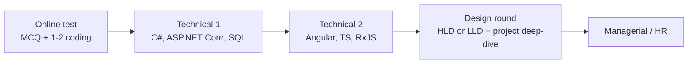

import { Steps, Aside } from '@astrojs/starlight/components';

## What a 3–4 year .NET + Angular loop looks like

Service companies often merge the technical rounds and skip system design. Product companies add a DSA round and a deeper design round. This site covers both.

## 4-week plan (about 2 hours a day)

| Week | Focus | Daily routine |
|------|-------|---------------|
| 1 | **C# & .NET runtime**, **ASP.NET Core** | 2–3 topics + quick quizzes. 2 DSA problems (arrays, hashing, strings). |
| 2 | **EF Core & SQL**, **Angular** | 2–3 topics. Write 3 SQL queries by hand. 2 DSA problems (two pointers, stack, linked list). |
| 3 | **TypeScript/JS**, **Design patterns**, **System design**, **Microservices** | 1 HLD case study every 2 days. 2 DSA problems (trees, BFS/DFS, binary search). |
| 4 | **Security**, **Testing/Docker/K8s**, **Fundamentals**, **Behavioral** | Mock test every other day. Drill weak areas. Rehearse project walkthrough and STAR stories out loud. |

At the end of each week, take the section tests for that week and aim for 80% or more.

## 1-week crash plan

<Steps>

1. **Day 1:** async/await, DI lifetimes, middleware pipeline, LINQ (deferred execution, IQueryable), value vs reference types.
2. **Day 2:** EF Core tracking, N+1, loading strategies, indexes, joins, window functions, isolation levels.
3. **Day 3:** Angular change detection, signals, RxJS higher-order operators, DI, routing guards, forms.
4. **Day 4:** SOLID, common patterns (Repository, Strategy, Factory, Decorator), JWT/OAuth flow, OWASP basics.
5. **Day 5:** System design fundamentals + URL shortener + notification system. Microservices messaging basics.
6. **Day 6:** DSA patterns (two pointers, sliding window, hashing, BFS/DFS). Two mock tests.
7. **Day 7:** Behavioral stories, project walkthrough, weak-area drill, flashcards.

</Steps>

## Last 48 hours

<Aside type="tip">
Don't learn new topics now. Revise, rehearse and sleep.
</Aside>

- Re-read the **cheat sheets** for the core stack sections.
- Run the **weak areas** drill until it is empty.
- Say your **"tell me about yourself"** and **project walkthrough** out loud twice. Time them: 90 seconds and 5 minutes.
- Prepare **3 questions to ask** the interviewer.
- Check your setup: camera, mic, IDE, a blank whiteboard tool for design rounds.

## How to answer technical questions

1. **Define** it in one sentence.
2. **Why it exists**: the problem it solves.
3. **How it works**: one level deeper than the definition.
4. **Example** from your project or a short code sketch.
5. **Trade-offs / when not to use it.**

Interviewers at 3–4 years look for points 3–5. Definitions alone sound like a fresher.
