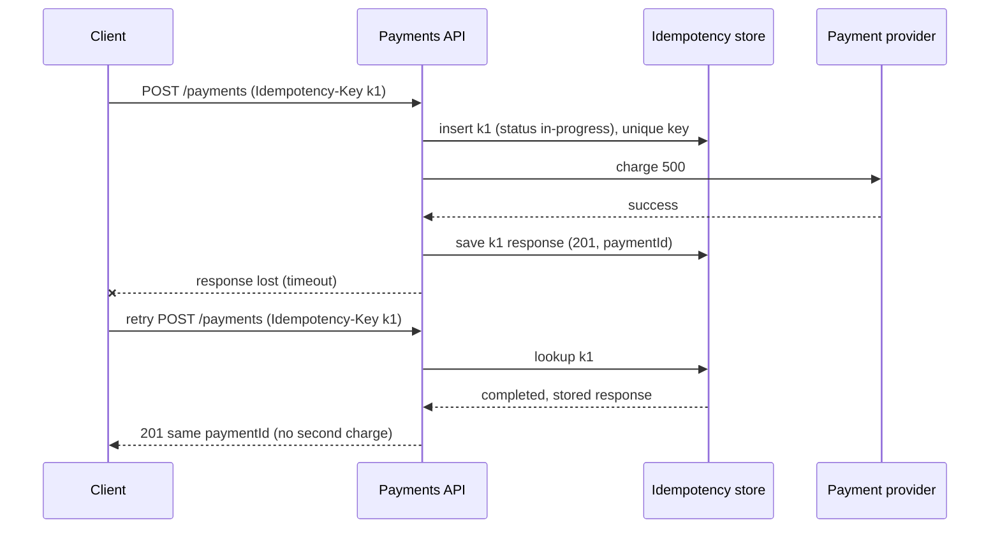
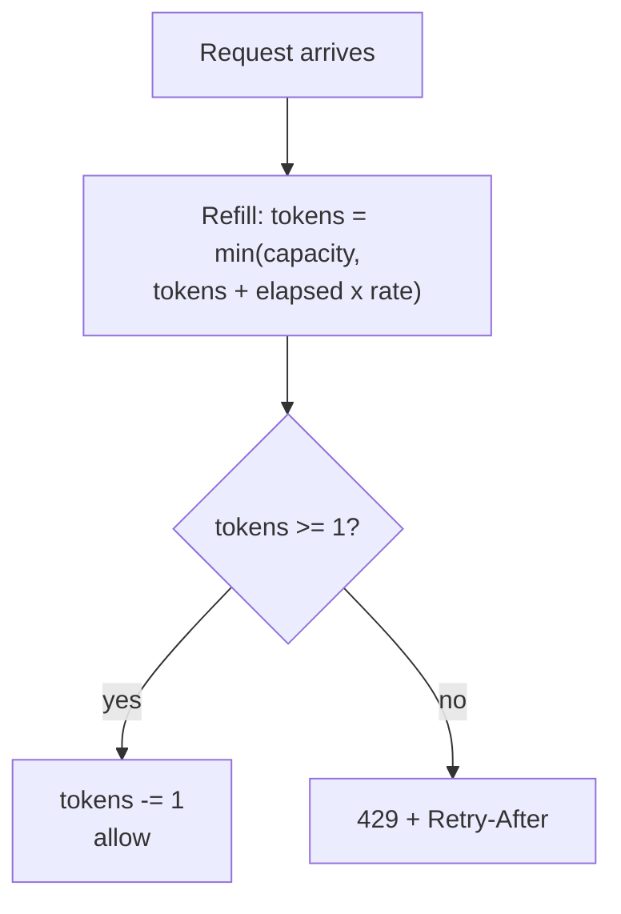
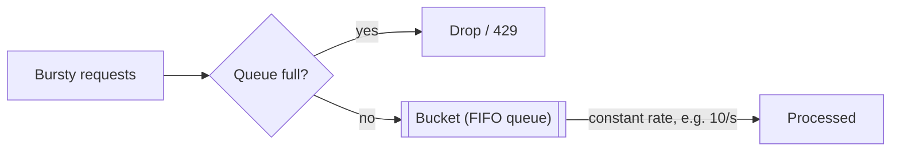
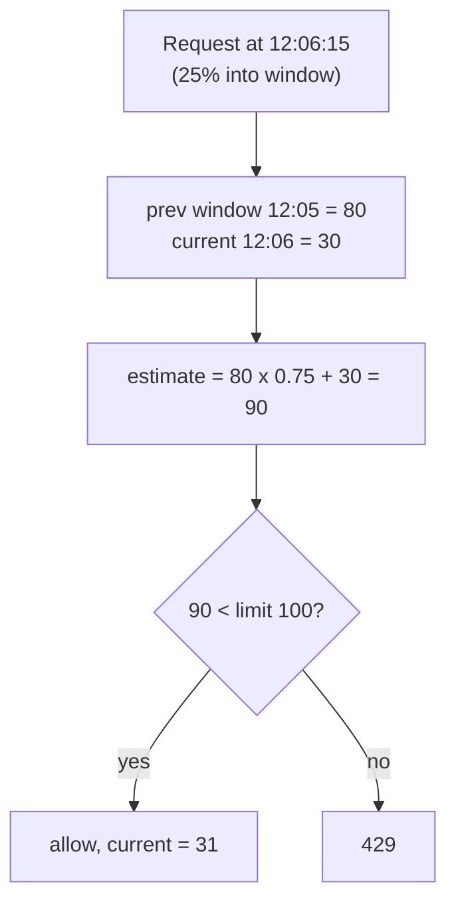

import { Tabs, TabItem, Aside } from '@astrojs/starlight/components';
import QuizBlock from '~/components/QuizBlock.astro';

## Why it matters in interviews

The API step of the design framework is where you show you think about clients: *"which protocol, how do you paginate a feed, what if the client retries a payment?"*. Rate limiting is both a standard deep dive and a full case study on its own, and *"explain token bucket vs sliding window"* is one of the most common system design questions at this level.

## Core idea

### Choosing the protocol

| | REST (JSON over HTTP) | gRPC | GraphQL | WebSockets | Server-Sent Events |
|---|---|---|---|---|---|
| Style | Resources + verbs | Remote procedure calls, Protobuf contracts | Client picks fields from one schema | Full-duplex socket | Server pushes over HTTP |
| Transport | HTTP/1.1 or 2 | HTTP/2 | HTTP | Upgraded TCP connection | HTTP (long-lived response) |
| Strengths | Universal, cacheable, easy to debug | Fast binary, streaming, strong typing, codegen | No over/under-fetching, one round trip for nested data | Low-latency both ways | Simple one-way push, auto-reconnect |
| Weaknesses | Over-fetching, chatty for nested data | Limited browser support (needs gRPC-Web) | HTTP caching is harder, query cost control, N+1 in resolvers | Stateful connections, scaling needs a backplane | Server to client only |
| Fits | Public APIs, CRUD, SPAs | Service-to-service, internal, low latency | Many clients with different data needs (mobile + web) | Chat, live collaboration, games | Live scores, notifications, progress |

A safe interview default: **REST for the public/SPA API, gRPC between internal services if latency matters, WebSockets (SignalR) or SSE only for real-time features.** More in [SignalR, gRPC & GraphQL](../../aspnet/signalr-grpc/) and [REST API design](../../aspnet/rest-api-design/).

### Pagination: offset vs cursor

```sql
-- Offset: simple, supports "page 37", but the DB still reads and discards 720 rows,
-- and inserts between requests shift rows (duplicates or gaps).
SELECT * FROM Orders WHERE UserId = @u ORDER BY CreatedAt DESC, Id DESC
OFFSET 720 ROWS FETCH NEXT 20 ROWS ONLY;

-- Cursor (keyset): the cursor encodes the last row seen. Index seek, stable under inserts.
SELECT TOP (20) * FROM Orders
WHERE UserId = @u AND (CreatedAt < @lastCreatedAt OR (CreatedAt = @lastCreatedAt AND Id < @lastId))
ORDER BY CreatedAt DESC, Id DESC;
```

| | Offset / page number | Cursor / keyset |
|---|---|---|
| Deep pages | Gets slower (scans skipped rows) | Constant cost with an index |
| Concurrent inserts | Duplicates or skipped items | Stable |
| Jump to page N | Yes | No, only next/previous |
| Total count | Easy (but `COUNT(*)` is costly on big tables) | Usually omitted |
| Fits | Admin grids, small data sets | Feeds, infinite scroll, large tables, public APIs |

Return the cursor as an **opaque** token (base64 of the last sort key) so clients cannot build their own and you can change the format later.

### Idempotency keys

Networks fail after the server has done the work: the client times out, retries, and a non-idempotent `POST /payments` charges twice. The client sends a unique `Idempotency-Key` header per logical operation; the server stores the key with the result and replays it on retries.



Details that interviewers like: scope keys per client/user, store a hash of the request body and reject the same key with a different body (422), return 409 if the first request is still in progress, expire keys after a retention window (for example 24 hours), and write the key in the same transaction as the business change when possible.

### Rate limiting

Rate limiting protects the system from abuse, enforces fair use between tenants, and controls cost. It usually sits at the **edge**: API gateway such as Azure API Management (AWS: API Gateway usage plans), Azure Front Door WAF rate-limit rules (AWS: WAF rate-based rules), and/or in the app. Rejected requests get **429 Too Many Requests** with a `Retry-After` header.

**Token bucket**: a bucket holds up to `capacity` tokens and refills at `r` tokens per second. Each request takes a token; no token, rejected. Allows **bursts** up to capacity while enforcing the average rate. The most common choice.



**Leaky bucket**: requests enter a fixed-size queue that drains at a constant rate. Output is perfectly smooth, but bursts wait (or are dropped when the queue is full). Good for protecting a downstream that needs a steady rate.



**Fixed window counter**: count requests per key in fixed windows (`user:42:12:05` for minute 12:05); reject over the limit. Cheap (one `INCR` with expiry), but a client can send the full limit at 12:05:59 and again at 12:06:00: **up to 2x the limit** across the boundary.

**Sliding window log**: store each request timestamp (a Redis sorted set), drop entries older than the window, count the rest. Exact, but memory grows with the limit.

**Sliding window counter**: keep the current and previous fixed-window counts and weight the previous one by how much of it still overlaps:

```text
estimate = previous_count x (1 - elapsed_fraction_of_current_window) + current_count
```

Close to exact with only two counters per key. A good default for distributed limits.



| Algorithm | Bursts | Memory per key | Accuracy | Typical use |
|---|---|---|---|---|
| Token bucket | Allowed up to capacity | 2 values | Good | Public APIs, per-user limits |
| Leaky bucket | Smoothed (queued) | Queue | Good | Shaping traffic to a fragile downstream |
| Fixed window | Up to 2x at edges | 1 counter | Approximate | Simple quotas |
| Sliding log | No | One entry per request | Exact | Low limits, strict enforcement |
| Sliding counter | Minimal | 2 counters | Very close | Distributed limits at scale |

**Distributed limits**: with several API instances, per-instance counters let a client get N x the limit. Keep counters in Redis and make check-and-increment **atomic** (a Lua script or `INCR` + `EXPIRE`). The full design is in the [distributed rate limiter case study](../case-rate-limiter/).

## Code

<Tabs syncKey="ratelimit">
  <TabItem label="Token bucket (C#)">

```csharp
// In-memory token bucket for a single key. TimeProvider makes it testable.
public sealed class TokenBucket(int capacity, double refillPerSecond, TimeProvider clock)
{
    private readonly Lock _gate = new();          // .NET 9+; use object on .NET 8
    private double _tokens = capacity;
    private long _lastRefill = clock.GetTimestamp();

    public bool TryTake(int cost = 1)
    {
        lock (_gate)
        {
            var now = clock.GetTimestamp();
            var elapsed = clock.GetElapsedTime(_lastRefill, now).TotalSeconds;
            _tokens = Math.Min(capacity, _tokens + elapsed * refillPerSecond);
            _lastRefill = now;

            if (_tokens < cost) return false;      // caller returns 429
            _tokens -= cost;
            return true;
        }
    }
}
```

  </TabItem>
  <TabItem label="ASP.NET Core built-in limiter">

```csharp
builder.Services.AddRateLimiter(o =>
{
    o.RejectionStatusCode = StatusCodes.Status429TooManyRequests;
    // Partition per user (or IP for anonymous): each partition gets its own bucket.
    o.AddPolicy("per-user", ctx => RateLimitPartition.GetTokenBucketLimiter(
        ctx.User.Identity?.Name ?? ctx.Connection.RemoteIpAddress?.ToString() ?? "anon",
        _ => new TokenBucketRateLimiterOptions
        {
            TokenLimit = 100,                         // burst size
            TokensPerPeriod = 20,
            ReplenishmentPeriod = TimeSpan.FromSeconds(1),
            QueueLimit = 0                            // reject instead of queueing
        }));
});

app.UseRateLimiter();
app.MapGet("/api/orders", GetOrders).RequireRateLimiting("per-user");
// Note: these limiters are in-memory per instance. Use Redis or the gateway for global limits.
```

  </TabItem>
</Tabs>

## Interview Q&A

<details>
<summary>REST vs gRPC: when do you choose gRPC?</summary>

For internal service-to-service calls where latency and payload size matter, where you want strict contracts with generated clients, or where you need streaming. REST stays the default for public APIs and browser clients because of universal tooling, HTTP caching and easy debugging. gRPC in the browser needs gRPC-Web.
</details>

<details>
<summary>Why is cursor pagination preferred for a feed?</summary>

Offset pagination gets slower on deep pages because the database still walks the skipped rows, and new items inserted at the top shift everything, so users see duplicates or miss items. A cursor (the last seen sort key) turns each page into an index seek and is stable under inserts. The trade-off is no jumping to an arbitrary page.
</details>

<details>
<summary>How do idempotency keys work and where do you store them?</summary>

The client generates a unique key per logical operation and resends it on retries. The server records the key (unique constraint) with the request hash and the response; a retry with the same key gets the stored response instead of a second execution. Store them in the main database, ideally in the same transaction as the side effect, or in Redis with a TTL for less critical cases.
</details>

<details>
<summary>Token bucket vs leaky bucket?</summary>

Token bucket allows bursts up to the bucket size while enforcing an average rate, which suits user-facing APIs. Leaky bucket queues requests and releases them at a constant rate, which smooths traffic for a downstream that cannot handle bursts. Token bucket rejects excess immediately; leaky bucket delays it until the queue is full.
</details>

<details>
<summary>What is the problem with a fixed window rate limiter?</summary>

Boundary bursts. With 100 requests per minute, a client can send 100 at 12:00:59 and 100 more at 12:01:00, so 200 requests hit in about one second. Sliding window log or sliding window counter fixes it; the counter version is nearly as accurate with constant memory.
</details>

<details>
<summary>You have 10 API instances behind a load balancer. How do you enforce 100 requests/minute per user?</summary>

Per-instance limits would allow up to 1,000. Keep the counter in a shared store such as Redis, keyed by user and window, and update it atomically (Lua script or `INCR` with expiry). Alternatively enforce it at the gateway (API Management, AWS API Gateway). Decide the failure mode: if Redis is down, fail open (allow) for availability or fail closed for strict protection.
</details>

<details>
<summary>What should a rate-limited response look like?</summary>

HTTP 429 Too Many Requests, a `Retry-After` header (seconds or a date), and ideally headers telling clients their limit and remaining quota. Many APIs use `X-RateLimit-Limit` / `X-RateLimit-Remaining`, and the IETF has a draft for standard `RateLimit` headers. Clients should back off with jitter instead of retrying immediately.
</details>

<details>
<summary>Which operations need idempotency keys if HTTP already defines idempotent methods?</summary>

GET, PUT and DELETE are idempotent by definition, so a retry is safe if implemented correctly. POST (create order, charge card) and sometimes PATCH are not, so they need keys. In practice anything that moves money, sends a message or creates a resource should accept one.
</details>

## Pitfalls

<Aside type="caution" title="Common mistakes">

- **Rate limiting per instance** and assuming it is global.
- **Fixed windows** where boundary bursts matter, without acknowledging the 2x problem.
- **Non-atomic check-then-increment** in Redis: concurrent requests all pass the check.
- **Offset pagination on a large, changing table**: slow deep pages, duplicates and gaps.
- **Idempotency keys without a request hash**: a reused key with a different body silently returns the wrong result.
- **Limiting only by IP**: users behind one corporate NAT share a limit, and attackers rotate IPs. Prefer user or API key when authenticated.

</Aside>

## Related

- [Case study: distributed rate limiter](../case-rate-limiter/)
- [Rate limiting & health checks in ASP.NET Core](../../aspnet/rate-limiting-health-checks/)
- [REST API design](../../aspnet/rest-api-design/)
- [Delivery guarantees & idempotency](../../microservices/delivery-guarantees/)

## Quick quiz

<QuizBlock section="system-design" topic="api-design-rate-limiting" />
