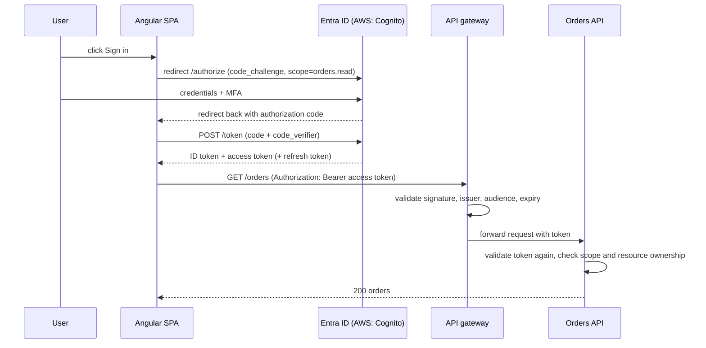
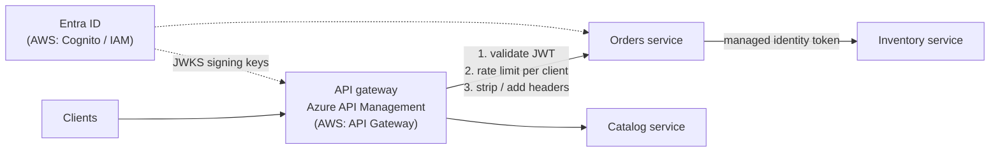

import { Aside } from '@astrojs/starlight/components';
import QuizBlock from '~/components/QuizBlock.astro';

## Why it matters in interviews

In design rounds auth rarely gets its own question, but it shows up in every diagram: *"where is the user authenticated?"*, *"how does service A call service B?"*, *"where do the connection strings live?"*. A clear, standard answer (identity provider, OIDC, tokens validated at the gateway **and** the service, managed identities, Key Vault) takes two minutes and signals maturity. The protocol details live in the security section; this page is about **where auth sits in an architecture**.

## Core idea

### Sessions vs tokens at scale

| | Server-side session (cookie + session store) | Self-contained token (JWT access token) |
|---|---|---|
| State | Session data on the server (Redis/DB), cookie holds an ID | Claims inside the signed token, server stores nothing |
| Horizontal scaling | Needs a shared session store (or sticky sessions) | Any instance validates the signature locally |
| Revocation | Instant: delete the session | Hard: valid until expiry, unless you add a denylist |
| Per-request cost | Store lookup (~1 ms to Redis) | Signature check (CPU only) |
| Size | Small cookie | Larger header (claims), grows with roles |
| Best for | Server-rendered apps, the BFF pattern | APIs, service-to-service, many independent resource servers |

The usual compromise: **short-lived access tokens** (minutes) plus **refresh tokens** that the identity provider can revoke, so revocation takes effect within one access-token lifetime. Details on storage and rotation are in [sessions, JWT & refresh tokens](../../security/authn-authz-tokens/).

### OAuth2 / OIDC with an identity provider

Do not build login, password storage and MFA yourself. Use an identity provider: Microsoft Entra ID for employees, Entra External ID for customers (AWS: Amazon Cognito), or Auth0 / Okta / Keycloak. **OIDC** handles authentication (an ID token about the user); **OAuth 2.0** handles delegated authorisation (an access token for an API). An Angular SPA uses **authorization code flow with PKCE**.



The API trusts the IdP by downloading its **public signing keys** (from the OIDC discovery document / JWKS endpoint) and validating tokens locally, with no call to the IdP per request. Full flow details: [OAuth 2.0 & OpenID Connect](../../security/oauth-oidc/).

**BFF (backend for frontend)** alternative: the SPA talks to its own backend with an HttpOnly cookie, and the BFF holds the tokens server-side. It keeps tokens out of browser JavaScript, at the cost of a stateful component.

### Auth at the API gateway



The gateway does **coarse-grained** checks: is the token valid, is the client subscribed, is it within its rate limit. API Management has a `validate-jwt` policy; AWS API Gateway has JWT and Lambda authorizers. Services still do **fine-grained** authorisation (does this user own order 42?) and should still validate the token: a gateway-only check fails open the moment someone reaches a service directly through a misconfigured network path. This is **defence in depth** (zero trust).

### Service-to-service auth

| Approach | How | When |
|---|---|---|
| Managed identity / IAM role | The platform gives the workload an identity; it gets tokens without any stored secret | Calling Azure services (SQL, Key Vault, Service Bus, Storage) or your own APIs on Azure (AWS: IAM roles for EC2/ECS tasks, IRSA / EKS Pod Identity) |
| OAuth2 client credentials | Service A authenticates as itself to the IdP, gets a token for service B's audience | Your own APIs, cross-cloud, third parties |
| mTLS | Both sides present certificates | Service mesh (Istio, Linkerd), zero-trust networks |
| API keys | Static shared secret in a header | Simple partner integrations; rotate and scope them; weakest option |

On AKS, **workload identity** federates a Kubernetes service account with an Entra identity, so pods get tokens without secrets. The goal everywhere: **no long-lived secrets in config**.

### Secrets

- Store secrets in Azure Key Vault (AWS: Secrets Manager, or SSM Parameter Store; KMS for encryption keys).
- The app reads them with its **managed identity**, so there is no "secret to read the secret".
- Better still, remove the secret: use Entra authentication to Azure SQL, Service Bus and Storage instead of connection strings with keys.
- App Service and Functions support **Key Vault references** in app settings; Kubernetes can mount secrets with the Secrets Store CSI driver.
- Rotate secrets, keep separate vaults per environment, never log tokens or connection strings, and keep secrets out of Git (user secrets locally, pipeline secret variables in CI).

## Code

API validating Entra ID tokens, a scope policy, and secrets via managed identity:

```csharp
var builder = WebApplication.CreateBuilder(args);
var credential = new DefaultAzureCredential();   // managed identity in Azure, dev login locally

// Secrets from Key Vault; no secret needed to reach the vault.
builder.Configuration.AddAzureKeyVault(new Uri(builder.Configuration["KeyVault:Uri"]!), credential);

builder.Services.AddAuthentication(JwtBearerDefaults.AuthenticationScheme)
    .AddJwtBearer(o =>
    {
        o.Authority = $"https://login.microsoftonline.com/{builder.Configuration["Entra:TenantId"]}/v2.0";
        o.Audience = builder.Configuration["Entra:Audience"];   // e.g. the API's client ID
        o.MapInboundClaims = false;                              // keep "scp", "roles" as-is
    });

builder.Services.AddAuthorizationBuilder()
    .AddPolicy("orders.read", p => p.RequireAssertion(ctx =>
        ctx.User.FindFirst("scp")?.Value.Split(' ').Contains("Orders.Read") == true));

// Azure SQL without a password: "Server=...;Database=...;Authentication=Active Directory Default"
```

```csharp
// Service-to-service: get a token for the Inventory API with the app's own identity.
public sealed class InventoryClient(HttpClient http, TokenCredential credential)
{
    public async Task<int> GetStockAsync(string sku, CancellationToken ct)
    {
        var token = await credential.GetTokenAsync(
            new TokenRequestContext(["api://inventory-api/.default"]), ct);
        using var req = new HttpRequestMessage(HttpMethod.Get, $"/stock/{sku}");
        req.Headers.Authorization = new AuthenticationHeaderValue("Bearer", token.Token);
        using var res = await http.SendAsync(req, ct);
        res.EnsureSuccessStatusCode();
        return await res.Content.ReadFromJsonAsync<int>(ct);
    }
}
```

The Azure Identity credentials cache tokens in memory, so calling `GetTokenAsync` per request does not hit Entra ID each time.

## Interview Q&A

<details>
<summary>Sessions or JWTs for a horizontally scaled API?</summary>

Both work. Sessions need a shared store such as Redis, cost a lookup per request, and can be revoked instantly. JWTs are validated locally by any instance with no shared state, but cannot be revoked before expiry. For APIs consumed by SPAs and other services, short-lived JWT access tokens plus revocable refresh tokens is the common choice; for a server-rendered app or BFF, cookie sessions are simpler.
</details>

<details>
<summary>How do you revoke a JWT?</summary>

You cannot "un-sign" it, so keep access tokens short-lived (5-15 minutes) and revoke the refresh token at the IdP; the user loses access at the next refresh. For immediate revocation, check a denylist of token IDs (`jti`) or a per-user "tokens valid after" timestamp in a fast store, which reintroduces a lookup.
</details>

<details>
<summary>If the API gateway validates tokens, do services need to?</summary>

Yes. The gateway handles coarse checks and rate limits, but services must still validate tokens and enforce fine-grained authorisation (resource ownership, roles). Otherwise anything that reaches a service without passing through the gateway is fully trusted. Defence in depth is the expected answer.
</details>

<details>
<summary>How should a background worker authenticate to Azure SQL and Service Bus?</summary>

With a managed identity (AWS: an IAM role attached to the task or instance). Grant that identity the minimal data-plane roles, and use Entra authentication in the connection (`Authentication=Active Directory Default` for SQL, `DefaultAzureCredential` for the Service Bus client). There is no password or key to store or rotate.
</details>

<details>
<summary>Which OAuth flow does an Angular SPA use, and which does a backend job use?</summary>

The SPA uses authorization code flow with PKCE, because it is a public client that cannot keep a secret. A backend job with no user uses client credentials, authenticating as itself, ideally with a managed identity or certificate instead of a client secret. The implicit flow is deprecated.
</details>

<details>
<summary>Where do you store secrets in a cloud architecture?</summary>

In a managed secret store: Azure Key Vault (AWS: Secrets Manager), accessed via the app's managed identity, with separate vaults per environment and rotation. Prefer eliminating secrets entirely with identity-based access. Never in source control, container images or plain app settings.
</details>

<details>
<summary>How do you design multi-tenant authorisation?</summary>

Put the tenant ID in the token (a claim from the IdP or a mapping on first login), and enforce it on every query: an EF Core global query filter on `TenantId`, row-level security in SQL, or a partition key per tenant. Never trust a tenant ID from the URL or body without matching it against the token.
</details>

## Pitfalls

<Aside type="caution" title="Common mistakes">

- **Validating tokens only at the gateway** and trusting everything behind it.
- **Long-lived access tokens** (hours or days) with no revocation story.
- **Connection strings with passwords or storage keys** in appsettings when managed identity is available.
- **Accepting tokens without checking audience and issuer**: a token issued for another API gets accepted.
- **Rolling your own login and password storage** instead of using an identity provider.
- **Putting large role lists in the JWT**: headers grow until proxies reject them. Use groups/app roles carefully or look permissions up.

</Aside>

## Related

- [OAuth 2.0 & OpenID Connect](../../security/oauth-oidc/)
- [Sessions, JWT & refresh tokens](../../security/authn-authz-tokens/)
- [Hashing, encryption & secrets](../../security/crypto-secrets/)
- [Authentication & authorization in ASP.NET Core](../../aspnet/authentication-authorization/)

## Quick quiz

<QuizBlock section="system-design" topic="auth-in-design" />
