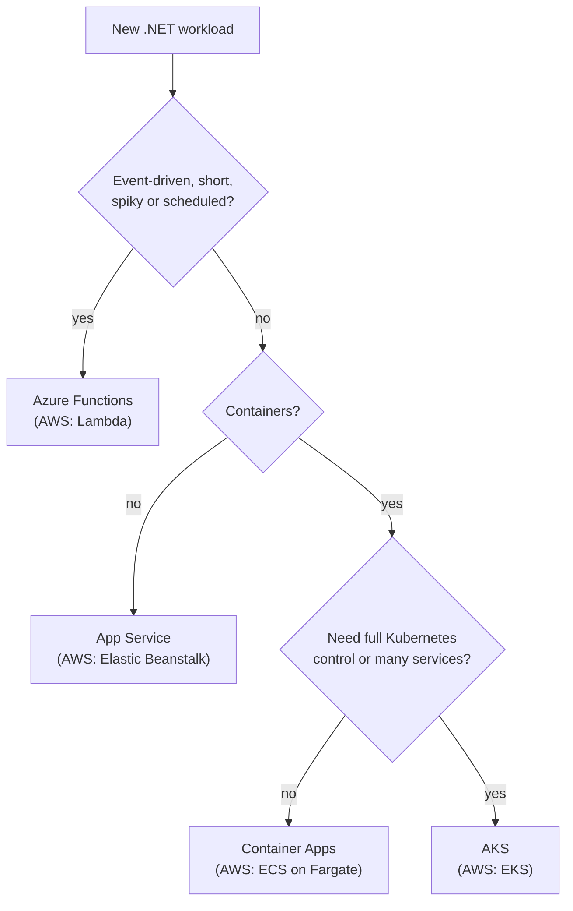
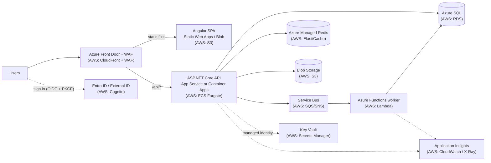

import { Aside } from '@astrojs/starlight/components';
import QuizBlock from '~/components/QuizBlock.astro';

## Why it matters in interviews

Design interviews are cloud-agnostic in theory, but naming a concrete managed service for each box makes a design credible and shows you have shipped something. As a .NET developer you are expected to know the Azure options; many companies run on AWS, so being able to say *"Service Bus, or SQS/SNS on AWS"* without hesitation is a real advantage. Interviewers also ask *"App Service vs AKS vs Functions: which and why?"*.

## Core idea

Pick **managed services by default** (less to operate), and know the one-line reason for each. The mappings are approximate: services overlap differently on each cloud.

### Compute

| Azure | AWS equivalent | Use when |
|---|---|---|
| App Service | Elastic Beanstalk; ECS on Fargate (or ECS Express Mode) for containers | Web apps and APIs with minimal ops: deployment slots, autoscale, easy TLS |
| Azure Container Apps | ECS on Fargate, ECS Express Mode | Containerised APIs and workers without managing Kubernetes; scale to zero and KEDA scale rules |
| AKS (Azure Kubernetes Service) | EKS | Many services, need full Kubernetes control, existing K8s skills |
| Azure Functions | Lambda | Event-driven, spiky or scheduled work: queue triggers, blob triggers, timers |
| Virtual Machines / VM Scale Sets | EC2 / Auto Scaling groups | Lift-and-shift, special OS needs, full control |
| Static Web Apps (or Blob static website + Front Door) | Amplify Hosting (or S3 + CloudFront) | Hosting the Angular SPA |

### Data and storage

| Azure | AWS equivalent | Use when |
|---|---|---|
| Azure SQL Database (incl. Hyperscale) | RDS for SQL Server; Aurora for cloud-native relational | Relational, transactional workloads; .NET + EF Core default |
| Azure SQL Managed Instance | RDS for SQL Server (or SQL Server on EC2) | Near-full SQL Server compatibility for migrations (Agent jobs, cross-DB queries) |
| Azure Database for PostgreSQL | RDS / Aurora PostgreSQL | Open-source relational |
| Cosmos DB | DynamoDB (DocumentDB for the MongoDB API) | Global distribution, massive key-based scale, tunable consistency |
| Azure Managed Redis (successor to Azure Cache for Redis) | ElastiCache (Redis OSS / Valkey), MemoryDB | Caching, sessions, rate-limit counters, leaderboards |
| Blob Storage | S3 | Files, images, backups, data lake storage |
| Azure Files | EFS, FSx | Shared file system (SMB/NFS) for legacy apps |
| Azure AI Search | OpenSearch Service | Full-text and vector search |

### Messaging and integration

| Azure | AWS equivalent | Use when |
|---|---|---|
| Service Bus (queues, topics) | SQS (queues), SNS (topics), Amazon MQ | Business messaging: commands, events, sessions for ordering, DLQ, scheduled messages |
| Storage Queues | SQS | Simple, cheap, high-volume work queues |
| Event Grid | EventBridge | Reacting to events (BlobCreated, resource events, custom events) with push delivery |
| Event Hubs | Kinesis Data Streams, MSK (managed Kafka) | High-throughput streaming and telemetry with replay; Kafka-compatible endpoint |
| Durable Functions / Logic Apps | Step Functions | Workflows and orchestrations |
| Azure SignalR Service | API Gateway WebSocket APIs, AppSync | Real-time push to many clients at scale |

### Networking and delivery

| Azure | AWS equivalent | Use when |
|---|---|---|
| Virtual Network (VNet), NSGs | VPC, security groups / NACLs | Network isolation |
| Azure Load Balancer | Network Load Balancer | L4 load balancing |
| Application Gateway (+ WAF) | Application Load Balancer (+ AWS WAF) | Regional L7 routing, TLS termination |
| Azure Front Door (+ WAF) | CloudFront (+ AWS WAF), Global Accelerator for non-HTTP | Global entry point, CDN, edge TLS, failover between regions |
| Traffic Manager, Azure DNS | Route 53 | DNS-based routing and failover |
| API Management | API Gateway | Auth, quotas, rate limits, versioning, developer portal |
| Private Link / Private Endpoint | PrivateLink / VPC endpoints | Reach PaaS services over a private IP |

### Identity, security and observability

| Azure | AWS equivalent | Use when |
|---|---|---|
| Microsoft Entra ID | IAM Identity Center (workforce), IAM | Employee sign-in, app registrations, RBAC |
| Entra External ID | Cognito | Customer sign-up / sign-in for your app |
| Managed identity | IAM roles (instance profiles, ECS task roles, EKS Pod Identity / IRSA) | Workloads calling cloud services without secrets |
| Key Vault | Secrets Manager, KMS (keys), ACM (certificates) | Secrets, keys, certificates |
| Microsoft Defender for Cloud | Security Hub, GuardDuty | Security posture and threat detection |
| Azure Monitor, Application Insights, Log Analytics | CloudWatch (metrics, logs), X-Ray / CloudWatch Application Signals | Logs, metrics, distributed tracing, alerts |
| Azure Container Registry | ECR | Container images |
| Bicep / ARM (or Terraform) | CloudFormation / CDK (or Terraform) | Infrastructure as code |

### Choosing compute



For a typical product with one API and an Angular front end, App Service or Container Apps is the right answer; AKS is justified by many services and a team that can operate it. More on deployment options in [deploying to Azure (and AWS)](../../testing-devops/cloud-deployment/).

### Reference architecture: .NET API + Angular SPA on Azure



How to talk through it: Front Door is the single global entry with WAF and caching for the SPA bundles; the API is stateless and autoscaled; the API reaches SQL, Redis, Blob and Service Bus with its managed identity, ideally over private endpoints; slow work (emails, image processing, exports) goes through Service Bus to a Functions worker; everything sends OpenTelemetry data to Application Insights. Add a second region with SQL failover groups and Front Door health probes when the availability target requires it.

## Code

Wiring the reference architecture's clients in `Program.cs` with one identity and no secrets:

```csharp
var builder = WebApplication.CreateBuilder(args);
var credential = new DefaultAzureCredential();   // managed identity in Azure

// Microsoft.Extensions.Azure: register SDK clients for DI, all using the managed identity.
builder.Services.AddAzureClients(clients =>
{
    clients.AddBlobServiceClient(new Uri(builder.Configuration["Storage:BlobUri"]!));
    clients.AddServiceBusClientWithNamespace(builder.Configuration["ServiceBus:Namespace"]!);
    clients.UseCredential(credential);
});

// Azure SQL with Entra auth: "...;Authentication=Active Directory Default"
builder.Services.AddDbContext<AppDbContext>(o =>
    o.UseSqlServer(builder.Configuration.GetConnectionString("Sql")));

builder.Services.AddStackExchangeRedisCache(o =>
    o.Configuration = builder.Configuration.GetConnectionString("Redis"));

// Traces, metrics and logs to Application Insights via OpenTelemetry.
builder.Services.AddOpenTelemetry().UseAzureMonitor();

var app = builder.Build();
app.Run();
```

## Interview Q&A

<details>
<summary>App Service vs Container Apps vs AKS for a .NET API?</summary>

App Service is the simplest PaaS: deploy code or a container, get slots, autoscale and TLS with almost no ops. Container Apps runs containers with KEDA-based scaling (including to zero) and Dapr support, without managing a cluster. AKS gives full Kubernetes control for many services but needs a team to operate it. Pick the least complex option that meets the requirements.
</details>

<details>
<summary>Service Bus vs Event Grid vs Event Hubs?</summary>

Service Bus is for business messages that must not be lost: queues, topics, sessions, transactions, dead-lettering (AWS: SQS/SNS). Event Grid is lightweight push routing of discrete events such as "blob created" (AWS: EventBridge). Event Hubs is a high-throughput partitioned log for telemetry and streaming with replay (AWS: Kinesis or MSK).
</details>

<details>
<summary>What is the AWS equivalent of a managed identity?</summary>

IAM roles attached to the compute: an instance profile on EC2, a task role on ECS, IRSA or EKS Pod Identity on EKS, an execution role on Lambda. The SDK picks up temporary credentials automatically, so no access keys are stored in the app.
</details>

<details>
<summary>Where would you host the Angular SPA, and why not on the API's App Service?</summary>

Static Web Apps, or a Blob static website behind Front Door (AWS: S3 + CloudFront). The SPA is static files, so serving them from storage plus CDN is cheaper, faster globally and scales independently of the API. Hosting both in one App Service works for small apps but couples deployments and wastes API compute on static files.
</details>

<details>
<summary>Azure SQL or Cosmos DB for an e-commerce order system?</summary>

Azure SQL for orders, payments and inventory: relational data, multi-row transactions, reporting. Cosmos DB could serve a product catalogue read model, a shopping cart or user activity if global low-latency key access matters. Polyglot persistence is fine when each store has a clear reason.
</details>

<details>
<summary>How do you make the reference architecture survive a region outage?</summary>

Deploy the API and workers to a second region, use SQL auto-failover groups (AWS: Aurora Global Database or cross-region replicas), geo-redundant storage, and Front Door health probes to route traffic to the healthy region. State the RPO/RTO trade-off: async replication means a few seconds of data loss are possible on failover.
</details>

<details>
<summary>What is Azure Front Door and its AWS counterpart?</summary>

A global L7 entry point: anycast edge, TLS termination, WAF, CDN caching and routing to the closest healthy backend across regions. The closest AWS counterpart is CloudFront with AWS WAF, with Global Accelerator covering non-HTTP or static-anycast-IP needs.
</details>

## Pitfalls

<Aside type="caution" title="Common mistakes">

- **Choosing AKS by default** for a single API: you take on cluster operations for no requirement.
- **Treating mappings as exact**: Service Bus maps to SQS **and** SNS; App Service has no perfect AWS twin.
- **Naming retired or legacy services** (classic Cloud Services, older CDN SKUs). Front Door is the current Azure CDN choice.
- **Storing keys and connection strings** in config when managed identities and Entra auth are available.
- **Public endpoints on databases and storage** in a production design; mention private endpoints and network rules.

</Aside>

## Related

- [Deploying to Azure (and AWS)](../../testing-devops/cloud-deployment/)
- [Auth in system design](../auth-in-design/)
- [Scaling fundamentals](../scaling-fundamentals/)
- [Observability in production](../../testing-devops/observability/)

## Quick quiz

<QuizBlock section="system-design" topic="azure-aws-mapping" />
