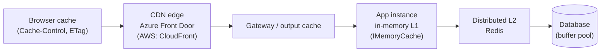
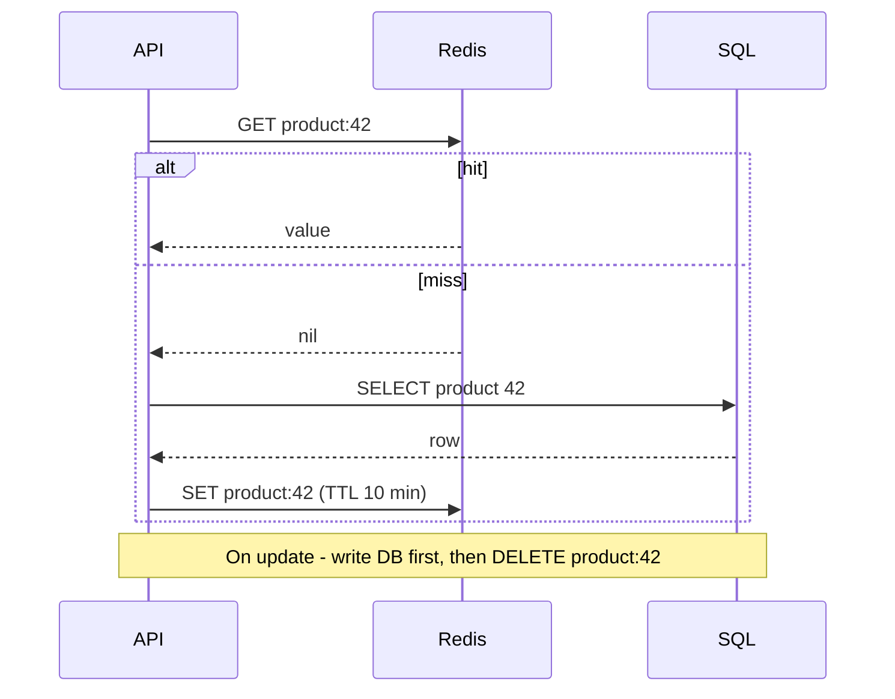
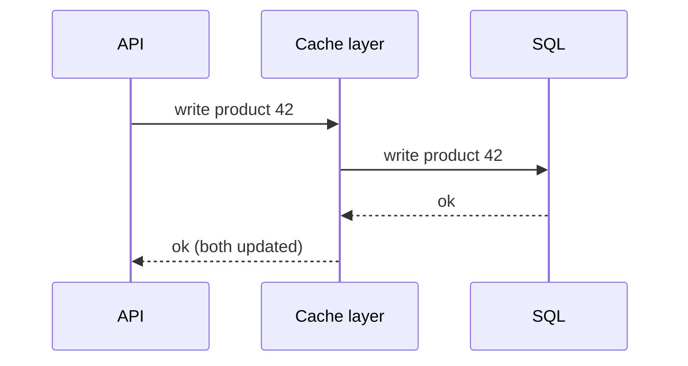
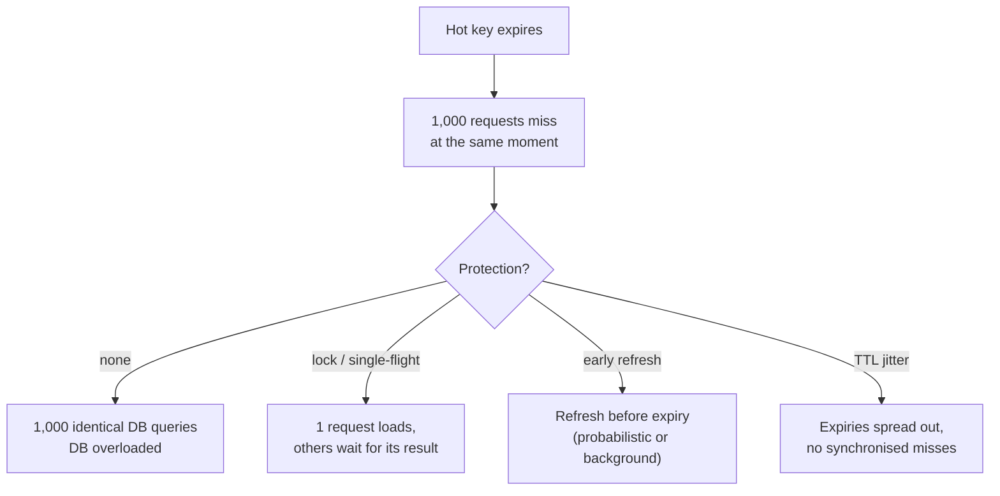

import { Tabs, TabItem, Aside } from '@astrojs/starlight/components';
import QuizBlock from '~/components/QuizBlock.astro';

## Why it matters in interviews

Caching is the first tool you reach for when a design is read-heavy, so almost every HLD round touches it. Interviewers then probe the hard parts: *"how do you keep the cache consistent with the DB?"*, *"what happens when a popular key expires?"*, *"one product gets 50% of the traffic, now what?"*. Knowing the patterns by name and their failure modes is what separates a 3-year answer from a 5-year one.

## Core idea

A cache keeps a copy of data in a faster layer so you skip the slow one (DB, remote API, computation). It trades **freshness and memory** for **latency and load**. Use it when data is read much more than it is written and slightly stale data is acceptable.

### Where to cache



| Layer | Good for | Watch out for |
|---|---|---|
| Browser | Static assets, per-user GETs | You cannot purge it; use versioned file names |
| CDN | Static files, public API responses | Invalidation delay, personalised data must not be cached publicly |
| In-process (L1) | Hot, small, rarely changing data (config, reference lists) | Each instance has its own copy, so instances can disagree |
| Distributed (L2, Redis) | Shared data across instances, sessions, rate-limit counters | Network hop (~1 ms), another component to run |
| Database | Automatic (pages in memory) | Not something you design, but explains why "warm" DBs are faster |

A **two-level cache** (L1 in-process + L2 Redis) gives sub-millisecond hits with a shared source. .NET's `HybridCache` implements exactly this.

### Caching patterns

**Cache-aside (lazy loading)**, the default answer. The application talks to both the cache and the DB.



**Write-through**: every write goes to the cache and the DB synchronously, so the cache is always populated and fresh, at the cost of slower writes and caching data nobody reads.



**Write-behind (write-back)**: writes go to the cache and are flushed to the DB asynchronously in batches. Very fast writes, but **data loss if the cache dies** before flushing. Used for counters, view counts and metrics, not orders.

| Pattern | Read path | Write path | Consistency | Typical use |
|---|---|---|---|---|
| Cache-aside | App checks cache, loads DB on miss | App writes DB, deletes key | Stale until TTL or delete | Default for most APIs |
| Read-through | Cache library loads from DB on miss | Usually combined with write-through | Same as cache-aside | `HybridCache.GetOrCreateAsync`, provider-managed caches |
| Write-through | Always hits | Cache and DB synchronously | Fresh, slower writes | Read-after-write critical data |
| Write-behind | Always hits | Cache now, DB later | Risk of loss | Counters, analytics |
| Write-around | Miss after write | DB only | Fresh on next load | Write-once data rarely re-read soon |

### Eviction

When memory is full, something must go.

- **LRU** (least recently used): evict what has not been touched longest. Good general default.
- **LFU** (least frequently used): evict what is used least often. Better when a stable set of keys is popular.
- **TTL**: entries expire after a time, regardless of memory. Bounds staleness, not memory.
- **FIFO / random**: simple, rarely the best.

Redis applies its `maxmemory-policy` when memory is full: `noeviction` (the default, writes fail), `allkeys-lru`, `allkeys-lfu`, `volatile-lru` / `volatile-lfu` / `volatile-ttl` (only keys with a TTL), and random variants. For a pure cache, `allkeys-lru` or `allkeys-lfu` is the usual choice. See the [LRU cache LLD](../lld-lru-cache/) for the O(1) design.

### Invalidation

*"There are only two hard things in computer science: cache invalidation and naming things."* Options, from simplest:

1. **TTL only**: accept staleness up to the TTL. Simple and self-healing.
2. **Delete on write**: after updating the DB, delete the key; the next read reloads it. Prefer **delete** over **update**: two concurrent updates can write cache values in the wrong order.
3. **Event-driven**: the writer publishes "product 42 changed"; subscribers delete keys (also clears L1 caches on every instance).
4. **Versioned keys**: `product:42:v7`. Bump the version on change; old entries simply expire.

Even delete-on-write has a race: a reader misses, reads the **old** row, the writer updates and deletes, then the reader puts the old value back. A TTL caps how long that lasts. Keep a TTL on every key as a safety net.

### Stampede (thundering herd)

A hot key expires and thousands of concurrent requests miss at once and all hit the DB.



Fixes: **request coalescing** (one loader per key; `HybridCache` does this per instance), a **distributed lock** (Redis `SET key value NX PX 5000`) for cross-instance coalescing, **serve stale while refreshing**, and **random jitter on TTLs** so keys written together do not expire together.

### Hot keys

One key (a celebrity profile, a flash-sale product) gets so much traffic that the single Redis shard holding it saturates.

- Add an **in-process L1 cache** with a short TTL (seconds): most reads never leave the instance.
- **Replicate the key**: store `product:42#1` ... `product:42#N` on different shards and read a random copy.
- Use **read replicas** of the Redis shard.
- Detect them: Redis has a `--hotkeys` option in `redis-cli` (requires an LFU policy); also watch per-shard CPU.

### Redis data structures

| Structure | Example use |
|---|---|
| String | Cached JSON, counters (`INCR`), distributed lock |
| Hash | Object fields (`HSET user:1 name ...`), partial updates |
| List | Recent activity, simple queues |
| Set | Unique visitors, tags, "who liked this" |
| Sorted set | Leaderboards, top-k, sliding-window rate limits, delayed jobs by timestamp |
| Stream | Append-only event log with consumer groups |
| Bitmap / HyperLogLog | Daily active flags per user id / approximate unique counts in ~12 KB |
| Geo | "Stores near me" |
| Pub/Sub | Fire-and-forget notifications (no persistence) |

Managed Redis on Azure: Azure Managed Redis, the successor to Azure Cache for Redis (AWS: ElastiCache for Redis OSS / Valkey, or MemoryDB when you need durability).

### Numbers to know

- A cache hit ratio of **90%** cuts DB reads by 10x; going from 90% to 99% cuts them by **another** 10x.
- Sizing: 1M products x 2 KB = 2 GB, which fits comfortably in one Redis node. Cache the **hot set**, not everything: often 20% of keys serve 80% of reads.

## Code

<Tabs syncKey="cache">
  <TabItem label="Cache-aside (IDistributedCache)">

```csharp
public sealed class ProductService(IDistributedCache cache, IProductRepository repo)
{
    private static string Key(int id) => $"product:{id}";

    public async Task<ProductDto?> GetAsync(int id, CancellationToken ct)
    {
        var cached = await cache.GetStringAsync(Key(id), ct);
        if (cached is not null) return JsonSerializer.Deserialize<ProductDto>(cached);

        var product = await repo.GetAsync(id, ct);           // miss: load from DB
        if (product is null) return null;                     // consider caching "not found" briefly

        var ttl = TimeSpan.FromMinutes(10) + TimeSpan.FromSeconds(Random.Shared.Next(0, 60)); // jitter
        await cache.SetStringAsync(Key(id), JsonSerializer.Serialize(product),
            new DistributedCacheEntryOptions { AbsoluteExpirationRelativeToNow = ttl }, ct);
        return product;
    }

    public async Task UpdateAsync(ProductDto product, CancellationToken ct)
    {
        await repo.UpdateAsync(product, ct);   // 1. source of truth first
        await cache.RemoveAsync(Key(product.Id), ct); // 2. delete, don't overwrite
    }
}
```

  </TabItem>
  <TabItem label="HybridCache (L1 + L2, stampede-safe)">

```csharp
// Program.cs: builder.Services.AddHybridCache(); plus AddStackExchangeRedisCache(...) for L2.
public sealed class ProductService(HybridCache cache, IProductRepository repo)
{
    private static readonly HybridCacheEntryOptions Options = new()
    {
        Expiration = TimeSpan.FromMinutes(10),          // L2 (Redis)
        LocalCacheExpiration = TimeSpan.FromSeconds(30) // L1 (in-process), short for hot keys
    };

    // Concurrent misses for the same key on this instance share one factory call.
    public ValueTask<ProductDto?> GetAsync(int id, CancellationToken ct) =>
        cache.GetOrCreateAsync($"product:{id}",
            async token => await repo.GetAsync(id, token),
            Options, tags: ["products"], cancellationToken: ct);

    public async Task UpdateAsync(ProductDto product, CancellationToken ct)
    {
        await repo.UpdateAsync(product, ct);
        await cache.RemoveAsync($"product:{product.Id}", ct);
    }
}
```

  </TabItem>
</Tabs>

## Interview Q&A

<details>
<summary>Cache-aside vs write-through: which do you choose?</summary>

Cache-aside by default: only data that is actually read gets cached, and a cache outage degrades to DB reads instead of failing. Write-through when reads right after writes must be fresh and the write-latency cost is acceptable. Many systems combine cache-aside reads with delete-on-write.
</details>

<details>
<summary>Why delete the cache key on update instead of setting the new value?</summary>

With two concurrent writers, the DB may end up with B's value while the cache ends up with A's, because the cache writes can arrive in a different order. Deleting means the next read loads whatever the DB holds. It is simpler and avoids caching values computed from partial data.
</details>

<details>
<summary>What is a cache stampede and how do you prevent it?</summary>

A popular key expires and many requests miss simultaneously, all hitting the DB. Prevent it with request coalescing (one loader per key, as `HybridCache` does per instance), a distributed lock so only one instance reloads, serving stale data while refreshing in the background, and TTL jitter so related keys do not expire together.
</details>

<details>
<summary>How do you handle a hot key?</summary>

Put a short-TTL in-process cache in front of Redis so most reads never leave the instance, replicate the key across shards (`key#1..N`) and read a random copy, or use Redis read replicas. For writes to a hot key (like counters), shard the counter and sum on read.
</details>

<details>
<summary>What happens to your system if Redis goes down?</summary>

With cache-aside, every read falls through to the DB, which may not handle the full load. Plan for it: timeouts on cache calls so they fail fast, a circuit breaker, an L1 in-process cache that keeps serving hot data, rate limiting, and a Redis setup with replicas and automatic failover. Never make the cache the only copy of important data.
</details>

<details>
<summary>LRU vs LFU?</summary>

LRU evicts what was used longest ago; it adapts quickly to changing access patterns but a one-off scan can flush popular keys. LFU evicts what is used least often; it protects consistently popular keys but adapts slowly when popularity shifts. Redis implements approximated versions of both.
</details>

<details>
<summary>What should you not cache?</summary>

Data that must be strongly consistent (account balances during a payment), highly personalised data in a shared cache without a per-user key, rapidly changing data with a low read/write ratio, and anything sensitive in a CDN or browser cache. Caching also adds a component to run, so do not add it before a measured need.
</details>

<details>
<summary>How do you keep in-process (L1) caches on many instances consistent?</summary>

Keep L1 TTLs short (seconds) so staleness is bounded, and broadcast invalidations: publish a "key changed" message (Redis pub/sub or a topic) that every instance subscribes to and uses to evict its local copy. `HybridCache` supports tag-based removal for this kind of grouped invalidation.
</details>

## Pitfalls

<Aside type="caution" title="Common mistakes">

- **No TTL** on cache entries: one missed invalidation means stale data forever.
- **Caching null results never** (or forever): missing keys hammer the DB (cache penetration). Cache "not found" briefly.
- **Same TTL for everything** written at the same time: synchronised expiry causes stampedes. Add jitter.
- **Caching per-user responses at a CDN** without varying by user: users see each other's data.
- **Treating Redis as durable storage** with write-behind for business-critical data.
- **Huge values** (multi-MB JSON) in Redis: they block the single-threaded command loop and saturate bandwidth.

</Aside>

## Related

- [Caching in ASP.NET Core](../../aspnet/caching/)
- [LLD: LRU cache](../lld-lru-cache/)
- [Databases at scale](../databases-at-scale/)
- [Data in microservices](../../microservices/data-management/)

## Quick quiz

<QuizBlock section="system-design" topic="caching" />
