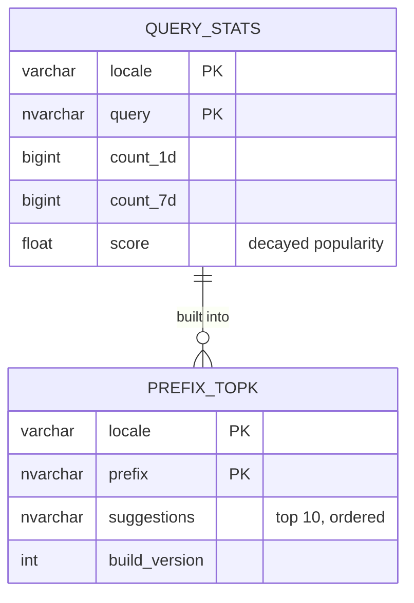
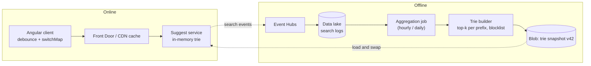
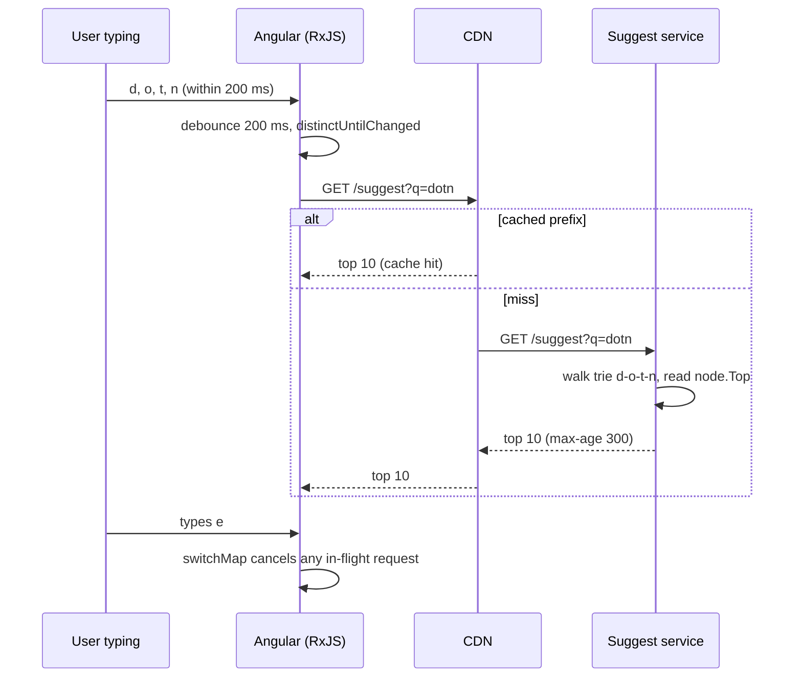

import { Aside } from '@astrojs/starlight/components';
import QuizBlock from '~/components/QuizBlock.astro';

## Why it matters in interviews

Autocomplete looks small but has a very tight **latency budget**: suggestions must appear while the user is still typing, so the server gets roughly 20 ms. That forces the key insight of the question: **don't compute top suggestions at request time; precompute them**. The interviewer checks:

- whether you know the trie and why plain `LIKE 'pre%'` doesn't scale for top-k;
- whether you split the system into an **offline build pipeline** and an **online serving path**;
- whether you reduce load on the client (debounce, cancel stale requests, cache).

Full-stack developers get bonus points for the Angular/RxJS side.

## Requirements

**Functional**

- As the user types, return the **top 10** suggestions for the current prefix, ranked by popularity.
- Suggestions update with trends (daily is the baseline; "within an hour" for trending topics).
- Filter offensive or blocked terms.

**Non-functional**

- Server p99 **under 20 ms**; end-to-end under about 100 ms so it feels instant.
- Very high availability. If suggestions fail, search still works, so degrade silently.
- Read-heavy: the request rate is a multiple of the search rate.

**Out of scope:** spell correction / fuzzy matching (mention it), the search results page, per-user personalisation beyond recent searches.

**Clarifying questions to ask**

1. What are we completing: past search queries, product names, or people?
2. How many users and searches per day?
3. How fresh must rankings be?
4. Single language or multilingual (affects normalisation and tokenisation)?
5. Is personalisation required?

## Back-of-the-envelope estimates

Assume **10 M DAU**, **10 searches** per user per day, about **4 suggestion requests per search** after client debounce, and **10 M distinct queries** worth suggesting (after dropping the long tail).

| Quantity | Arithmetic | Result |
|---|---|---|
| Searches per day | 10 M × 10 | 100 M |
| Suggestion requests per day | 100 M × 4 | 400 M |
| Suggestion QPS (avg) | 400 M ÷ 86,400 | ≈ **4,600/s** (peak ×3 ≈ 14,000/s) |
| Without debounce (1 request per keystroke, ~20 chars) | 100 M × 20 ÷ 86,400 | ≈ 23,000/s (5× more) |
| Prefix nodes (upper bound) | 10 M queries × 20 chars | 200 M nodes (shared prefixes make it far fewer) |
| Top-10 lists | 200 M × 10 × 4-byte query id | ≈ **8 GB** upper bound |
| Query strings | 10 M × 20 B | ≈ 200 MB |
| Search logs | 100 M × 100 B | 10 GB/day |

Takeaways: the whole index fits **in memory on one machine**, so replicate it to every serving node instead of sharding it. Debounce on the client cuts traffic about 5×. The request rate is high, but each request is a tiny in-memory lookup.

## API design

```http
GET /api/v1/suggest?q=dotn&limit=10&locale=en-IN

200 OK
Cache-Control: public, max-age=300
{ "prefix": "dotn", "suggestions": [ "dotnet 10", "dotnet core interview questions", "dotnet aspire", "dotnet maui" ] }
```

Short, common prefixes ("d", "do") return the same answer for everyone, so `Cache-Control: public` lets the CDN and the browser cache them. Personalised suggestions would need `private` and could not be cached at the edge.

## Data model

| Store | Content | Why |
|---|---|---|
| Search log (Event Hubs → data lake) | raw events: query, timestamp, locale, user hash | append-only, replayable |
| Query stats (Azure Data Explorer / Spark table) | `query, count_1d, count_7d, score` | aggregation input |
| Trie snapshot (blob) | serialised trie with top-k per node, versioned | built offline, loaded by servers |
| Optional Redis | `ac:{locale}:{prefix}` → JSON top 10 | when serving nodes shouldn't hold the index |
| Blocklist (SQL) | blocked terms and patterns | applied at build time and at serve time |

There is no relational query on the hot path. The serving "database" is an **in-memory data structure**, which is the right choice when the data is small, read-only between builds, and latency-critical.



## High-level design



**Offline:** search events are aggregated per query with a time-decayed score (e.g. `score = count_1d + 0.5 × count_7d`, or exponential decay). Blocked terms are removed, and a trie is built in which **every node stores its top 10 completions**. The snapshot is versioned and written to blob storage.

**Online:** each suggest node loads the latest snapshot into memory, builds the new trie in the background, and **swaps the reference atomically** (blue/green in-process). A request walks the prefix (O(length)) and returns the precomputed list.



## Deep dives

### 1. Why a trie with top-k per node

- `SELECT TOP 10 query FROM Queries WHERE query LIKE 'd%' ORDER BY score DESC` must find and sort **every** query starting with "d" (millions) on each keystroke. An index helps the `LIKE`, but not the top-k sort.
- A **plain trie** finds the prefix node in O(p), but collecting the best completions still means walking the whole subtree.
- A **trie with cached top-k per node** answers in O(p) plus copying 10 items. The cost moves to build time: each query updates the top-k list of every node on its path, so the build is O(total characters × k), done offline.

An alternative with the same idea is a **prefix hash table**: precompute `prefix → top 10` for all prefixes up to ~15 characters and store it in Redis or a KV store. That is simpler to operate when the index is too big for each node's memory.

### 2. Keeping rankings fresh

- **Batch layer:** a daily (or hourly) rebuild from logs with time decay, so last week's spike fades.
- **Trending layer:** a streaming job counts the last hour per query (Stream Analytics / Flink). Queries whose rate jumps sharply are merged into results at serve time from a small Redis set. This gives "within minutes" freshness without rebuilding the trie.
- **Safety:** new trending terms pass the blocklist filter before appearing. Builds are versioned, so a bad build can be rolled back by loading the previous snapshot.

### 3. Client-side load reduction

The cheapest request is the one never sent:

- **Debounce** (150-300 ms): send only after the user pauses.
- **distinctUntilChanged:** don't re-send the same prefix.
- **switchMap:** cancel the in-flight request when the user types again, so stale responses can't overwrite fresh ones.
- **Minimum length** (1-2 chars) and a local cache of prefix results; filtering a cached "dotn" list locally can often answer "dotne" without a call.

### 4. Sharding, if the index doesn't fit

Replicating the full index to each node is simplest and should be the default. If it doesn't fit (many locales, product catalogues with hundreds of millions of entries), shard **by locale first**, then by prefix. Plain first-letter sharding is skewed ("s" is much bigger than "x"), so split ranges by measured size or hash the first 2-3 characters. A thin router sends each prefix to its shard.

## Scaling & bottlenecks

- **Serving** is CPU- and memory-light: a few nodes handle 14,000 QPS, and more replicas add capacity linearly.
- **CDN hit rate** for short prefixes is very high. Long prefixes are mostly unique, so they reach the origin.
- **Build time** grows with the number of queries. Prune rare queries (below a minimum count) and parallelise the build per locale or top-level letter.
- **Snapshot loading:** a multi-GB load on every node at once can spike memory. Stagger reloads, and keep the old trie until the new one is ready.

## Failure modes

| Failure | Effect | Mitigation |
|---|---|---|
| Suggest service down | No suggestions | Client hides the dropdown silently; search still works |
| Bad build (offensive or empty suggestions) | Embarrassing or useless results | Validation checks before publish; versioned rollback |
| Aggregation pipeline stalls | Rankings go stale | Serve the last good snapshot; alert on snapshot age |
| Node restarts | Cold node has no trie | Readiness probe fails until the trie is loaded |
| Out-of-order responses | Old suggestions overwrite new | `switchMap` cancellation; include the prefix in the response and ignore mismatches |

## Trade-offs

| Decision | Options | Choice | Why |
|---|---|---|---|
| Index | SQL `LIKE`, plain trie, trie + top-k, search engine | Trie + top-k per node | O(prefix) lookups within the 20 ms budget |
| Where to compute | At request time, precomputed | Precomputed offline | Moves cost off the hot path |
| Serving store | In-memory per node, Redis prefix table | In-memory replicated (Redis if too large) | Fastest; data fits |
| Freshness | Real-time updates, periodic rebuild + trending layer | Rebuild + trending layer | Simple core, fresh where it matters |
| Client | Request per keystroke, debounce + cancel | Debounce + switchMap + cache | About 5× fewer requests, no stale results |
| Build vs buy | Custom, Azure AI Search suggesters / OpenSearch completion suggester | Buy if you already run a search engine | Less to operate; custom for scale or special ranking |

## How to build it on Azure (with AWS equivalents)

- **Serving:** ASP.NET Core on Container Apps / App Service behind Front Door with caching (AWS: ECS + CloudFront).
- **Logs and aggregation:** Event Hubs → Data Lake → Azure Databricks / Fabric / Azure Data Explorer (AWS: Kinesis → S3 → EMR / Glue / Athena).
- **Trending:** Stream Analytics → Azure Cache for Redis (AWS: Managed Service for Apache Flink → ElastiCache).
- **Snapshots:** Blob Storage, versioned (AWS: S3).
- **Off the shelf:** Azure AI Search suggesters and autocomplete API (AWS: OpenSearch completion suggester).

## .NET implementation notes

A trie in which each node keeps its best `k` completions. The build is offline; the read is a walk down the prefix.

```csharp
public sealed record Suggestion(string Query, long Score);

public sealed class TopKTrie(int k = 10)
{
    private sealed class Node
    {
        public readonly Dictionary<char, Node> Children = [];
        public readonly List<Suggestion> Top = [];   // precomputed best k for this prefix
    }

    private readonly Node _root = new();

    public void Add(string query, long score)            // offline build
    {
        var suggestion = new Suggestion(query, score);
        var node = _root;
        foreach (char c in query.ToLowerInvariant())
        {
            if (!node.Children.TryGetValue(c, out var next))
                node.Children[c] = next = new Node();
            node = next;
            Offer(node.Top, suggestion);
        }
    }

    public IReadOnlyList<Suggestion> Suggest(string prefix) // online read: O(prefix length)
    {
        var node = _root;
        foreach (char c in prefix.ToLowerInvariant())
            if (!node.Children.TryGetValue(c, out node)) return [];
        return node.Top;
    }

    private void Offer(List<Suggestion> top, Suggestion s)
    {
        int i = top.FindIndex(x => x.Score < s.Score);
        if (i < 0) { if (top.Count < k) top.Add(s); return; }
        top.Insert(i, s);
        if (top.Count > k) top.RemoveAt(top.Count - 1);
    }
}
```

With `k = 3` and the queries data(100), domain(90), docker(80), dotnet(50), dog(30), `Suggest("do")` returns domain, docker, dotnet. The serving node holds the trie in a `volatile` field (or `Interlocked.Exchange`) and swaps in a freshly built one, so readers never see a half-built index. Each query is added once, so the per-node lists need no de-duplication.

The client side in Angular (see [RxJS operators](../../angular/rxjs-operators/)):

```ts
@Component({
  selector: 'app-search-box',
  imports: [ReactiveFormsModule],
  template: `
    <input [formControl]="query" placeholder="Search" />
    <ul>
      @for (s of suggestions(); track s) { <li>{{ s }}</li> }
    </ul>
  `,
})
export class SearchBoxComponent {
  private readonly http = inject(HttpClient);
  readonly query = new FormControl('', { nonNullable: true });
  readonly suggestions = toSignal(
    this.query.valueChanges.pipe(
      map((q) => q.trim().toLowerCase()),
      debounceTime(200),
      distinctUntilChanged(),
      switchMap((q) =>
        q.length < 2
          ? of([] as string[])
          : this.http
              .get<{ suggestions: string[] }>('/api/v1/suggest', { params: { q } })
              .pipe(map((r) => r.suggestions), catchError(() => of([] as string[]))),
      ),
    ),
    { initialValue: [] as string[] },
  );
}
```

## Interview Q&A

<details>
<summary>Why not query the database with LIKE 'prefix%'?</summary>

An index can find rows matching the prefix, but returning the top 10 by popularity means reading and sorting every match. For a one-letter prefix that is millions of rows, on every keystroke, at thousands of QPS. Precomputing top-k per prefix turns each request into a lookup.
</details>

<details>
<summary>What does each trie node store, and what is the lookup cost?</summary>

Its children (by character) and a precomputed list of the top k completions for that prefix. Lookup is O(p) to walk the prefix plus O(k) to return the list, independent of how many queries share the prefix. The cost is memory and a longer offline build.
</details>

<details>
<summary>How do you update rankings without rebuilding the trie on every search?</summary>

Don't update it online. Log searches, aggregate them in batch with time decay, rebuild the trie periodically, and hot-swap it on the servers. For trending queries, add a small real-time layer (last-hour counts in Redis) and merge it in at serve time.
</details>

<details>
<summary>How does the client avoid flooding the server?</summary>

Debounce input (around 200 ms), skip unchanged values, require a minimum length, cancel in-flight requests with `switchMap`, and cache responses per prefix. In RxJS: `debounceTime`, `distinctUntilChanged`, `switchMap`. Together these cut requests several-fold and prevent stale responses from overwriting fresh ones.
</details>

<details>
<summary>How would you shard the trie if it didn't fit in memory?</summary>

First by locale. Then by prefix ranges sized by data volume, not by first letter, because letter distribution is skewed. Alternatively store a precomputed prefix → top-k table in a distributed KV store (Redis Cluster, Cosmos DB), which shards by key automatically.
</details>

<details>
<summary>How would you add personalisation?</summary>

Blend in a small per-user candidate set (recent searches, stored client-side or in a per-user Redis list) with the global top-k, re-ranking the merged list at serve time. Personalised responses can't be cached at the CDN, so only the personal part should vary. A common approach is to merge global and personal results on the client.
</details>

<details>
<summary>When would you use Azure AI Search or Elasticsearch instead of building this?</summary>

When you already run a search engine over the same data (product catalogue, documents) and its suggester meets your latency target. You get fuzzy matching and analyzers for free. Build your own when you need query-log popularity ranking at very large scale, custom trending, or strict latency that an extra hop can't meet.
</details>

## Pitfalls

<Aside type="caution" title="Common mistakes">

- Computing top-k at request time (subtree walk or SQL sort) instead of precomputing.
- Updating the serving trie in place while requests are reading it.
- No debounce or cancellation on the client, so responses arrive out of order.
- Sharding by first letter and getting a hot "s" shard.
- Forgetting the blocklist: offensive suggestions are a real incident.
- Using `mergeMap` instead of `switchMap` in the Angular typeahead.

</Aside>

## Related

- [RxJS operators (debounce, switchMap)](../../angular/rxjs-operators/)
- [Caching at scale](../caching/)
- [Scaling fundamentals](../scaling-fundamentals/) (CDN)
- [News feed](../case-news-feed/) (precompute vs compute on read)

## Quick quiz

<QuizBlock section="system-design" topic="case-autocomplete" />
