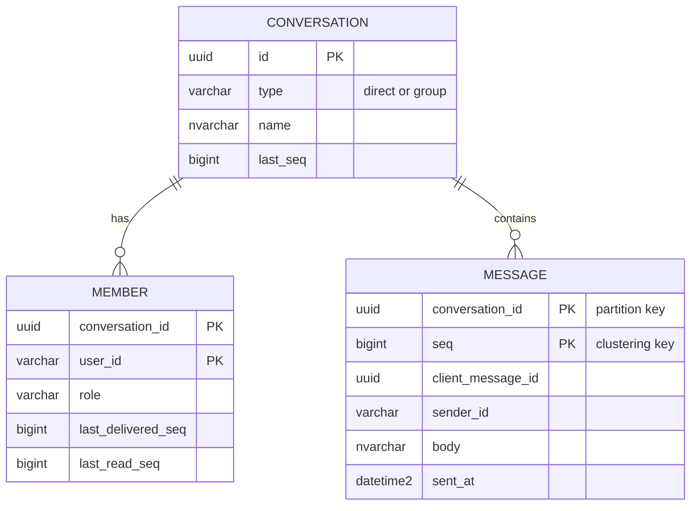
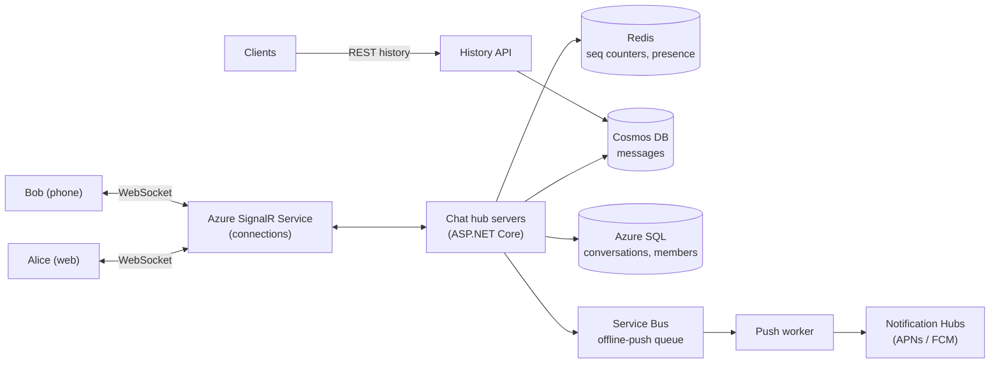
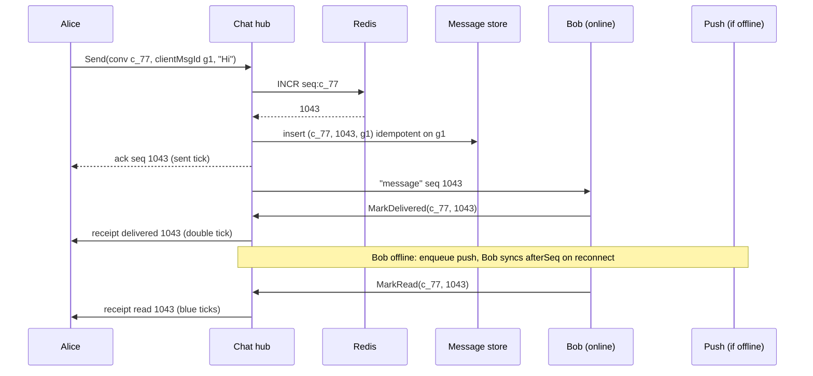

import { Aside } from '@astrojs/starlight/components';
import QuizBlock from '~/components/QuizBlock.astro';

## Why it matters in interviews

Chat is the classic **stateful real-time** design. Unlike a REST API, servers hold millions of long-lived connections, so you have to explain how a message from a user on server A reaches a user on server B. The interviewer listens for:

- the right transport (WebSockets, and why not polling);
- **message ordering** without trusting client clocks;
- the meaning of the sent, delivered and read ticks;
- what happens when the recipient is offline;
- how group chat fan-out differs from 1:1.

For a .NET developer, SignalR and its scale-out options are expected vocabulary.

## Requirements

**Functional**

- 1:1 and group chats (groups up to 500 members).
- Send and receive text messages in real time; media through attachments (see [file upload](../case-file-upload/)).
- Sent / delivered / read receipts.
- Online / last-seen presence.
- Message history, synced across a user's devices (phone + web).
- Push notification when the recipient is offline.

**Non-functional**

- Delivery latency under 200 ms p95 when both users are online.
- **No message loss** once the sender sees the "sent" tick.
- Messages appear in the same order for every member of a conversation.
- High availability. Brief presence inaccuracy is fine.

**Out of scope:** end-to-end encryption internals (mention the Signal protocol), voice/video calls, message search, channels with 100k+ members.

**Clarifying questions to ask**

1. 1:1 only, or groups? What is the maximum group size?
2. How many daily active users and messages per user?
3. Multi-device support? Must history sync to a new device?
4. How long do we keep messages: forever, or 30 days?
5. Is end-to-end encryption required? It changes what the server can store and index.

## Back-of-the-envelope estimates

Assume **50 M DAU**, each sending **40 messages per day**, with 20% of DAU online at peak.

| Quantity | Arithmetic | Result |
|---|---|---|
| Messages per day | 50 M × 40 | 2 B |
| Write QPS (avg) | 2 B ÷ 86,400 | ≈ **23,000/s** (peak ×3 ≈ 70,000/s) |
| Message size | text + ids + timestamps | ≈ 300 B |
| Storage per day | 2 B × 300 B | 600 GB |
| Storage per year | 600 GB × 365 | ≈ **219 TB** (before replication) |
| Peak concurrent connections | 50 M × 20% | **10 M** WebSockets |
| Gateway nodes | 10 M ÷ 50,000 per node (conservative) | ≈ **200 nodes** |
| Deliveries | ~2 recipients per message × 23,000/s | ≈ 46,000/s, ≈ 14 MB/s |
| Naive presence heartbeats | 10 M online ÷ every 30 s | ≈ **333,000 writes/s** |

The last row is a trap worth pointing out: presence done naively generates more writes than the messages do. The storage figure says messages need a **horizontally scalable, write-optimised store**, not one SQL server.

## API design

Real-time traffic goes over a **WebSocket** (SignalR hub). Everything else is plain REST.

```text
Hub: /hubs/chat  (WebSocket, JWT in access_token query param on connect)

client → server  Send({ conversationId, clientMessageId, body })      returns { clientMessageId, seq, sentAt }
client → server  MarkDelivered(conversationId, upToSeq)
client → server  MarkRead(conversationId, upToSeq)
server → client  "message"   { conversationId, seq, senderId, body, sentAt }
server → client  "receipt"   { conversationId, userId, type: "delivered" | "read", upToSeq }
server → client  "presence"  { userId, online, lastSeen }
```

```http
GET /api/v1/conversations/c_77/messages?afterSeq=1042&limit=50
200 OK
{ "messages": [ { "seq": 1043, "senderId": "u_9", "body": "On my way", "sentAt": "2026-11-02T10:01:03Z" } ], "hasMore": false }

POST /api/v1/conversations
{ "type": "group", "name": "Trip 2027", "memberIds": ["u_1", "u_9", "u_12"] }
```

`clientMessageId` (a GUID created on the device) makes retries idempotent. `seq` is assigned by the server and defines the order.

## Data model



- **Conversations and members** are small and relational, and you need queries like "my conversations": **Azure SQL**.
- **Messages** are 219 TB/year of append-only writes, always read as "conversation X, newest first, after seq N". That is a perfect fit for a wide-column or document store partitioned by `conversation_id`: **Cosmos DB** (AWS: DynamoDB), or Cassandra/ScyllaDB. A Cosmos DB logical partition is capped at 20 GB, so very long-lived groups need a bucket in the key, e.g. `conversation_id + month`.
- **Receipts** are a watermark per member (`last_read_seq`), not a row per message per reader. That turns millions of rows into one integer.

## High-level design



With **Azure SignalR Service**, clients hold their WebSockets to the managed service. The hub servers are stateless, and `Clients.User(id)` reaches that user on any server. Self-hosting instead means you need a **backplane** (Redis pub/sub) or a **connection registry** (`userId → gateway node` in Redis) so that one server can deliver to a user connected to another.



## Deep dives

### 1. Ordering

Client timestamps are unreliable (skewed clocks, offline phones), and two servers' clocks disagree too. Instead, **the server assigns a monotonically increasing `seq` per conversation**: `INCR seq:{conversationId}` in Redis, or a single-writer actor per conversation. Every client sorts by `seq`. A global order across all conversations is neither needed nor affordable.

Gaps can occur (seq incremented, then the insert failed). Clients treat a gap as "ask the server". If the history API says nothing is missing, they ignore it.

### 2. Never lose a message

**Persist before you acknowledge.** The sender's "sent" tick means the message is in the durable store. If the ack never arrives (network drop), the client resends with the **same `clientMessageId`**. The store has a unique key on `(conversation_id, client_message_id)`, so the retry returns the existing `seq` instead of creating a duplicate. Real-time delivery to recipients is a best-effort optimisation on top. The source of truth is the **sync protocol**: on reconnect each device sends its `lastSeq` per conversation and pulls everything after it.

### 3. Group fan-out

For a group of up to 500, write the message **once** (it is stored per conversation, not per recipient) and fan out the real-time event to members' connections. With SignalR that is `Clients.Users(memberIds)` or a SignalR group per conversation. Offline members get one push notification (collapsed: "5 new messages in Trip 2027") and catch up through sync. For very large channels (10k+ members), skip per-member push and per-member receipts: clients pull new messages when they open the channel. This is the same push vs pull trade-off as the [news feed](../case-news-feed/).

### 4. Presence without 333,000 writes per second

- Derive "online" from **connection events**: `OnConnectedAsync` adds a connection id to a Redis set `presence:{userId}` (with a TTL), and `OnDisconnectedAsync` removes it. The TTL is refreshed infrequently (every few minutes), not on every WebSocket ping.
- Store `lastSeen` only on disconnect.
- **Don't broadcast presence to everyone.** Send presence only to users who currently have that contact's chat open (subscribe on view), and debounce flapping mobile connections by a few seconds before announcing "offline".

## Scaling & bottlenecks

- **Connections:** scale out the connection tier (SignalR Service units, or gateway nodes). Keep hub logic stateless so hub servers scale independently.
- **Message store:** partition by conversation. Hot partitions come from huge, very active groups; bucket by time.
- **Seq counters:** Redis `INCR` handles hundreds of thousands of ops/s; shard by conversation with Redis Cluster.
- **Reconnect storms:** after a deploy or outage, millions of clients reconnect and sync at once. Use client-side jittered backoff, sync only conversations with changes (compare `last_seq` per conversation first), and use rolling deploys that drain connections gradually.
- **Push notifications:** a burst in a big group triggers many pushes. Collapse and rate limit per user.

## Failure modes

| Failure | Effect | Mitigation |
|---|---|---|
| Hub server dies | Its clients disconnect | Clients reconnect to another server and sync after `lastSeq` |
| Ack lost after persist | Client resends | Idempotent insert on `clientMessageId` |
| Redis seq store fails over | Possible seq reuse or gap | Recover counter from `MAX(seq)` in the store before serving; clients handle gaps |
| Message store slow | Sends back up | Return an error so the client retries; never ack before persisting |
| Push provider down | Offline users not alerted | Queue with retries; messages are safe and arrive on next app open |
| Recipient's device offline for days | Large backlog | Paged sync API; old conversations synced lazily |

## Trade-offs

| Decision | Options | Choice | Why |
|---|---|---|---|
| Transport | Short polling, long polling, SSE, WebSockets | WebSockets (SignalR with fallbacks) | Bidirectional and low-latency; SignalR handles reconnects and fallbacks |
| Connection tier | Self-hosted + Redis backplane, Azure SignalR Service | Azure SignalR Service | No backplane to run; scales by units. Self-host only at very large scale |
| Ordering | Client time, server time, per-conversation seq | Per-conversation seq | Deterministic, cheap, no global coordination |
| Message store | SQL, Cosmos DB / Cassandra | Cosmos DB | 219 TB/year, partitioned access by conversation |
| Receipts | Row per message per reader, watermark | Watermark per member | O(members), not O(messages × members) |
| Group delivery | Fan-out on write, pull | Push for ≤ 500 members, pull for huge channels | Latency for normal groups, cost control for huge ones |

## How to build it on Azure (with AWS equivalents)

- **Connections:** Azure SignalR Service in default mode, or Azure Web PubSub for non-SignalR clients (AWS: API Gateway WebSocket APIs, or AppSync Events).
- **Hub servers:** ASP.NET Core on Container Apps / AKS (AWS: ECS / EKS).
- **Data:** Cosmos DB for messages, Azure SQL for metadata, Azure Cache for Redis for seq and presence (AWS: DynamoDB, RDS, ElastiCache).
- **Offline push:** Service Bus queue → worker → Azure Notification Hubs (AWS: SQS → Lambda → SNS mobile push).
- **Media:** Blob Storage + Front Door, uploaded with SAS (AWS: S3 pre-signed URLs + CloudFront).

## .NET implementation notes

A SignalR hub that persists before acknowledging and fans out with `Clients.Users`. With `AddAzureSignalR()` the same hub code works across any number of hub servers. See [SignalR & gRPC](../../aspnet/signalr-grpc/).

```csharp
[Authorize]
public sealed class ChatHub(IMessageStore store, IPresenceStore presence) : Hub
{
    private string UserId => Context.UserIdentifier!;   // from the NameIdentifier claim

    public override Task OnConnectedAsync() => presence.ConnectedAsync(UserId, Context.ConnectionId);
    public override Task OnDisconnectedAsync(Exception? ex) => presence.DisconnectedAsync(UserId, Context.ConnectionId);

    public async Task<MessageAck> Send(SendMessage cmd)
    {
        var ct = Context.ConnectionAborted;
        var members = await store.GetMemberIdsAsync(cmd.ConversationId, ct);
        if (!members.Contains(UserId)) throw new HubException("Not a member of this conversation");

        var msg = await store.AppendAsync(cmd, UserId, ct);              // 1. persist first
        await Clients.Users(members).SendAsync("message", msg, ct);       // 2. fan out to every device
        return new MessageAck(cmd.ClientMessageId, msg.Seq, msg.SentAt);  // 3. ack = single tick
    }

    public async Task MarkRead(Guid conversationId, long upToSeq)
    {
        var members = await store.GetMemberIdsAsync(conversationId, Context.ConnectionAborted);
        await Clients.Users(members.Where(m => m != UserId)).SendAsync("read", conversationId, UserId, upToSeq);
    }
}

public sealed record SendMessage(Guid ConversationId, Guid ClientMessageId, string Body);
public sealed record ChatMessage(Guid ConversationId, long Seq, string SenderId, string Body, DateTimeOffset SentAt);
public sealed record MessageAck(Guid ClientMessageId, long Seq, DateTimeOffset SentAt);
```

`Clients.Users(members)` includes the sender, so the sender's *other* devices receive the message too. In production, cache the member list instead of loading it per message, and persist the read watermark in `MarkRead`.

## Interview Q&A

<details>
<summary>Why WebSockets instead of polling every second?</summary>

Polling every second from 10 M clients is 10 M requests/s, nearly all returning nothing, with up to a second of extra latency. Long polling reduces the waste but still re-establishes requests constantly. WebSockets keep one connection open in both directions, so the server pushes the moment a message arrives. SignalR negotiates WebSockets and falls back to SSE or long polling when a proxy blocks them.
</details>

<details>
<summary>User A is connected to server 1 and user B to server 2. How does A's message reach B?</summary>

Server 1 has to find B's connection. With Azure SignalR Service all connections live in the service, so `Clients.User("B")` just works. Self-hosted, either use a Redis backplane (every server receives the publish and delivers to its local connections), or a connection registry in Redis that maps user to server, plus server-to-server routing. The backplane is simpler; the registry scales better.
</details>

<details>
<summary>How do you guarantee messages are shown in the same order to everyone?</summary>

The server assigns a per-conversation sequence number (Redis `INCR` or a single writer per conversation) at persist time, and every client sorts by it. Client clocks are only used for display. Two messages sent "simultaneously" get an order decided by the server, and everyone sees the same one.
</details>

<details>
<summary>What do sent, delivered and read ticks mean technically?</summary>

**Sent:** the server persisted the message and returned the ack with its `seq`. **Delivered:** a recipient's device received it and called `MarkDelivered(upToSeq)`. **Read:** the user opened the conversation and the client called `MarkRead(upToSeq)`. Both are stored as per-member watermarks, so one call covers every earlier message.
</details>

<details>
<summary>How does a new device get the full history?</summary>

It lists the user's conversations from SQL, then pages messages per conversation from the history API (newest first, `beforeSeq` cursor) and loads older pages lazily as the user scrolls. After the initial load it keeps a `lastSeq` per conversation and syncs incrementally. With end-to-end encryption this is harder: the server only has ciphertext, so history is transferred from another of the user's devices.
</details>

<details>
<summary>How would you store messages in SQL Server if you had to?</summary>

A `Messages` table with clustered key `(ConversationId, Seq)` so each conversation's messages are physically together and range scans are cheap. Partition by date for archiving, and shard across databases by `ConversationId` hash once one server can't take the write rate. That works up to a point. At 600 GB/day a natively partitioned store is less operational work.
</details>

<details>
<summary>What happens when a 500-member group gets a message?</summary>

One write to the message store, one real-time fan-out to online members' connections, one collapsed push per offline member (rate-limited), and later receipts updating member watermarks. Read receipts in big groups are usually aggregated ("read by 120") rather than broadcast individually.
</details>

## Pitfalls

<Aside type="caution" title="Common mistakes">

- Ordering by client timestamps.
- Acknowledging ("sent") before the message is durable, then losing it on a crash.
- Storing one copy of a group message per recipient (inbox per user) without discussing the write amplification.
- Writing presence on every heartbeat, and broadcasting presence to all contacts.
- Forgetting multi-device: delivering only to "the" connection of a user.
- No sync protocol, relying on real-time delivery never missing anything.

</Aside>

## Related

- [SignalR, gRPC & GraphQL](../../aspnet/signalr-grpc/)
- [API design: WebSockets vs SSE](../api-design-rate-limiting/)
- [Databases at scale](../databases-at-scale/) (partitioning)
- [News feed](../case-news-feed/) (fan-out trade-offs)

## Quick quiz

<QuizBlock section="system-design" topic="case-chat-system" />
