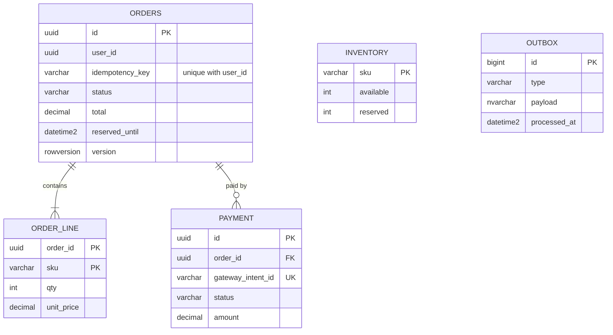
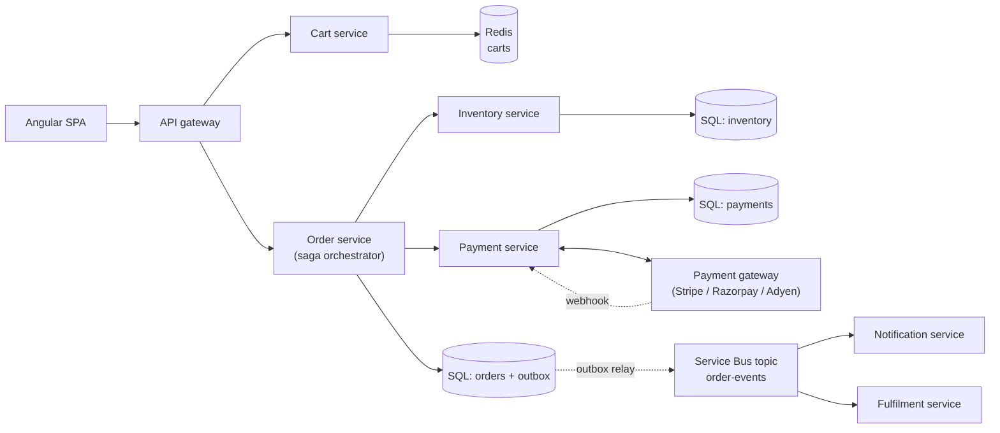
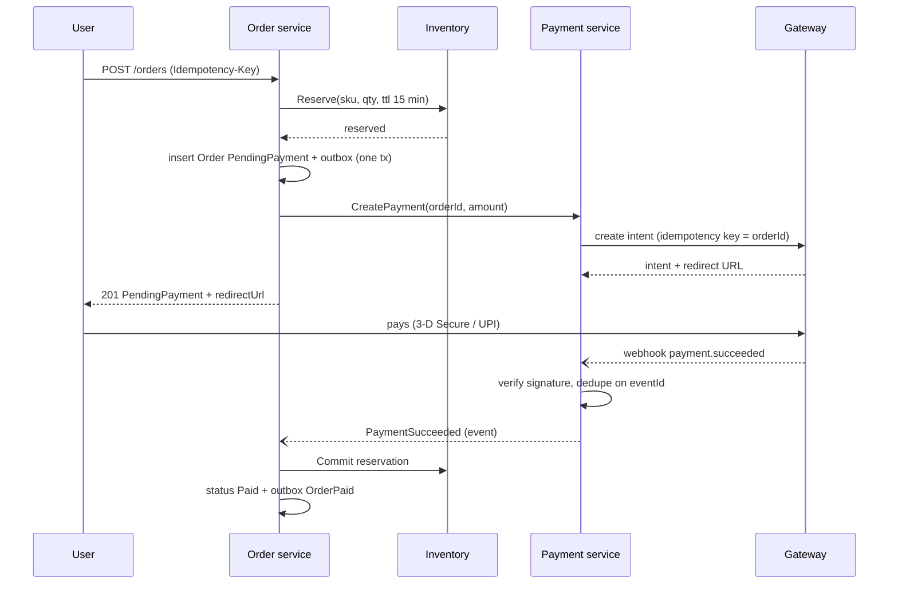
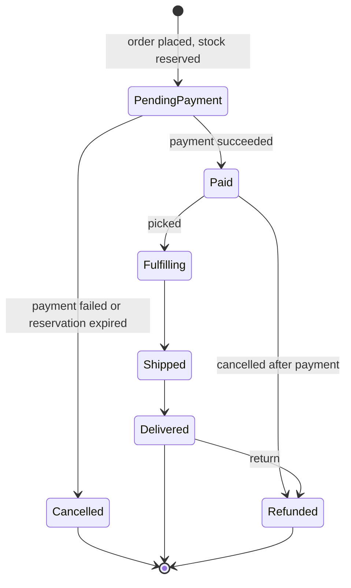

import { Aside } from '@astrojs/starlight/components';
import QuizBlock from '~/components/QuizBlock.astro';

## Why it matters in interviews

This is the question .NET developers from service companies are most likely to get, because most of them have built some version of it. It is less about scale and more about **correctness under failure**:

- Don't oversell stock.
- Don't charge twice.
- Don't lose an order when the payment succeeded but your service crashed.
- Recover cleanly when step 3 of 4 fails.

The interviewer wants to hear **idempotency keys**, **reservation with expiry**, a **saga with compensations**, and the **transactional outbox**, explained with a concrete failure, not as buzzwords. Flash sales add a hot-row problem.

## Requirements

**Functional**

- Cart: add, update, remove items; survives logout for signed-in users.
- Checkout: price and stock validated, order created, payment taken, stock committed.
- Payment through an external gateway (cards, UPI, wallets) including redirects/3-D Secure.
- Order status tracking and cancellation; refunds.
- Notifications on order events (handled by the [notification system](../case-notification-system/)).

**Non-functional**

- **No overselling** and **no double charging**. These are correctness requirements, not "nice to have".
- Checkout p95 under 1 s (excluding the user's time on the payment page).
- Highly available browsing; checkout can degrade but must never corrupt state.
- Survive flash sales: 100× normal traffic on a few SKUs.

**Out of scope:** product catalogue search, recommendations, shipping/logistics internals, tax calculation details.

**Clarifying questions to ask**

1. Monolith or microservices today? Do inventory and orders share a database?
2. Pay before or after the order is created? Cash on delivery?
3. How long may stock be held for an unpaid order?
4. Expected flash sales: how many units, how many buyers?
5. Multiple warehouses (stock per location)?

## Back-of-the-envelope estimates

Assume **10 M DAU**, **1 M orders per day**, 20 page views per user, and a flash sale of **10,000 units** with **1 M buyers trying in the first minute**.

| Quantity | Arithmetic | Result |
|---|---|---|
| Order QPS (avg) | 1 M ÷ 86,400 | ≈ **12/s** (evening peak ×10 ≈ 120/s) |
| Browse QPS (avg) | 10 M × 20 ÷ 86,400 | ≈ **2,300/s**, served mostly from cache/CDN |
| Order record | header + ~3 lines + addresses | ≈ 2 KB |
| Order storage per year | 1 M × 2 KB × 365 | ≈ **730 GB** |
| Flash-sale demand | 1 M attempts ÷ 60 s | ≈ **16,700 req/s on one SKU** |
| One SQL row's throughput | serialized updates at ~2 ms each | ≈ 500/s |

Takeaways: normal order volume is easy for SQL Server; the danger is **one inventory row receiving 16,700 updates/s** during a flash sale. That needs a gate in front of the database (deep dive 4).

## API design

```http
PUT /api/v1/cart/items/sku-123
{ "quantity": 2 }

POST /api/v1/orders
Idempotency-Key: 3c9a1f5e-7b8d-4f2a-9e61-0d2c7a5b8e44
{ "cartVersion": 17, "shippingAddressId": "addr_9", "paymentMethod": "card" }

201 Created
{ "orderId": "ord_5521", "status": "PendingPayment", "total": 2598.00, "currency": "INR",
  "payment": { "redirectUrl": "https://gateway.example/pay/pi_abc123" }, "reservedUntil": "2026-11-02T10:15:00Z" }

GET /api/v1/orders/ord_5521
{ "orderId": "ord_5521", "status": "Paid", "items": [ { "sku": "sku-123", "qty": 2, "price": 1299.00 } ] }

POST /api/v1/orders/ord_5521/cancel

POST /webhooks/payments            (called by the gateway, signature-verified)
{ "eventId": "evt_88", "type": "payment.succeeded", "paymentIntentId": "pi_abc123", "orderId": "ord_5521", "amount": 259800 }
```

The `Idempotency-Key` is generated **once by the client when the user clicks "Place order"** and reused on every retry of that click. A repeat with the same key returns the original order, not a second one.

## Data model



**SQL Server / Azure SQL** for orders, payments and inventory: money and stock need ACID transactions, constraints (unique idempotency key, `CHECK (available >= 0)`), and 730 GB/year is comfortable. The **cart** is a better fit for Redis (hash per user, TTL for guests) or Cosmos DB: high write churn, key-value access, no cross-user queries. The **catalogue** read path is cached heavily (Redis + CDN).

## High-level design





Order status is a small state machine. Every transition is validated, so a late webhook cannot move a `Cancelled` order to `Paid` without a refund decision.



## Deep dives

### 1. Inventory reservation: no overselling

Never read stock, check it in C#, then write it back. Two requests read `available = 1` and both succeed. Use a **conditional atomic update**:

```sql
UPDATE Inventory
SET Available = Available - @qty, Reserved = Reserved + @qty
WHERE Sku = @sku AND Available >= @qty;
-- 0 rows affected = out of stock
```

A reservation is held with an expiry (`reserved_until`, 15 minutes). On payment success it is **committed** (`Reserved -= qty`). On failure, cancellation or expiry a sweeper job **releases** it (`Available += qty`). Reserve at checkout, not at add-to-cart, or abandoned carts lock up stock.

### 2. The saga

When orders, inventory and payments are separate services with separate databases, there is no distributed transaction. A **saga** runs local transactions in sequence and defines a **compensation** for each:

| Step | Action | Compensation |
|---|---|---|
| 1 | Reserve stock | Release stock |
| 2 | Create order (PendingPayment) | Mark order Cancelled |
| 3 | Take payment | Refund |
| 4 | Commit stock, mark Paid | (final) |

Here the order service is the **orchestrator**: it holds the saga state and knows the next step, which is easier to reason about and debug than choreography for a 4-step flow. MassTransit state machines or Durable Functions implement this in .NET. More in [outbox, saga & resilience](../../microservices/reliability-patterns/).

### 3. Payments: idempotency and webhooks

- **Our API:** `Idempotency-Key` on `POST /orders` plus a unique index on `(user_id, idempotency_key)`. A double click or client retry creates one order.
- **Gateway calls:** pass an idempotency key (for example the order id plus attempt number) on "create payment". A timeout followed by a retry then returns the same payment intent, not a second charge. Stripe, Adyen and others support this.
- **Webhooks:** verify the signature, store the gateway's `eventId` with a unique constraint (an inbox), and ignore duplicates. Webhooks arrive at least once and out of order, so apply them through the state machine.
- **Reconciliation:** if a webhook never arrives, a job queries the gateway for orders stuck in `PendingPayment` past N minutes. A nightly settlement-report reconciliation catches anything else.

The worst case is **payment succeeded, but the reservation already expired and the stock was sold**. Handle it explicitly: try to re-reserve, otherwise auto-refund and notify the user.

### 4. Flash sales and the hot row

16,700 requests per second against one `Inventory` row serialise on its lock. Fixes, combined:

- **Gate in Redis:** pre-load the stock count and `DECR stock:{sku}` per attempt (atomic, ~100k ops/s). If the result is below 0, reply "sold out" immediately. Only the ~10,000 winners proceed to the SQL reservation, which then sees a few hundred writes per second.
- **Queue the winners:** put them on a Service Bus queue and process them at a rate the database can sustain. The UI shows "you're in, confirming...".
- **Split the row:** spread stock across N bucket rows (`sku-123#0..#9`) and reserve from a random bucket. This multiplies throughput by N.
- Rate limit per user, add a CAPTCHA or waiting room against bots, and serve the product page from the CDN.

## Scaling & bottlenecks

- **Browse** traffic dwarfs checkout: CDN for images, Redis for product details and prices, read replicas for search pages.
- **Checkout** is low-volume but latency-sensitive. Keep the synchronous path short (reserve, create order, create payment intent) and do everything else (emails, analytics, fulfilment) asynchronously through events.
- **Outbox relay** throughput: a polling relay at 1 s intervals handles thousands of events/s. Index `processed_at IS NULL`, and delete processed rows in batches.
- **Hot SKUs** during sales: see deep dive 4.

## Failure modes

| Failure | Effect | Mitigation |
|---|---|---|
| Client retries "Place order" | Duplicate order | Idempotency key + unique index |
| Gateway timeout, then retry | Double charge | Gateway idempotency key |
| Crash after commit, before publishing the event | Order exists, nobody notified | Transactional outbox: the event is in the same transaction |
| Webhook lost | Order stuck in PendingPayment | Reconciliation job polls the gateway |
| Payment succeeds after reservation expired | Paid order with no stock | Re-reserve or auto-refund + notify |
| Inventory service down | Can't reserve | Checkout returns 503; browsing unaffected; circuit breaker |
| Duplicate event delivery | Stock committed twice | Idempotent consumers (inbox table keyed by message id) |

## Trade-offs

| Decision | Options | Choice | Why |
|---|---|---|---|
| Stock check | Read-then-write, pessimistic lock, conditional update | Conditional update | Atomic, no long-held locks |
| When to reserve | Add to cart, checkout, after payment | Checkout with 15-min TTL | Fair to buyers, avoids cart hoarding |
| Saga style | Choreography, orchestration | Orchestration in the order service | Clear state for a 4-step flow; easier to debug |
| Event publishing | Publish after commit, outbox | Outbox | No lost or phantom events |
| Payment result | Synchronous redirect result, webhook | Webhook + reconciliation | Redirect results can be lost or forged |
| Flash-sale gate | DB only, Redis counter + queue | Redis counter + queue | Protects the DB row; fast "sold out" |

## How to build it on Azure (with AWS equivalents)

- **Data:** Azure SQL for orders, inventory and payments (AWS: RDS / Aurora); Azure Cache for Redis for carts and the flash-sale gate (AWS: ElastiCache).
- **Messaging:** Service Bus topics for order events, with duplicate detection and DLQ (AWS: SNS + SQS, or EventBridge).
- **Saga:** MassTransit state machine on Container Apps / AKS, or Durable Functions orchestrations (AWS: Step Functions).
- **Edge:** Front Door with WAF and a waiting room for sales (AWS: CloudFront + WAF; a virtual waiting room solution).
- **Secrets:** gateway API keys and webhook secrets in Key Vault (AWS: Secrets Manager).

## .NET implementation notes

When orders and stock live in one database (a modular monolith), a single EF Core transaction does the reservation, the order and the outbox row. In microservices each step becomes a saga step, but the same three techniques apply: idempotency, conditional update, outbox.

```csharp
public sealed class PlaceOrderHandler(ShopDb db)
{
    public async Task<(Guid OrderId, bool Created)> HandleAsync(
        Guid userId, string idemKey, IReadOnlyList<OrderLine> lines, CancellationToken ct)
    {
        var existing = await db.Orders.AsNoTracking()      // retry of the same request: same answer
            .FirstOrDefaultAsync(o => o.UserId == userId && o.IdempotencyKey == idemKey, ct);
        if (existing is not null) return (existing.Id, false);

        await using var tx = await db.Database.BeginTransactionAsync(ct);
        foreach (var line in lines)
        {
            // Atomic check-and-decrement: no read-modify-write race, no oversell.
            var rows = await db.Inventory
                .Where(i => i.Sku == line.Sku && i.Available >= line.Qty)
                .ExecuteUpdateAsync(s => s
                    .SetProperty(i => i.Available, i => i.Available - line.Qty)
                    .SetProperty(i => i.Reserved, i => i.Reserved + line.Qty), ct);
            if (rows == 0) throw new InvalidOperationException($"Out of stock: {line.Sku}"); // tx rolls back
        }

        var order = new Order { Id = Guid.NewGuid(), UserId = userId, IdempotencyKey = idemKey,
                                Status = "PendingPayment", Total = lines.Sum(l => l.Qty * l.Price) };
        db.Orders.Add(order);
        db.Outbox.Add(new OutboxMessage { Type = "OrderPlaced", Payload = $$"""{"orderId":"{{order.Id}}"}""" });
        await db.SaveChangesAsync(ct);   // unique index (UserId, IdempotencyKey) rejects a concurrent duplicate
        await tx.CommitAsync(ct);
        return (order.Id, true);
    }
}
```

`ExecuteUpdateAsync` runs immediately as SQL inside the open transaction. `SaveChangesAsync` then adds the order and outbox rows to the same transaction. If two identical requests race past the first check, the unique index makes the second `SaveChangesAsync` throw. Catch `DbUpdateException`, re-read and return the existing order. See [transactions & raw SQL in EF Core](../../data/transactions-raw-sql/).

## Interview Q&A

<details>
<summary>How do you prevent two users from buying the last item?</summary>

Make the check and the decrement one atomic statement: `UPDATE ... SET Available = Available - 1 WHERE Sku = @sku AND Available >= 1`, and treat "0 rows affected" as out of stock. Add a `CHECK (Available >= 0)` constraint as a safety net. Optimistic concurrency with `rowversion` also works but causes retries under contention.
</details>

<details>
<summary>The payment gateway times out. Do you retry?</summary>

Yes, but with the **same idempotency key**, so if the first attempt actually went through, the gateway returns that result instead of charging again. If retries keep failing, leave the order in `PendingPayment` and let the webhook or the reconciliation job settle it. Never create a new payment with a new key just because of a timeout.
</details>

<details>
<summary>Why the outbox? Why not publish to Service Bus right after SaveChanges?</summary>

Because the process can crash between the commit and the publish. Then the order exists but no "OrderPlaced" event is ever sent: no email, no fulfilment. Publishing first is worse: an event for an order that was rolled back. The outbox writes the event in the same database transaction, and a relay publishes it later, at least once.
</details>

<details>
<summary>Orchestration or choreography for this saga?</summary>

Orchestration. With four steps and compensations, a central orchestrator (the order service, or a MassTransit state machine) makes the flow explicit, and makes "where is order X stuck?" a single query. Choreography (each service reacts to events) suits simple, loosely coupled reactions like "send an email when an order is paid". It becomes hard to follow for multi-step business transactions.
</details>

<details>
<summary>How do you handle a webhook that arrives twice, or before your own API response?</summary>

Store the gateway event id with a unique constraint and skip duplicates. Apply events through the order state machine, which only allows valid transitions: if the order is already `Paid`, another `payment.succeeded` is a no-op. Ordering races are fine because the webhook handler loads the order by id and the transition is idempotent.
</details>

<details>
<summary>How would you design for a flash sale of 10,000 units with a million buyers?</summary>

CDN for the product page, a waiting room or per-user rate limit, then a Redis `DECR` gate holding the stock count so 990,000 users get "sold out" in milliseconds without touching SQL. The 10,000 winners are queued and reserved in SQL at a sustainable rate, with a short payment window. Stock not paid for in time is released back to the gate.
</details>

<details>
<summary>What should the cart store: prices or just SKUs?</summary>

SKUs and quantities, plus the price seen (for a "price changed" warning). At checkout, re-read current prices and stock on the server. Never trust client-side totals.
</details>

## Pitfalls

<Aside type="caution" title="Common mistakes">

- Read-check-write stock updates, which oversell under concurrency.
- Reserving stock at add-to-cart with no expiry.
- Calling the payment gateway inside a database transaction (holding locks during a slow external call).
- Treating the browser redirect after payment as proof of payment instead of the signed webhook.
- Publishing events outside the transaction (lost or phantom events) instead of an outbox.
- Saying "distributed transaction" or 2PC across services instead of a saga with compensations.

</Aside>

## Related

- [Outbox, saga & resilience](../../microservices/reliability-patterns/)
- [Delivery guarantees & idempotency](../../microservices/delivery-guarantees/)
- [Concurrency control in EF Core](../../data/concurrency/)
- [Microservices scenario questions](../../microservices/microservices-scenarios/)

## Quick quiz

<QuizBlock section="system-design" topic="case-ecommerce-orders" />
