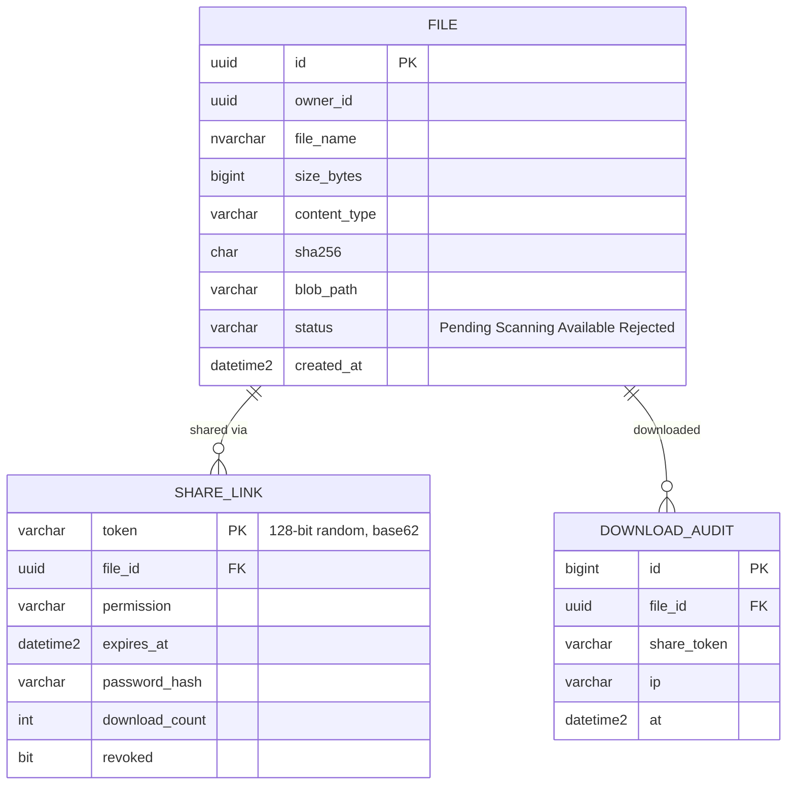
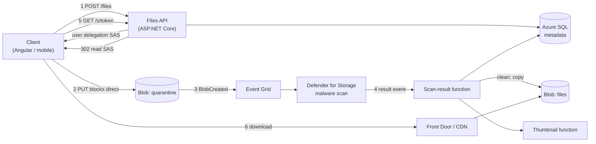
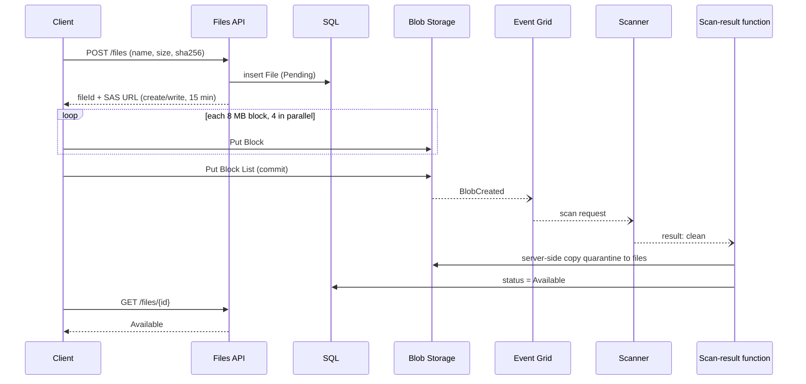

import { Aside } from '@astrojs/starlight/components';
import QuizBlock from '~/components/QuizBlock.astro';

## Why it matters in interviews

Nearly every business app uploads files: invoices, profile photos, KYC documents, reports. The question checks whether you know the one big idea: **file bytes should not flow through your API servers**. Clients upload straight to blob storage with a short-lived signed URL (SAS in Azure, pre-signed URL in AWS), and your API only handles metadata. After that come chunking and resume, an asynchronous **malware scan before anyone can download**, and secure share links. Candidates who stream a 2 GB file through an ASP.NET Core controller into a `byte[]` usually stop there.

Background on the storage primitives is in [Blob storage, files & CDN](../storage-files-cdn/).

## Requirements

**Functional**

- Upload files up to **5 GB** from web and mobile, with progress and **resume** after a network drop.
- Scan every file for malware; block download until it is clean.
- List and download your own files.
- Create share links: expiry, optional password, view or download permission, revocable.
- Image thumbnails / previews (nice to have).

**Non-functional**

- Uploads saturate the user's bandwidth; our servers are not in the data path.
- Durable: no file loss (11 nines is the storage provider's job; ours is not losing the metadata).
- Downloads fast worldwide.
- Private by default: no guessable URLs, no long-lived public links.

**Out of scope:** folder sync clients (Dropbox's delta sync), real-time co-editing, full-text search inside documents.

**Clarifying questions to ask**

1. Maximum file size, and typical size?
2. Upload and download volumes? Is it read-heavy (sharing) or write-heavy (backup)?
3. Who can see a file: owner only, organisation, anyone with the link?
4. Retention: forever, or deleted after N days (WeTransfer-style)?
5. Compliance needs: data residency, legal hold, audit of downloads?

## Back-of-the-envelope estimates

Assume **1 M uploads per day**, **average size 5 MB**, each file downloaded **5 times**.

| Quantity | Arithmetic | Result |
|---|---|---|
| Upload API calls (avg) | 1 M ÷ 86,400 | ≈ **12/s** (peak ×5 ≈ 60/s) |
| Ingest per day | 1 M × 5 MB | 5 TB/day |
| Ingest bandwidth (avg) | 5 TB ÷ 86,400 s | ≈ **58 MB/s ≈ 460 Mbps** (peak ≈ 2.3 Gbps) |
| Storage per year | 5 TB × 365 | ≈ **1.8 PB** (before redundancy) |
| Egress per day | 5 M downloads × 5 MB | 25 TB/day ≈ **290 MB/s** avg |
| Metadata per year | 1 M rows × 1 KB × 365 | ≈ 365 GB (one SQL database) |
| Blocks for a 2 GB file | 2,048 MB ÷ 8 MB blocks | 256 blocks |

Takeaways: API traffic is tiny, but **bytes are huge**. If 460 Mbps of uploads went through the API, you would size the whole compute tier around file transfer. Direct-to-blob removes that, a CDN takes the egress, and lifecycle tiering controls the 1.8 PB/year storage bill.

## API design

```http
POST /api/v1/files
{ "fileName": "contract.pdf", "sizeBytes": 2147483648, "contentType": "application/pdf", "sha256": "9f86d0...", "folderId": null }

201 Created
{ "fileId": "f_7c1e", "uploadUrl": "https://acct.blob.core.windows.net/quarantine/u_42/f_7c1e?sv=...&sig=...", "blockSizeBytes": 8388608, "expiresAt": "2026-11-02T10:15:00Z" }
```

The client then talks to Blob Storage directly: `PUT {uploadUrl}&comp=block&blockid=...` for each 8 MB block (4-8 in parallel), and finally `PUT {uploadUrl}&comp=blocklist` to commit.

```http
GET /api/v1/files/f_7c1e
{ "fileId": "f_7c1e", "status": "Scanning", "sizeBytes": 2147483648 }      // Pending | Scanning | Available | Rejected

POST /api/v1/files/f_7c1e/upload-url        // SAS expired mid-upload: get a fresh one for the same blob

POST /api/v1/files/f_7c1e/shares
{ "expiresAt": "2026-11-09T00:00:00Z", "permission": "download", "password": "optional" }
201 Created
{ "shareUrl": "https://files.example.com/s/q8Z1vNw3Kp0rT6yE" }

GET /s/q8Z1vNw3Kp0rT6yE   →   302 Location: <read-only SAS URL, valid 5 minutes>
```

## Data model



**SQL** (Azure SQL / RDS) is the right fit for metadata. It is relational (owners, folders, shares), needs transactions (create share, revoke), and stays small: 365 GB/year. The **bytes live in blob storage**, never in the database. `VARBINARY(MAX)` or FILESTREAM for user uploads is an anti-pattern at this scale.

## High-level design





## Deep dives

### 1. Direct upload with SAS

The API creates a **user delegation SAS**, signed with a key obtained through the app's managed identity, so no storage account key ever sits in config. The SAS is scoped tightly:

- **one blob** (not the container);
- **create + write** only (no read, no delete, no list);
- **15-minute expiry**;
- optionally restricted to HTTPS.

Uploads go to a **quarantine container** that nothing serves from. Configure CORS on the storage account for the Angular origin. AWS is the same idea: a pre-signed `PUT` URL, or `CreateMultipartUpload` plus pre-signed `UploadPart` URLs.

### 2. Chunked and resumable uploads

Azure block blobs are made of blocks: upload each with **Put Block** (any order, in parallel), then **Put Block List** commits them atomically. A blob can have up to 50,000 blocks. Resume works like this:

1. The client keeps `fileId`, block size and the block ids it has uploaded (in IndexedDB on the web).
2. After a drop it asks the API for a fresh SAS if the old one expired, then lists the **uncommitted blocks** (`Get Block List`) to see which ones the service already has.
3. It uploads only the missing blocks, then commits.

Uncommitted blocks that are never committed are garbage-collected by the service after about a week. In S3 the equivalent is multipart upload (parts of at least 5 MB except the last, up to 10,000 parts) plus a lifecycle rule `AbortIncompleteMultipartUpload` to clean up abandoned uploads.

### 3. The scan pipeline

Never let an unscanned file be downloadable. The `BlobCreated` event (Event Grid; AWS: S3 event notification → EventBridge/SQS) triggers the scan. **Microsoft Defender for Storage** has on-upload malware scanning that publishes results as events and blob index tags. Alternatively, run ClamAV in a container behind a queue. On "clean", server-side copy to the `files` container and mark the file `Available`. On "malicious", delete it, mark it `Rejected` and alert. Also check that the **actual size and hash** match what the client declared, and sniff the real content type rather than trusting the extension.

### 4. Share links and downloads

A share token is **128 bits of randomness** (`RandomNumberGenerator`), not a sequential id, so links can't be guessed. `GET /s/{token}` checks revoked/expired/password/permission, writes an audit row, and redirects to a **read-only SAS valid for a few minutes** with `Content-Disposition: attachment; filename="contract.pdf"` set via the SAS response headers. Revoking a share is instant for new clicks; an already-issued 5-minute SAS simply runs out.

Popular public files go through the CDN (Azure Front Door; AWS: CloudFront). Each private SAS URL is unique, so caching them at the edge gives few hits. AWS CloudFront has native signed URLs and signed cookies for private content behind the CDN. On Azure, private downloads typically go straight to Blob Storage with a short SAS, and geo-replication serves distant users.

## Scaling & bottlenecks

- **API** handles metadata only, so a couple of instances cover 60 req/s.
- **Blob storage** scales per account to high throughput. For very large ingest, spread across several storage accounts (shard by owner id) to stay under per-account limits.
- **Scan throughput** is the first real bottleneck in bursts. Queue scan requests and autoscale scanners; surface `Scanning` status to the UI so users understand the delay.
- **Thumbnails / previews** are CPU-heavy; run them in Functions or Container Apps jobs off a queue.
- **Cost** dominates at 1.8 PB/year: lifecycle rules move blobs from Hot to Cool after 30 days and to Cold/Archive later, and expired files are deleted. Optional dedup by `sha256` saves storage for identical files.

## Failure modes

| Failure | Effect | Mitigation |
|---|---|---|
| Network drop mid-upload | Partial upload | Resume from uncommitted block list |
| SAS expires during a long upload | 403 from storage | Client requests a fresh SAS for the same blob |
| Client never commits | Orphan metadata row stuck `Pending` | Cleanup job deletes `Pending` older than 24 h |
| Scan event lost or scanner down | File stuck `Scanning` | Event Grid retries + DLQ; reconciliation job re-queues stale scans |
| Leaked SAS URL | Someone can write/read one blob briefly | Short expiry, single-blob scope, minimal permissions |
| Malicious file type (HTML/SVG with script) | Stored XSS on your domain | Serve from a separate download domain, `Content-Disposition: attachment`, `X-Content-Type-Options: nosniff` |

## Trade-offs

| Decision | Options | Choice | Why |
|---|---|---|---|
| Upload path | Through API, direct to blob | Direct with SAS | Servers out of the data path; scales with storage |
| Large files | Single PUT, chunked blocks | 8 MB blocks, parallel, resumable | Retries cost one block, not the whole file |
| Scan timing | Before upload completes, async after | Async after, quarantine container | Can't scan what hasn't arrived; quarantine keeps it unreachable |
| Metadata store | SQL, NoSQL | Azure SQL | Relational, transactional, small |
| Download auth | Public URL, proxy through API, short SAS | Short SAS via redirect | Revocable, no bytes through the API |
| Dedup | None, by content hash | Optional, per tenant | Saves storage; cross-tenant dedup leaks "this file exists" |

## How to build it on Azure (with AWS equivalents)

- **Storage:** Blob Storage with quarantine and files containers, lifecycle policies, soft delete (AWS: S3 with lifecycle rules, versioning).
- **Auth to storage:** managed identity + user delegation SAS (AWS: IAM role + pre-signed URLs).
- **Events:** Event Grid `BlobCreated` (AWS: S3 event notifications → EventBridge / SQS).
- **Scanning:** Microsoft Defender for Storage malware scanning (AWS: GuardDuty Malware Protection for S3).
- **Compute:** Azure Functions for scan results and thumbnails (AWS: Lambda); API on App Service / Container Apps.
- **Delivery:** Azure Front Door (AWS: CloudFront with signed URLs / cookies).

## .NET implementation notes

Issuing a tightly scoped upload SAS with the Azure SDK. `BlobServiceClient` is created with `DefaultAzureCredential`, so there are no keys in config.

```csharp
public sealed class UploadTicketService(BlobServiceClient blobs)
{
    public async Task<UploadTicket> CreateAsync(Guid ownerId, long sizeBytes, CancellationToken ct)
    {
        const long MaxBytes = 5L * 1024 * 1024 * 1024;              // 5 GB
        if (sizeBytes is <= 0 or > MaxBytes) throw new ArgumentOutOfRangeException(nameof(sizeBytes));

        var fileId = Guid.NewGuid();
        var blob = blobs.GetBlobContainerClient("quarantine").GetBlobClient($"{ownerId}/{fileId}");
        var expires = DateTimeOffset.UtcNow.AddMinutes(15);

        // User delegation SAS: signed with an Entra ID key, no storage account key in the app.
        var key = await blobs.GetUserDelegationKeyAsync(DateTimeOffset.UtcNow.AddMinutes(-5), expires, ct);
        var sas = new BlobSasBuilder
        {
            BlobContainerName = blob.BlobContainerName,
            BlobName = blob.Name,
            Resource = "b",                                           // a single blob
            ExpiresOn = expires,
        };
        sas.SetPermissions(BlobSasPermissions.Create | BlobSasPermissions.Write);

        var uri = new BlobUriBuilder(blob.Uri)
        {
            Sas = sas.ToSasQueryParameters(key.Value, blobs.AccountName),
        }.ToUri();
        // Insert the metadata row (Status = Pending) here, then return the ticket.
        return new UploadTicket(fileId, uri, expires);
    }
}

public sealed record UploadTicket(Guid FileId, Uri UploadUrl, DateTimeOffset ExpiresOn);
```

The start time is set 5 minutes in the past to tolerate clock skew. In the browser, `@azure/storage-blob`'s `BlockBlobClient.uploadData` (or a hand-rolled `fetch` loop over `File.slice`) does the block upload with progress events.

## Interview Q&A

<details>
<summary>Why not upload through the API and then write to blob storage?</summary>

Every byte would cross your servers twice (in and out), tying up connections and memory and making compute scale with bandwidth. Request size limits and timeouts also get in the way of large files. Direct upload with a scoped SAS keeps the API at a few metadata calls per file, and storage scales on its own.
</details>

<details>
<summary>How does the server know the upload finished?</summary>

The `BlobCreated` event fires when the block list is committed; it triggers scanning, and the pipeline updates the metadata row. The client can also call `POST /files/{id}/complete` to get faster feedback, but the event is the source of truth. A reconciliation job catches anything stuck in `Pending` or `Scanning`.
</details>

<details>
<summary>What permissions and lifetime should the upload SAS have?</summary>

Create and write on one blob path only, expiring in about 15 minutes, HTTPS only, signed with a user delegation key rather than the account key. If an upload takes longer, the client asks for a new SAS for the same blob. A leaked token can then only write one quarantined blob for a few minutes.
</details>

<details>
<summary>How do you stop someone from downloading a file before the virus scan finishes?</summary>

Uploads land in a quarantine container that has no read SAS ever issued for it and no CDN origin. Only clean files are copied to the serving container, and the download endpoint checks `status = Available` before issuing a read SAS.
</details>

<details>
<summary>How would you support resumable uploads from an Angular app?</summary>

Slice the `File` into fixed-size chunks, give each a deterministic block id (base64 of the index), upload in parallel with progress, and persist `fileId` plus completed block ids in IndexedDB. On reload, fetch the uncommitted block list, upload what's missing, then commit the full list in order.
</details>

<details>
<summary>How do share links stay secure?</summary>

Unguessable 128-bit tokens, an expiry, optional password (hashed), a revoked flag, a download audit trail, and redirects to short-lived read SAS URLs instead of permanent public blob URLs. Serve downloads from a separate domain with `Content-Disposition: attachment` so uploaded HTML can't run scripts on your main site.
</details>

<details>
<summary>How do you keep storage cost under control at petabyte scale?</summary>

Lifecycle management: move to Cool after 30 days without access, Cold/Archive later, delete expired transfers. Clean up orphaned uploads. Consider content-hash dedup within a tenant. Track egress too: a CDN and caching popular files is cheaper than serving everything from the storage account.
</details>

## Pitfalls

<Aside type="caution" title="Common mistakes">

- Streaming whole files through the API, or buffering them into memory with `IFormFile` and a `MemoryStream`.
- Storing file bytes in SQL Server.
- Issuing a container-level SAS with read/write/delete and a long expiry, or embedding the storage account key in the app.
- Making files downloadable before the malware scan completes.
- Trusting the client's file extension and content type.
- No cleanup for abandoned uploads and expired files, so storage grows forever.

</Aside>

## Related

- [Blob storage, files & CDN](../storage-files-cdn/)
- [Auth in system design](../auth-in-design/) (managed identity, SAS)
- [Real-time chat](../case-chat-system/) (media attachments)
- [Azure services map](../azure-aws-mapping/)

## Quick quiz

<QuizBlock section="system-design" topic="case-file-upload" />
