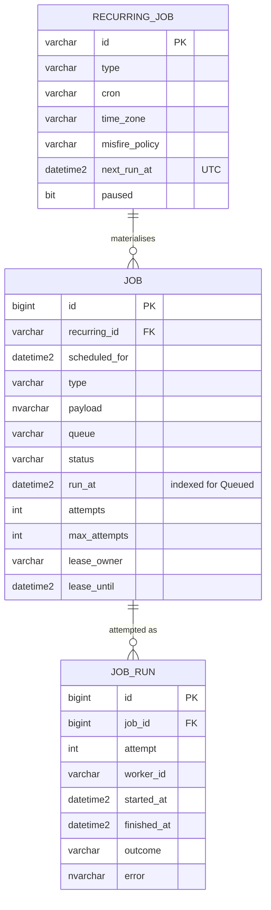
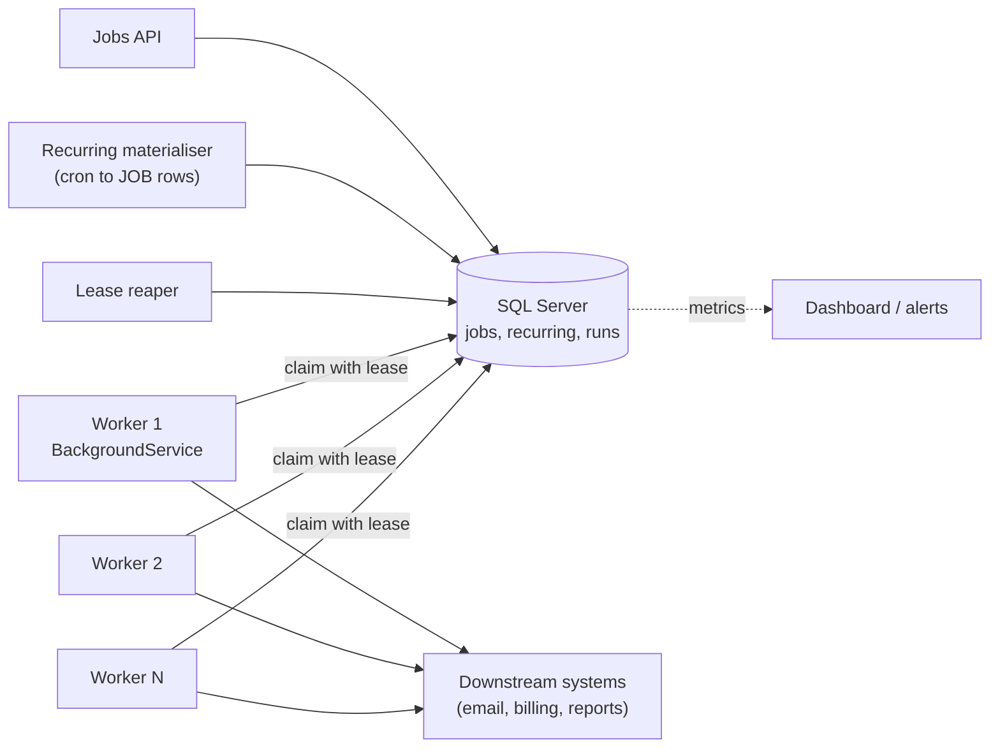
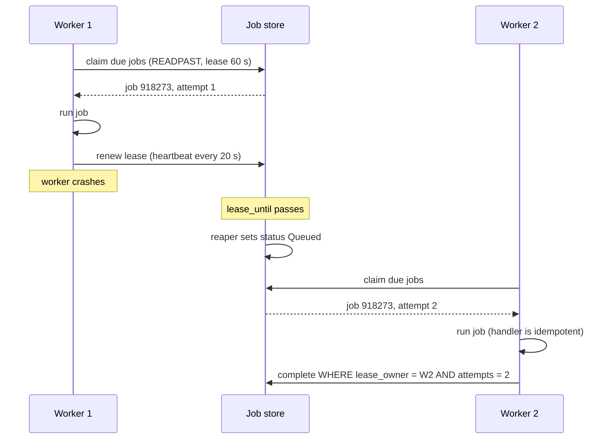

import { Aside } from '@astrojs/starlight/components';
import QuizBlock from '~/components/QuizBlock.astro';

## Why it matters in interviews

Every backend has jobs: nightly reports, "send a reminder in 24 hours", invoice generation on the 1st, retrying a failed webhook. This question tests **distributed coordination at an approachable level**:

- How do 20 workers avoid running the same job twice?
- What happens when a worker dies halfway through?
- Why is the honest guarantee "at least once"?
- How do retries back off?
- Why does "every day at 9 am" need a time zone?

.NET interviewers often follow up with "would you build this or use Hangfire / Quartz.NET / Azure Functions?". A good answer knows the mechanics *and* when to buy instead of build.

## Requirements

**Functional**

- Submit **one-off** jobs (run now), **delayed** jobs (run at time T or after N minutes), and **recurring** jobs (cron expression + time zone).
- Cancel, pause and resume jobs; trigger a recurring job manually.
- Retries with exponential backoff, a max attempt count, and a dead-letter state.
- Job history and status: queued, running, succeeded, failed, dead-lettered.

**Non-functional**

- A due job starts within **10 seconds** of its scheduled time under normal load.
- **At-least-once** execution: a job is never silently lost, even if workers crash.
- Duplicate execution is rare and handled (job handlers are idempotent).
- Horizontally scalable workers; no single point of failure.

**Out of scope:** DAG workflows with dependencies (Airflow, Durable Functions territory), and the code inside each job.

**Clarifying questions to ask**

1. How many jobs per day, and how long does a typical job run?
2. Are jobs defined by developers (a few dozen cron entries) or by users (millions of "remind me" jobs)?
3. How precise must start times be: seconds or minutes?
4. What happens to runs missed during downtime: run once, run all, or skip?
5. Are jobs CPU-heavy or I/O-bound? Do some need isolation (separate workers)?

## Back-of-the-envelope estimates

Assume **10 M job executions per day**, an **average runtime of 2 s**, and that recurring jobs cluster at the top of the hour.

| Quantity | Arithmetic | Result |
|---|---|---|
| Executions per second (avg) | 10 M ÷ 86,400 | ≈ **116/s** |
| Concurrent executions (Little's law) | 116/s × 2 s | ≈ **232** running at any moment |
| Peak (top-of-hour ×10) | 232 × 10 | ≈ 2,300 concurrent |
| Workers at 16 slots each | 2,300 ÷ 16 | ≈ **145 workers** at peak |
| Midnight burst | 1 M jobs due at 00:00, started within 60 s | ≈ **16,700 claims/s** |
| History row | id, status, timestamps, error | ≈ 500 B |
| History per day | 10 M × 500 B | 5 GB/day (30-day retention ≈ 150 GB) |

Takeaways: average load is easy. The **top-of-hour burst** is the design problem. It shapes the claim query, and it is why spreading cron jobs (`7 0 * * *` instead of `0 0 * * *`) or adding jitter matters. Little's law turns "jobs per second" into "worker capacity".

## API design

```http
POST /api/v1/jobs
Idempotency-Key: invoice-2026-11-acct-42
{ "type": "GenerateInvoice", "payload": { "accountId": 42, "month": "2026-11" },
  "runAt": "2026-12-01T03:30:00Z", "maxAttempts": 5, "timeoutSeconds": 300, "queue": "billing" }

201 Created
{ "jobId": 918273, "status": "Scheduled", "runAt": "2026-12-01T03:30:00Z" }

PUT /api/v1/recurring-jobs/daily-sales-report
{ "type": "SalesReport", "cron": "30 9 * * 1-5", "timeZone": "Asia/Kolkata", "misfirePolicy": "RunOnce", "payload": {} }

GET  /api/v1/jobs/918273            → status, attempts, lastError, history
POST /api/v1/jobs/918273/cancel
POST /api/v1/recurring-jobs/daily-sales-report/trigger
```

## Data model



**SQL Server** is a solid choice here. Claiming needs **atomic conditional updates and row-level locking**, the volume (≈ 116 claims/s average, bursts in the thousands) is within one well-indexed database, and job state is operational data you query ad hoc ("what failed last night?"). A **filtered index** on `(queue, run_at) WHERE status = 'Queued'` keeps the claim query a cheap seek. A unique index on `(recurring_id, scheduled_for)` makes materialising a recurring occurrence idempotent.

## High-level design



- **Jobs API** writes `JOB` rows (status `Queued`, `run_at`).
- The **recurring materialiser** runs every few seconds. For each `RECURRING_JOB` whose `next_run_at` has passed, it inserts the occurrence (idempotent thanks to the unique index) and computes the next `next_run_at` from the cron expression in the job's time zone.
- **Workers** poll: claim a batch of due jobs with a **lease**, run them, and record the outcome.
- The **lease reaper** returns jobs whose lease expired (the worker died) to `Queued`.



## Deep dives

### 1. Claiming without double execution

Workers must not grab the same row. In SQL Server one statement does select-and-mark atomically, skipping rows other workers have locked:

```sql
WITH due AS (
    SELECT TOP (@batch) *
    FROM dbo.Job WITH (ROWLOCK, UPDLOCK, READPAST)
    WHERE status = 'Queued' AND queue = @queue AND run_at <= SYSUTCDATETIME()
    ORDER BY run_at
)
UPDATE due
SET status = 'Running', lease_owner = @workerId,
    lease_until = DATEADD(SECOND, @leaseSeconds, SYSUTCDATETIME()), attempts = attempts + 1
OUTPUT inserted.id, inserted.type, inserted.payload, inserted.attempts, inserted.max_attempts;
```

`READPAST` lets 50 workers poll concurrently without blocking each other. This is how Hangfire's SQL Server storage behaves conceptually. (PostgreSQL: `FOR UPDATE SKIP LOCKED`.)

### 2. Leases, fencing and why "at least once"

A lease is a time-limited claim. Long jobs **renew** it (heartbeat). If a worker dies, the lease lapses and the job runs again: that is the "at least once". It is also why **exactly-once execution is not achievable** in general. A worker may finish the work, then crash before writing "succeeded".

Two consequences to say out loud:

- **Handlers must be idempotent**: use the job id or business key as an idempotency key downstream ("invoice for account 42, Nov 2026" is created once).
- **Fencing:** a worker that paused (long GC, network partition) past its lease may wake up and try to complete a job that another worker now owns. Completion updates include `WHERE lease_owner = @me AND attempts = @attempt`, so the stale worker's write affects 0 rows.

### 3. Retries and backoff

On failure, if `attempts < max_attempts`, set `status = 'Queued'` and `run_at = now + backoff`. Use **exponential backoff with full jitter** (`random(0, min(cap, base × 2^attempt))`) so a downstream outage doesn't cause every failed job to retry in the same second. Separate **transient** errors (timeouts, 503) from **permanent** ones (validation error, missing entity), which go straight to `DeadLettered`. Alert on dead-letter counts and provide a "retry" button in the dashboard.

### 4. Cron, time zones and misfires

- Store cron **with a time zone** ("09:30 Asia/Kolkata"), compute `next_run_at` in UTC. Otherwise daylight-saving changes shift jobs by an hour twice a year (or skip/duplicate runs during the transition hour).
- Dialects differ: standard cron has 5 fields; Azure Functions' NCRONTAB and Quartz add a **seconds** field (6+ fields). Validate expressions at the API.
- **Misfire policy** for runs missed while the system was down: `RunOnce` (coalesce into one run, the usual choice), `RunAll` (catch up every missed run, careful), or `Skip`.
- **Thundering herd:** thousands of tenants scheduling "0 0 * * *" all fire at midnight. Add a per-job random offset or spread the start over a window.

## Scaling & bottlenecks

- **Claim query** under the midnight burst: batch claims (10-100 rows), the filtered index, and partitioning by `queue` keep it cheap. Beyond one database's capacity, shard jobs by `hash(job_id) % N` with workers assigned to shards.
- **Polling cost:** 150 workers polling every second is 150 queries/s, fine. For lower latency without more polling, the dispatcher can push claimed jobs onto a Service Bus queue and workers consume with peek-lock, which is also a natural fit for autoscaling on queue length.
- **Isolation:** separate queues (and worker pools) for heavy jobs (report generation) and latency-sensitive ones (reminders), so one can't starve the other.
- **History table** growth: partition by day and drop old partitions instead of deleting rows.

## Failure modes

| Failure | Effect | Mitigation |
|---|---|---|
| Worker crashes mid-job | Job stuck `Running` | Lease expiry + reaper → retry (handler idempotent) |
| Worker paused past lease (GC, partition) | Two workers run the same job | Fencing on completion; idempotent side effects |
| Job always fails (poison) | Endless retries | `max_attempts` → `DeadLettered` + alert |
| DB unavailable | No claims, nothing runs | Failover group; workers back off and resume; misfire policy on recovery |
| Clock skew between workers | Early or late claims | Compare against the DB clock (`SYSUTCDATETIME()`), not the worker's |
| Downstream outage | Mass failures and retry storms | Jittered backoff, circuit breaker per downstream, pause queue |

## Trade-offs

| Decision | Options | Choice | Why |
|---|---|---|---|
| Dispatch | DB polling, queue with delayed messages, both | DB polling with leases; queue as a later scale step | Simple, queryable, cancellable jobs |
| Guarantee | At-most-once, at-least-once | At-least-once + idempotent handlers | Never lose jobs; dupes are handled |
| Claim locking | Optimistic version check, `UPDLOCK + READPAST` | `UPDLOCK + READPAST` | Workers don't block or collide |
| Recurring | Workers evaluate cron, materialiser | Materialiser + unique `(recurring_id, scheduled_for)` | One occurrence per tick, even with many instances |
| Build vs buy | Custom, Hangfire, Quartz.NET, cloud scheduler | Hangfire/Quartz for most teams; custom only with special needs | Mature retries, dashboards, clustering |

### Hangfire vs Quartz.NET vs Azure Functions timers

| | Hangfire | Quartz.NET | Azure Functions timer trigger | Service Bus scheduled messages / EventBridge Scheduler |
|---|---|---|---|---|
| Model | Fire-and-forget, delayed, recurring jobs in your app | Jobs + triggers (cron, calendars) | One cron schedule per function | Per-message delivery at a time |
| Storage | SQL Server, Redis, others | RAM or ADO.NET job store (clustered) | Managed (blob lease for singleton) | Managed by the broker |
| Retries | Automatic retries (default 10 attempts) | You implement them; misfire instructions | Retry policies; missed runs via schedule monitor | Broker redelivery / DLQ |
| Dashboard | Built in | None built in | Portal / App Insights | Portal |
| Dynamic per-user jobs | Yes | Yes | No (schedules are static config) | Yes |
| Best for | .NET apps needing background jobs quickly | Complex calendars, fine-grained trigger control | Fixed housekeeping schedules, serverless | "Run this once at T" at very large scale |

## How to build it on Azure (with AWS equivalents)

- **Workers:** `BackgroundService` on Container Apps / AKS with autoscaling (AWS: ECS / EKS), or Azure Container Apps jobs for scheduled containers (AWS: ECS scheduled tasks).
- **Store:** Azure SQL (AWS: RDS / Aurora).
- **Delays at scale:** Service Bus scheduled messages (AWS: EventBridge Scheduler; SQS delay queues only go up to 15 minutes).
- **Serverless option:** Azure Functions timer triggers and Durable Functions timers (AWS: EventBridge Scheduler + Lambda, Step Functions wait states).
- **Monitoring:** Application Insights + alerts on dead-letter count and job lag (AWS: CloudWatch).

## .NET implementation notes

A polling worker with a batch claim, parallel execution, retries with jittered backoff, and cron evaluation with the `Cronos` library. See [background services](../../aspnet/background-services/).

```csharp
public sealed class JobWorker(IJobStore store, IJobRunner runner) : BackgroundService
{
    private readonly string _workerId = $"{Environment.MachineName}-{Guid.NewGuid():N}";

    protected override async Task ExecuteAsync(CancellationToken stoppingToken)
    {
        using var timer = new PeriodicTimer(TimeSpan.FromSeconds(1));
        while (await timer.WaitForNextTickAsync(stoppingToken))
        {
            var jobs = await store.ClaimDueAsync(_workerId, batch: 10, lease: TimeSpan.FromMinutes(1), stoppingToken);
            await Parallel.ForEachAsync(jobs, stoppingToken, async (job, ct) =>
            {
                try { await runner.RunAsync(job, ct); await store.CompleteAsync(job.JobId, ct); }
                catch (Exception ex) when (job.Attempts < job.MaxAttempts)
                { await store.RetryAsync(job.JobId, DateTimeOffset.UtcNow + Schedule.Backoff(job.Attempts), ex.Message, ct); }
                catch (Exception ex) { await store.DeadLetterAsync(job.JobId, ex.Message, ct); }
            });
        }
    }
}

public static class Schedule
{
    // Next fire time for a cron job, evaluated in the job's own time zone (DST-safe).
    public static DateTimeOffset? NextRun(string cron, string timeZoneId, DateTimeOffset after) =>
        CronExpression.Parse(cron).GetNextOccurrence(after, TimeZoneInfo.FindSystemTimeZoneById(timeZoneId));

    // Exponential backoff with full jitter: random delay in [0, min(1 h, 5 s × 2^attempt)].
    public static TimeSpan Backoff(int attempt)
    {
        double ceilingMs = Math.Min(TimeSpan.FromHours(1).TotalMilliseconds, 5_000 * Math.Pow(2, attempt));
        return TimeSpan.FromMilliseconds(Random.Shared.NextDouble() * ceilingMs);
    }
}
```

`ClaimDueAsync` runs the `UPDLOCK, READPAST` statement above. For brevity this worker doesn't renew leases; real long-running jobs need a heartbeat task, and the store's `CompleteAsync` should include the fencing condition.

## Interview Q&A

<details>
<summary>How do you make sure two workers don't pick the same job?</summary>

Claim with one atomic statement that marks rows as `Running` with a lease owner, using `UPDLOCK, READPAST` in SQL Server (`SKIP LOCKED` in PostgreSQL), so concurrent pollers skip rows already being claimed. Alternatively push due jobs into a queue with competing consumers, where the broker's peek-lock gives each message to one consumer at a time.
</details>

<details>
<summary>Can you guarantee a job runs exactly once?</summary>

Not in general. A worker can finish the side effect and crash before recording success, and the job will run again. Aim for at-least-once execution plus **idempotent handlers** (dedupe by job id or business key, upserts instead of inserts, idempotency keys on external APIs). That combination gives an exactly-once *effect*.
</details>

<details>
<summary>What is a lease, and how long should it be?</summary>

A time-limited ownership claim on a job. Too short and healthy long jobs get reclaimed and run twice; too long and a crashed worker's job waits a long time to be retried. Use a short lease (30-60 s) and have the worker renew it periodically while the job runs, so the lease length is independent of job duration.
</details>

<details>
<summary>How do you handle a recurring job when the scheduler was down for two hours?</summary>

That is the misfire policy. Usually run it once on recovery (coalesce), because ten back-to-back runs of "sync prices" are useless. Some jobs (hourly billing aggregation) need every occurrence, so they use run-all with a unique key per occurrence. Make the policy a per-job setting.
</details>

<details>
<summary>Why store a time zone with the cron expression?</summary>

"9 am every weekday" means 9 am local time to the user. Evaluated in UTC, it shifts by an hour when daylight saving starts or ends, and a 02:30 job may run twice or not at all on transition days. Libraries like Cronos compute the next occurrence in a given `TimeZoneInfo` and handle the gaps and overlaps.
</details>

<details>
<summary>Would you use Hangfire, Quartz.NET or Azure Functions for nightly report generation?</summary>

For a fixed nightly schedule in a serverless setup, an Azure Functions timer trigger is simplest. If the app already runs on ASP.NET Core with SQL Server and needs retries and a dashboard, Hangfire. Quartz.NET if you need calendars ("last business day of the month, excluding holidays") or fine trigger control. Build your own only if you need something these don't offer, such as millions of user-defined schedules with custom sharding.
</details>

<details>
<summary>How would you scale to 100 M jobs per day?</summary>

Shard the job store by job id hash, with worker groups per shard. Move dispatch to a queue (the dispatcher claims and enqueues; workers consume and autoscale on queue depth). Keep history in a separate, partitioned, append-only store, and spread cron-heavy times with jitter.
</details>

## Pitfalls

<Aside type="caution" title="Common mistakes">

- `SELECT` due jobs, then `UPDATE` them in a second statement, so two workers claim the same rows.
- Claiming jobs with no lease, so a crashed worker's jobs are stuck forever.
- Claiming "exactly-once execution" without idempotent handlers.
- Running scheduled work inside every web instance with a plain `Timer`, so N instances run it N times.
- Cron in UTC for user-facing schedules (DST bugs).
- Retrying permanent failures with no backoff, no cap and no dead-letter state.

</Aside>

## Related

- [Background services in ASP.NET Core](../../aspnet/background-services/)
- [Delivery guarantees & idempotency](../../microservices/delivery-guarantees/)
- [Transactions, isolation & locking](../../data/transactions-isolation/)
- [Notification system](../case-notification-system/) (scheduled sends)

## Quick quiz

<QuizBlock section="system-design" topic="case-job-scheduler" />
