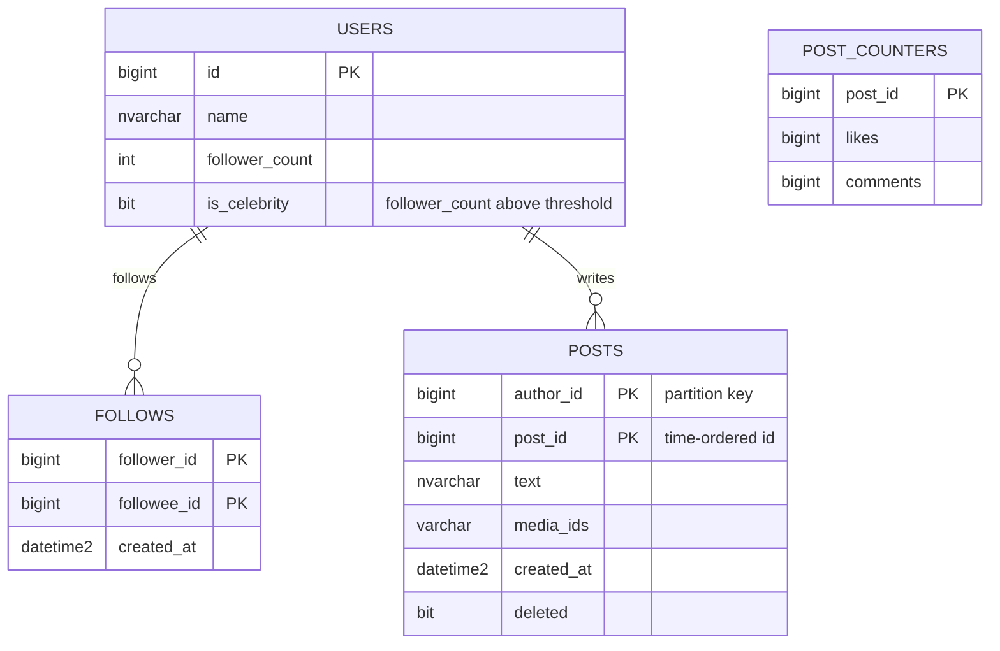
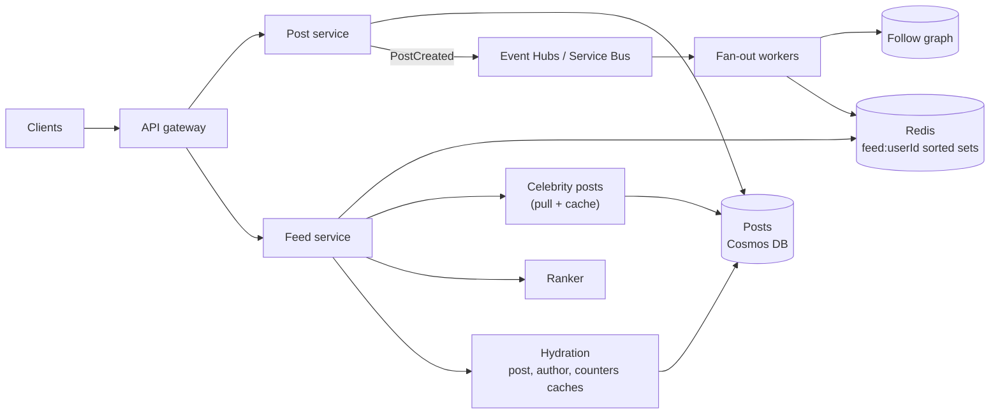
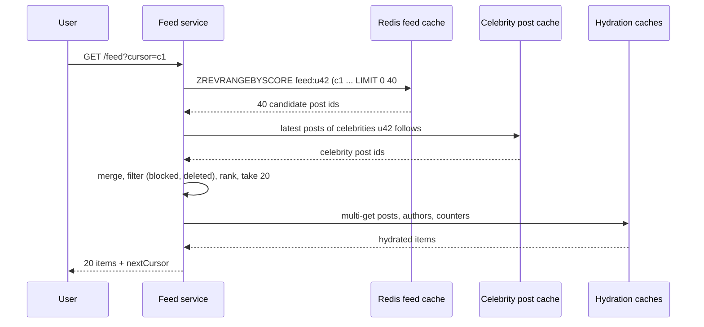

import { Aside } from '@astrojs/starlight/components';
import QuizBlock from '~/components/QuizBlock.astro';

## Why it matters in interviews

The news feed is the textbook **push vs pull** problem. Do you do the work when a post is written (copy it into every follower's feed) or when a feed is read (gather posts from everyone the user follows)? Each choice breaks at a different extreme: pull is slow for users following thousands of accounts, and push explodes for a celebrity with 10 million followers. The interviewer wants you to quantify both, land on the **hybrid**, and then handle pagination, ranking and caching sensibly. It also tests whether you separate **ids** (cheap to fan out) from **content** (hydrated at read time).

## Requirements

**Functional**

- Users create posts (text, images) and follow other users.
- Home feed: posts from people you follow, newest or ranked first, infinitely scrollable.
- Likes and comments counts shown on each post.

**Non-functional**

- Feed load p95 under 300 ms.
- A new post appears in followers' feeds within a few seconds. Eventual consistency is fine.
- Read-heavy: feeds are read far more than posts are written.
- Highly available. A slightly stale feed is acceptable; an error page is not.

**Out of scope:** ads, the ML ranking model itself, notifications, search, stories/video.

**Clarifying questions to ask**

1. DAU, feed loads per user, posts per user per day?
2. Average and maximum follower counts? Are there celebrities?
3. Chronological or ranked feed?
4. How far back can a user scroll: days, or forever?
5. Must deleted or edited posts disappear from feeds immediately?

## Back-of-the-envelope estimates

Assume **100 M DAU**, **10 feed loads** per user per day, **10 M posts per day**, an **average of 200 followers**, and some accounts with **10 M followers**.

| Quantity | Arithmetic | Result |
|---|---|---|
| Feed reads per day | 100 M × 10 | 1 B |
| Feed read QPS (avg) | 1 B ÷ 86,400 | ≈ **11,600/s** (peak ×3 ≈ 35,000/s) |
| Post write QPS (avg) | 10 M ÷ 86,400 | ≈ **116/s** |
| Fan-out writes per day | 10 M × 200 followers | 2 B |
| Fan-out writes per second | 2 B ÷ 86,400 | ≈ **23,000/s** |
| One celebrity post | 10 M followers × 1 write | 10 M writes (≈ 100 s at 100,000 writes/s) |
| Feed cache | 100 M users × 200 ids × ~64 B per sorted-set entry | ≈ **1.3 TB** of Redis |
| Post storage | 10 M × 1 KB | 10 GB/day ≈ 3.65 TB/year (media in blob storage) |
| Feed response bandwidth | 11,600/s × 20 posts × 1 KB | ≈ 230 MB/s (images via CDN) |

Takeaways: reads are 100× posts, so **precomputing feeds** pays off. Fan-out on write is affordable on average (23,000 writes/s) but a single celebrity post costs as much as 50,000 normal posts. That number is the argument for the hybrid.

## API design

```http
POST /api/v1/posts
{ "text": "Shipped our .NET 10 upgrade today", "mediaIds": ["m_88"] }
201 Created
{ "postId": "1853012345678901248", "createdAt": "2026-11-02T10:01:03Z" }

GET /api/v1/feed?limit=20
GET /api/v1/feed?limit=20&cursor=eyJ0cyI6MTc2MjA3NzI2MzAwMCwiaWQiOjE4NTN9
200 OK
{
  "items": [
    { "postId": "1853012345678901248", "author": { "id": "u_9", "name": "Asha", "avatarUrl": "..." },
      "text": "Shipped our .NET 10 upgrade today", "likeCount": 42, "commentCount": 3, "createdAt": "2026-11-02T10:01:03Z" }
  ],
  "nextCursor": "eyJ0cyI6MTc2MjA3NzEwMDAwMCwiaWQiOjE4NDl9"
}

PUT    /api/v1/users/u_9/followers/me      (follow)
DELETE /api/v1/users/u_9/followers/me      (unfollow)
```

The cursor is an opaque, encoded `(timestamp, postId)` of the last item returned. It is **not** a page number, because new posts arriving at the top would shift every offset and cause duplicates or gaps.

## Data model



Plus the **feed cache** in Redis: `feed:{userId}` is a sorted set of post ids scored by time (or rank score), trimmed to the newest 200-800 entries.

- **Posts:** Cosmos DB (AWS: DynamoDB) or Cassandra, partitioned by `author_id`, sorted by `post_id`. That gives "latest posts by author X" as one partition read, which is exactly what the pull path needs. Use time-ordered ids (Snowflake-style) so the id itself sorts by time.
- **Follow graph:** stored **both ways**: followers of X (for fan-out) and followees of Y (for pull). Each direction is partitioned by its first column. At this size (tens of billions of edges) it is a NoSQL table; a SQL table works for smaller products.
- **Counters** live separately and are updated asynchronously, so a viral post's likes don't contend with the post row.

## High-level design



**Write path:** the post is stored, then a `PostCreated` event goes to fan-out workers. If the author is **not** a celebrity, workers page through the author's followers (only those active in the last 30 days) and `ZADD` the post id into each `feed:{followerId}`. Celebrity posts are **not** fanned out.

**Read path:**



## Deep dives

### 1. Fan-out on write vs on read

| | Fan-out on write (push) | Fan-out on read (pull) |
|---|---|---|
| Work happens | When a post is created | When a feed is loaded |
| Feed read | One cache read, very fast | Query every followee, merge: slow for users following 2,000 accounts |
| Write cost | One write per follower: a 10 M-follower post means 10 M writes | One write |
| Wasted work | Feeds of users who never log in | None |
| Freshness | Seconds of delay for big fan-outs | Always fresh |

**Hybrid:** push for normal authors, pull for celebrities (above a threshold, e.g. 100k followers). A user follows only a handful of celebrities, so merging their latest posts at read time is cheap, especially because celebrity posts are cached per author and read by millions. Also skip fan-out to **inactive users**; rebuild their feed with a pull when they return.

### 2. Ids, not content

The feed cache stores **post ids only**. Content is looked up at read time (hydration) from post, author and counter caches. That keeps fan-out writes tiny, makes edits and deletes visible without rewriting millions of feeds (the hydrator drops deleted posts), and lets like counts update live. Hydration is a batched multi-get, not 20 separate calls (the N+1 problem again).

### 3. Ranking

Start chronological. For a ranked feed, use a **two-stage** approach:

1. **Candidate generation:** the ~200-500 ids from the feed cache plus celebrity posts.
2. **Scoring:** a cheap score per candidate. For example `affinity(user, author) × engagement weight × time decay`, with time decay like `1 / (age_hours + 2)^1.5`. A real product swaps the formula for an ML model; the architecture stays the same.

Rank only the candidates for the current page window, and keep the cursor stable. Re-ranking items the user has already scrolled past would show duplicates.

### 4. Pagination and caching

- **Cursor pagination** over `(score, postId)`: "give me 20 items with score below X". It is stable under inserts and an index seek in any store.
- **Feed cache:** Redis sorted sets trimmed to N entries. Users who scroll beyond N fall back to a pull query against the posts store.
- **Hot posts:** a celebrity post is hydrated millions of times. Keep it in an in-process cache on each feed node (seconds of TTL) on top of Redis.
- **Cold start:** a new user follows 10 accounts. The feed service builds the feed by pulling, then writes it to the cache.

## Scaling & bottlenecks

- **Fan-out workers** scale horizontally on queue depth; partition the event stream by author id. Batch Redis writes with pipelining.
- **Redis** at ~1.3 TB needs a cluster (shard by user id). Store only active users' feeds and trim aggressively.
- **Celebrity threshold** is a dial: lower means fewer fan-out writes and more read-time merging.
- **Follow-graph reads** during fan-out: page through followers in batches of 1,000 and stream them to workers.
- **Counters** for viral posts: aggregate likes in memory or Redis and flush periodically instead of writing per like.

## Failure modes

| Failure | Effect | Mitigation |
|---|---|---|
| Fan-out backlog (celebrity edge cases, outage) | New posts appear late | Autoscale workers; hybrid model keeps backlogs small |
| Redis node lost | Some feeds empty | Rebuild on read via pull; replicas |
| Post deleted after fan-out | Deleted post in feeds | Hydration drops deleted posts |
| Unfollow after fan-out | Old posts from the unfollowed user | Filter at read against the follow set; lazy cleanup |
| Ranking service slow | Feed latency | Timeout and fall back to chronological order |
| Hot post hydration | One Redis key hammered | Local in-process cache per feed node |

## Trade-offs

| Decision | Options | Choice | Why |
|---|---|---|---|
| Feed generation | Push, pull, hybrid | Hybrid with a celebrity threshold | Fast reads without 10 M-write posts |
| Feed cache content | Full posts, ids | Ids (+ score) | Small fan-out, edits/deletes free |
| Who gets fan-out | All followers, active followers | Active followers only | No work for users who won't read it |
| Ordering | Chronological, ranked | Chronological first, two-stage ranking later | Simple, explainable; ranking is a plug-in |
| Pagination | Offset, cursor | Cursor `(score, id)` | Stable while new posts arrive |
| Post store | SQL, Cosmos DB / Cassandra | Cosmos DB, partition by author | Fast "latest by author" reads; scales writes |

## How to build it on Azure (with AWS equivalents)

- **Event stream:** Event Hubs for `PostCreated` with partitions by author (AWS: Kinesis or MSK); Service Bus works at smaller scale (AWS: SQS).
- **Feed cache:** Azure Cache for Redis / Azure Managed Redis in cluster mode (AWS: ElastiCache cluster mode).
- **Posts and graph:** Cosmos DB for NoSQL (AWS: DynamoDB).
- **Compute:** feed and fan-out services on AKS or Container Apps with KEDA scaling on Event Hubs lag (AWS: EKS / ECS).
- **Media:** Blob Storage behind Front Door (AWS: S3 + CloudFront).

## .NET implementation notes

Fan-out into Redis sorted sets with pipelining, and a cursor page read. See [caching at scale](../caching/) for Redis structures.

```csharp
public sealed class FeedCache(IConnectionMultiplexer redis)
{
    private const int MaxFeedLength = 800;   // keep only the newest N ids per user

    // Fan-out on write: push the post id into every follower's sorted set (score = time).
    public async Task FanOutAsync(Post post, IEnumerable<long> followerIds)
    {
        var batch = redis.GetDatabase().CreateBatch();
        var pending = new List<Task>();
        foreach (var followerId in followerIds)
        {
            RedisKey key = $"feed:{followerId}";
            pending.Add(batch.SortedSetAddAsync(key, post.PostId, post.CreatedAt.ToUnixTimeMilliseconds()));
            pending.Add(batch.SortedSetRemoveRangeByRankAsync(key, 0, -(MaxFeedLength + 1)));
        }
        batch.Execute();                      // pipelined: commands go out together
        await Task.WhenAll(pending);
    }

    // A page of post ids strictly older than the cursor, newest first.
    public async Task<long[]> GetPageAsync(long userId, long? beforeUnixMs, int pageSize = 20)
    {
        var ids = await redis.GetDatabase().SortedSetRangeByScoreAsync(
            $"feed:{userId}",
            start: double.NegativeInfinity,
            stop: beforeUnixMs ?? double.PositiveInfinity,
            exclude: beforeUnixMs is null ? Exclude.None : Exclude.Stop,
            order: Order.Descending,
            take: pageSize);
        return ids.Select(v => (long)v).ToArray();
    }
}

public sealed record Post(long PostId, long AuthorId, DateTimeOffset CreatedAt);
```

`ZREMRANGEBYRANK key 0 -(N+1)` removes everything except the top N by score, keeping each feed bounded. A production cursor would encode `(timestamp, postId)` to break ties between posts in the same millisecond.

## Interview Q&A

<details>
<summary>Push or pull: which would you choose?</summary>

Neither alone. Push gives fast reads but costs one write per follower, which is catastrophic for celebrities. Pull is cheap to write but slow to read for users who follow many accounts. Use the hybrid: push for normal users, pull and merge for the few celebrities a user follows, and skip pushing to inactive users.
</details>

<details>
<summary>How do you pick the celebrity threshold?</summary>

From cost, not a magic number. Fan-out cost grows with follower count; read-merge cost grows with the number of celebrities a user follows. Pick the threshold (say 100k followers) so the fan-out queue stays within its latency target, and make it configurable. Some designs also treat very active posters differently.
</details>

<details>
<summary>Why store post ids instead of whole posts in the feed cache?</summary>

Ids are 8 bytes, so fanning them out is cheap. Edits, deletes and like counts are read fresh at hydration time instead of being copied into millions of feeds. Hydration uses batched cache reads, so the extra lookup costs a single round trip.
</details>

<details>
<summary>Why cursor pagination and not page numbers?</summary>

New posts keep arriving at the top. With `OFFSET 20` the second page shifts and the user sees duplicates or misses posts. A cursor ("items older than this score and id") is stable and is an efficient index seek, while large offsets scan and discard rows.
</details>

<details>
<summary>A user unfollows someone. Do you remove that person's posts from their feed?</summary>

Usually lazily: at read time, filter candidates against the current follow set (cached), and let old entries age out of the trimmed cache. Actively scanning and removing entries is possible but rarely worth it.
</details>

<details>
<summary>How would you rank the feed without a machine-learning team?</summary>

A weighted score: recency decay, plus affinity (how often the user interacts with the author), plus engagement on the post. Compute it over a candidate set of a few hundred posts per request. Keep chronological order as a fallback when the ranker times out.
</details>

<details>
<summary>What is the first thing that breaks as the product grows?</summary>

Usually fan-out for popular accounts, which shows up as growing queue lag and posts appearing minutes late. Then Redis memory as the user base grows. The hybrid model and trimming feeds to active users address both.
</details>

## Pitfalls

<Aside type="caution" title="Common mistakes">

- Picking pure fan-out on write without doing the celebrity math.
- Building the feed with a SQL `JOIN` over follows and posts on every request at 35,000 QPS.
- Storing full post content in every follower's feed.
- Offset pagination on a constantly changing list.
- Fanning out to every follower, including the ones who haven't logged in for a year.
- Hydrating items one by one (N+1 calls per page).

</Aside>

## Related

- [Caching at scale](../caching/)
- [Databases at scale](../databases-at-scale/) (partitioning, consistent hashing)
- [Queues & pub/sub basics](../messaging-basics/) (fan-out)
- [Real-time chat](../case-chat-system/) (group fan-out)

## Quick quiz

<QuizBlock section="system-design" topic="case-news-feed" />
