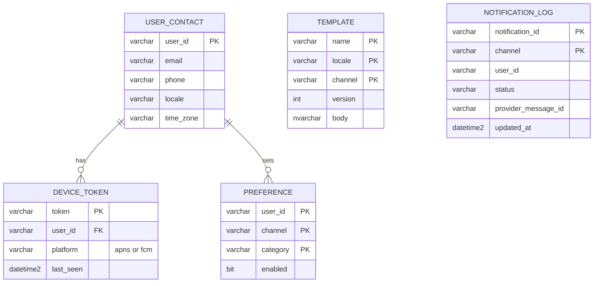
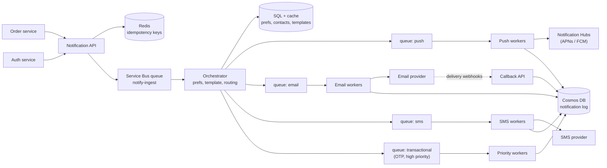
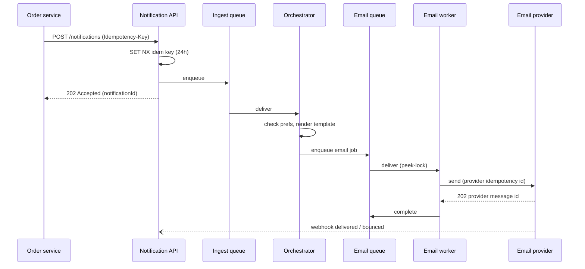

import { Aside } from '@astrojs/starlight/components';
import QuizBlock from '~/components/QuizBlock.astro';

## Why it matters in interviews

Almost every product sends notifications, and almost every team has shipped a duplicate email or a lost OTP. That is why this question is popular with both product and service companies. It tests **asynchronous design**: why the API returns `202 Accepted`, how queues isolate slow providers, and what "at-least-once" means for a user who must not receive the same SMS twice. Strong answers separate **transactional** traffic (OTP, order confirmation) from **marketing** traffic. They also respect user preferences, handle provider limits and failures, and can say exactly where deduplication happens.

## Requirements

**Functional**

- Internal services send a notification to a user on one or more channels: **email, SMS, mobile push** (in-app is a bonus).
- Templates with variables and localisation (`order_shipped` in `en-IN`, `hi-IN`).
- User preferences: opt-out per channel and per category, quiet hours, and unsubscribe links (legal requirement for marketing email).
- Scheduled sends ("tomorrow 9 am local time") and bulk campaigns.
- Delivery status tracking: queued, sent, delivered, opened, failed.

**Non-functional**

- Transactional notifications (OTP) reach the provider within seconds, even during a marketing blast.
- At-least-once delivery to the provider with **effective deduplication**: no user-visible duplicates.
- Scale to campaign bursts of 10× normal traffic.
- A failing provider must not take down the other channels.

**Out of scope:** building an SMTP server or a push gateway (we use providers), the campaign-authoring UI, and A/B testing.

**Clarifying questions to ask**

1. Which channels, and what volume per channel per day?
2. Which notifications are time-critical (OTP) and which can be delayed?
3. Do callers need a synchronous "sent" result, or is fire-and-forget fine?
4. Are there per-user frequency caps ("max 3 marketing pushes a day")?
5. Must we keep a history of every notification, and for how long?

## Back-of-the-envelope estimates

Assume **100 M notifications per day**: 70 M push, 25 M email, 5 M SMS.

| Quantity | Arithmetic | Result |
|---|---|---|
| Average QPS | 100 M ÷ 86,400 | ≈ **1,160/s** |
| Peak QPS (campaign ×10) | 1,160 × 10 | ≈ **11,600/s** |
| SMS average | 5 M ÷ 86,400 | ≈ 58/s (providers often cap per-account throughput) |
| Notification log row | ids, channel, template, status, timestamps | ≈ 1 KB |
| Log storage per day | 100 M × 1 KB | **100 GB/day** |
| Log storage per year | 100 GB × 365 | ≈ 36.5 TB (so keep 90 days hot ≈ 9 TB, archive the rest) |
| Email payload | 25 M × 50 KB rendered HTML | 1.25 TB/day ≈ **14.5 MB/s** to the email provider |

Takeaways: the API tier is modest, the **log is big and append-only** (a good fit for a NoSQL store with TTL), and **provider throughput**, not our own servers, is the real limit during bursts.

## API design

```http
POST /api/v1/notifications
Idempotency-Key: order-981234-shipped
Content-Type: application/json

{
  "userId": "u_42",
  "category": "order_updates",
  "template": "order_shipped",
  "channels": ["push", "email"],
  "priority": "high",
  "data": { "orderId": "981234", "eta": "2026-11-05" },
  "sendAt": null
}

202 Accepted
{ "notificationId": "ntf_01JC8...", "status": "queued" }
```

```http
GET /api/v1/notifications/ntf_01JC8...

200 OK
{ "notificationId": "ntf_01JC8...", "deliveries": [
  { "channel": "push",  "status": "delivered", "at": "2026-11-02T10:01:03Z" },
  { "channel": "email", "status": "opened",    "at": "2026-11-02T10:07:41Z" } ] }
```

```http
PUT /api/v1/users/u_42/preferences
{ "email": { "marketing": false, "order_updates": true }, "sms": { "marketing": false }, "quietHours": { "from": "22:00", "to": "08:00", "tz": "Asia/Kolkata" } }
```

The `Idempotency-Key` comes from the **business event** (order id + event type), not a random value generated per HTTP call. Then a retried upstream call or a replayed event maps to the same notification.

## Data model



- **Contacts, preferences, templates** are small, relational and read-heavy: **Azure SQL** with a Redis cache in front (preferences are read on every send).
- **Notification log** is huge, append-mostly, read by id, and expires: **Cosmos DB** (AWS: DynamoDB) partitioned by `notification_id` with a 90-day TTL. Add a secondary path by `user_id` (a second container, or the change feed into a per-user view) if "show my notifications" is needed.

## High-level design



1. **API** validates, authenticates the calling service, checks the idempotency key, writes to the ingest queue and returns `202`.
2. **Orchestrator** loads the user's contacts and preferences, drops opted-out channels, applies quiet hours (reschedules the message), renders the template per channel, and routes it to a **per-channel queue**. OTPs go to a separate priority queue with dedicated workers.
3. **Channel workers** call the provider, honour per-provider rate limits, retry transient failures with backoff, and dead-letter after N attempts.
4. **Callbacks** from providers (delivered, bounced, opened) update the log. Hard bounces and invalid device tokens are fed back to the contact store so we stop sending to them.



## Deep dives

### 1. Deduplication: where and how

There are three layers, and you should name all of them.

1. **API:** `Idempotency-Key` stored with `SET key NX EX 86400` in Redis. A second request with the same key returns the original `notificationId`.
2. **Queue:** Azure Service Bus duplicate detection drops messages with the same `MessageId` within a configured window. AWS SQS FIFO queues have a similar 5-minute deduplication window.
3. **Worker:** the queue is at-least-once, so a worker can crash after the provider accepted the email but before completing the message. Before sending, the worker claims `notif:{id}:{channel}` in Redis. Where the provider supports an idempotency id, pass it so the provider also ignores the replay.

Exactly-once delivery to a phone is impossible in general. The goal is **at-least-once + idempotent processing**, which makes duplicates very rare. See [delivery guarantees](../../microservices/delivery-guarantees/).

### 2. Retries, backoff and the dead-letter queue

- **Transient** errors (timeouts, HTTP 429/5xx): retry with exponential backoff and jitter. With Service Bus, either abandon the message (immediate redelivery, counted toward `MaxDeliveryCount`) or complete it and **re-schedule a copy** with `ScheduledEnqueueTime = now + backoff` to get a real delay.
- **Permanent** errors (invalid number, unsubscribed, hard bounce): don't retry. Mark the delivery failed and update the contact.
- After N attempts the message lands in the **DLQ**. Alert on DLQ depth and build a small replay tool.
- **Expiry:** an OTP that is 10 minutes late is useless. Set a time-to-live on transactional messages so they expire instead of being delivered late.

### 3. Provider limits and failover

Each provider has throughput limits (per second and per day). Workers share a **distributed token bucket per provider** (see [rate limiter](../case-rate-limiter/)), so 50 worker instances don't exceed the contract together. Wrap each provider in a circuit breaker. When the primary SMS provider's error rate crosses a threshold, route to a secondary provider. Channel isolation (one queue and worker pool per channel) means an email outage builds an email backlog but push keeps flowing. That is the **bulkhead** pattern.

### 4. Priority and fairness during campaigns

A 20 M-recipient campaign must not delay OTPs. Use separate queues and worker pools for transactional traffic, and **pace campaigns**: the campaign scheduler releases recipients in batches at a set rate instead of enqueuing 20 M messages at once. Per-user frequency caps (`INCR user:{id}:mkt:{date}` with a TTL) protect users from over-notification.

## Scaling & bottlenecks

- API and orchestrator are stateless; scale on queue length (KEDA in Container Apps / AKS, or Functions' Service Bus scaling).
- **Preference lookups** run once per notification: cache them in Redis and invalidate on update.
- **Template rendering** is CPU-bound for big campaigns. Cache compiled templates; render once per locale when the content is not personalised.
- **The log store** takes about 3 writes per notification (queued, sent, delivered). Batch writes and use a write-optimised partition key.
- **Providers** are the true ceiling. Negotiate throughput and spread campaigns over time.

## Failure modes

| Failure | Effect | Mitigation |
|---|---|---|
| Email provider outage | Email backlog grows | Circuit breaker, secondary provider, queue absorbs the backlog |
| Worker crashes after send, before complete | Redelivery could send twice | Redis claim + provider idempotency id |
| Poison message (bad template data) | Endless retries | Max delivery count → DLQ; validate data at the API |
| Redis down | Dedup and prefs cache unavailable | Fall back to the DB for prefs; Service Bus duplicate detection still applies |
| Campaign floods the system | OTP latency rises | Priority queue, campaign pacing, autoscaling |
| Invalid device tokens pile up | Wasted calls, provider penalties | Remove tokens on "unregistered" feedback |

## Trade-offs

| Decision | Options | Choice | Why |
|---|---|---|---|
| Caller contract | Sync send, async 202 | Async 202 | Providers are slow and flaky; callers shouldn't wait |
| Queue layout | One queue, queue per channel, per priority | Per channel + a transactional queue | Isolation (bulkhead) and priority |
| Dedup | API only, worker only, both | Both + broker dedup | Each layer covers a different failure |
| Log store | SQL, Cosmos DB / DynamoDB | Cosmos DB with TTL | 100 GB/day of append-only writes; key lookups |
| Rendering | At API, in orchestrator, in worker | Orchestrator | Preferences and locale are known there; workers stay channel-specific |
| Retry style | Abandon (immediate), scheduled re-enqueue | Scheduled re-enqueue for provider throttling | Real backoff instead of hot-looping |

## How to build it on Azure (with AWS equivalents)

- **Messaging:** Azure Service Bus queues with duplicate detection, sessions not needed (AWS: SQS + SNS; SQS FIFO for dedup).
- **Compute:** Azure Functions with Service Bus triggers or Container Apps with KEDA (AWS: Lambda with SQS triggers, or ECS).
- **Providers:** Azure Communication Services for email and SMS (AWS: SES and SNS/End User Messaging); Azure Notification Hubs in front of APNs/FCM (AWS: SNS mobile push / Pinpoint).
- **Data:** Azure SQL + Azure Cache for Redis for preferences; Cosmos DB for the log (AWS: RDS + ElastiCache + DynamoDB).
- **Scheduling:** Service Bus scheduled messages for "send at" (AWS: EventBridge Scheduler).

## .NET implementation notes

An email worker as a `BackgroundService` with a Service Bus processor and a Redis claim. It completes duplicates, releases the claim on transient failure, and lets Service Bus dead-letter after `MaxDeliveryCount`.

```csharp
public sealed class EmailWorker(ServiceBusClient bus, IConnectionMultiplexer redis,
    IEmailProvider provider, ILogger<EmailWorker> log) : BackgroundService
{
    protected override async Task ExecuteAsync(CancellationToken stoppingToken)
    {
        await using var processor = bus.CreateProcessor("notify-email",
            new ServiceBusProcessorOptions { MaxConcurrentCalls = 16, AutoCompleteMessages = false });
        processor.ProcessMessageAsync += HandleAsync;
        processor.ProcessErrorAsync += e => { log.LogError(e.Exception, "Service Bus error"); return Task.CompletedTask; };
        await processor.StartProcessingAsync(stoppingToken);
        try { await Task.Delay(Timeout.Infinite, stoppingToken); }
        catch (OperationCanceledException) { await processor.StopProcessingAsync(); }
    }

    private async Task HandleAsync(ProcessMessageEventArgs args)
    {
        var msg = args.Message.Body.ToObjectFromJson<NotificationMessage>()!;
        var db = redis.GetDatabase();
        var key = $"notif:{msg.NotificationId}:email";

        // Claim the notification so only one worker sends it.
        if (!await db.StringSetAsync(key, "sending", TimeSpan.FromMinutes(2), When.NotExists))
        {
            if (await db.StringGetAsync(key) == "sent") await args.CompleteMessageAsync(args.Message); // duplicate
            else await args.AbandonMessageAsync(args.Message);   // another worker is mid-send: retry later
            return;
        }
        try
        {
            await provider.SendAsync(msg, args.CancellationToken);
            await db.StringSetAsync(key, "sent", TimeSpan.FromDays(1));
            await args.CompleteMessageAsync(args.Message);
        }
        catch (TransientProviderException)
        {
            await db.KeyDeleteAsync(key);                    // release the claim
            await args.AbandonMessageAsync(args.Message);    // after MaxDeliveryCount it goes to the DLQ
        }
    }
}
```

There is still a small window: if the process dies after `SendAsync` succeeds but before `"sent"` is written, the claim expires and the message is retried. A provider-side idempotency id closes that gap. For the object-oriented design of the dispatcher itself (Strategy per channel, Factory), see the [LLD notification dispatcher](../lld-notification-dispatcher/).

## Interview Q&A

<details>
<summary>Why not call the email provider directly from the order service?</summary>

It couples order placement to a slow, rate-limited third party. If the provider is down, either orders fail or emails are lost. A queue decouples them: the order succeeds, the notification is durable, and it is retried until it is delivered or dead-lettered. It also centralises preferences, templates and tracking.
</details>

<details>
<summary>How do you guarantee a user never gets the same OTP SMS twice?</summary>

You can't guarantee it absolutely, but you can make it very rare. Use an idempotency key at the API, broker duplicate detection, a worker-side claim keyed by notification id and channel, and the provider's idempotency id if it offers one. Also make the OTP itself idempotent: resending the *same* code within its validity window is harmless.
</details>

<details>
<summary>How do you keep OTPs fast during a 20-million-user campaign?</summary>

Separate queues and worker pools for transactional and marketing traffic, campaign pacing (release recipients in batches), and separate provider quotas or sender ids if possible. Autoscale the transactional pool on queue age, not just queue length.
</details>

<details>
<summary>Where do you check user preferences, and what about race conditions?</summary>

In the orchestrator, just before routing, using a cached copy. A user who opts out a second before a send may still get one message, which is acceptable. Marketing sends should re-check right before the provider call if the campaign runs for hours.
</details>

<details>
<summary>How do you handle quiet hours and time zones?</summary>

Store the user's time zone. If "now" is inside their quiet hours and the category is not urgent, compute the next allowed time and schedule the message (Service Bus scheduled message, or a delayed-job table). OTP and security alerts bypass quiet hours.
</details>

<details>
<summary>How do you track opens and clicks for email?</summary>

Opens use a tracking pixel URL with the notification id; clicks use redirect links through a tracking endpoint. Both write events to the log asynchronously. Note that privacy features in mail clients pre-fetch images, so open rates are approximate.
</details>

<details>
<summary>What is the bottleneck at 10× traffic?</summary>

Usually the providers' throughput limits, not our services. Queues absorb the burst. Workers pace to the provider limits with a shared token bucket. Rendering and preference lookups are the next things to watch, both fixed by caching.
</details>

## Pitfalls

<Aside type="caution" title="Common mistakes">

- One shared queue for all channels and priorities, so a marketing blast or one provider outage delays OTPs.
- Saying "exactly-once" without explaining idempotency keys and dedup.
- Retrying permanent failures (invalid number, unsubscribed) until the DLQ fills.
- Ignoring unsubscribe and consent rules for marketing messages.
- Generating the idempotency key randomly per HTTP call, which defeats its purpose.
- Storing the high-volume notification log in the same SQL database as preferences.

</Aside>

## Related

- [Delivery guarantees & idempotency](../../microservices/delivery-guarantees/)
- [Queues & pub/sub basics](../messaging-basics/)
- [LLD: notification dispatcher](../lld-notification-dispatcher/)
- [Distributed rate limiter](../case-rate-limiter/)

## Quick quiz

<QuizBlock section="system-design" topic="case-notification-system" />
