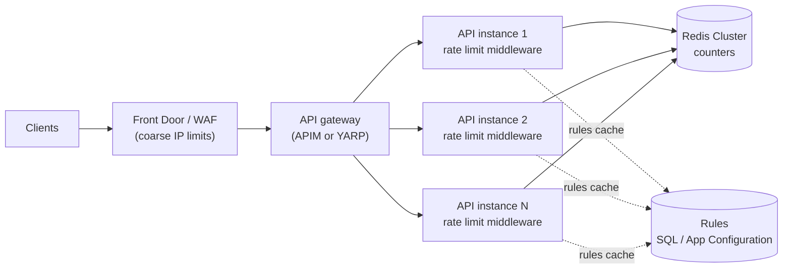
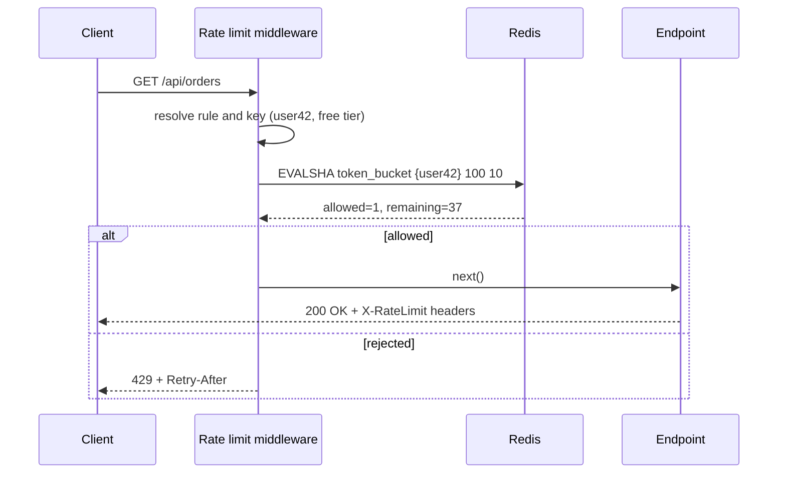

import { Aside } from '@astrojs/starlight/components';
import QuizBlock from '~/components/QuizBlock.astro';

## Why it matters in interviews

"Design a rate limiter" is a compact question with a lot of depth. It tests whether you know the **algorithms** and their trade-offs, whether you can see the **race condition** in a naive Redis `GET` then `SET`, and whether you can reason about **distributed state**: many API instances, several regions, and what happens when Redis is down. .NET developers also get a follow-up: "ASP.NET Core has a rate limiter built in, so why isn't that enough?" The answer is that it is per instance.

Algorithm basics live in [API design & rate limiting](../api-design-rate-limiting/). This page designs the distributed system around them.

## Requirements

**Functional**

- Limit requests per **client key** (user id, API key, or IP) per rule, e.g. "free tier: 100 requests/minute, burst 20", "login: 5 attempts/minute per IP".
- Rules can target a route, a tier, or a tenant, and are configurable without a deploy.
- Rejected requests get `429 Too Many Requests` with headers telling the client when to retry.

**Non-functional**

- Adds **under 2 ms** p99 latency to each request.
- **Accurate across all instances**: 10 API instances must not allow 10× the limit.
- Highly available: a limiter outage must not take the API down.
- Scales to the platform's peak traffic.

**Out of scope:** DDoS protection at the network layer (that is the CDN/WAF's job), billing and quota reporting.

**Clarifying questions to ask**

1. Client-side, gateway, or service-level limiting? Who are the clients (public API, internal services, browsers)?
2. Are short bursts acceptable, or must traffic be strictly smooth?
3. Hard limit, or is ~1-2% overshoot acceptable?
4. Single region or multi-region? Is the limit global or per region?
5. When the limiter itself fails, should we allow or block traffic?

## Back-of-the-envelope estimates

Assume **50,000 requests/s at peak** across the platform and **10 M distinct client keys per day**.

| Quantity | Arithmetic | Result |
|---|---|---|
| Limiter checks | 1 check per request | **50,000 ops/s** on the counter store |
| Token-bucket state per key | key + 2 hash fields (tokens, timestamp) | ≈ 100 B |
| Token-bucket memory | 10 M × 100 B | ≈ **1 GB** |
| Sliding-log memory (100 req/min limit) | 10 M × 100 entries × ~50 B per sorted-set entry | ≈ **50 GB** worst case |
| Network to Redis | 50,000 × ~200 B per round trip | ≈ 10 MB/s |
| Latency budget | same-region Redis round trip | ≈ 0.5-1 ms |

Takeaways: a **token bucket or sliding-window counter** fits in a small Redis deployment, while a sliding **log** is 50× bigger. 50,000 Lua calls per second is near the comfortable limit of a single Redis primary, so plan a 3-shard Redis Cluster for headroom.

## API design

The limiter is mostly **a library or middleware** that talks to Redis directly, because an extra network hop to a "limiter service" doubles the latency cost. Rules are managed through an admin API:

```http
PUT /admin/v1/rate-limit-rules/free-tier-default
{
  "match": { "tier": "free", "route": "/api/*" },
  "key": "userId",
  "algorithm": "token-bucket",
  "capacity": 20,
  "refillPerSecond": 1.67,
  "failMode": "open"
}
```

Responses to clients:

```http
HTTP/1.1 200 OK
X-RateLimit-Limit: 100
X-RateLimit-Remaining: 37

HTTP/1.1 429 Too Many Requests
Retry-After: 2
X-RateLimit-Limit: 100
X-RateLimit-Remaining: 0
Content-Type: application/problem+json

{ "title": "Too many requests", "status": 429, "detail": "Limit 100/min for tier free. Retry in 2 s." }
```

The `X-RateLimit-*` headers are a de facto convention. An IETF draft standardises `RateLimit` and `RateLimit-Policy` fields. Mention either, and always send `Retry-After` with a 429.

## Data model

- **Rules:** a small SQL table (or config in App Configuration), loaded into memory on every instance and refreshed every minute or on a change event.
- **Counters:** Redis keys with a TTL so idle clients cost nothing.

| Algorithm | Redis key | Value |
|---|---|---|
| Fixed window | `rl:{user42}:orders:2026-11-02T10:15` | integer, `INCR` + `EXPIRE` |
| Sliding window counter | current and previous window keys | two integers, weighted |
| Sliding log | `rl:{user42}:orders` | sorted set of request timestamps |
| Token bucket | `rl:{user42}` | hash: `tokens`, `ts` |

The braces in `{user42}` are a **Redis Cluster hash tag**: every key for one client lands in the same slot, so a Lua script can touch several of them atomically.

## High-level design



Layers each do a different job:

- **Edge (Front Door/WAF rate-limit rules; AWS WAF rate-based rules):** coarse per-IP limits that block floods before they cost compute.
- **Gateway (Azure API Management `rate-limit-by-key` / `quota-by-key`; AWS API Gateway usage plans):** per-subscription limits for public APIs, no code needed.
- **Service middleware + Redis:** fine-grained, business-aware limits (per user, per tenant, per endpoint cost). This is the part you design in the interview.



## Deep dives

### 1. Choosing the algorithm

| Algorithm | Bursts | Accuracy | Memory per key | Use when |
|---|---|---|---|---|
| Fixed window | Up to 2× at the window edge | Low | 1 counter | Simple quotas (per day) |
| Sliding log | No | Exact | 1 entry per request | Low limits needing exactness (login attempts) |
| Sliding window counter | Smoothed | Approximate, close | 2 counters | General API limits |
| Token bucket | Yes, up to capacity | Good | 2 fields | APIs that allow short bursts (most public APIs) |
| Leaky bucket | No, smooth output | Good | Queue | Protecting a fragile downstream at a fixed rate |

The token bucket is the usual answer. It has two intuitive knobs (capacity = burst size, refill rate = sustained rate) and tiny state.

### 2. The race condition, and why Lua

A naive implementation reads the counter, checks it in C#, then writes it back. Two instances can read `99` at the same time and both allow request number 100. Fixes, in order of preference:

- **Lua script:** Redis runs a script atomically (single-threaded execution), so read-check-write cannot interleave. This is the standard answer.
- **Atomic primitives:** for a fixed window, `INCR` is atomic. Set the TTL in the same atomic step, though: `INCR` followed by a separate `EXPIRE` can leave a key with no TTL if the client dies in between.
- `WATCH`/`MULTI` optimistic transactions work, but they retry under contention.

Use the **Redis server clock** (`TIME`) inside the script, not each API instance's clock. Skewed instance clocks otherwise refill tokens at different rates.

### 3. Multi-region

A single global Redis means a 50-150 ms cross-region round trip on every request, which is unacceptable. Options:

- **Split the quota:** each of N regions enforces `limit / N`. Simple, but it under-serves a client whose traffic all lands in one region.
- **Home region:** route each client (by key) to one region, which owns its counters. Accurate, but it adds routing complexity.
- **Local enforcement + async sync:** count locally and broadcast deltas every few hundred ms. Overshoot is bounded by sync lag × rate. That is usually acceptable for "100 per minute" limits, but not for "5 login attempts".

### 4. Failing open or closed

If Redis times out (keep the client timeout tight, e.g. 20-50 ms, behind a circuit breaker):

- **Fail open** for general API traffic: availability beats strictness, and an in-memory per-instance limiter (`limit / instanceCount`) acts as a fallback.
- **Fail closed** for security limits (login, OTP, password reset), where letting everything through is the attack.

Make the choice a per-rule setting (`failMode` above).

## Scaling & bottlenecks

- **Redis ops/s** is the first ceiling. Shard with Redis Cluster; the hash tag keeps each client's keys together.
- **Hot keys:** one tenant sending 20,000 req/s hammers one shard. Give big tenants a local pre-allocation: each instance takes a batch of 100 tokens at a time from Redis and spends them locally. That trades a little accuracy for far fewer Redis calls.
- **Script cost:** load the script once (`SCRIPT LOAD`, then `EVALSHA`). StackExchange.Redis caches the SHA and falls back to `EVAL` on a `NOSCRIPT` error.
- **Latency:** colocate Redis with the API in the same region and zone; use pipelining when one request is checked against several rules.

## Failure modes

| Failure | Effect | Mitigation |
|---|---|---|
| Redis unavailable | No shared counters | Per-rule fail open/closed; in-memory fallback limiter |
| Redis failover loses recent writes | Some clients get a fresh bucket | Acceptable: brief over-allowance |
| Clock skew between instances | Uneven refill | Use Redis `TIME` inside the script |
| Rules misconfigured (limit 0) | Everyone gets 429 | Validate rules, staged rollout, "shadow mode" that logs instead of blocking |
| Retry storms after 429 | Load spikes when limits reset | `Retry-After` with jitter in client SDKs |

## Trade-offs

| Decision | Options | Choice | Why |
|---|---|---|---|
| Placement | Edge, gateway, middleware, sidecar | Edge for IP floods + middleware for business limits | Each layer sees different information |
| Algorithm | Fixed, sliding log, sliding counter, token bucket | Token bucket | Allows bursts, tiny state, easy to explain |
| Atomicity | GET/SET, MULTI, Lua | Lua | Atomic read-check-write in one round trip |
| Store | In-memory per instance, Redis | Redis + in-memory fallback | Accuracy across instances; survives Redis outage |
| Multi-region | Global store, split quota, local + sync | Split quota (default), home region for strict limits | No cross-region latency on the hot path |
| Failure | Open, closed | Per rule | Availability for APIs, safety for auth |

## How to build it on Azure (with AWS equivalents)

- **Edge:** Azure Front Door WAF custom rate-limit rules (AWS: AWS WAF rate-based rules on CloudFront/ALB).
- **Gateway:** Azure API Management policies `rate-limit-by-key` and `quota-by-key` (AWS: API Gateway usage plans and throttling).
- **Counters:** Azure Cache for Redis / Azure Managed Redis (AWS: ElastiCache for Redis or Valkey).
- **Rules:** Azure App Configuration with refresh (AWS: AppConfig).
- **In-process:** ASP.NET Core `AddRateLimiter` with `PartitionedRateLimiter` for a single instance or as the fallback.

## .NET implementation notes

A token bucket in one Lua script, called from middleware. The built-in ASP.NET Core limiter is good, but its state lives in each instance's memory. Behind a load balancer with N instances it allows roughly N× the limit, which is why the shared Redis version exists. See [rate limiting in ASP.NET Core](../../aspnet/rate-limiting-health-checks/).

```csharp
public sealed class RedisTokenBucket(IConnectionMultiplexer redis)
{
    // Runs atomically inside Redis: read, refill, take, write. Uses Redis server time (no clock skew).
    private const string Lua = """
        local capacity = tonumber(ARGV[1])
        local rate     = tonumber(ARGV[2])
        local t        = redis.call('TIME')
        local now      = t[1] * 1000 + math.floor(t[2] / 1000)
        local data     = redis.call('HMGET', KEYS[1], 'tokens', 'ts')
        local tokens   = tonumber(data[1]) or capacity
        local ts       = tonumber(data[2]) or now
        tokens = math.min(capacity, tokens + math.max(0, now - ts) * rate / 1000)
        local allowed = 0
        if tokens >= 1 then tokens = tokens - 1; allowed = 1 end
        redis.call('HSET', KEYS[1], 'tokens', tokens, 'ts', now)
        redis.call('PEXPIRE', KEYS[1], math.ceil(capacity / rate * 1000) + 1000)
        return { allowed, math.floor(tokens) }
        """;

    public async Task<RateDecision> TryAcquireAsync(string clientId, int capacity, double perSecond)
    {
        var result = (RedisResult[])(await redis.GetDatabase().ScriptEvaluateAsync(
            Lua, [(RedisKey)$"rl:{{{clientId}}}"], [capacity, perSecond]))!;   // key "rl:{clientId}"
        return new RateDecision((int)result[0] == 1, (long)result[1]);
    }
}

public sealed record RateDecision(bool Allowed, long Remaining);
```

The middleware resolves the client key (the `sub` claim, else the API key, else the IP), calls `TryAcquireAsync`, sets the `X-RateLimit-*` headers, and short-circuits with `429` and `Retry-After` when `Allowed` is false. The key expires after one full refill period of inactivity, so idle clients use no memory.

## Interview Q&A

<details>
<summary>Why not just use the built-in ASP.NET Core rate limiter?</summary>

It keeps counters in process memory. With 5 instances behind a load balancer each one enforces the limit separately, so a client can get about 5× the limit, and the counts reset on every deploy. It is perfect for single-instance apps, concurrency limits, or as a local fallback. Global per-user limits need a shared store such as Redis.
</details>

<details>
<summary>Token bucket vs sliding window counter: which would you pick?</summary>

The token bucket when short bursts are fine (a mobile app syncing on launch): capacity sets the burst size and the refill sets the sustained rate. The sliding window counter when you want "N per minute" semantics without the double burst at fixed-window edges. Both need only a couple of numbers per key.
</details>

<details>
<summary>How do you rate limit by IP when clients are behind a proxy or CDN?</summary>

Use the client IP from a trusted header (`X-Forwarded-For` as rewritten by your own Front Door / load balancer, via ASP.NET Core `ForwardedHeaders` with known proxies). Never trust a client-supplied header blindly. Also prefer user id or API key over IP where possible: many users share an IP behind corporate NAT or mobile carrier NAT.
</details>

<details>
<summary>Redis is down. What happens to the API?</summary>

It depends on the rule's fail mode. General API rules fail open, falling back to an in-memory limiter per instance so there is still some protection. Login and OTP rules fail closed, because unlimited attempts is the threat. Short timeouts and a circuit breaker stop a slow Redis from adding latency to every request.
</details>

<details>
<summary>How do you apply different costs per endpoint?</summary>

Take more than one token: a search costs 5, a simple GET costs 1. Pass the cost as an argument to the script (`tokens >= cost`). That is also how GraphQL APIs limit by query complexity.
</details>

<details>
<summary>How would you limit concurrent requests rather than requests per second?</summary>

Use a counter that increments on entry and decrements on exit, with a lease TTL so a crashed request doesn't hold a slot forever. Alternatively use a sorted set of request ids with expiry times. ASP.NET Core's `ConcurrencyLimiter` does this in-process.
</details>

<details>
<summary>How does a client behave well against your limits?</summary>

It reads `Retry-After` and the remaining-count headers, backs off with jitter on 429, and spreads work out instead of retrying in a tight loop. Publish this in the API docs and SDKs; well-behaved clients reduce load more than any algorithm.
</details>

## Pitfalls

<Aside type="caution" title="Common mistakes">

- Read-then-write in application code (`GET`, check, `SET`), which lets concurrent requests through.
- `INCR` followed by a separate `EXPIRE`, leaving keys with no TTL after a crash.
- Relying on per-instance in-memory limiting behind a load balancer.
- Using each server's clock in the algorithm instead of the Redis clock.
- Keys without hash tags in Redis Cluster, so multi-key scripts fail with `CROSSSLOT`.
- Failing closed on every rule, so a Redis blip becomes a full outage.

</Aside>

## Related

- [API design & rate limiting algorithms](../api-design-rate-limiting/)
- [Caching at scale](../caching/) (Redis, hot keys)
- [Rate limiting & health checks in ASP.NET Core](../../aspnet/rate-limiting-health-checks/)
- [Notification system](../case-notification-system/) (provider limits)

## Quick quiz

<QuizBlock section="system-design" topic="case-rate-limiter" />
