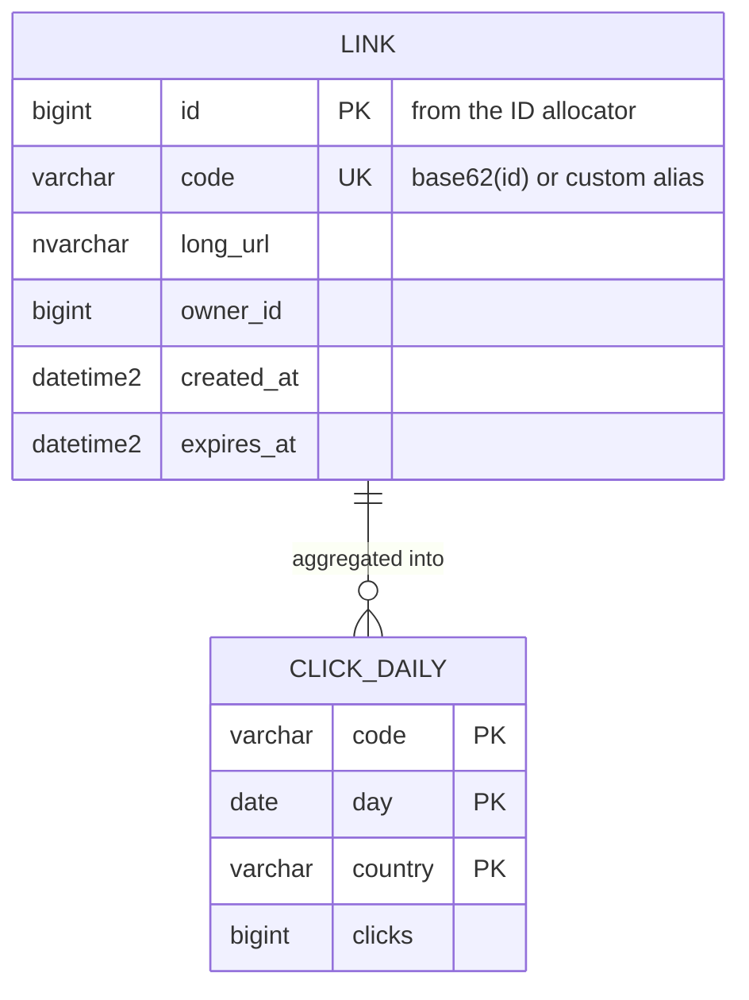
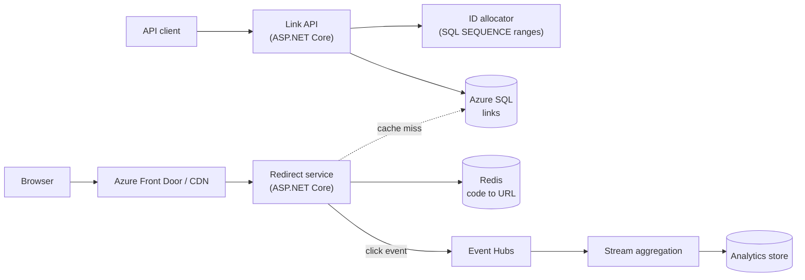
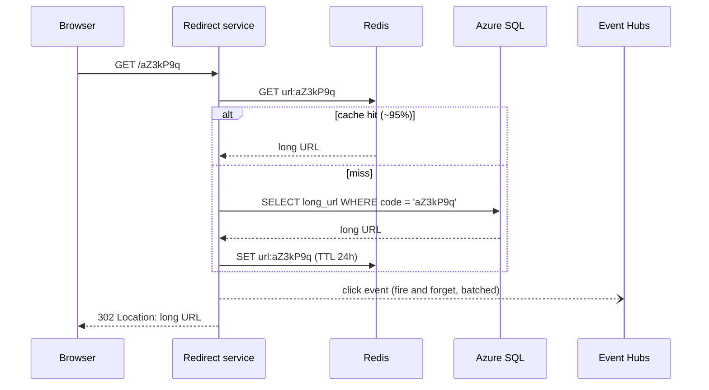

import { Aside } from '@astrojs/starlight/components';
import QuizBlock from '~/components/QuizBlock.astro';

## Why it matters in interviews

The URL shortener is the most common "first HLD" question because the problem is small enough to finish in 45 minutes. It still touches every part of the [framework](../interview-framework/): estimates, a read-heavy workload, **unique ID generation**, caching, and a well-known trade-off (**301 vs 302**). The interviewer is checking three things. Do you clarify scale before drawing boxes? Can you pick an ID scheme and defend it against collisions and enumeration? Do you notice that reads outnumber writes by 100:1 and design for that?

## Requirements

**Functional**

- Create a short link for a long URL, optionally with a custom alias and an expiry date.
- Redirect `GET /{code}` to the long URL.
- Basic click analytics per link (count, by day, by country/referrer).

**Non-functional**

- Redirect latency p99 under 50 ms at the server. Redirects are the product.
- High availability for redirects (99.99%). Creation can tolerate brief outages.
- Short codes must be unique and should not be easy to guess in sequence.
- Durable: a link that was created must keep working for years.

**Out of scope:** user accounts and billing, link editing, QR codes, spam/phishing detection (mention it, don't design it).

**Clarifying questions to ask**

1. How many new links per month, and what is the read:write ratio?
2. How short must the code be? Is a custom alias allowed?
3. Do links expire? Can they be deleted?
4. Do we need real-time analytics, or is "within minutes" fine?
5. Is predictability of codes a concern (private links)?

## Back-of-the-envelope estimates

Assume **100 M new links per month** and a **100:1** read:write ratio.

| Quantity | Arithmetic | Result |
|---|---|---|
| Seconds per month | 30 × 86,400 | ≈ 2.6 M s |
| Write QPS (avg) | 100 M ÷ 2.6 M | ≈ **40/s** (peak ×5 ≈ 200/s) |
| Redirects per month | 100 M × 100 | 10 B |
| Read QPS (avg) | 10 B ÷ 2.6 M | ≈ **3,900/s** (peak ×5 ≈ 20,000/s) |
| Links per year | 100 M × 12 | 1.2 B |
| Storage per link | 200 B URL + code + timestamps + owner | ≈ 500 B |
| Storage per year | 1.2 B × 500 B | **600 GB** (5 years ≈ 3 TB) |
| Links in 5 years | 1.2 B × 5 | 6 B |
| Codes available, 6 chars base62 | 62^6 | 56.8 B (enough for 6 B) |
| Codes available, 7 chars base62 | 62^7 | ≈ 3.5 T |
| Read bandwidth | 3,900/s × 500 B | ≈ 2 MB/s (tiny) |
| Cache for hot links | 10 B ÷ 30 = 333 M reads/day; cache 20% × 333 M × 500 B | ≈ **33 GB** upper bound |

Conclusions to say out loud: writes are trivial, **reads dominate**, the dataset fits on one database server for years, and the hot set fits in a small Redis cluster. This is a caching problem more than a storage problem.

## API design

```http
POST /api/v1/links
Authorization: Bearer <token>
Idempotency-Key: 7f9c...e1
Content-Type: application/json

{ "longUrl": "https://example.com/very/long/path?x=1", "customAlias": null, "expiresAt": "2027-12-31T00:00:00Z" }

201 Created
{ "code": "aZ3kP9q", "shortUrl": "https://sho.rt/aZ3kP9q", "expiresAt": "2027-12-31T00:00:00Z" }
```

```http
GET /aZ3kP9q

302 Found
Location: https://example.com/very/long/path?x=1
Cache-Control: private, max-age=0
```

```http
GET /api/v1/links/aZ3kP9q/stats?from=2026-11-01&to=2026-11-30

200 OK
{ "code": "aZ3kP9q", "totalClicks": 18234, "byDay": [{ "date": "2026-11-01", "clicks": 512 }], "topCountries": ["IN", "US"] }
```

Return `409 Conflict` when a custom alias is taken, `404` or `410 Gone` for unknown or expired codes, and `429` when a client creates too many links (see [rate limiter](../case-rate-limiter/)).

## Data model

The access pattern is **key-value**: look up one row by `code`. There are no joins on the hot path.



**SQL or NoSQL?** Both work, and saying why is the point.

- **Azure SQL / SQL Server (AWS: RDS):** 3 TB over five years and 200 writes/s fit on one primary. A `SEQUENCE` gives you the counter for ID generation. Read replicas are rarely needed because Redis absorbs reads. This is the natural choice for a .NET team.
- **Cosmos DB (AWS: DynamoDB), partition key `code`:** point reads at single-digit-ms latency with horizontal scale built in and a TTL for expiry. Pick it if the scale estimate is 10× bigger or you need multi-region writes.

Click analytics go to a **separate store** (Azure Data Explorer / ClickHouse; AWS: Redshift or Timestream). Mixing high-volume click inserts with the link table hurts redirect latency.

## High-level design



**Create flow:** the Link API validates the URL (scheme allow-list, length, block-list), takes the next ID from its locally cached range, encodes it in base62, inserts the row, and returns the short URL. A custom alias skips the allocator and relies on the unique index on `code`.

**Redirect flow** is the critical path:



The click event is sent asynchronously so analytics never slows the redirect.

## Deep dives

### 1. Generating the short code

| Approach | How | Pros | Cons |
|---|---|---|---|
| **Counter + base62** | Global counter → `Base62.Encode(id)` | No collisions, short codes, simple | Sequential codes are guessable; the counter is a coordination point |
| **Hash + truncate** | MD5/SHA-256 of URL, take first 7 base62 chars | Same URL gives same code (dedup) | Collisions: must check and retry with salt; extra DB read on every write |
| **Random** | 7 random base62 chars | Not guessable, no coordination | Collision check on insert; retries rise as the space fills |
| **Snowflake-style 64-bit** | time + worker + sequence | No central counter | Encodes to ~11 chars, too long for a "short" URL |

A good default is **counter with range allocation**. Each Link API instance asks the database for a block of 1,000 IDs once (`sp_sequence_get_range` on a SQL `SEQUENCE`, or `UPDATE ... SET next = next + 1000 OUTPUT`). It then hands them out from memory. The database sees one call per 1,000 links, and an instance that crashes just wastes the rest of its block. To make codes non-sequential, **permute the ID before encoding** (multiply by a large constant that is coprime to 62^7, modulo 62^7, or use a small Feistel cipher). The mapping stays one-to-one, so there are still no collisions.

### 2. 301 vs 302

- **301 Moved Permanently**: browsers and proxies cache the redirect, so repeat clicks never reach you. That means lower load but **lost analytics**, and you can never change or expire the link for those users.
- **302 Found / 307**: every click hits the service. You get accurate analytics and can disable a link. This is the usual choice for a commercial shortener.

Say which one you chose and why. That trade-off is the reason the interviewer asked.

### 3. Caching the hot set

Link popularity is heavily skewed, so a cache-aside Redis layer with LRU eviction (`allkeys-lru`) and a 24-hour sliding TTL serves most redirects. Links never change after creation, so **invalidation is trivial** (only delete or expire). For viral links add a short in-process cache (`IMemoryCache`, 30-60 s) on each redirect node so one Redis key is not hammered. That is the [hot key](../caching/) problem. Cache **negative results** briefly (`code → NOT_FOUND`, 60 s) so scanners guessing random codes cannot stampede the database.

### 4. Analytics without slowing redirects

Publish a click event (code, timestamp, country from Front Door headers, referrer, user agent) to Event Hubs (AWS: Kinesis) in batches. A stream job (Stream Analytics, or Functions with batching) aggregates per code per day and writes to the analytics store. Counts are eventually consistent within about a minute, which matches the requirement.

## Scaling & bottlenecks

- **Redirect tier** is stateless: scale out behind Front Door (AWS: CloudFront + ALB). Twenty thousand QPS is a handful of ASP.NET Core instances.
- **Redis** first: at ~33 GB, one primary with a replica is enough. Use Redis Cluster when memory or ops/s outgrow one node.
- **Database** reads only on cache miss. If you grow past one server, shard by `code` (hash) or move to Cosmos DB. The access pattern never needs cross-shard queries.
- **ID allocator**: range allocation removes it as a bottleneck. With several regions, give each region its own disjoint ID range.
- **Multi-region:** read-only replicas of the link table plus a regional Redis put redirects close to users. Creation can stay single-region.

## Failure modes

| Failure | Effect | Mitigation |
|---|---|---|
| Redis down | All reads hit SQL; latency rises | Fall through to the DB with a circuit breaker; in-process cache; replica failover |
| Primary DB down | Creation fails; cached redirects still work | Geo-replica failover (auto-failover group); creation returns 503 with retry |
| Instance crashes mid-range | Up to 1,000 IDs lost | Acceptable: the key space is 56.8 B+ |
| Event Hubs throttled | Analytics lag or drop | Buffer in memory with a cap; analytics is best-effort by requirement |
| Malicious URLs | Phishing via your domain | Check against a URL reputation service on create; disable links with a 410 |

## Trade-offs

| Decision | Options | Choice | Why |
|---|---|---|---|
| ID scheme | Counter, hash, random, Snowflake | Counter ranges + permutation + base62 | No collisions, 7 chars, not sequential |
| Redirect code | 301, 302 | 302 | Analytics and expiry beat the extra load, which the cache absorbs |
| Primary store | SQL, KV/NoSQL | Azure SQL (Cosmos DB at 10× scale) | Fits easily; sequence support; team skills |
| Analytics | Sync DB increment, async events | Async events + aggregation | Keeps redirect p99 low; no hot-row contention |
| Same long URL twice | Dedup, new code each time | New code each time | Per-user stats and expiry; dedup costs a lookup |

## How to build it on Azure (with AWS equivalents)

- **Edge:** Azure Front Door with WAF (AWS: CloudFront + AWS WAF) for TLS, geo headers and bot protection.
- **Compute:** Azure Container Apps or App Service for the Redirect and Link APIs (AWS: ECS on Fargate).
- **Data:** Azure SQL Database with a `SEQUENCE` (AWS: RDS for SQL Server / Aurora); Azure Cache for Redis (AWS: ElastiCache).
- **Analytics:** Event Hubs → Stream Analytics → Azure Data Explorer (AWS: Kinesis → Managed Flink → Redshift).
- **Ops:** Application Insights (AWS: CloudWatch / X-Ray), Key Vault for secrets (AWS: Secrets Manager).

## .NET implementation notes

A base62 codec plus a cache-aside redirect endpoint. `IDistributedCache` is backed by Redis with `AddStackExchangeRedisCache`.

```csharp
app.MapGet("/{code}", async (string code, IDistributedCache cache, IUrlStore store, CancellationToken ct) =>
{
    var longUrl = await cache.GetStringAsync($"url:{code}", ct);      // 1. cache
    if (longUrl is null)
    {
        longUrl = await store.GetLongUrlAsync(code, ct);              // 2. database
        if (longUrl is null) return Results.NotFound();
        await cache.SetStringAsync($"url:{code}", longUrl,
            new DistributedCacheEntryOptions { SlidingExpiration = TimeSpan.FromHours(24) }, ct);
    }
    // 302 so every click reaches us (analytics); 301 lets browsers cache it.
    return Results.Redirect(longUrl, permanent: false);
});

public static class Base62
{
    private const string Alphabet = "0123456789ABCDEFGHIJKLMNOPQRSTUVWXYZabcdefghijklmnopqrstuvwxyz";

    public static string Encode(long value)
    {
        ArgumentOutOfRangeException.ThrowIfNegative(value);
        if (value == 0) return "0";
        Span<char> buffer = stackalloc char[11];          // 62^11 > long.MaxValue
        int i = buffer.Length;
        while (value > 0)
        {
            buffer[--i] = Alphabet[(int)(value % 62)];
            value /= 62;
        }
        return new string(buffer[i..]);
    }
}
```

`Encode(56_800_235_583)` returns `zzzzzz`, the last 6-character code. `Encode(56_800_235_584)` is the first 7-character one, `1000000`.

## Interview Q&A

<details>
<summary>Why not just use an auto-increment identity column and base62 it?</summary>

That works for a single database and is a fine first answer. The issues are that codes become **sequential and guessable** (anyone can enumerate links), and the identity column ties ID generation to one primary. Range allocation from a sequence keeps the simplicity, and permuting the number before encoding removes the predictability.
</details>

<details>
<summary>How do you handle hash collisions if you use MD5 of the URL?</summary>

Take the first 7 base62 characters of the hash and try to insert with a unique constraint on `code`. On a duplicate key error, append a salt (or the user id) to the input and hash again. Collisions become more frequent as the table fills, and every create needs a uniqueness check, which is why counters are usually preferred.
</details>

<details>
<summary>How many characters do you need?</summary>

It depends on total links over the system's lifetime. 6 B links over 5 years fits in 62^6 = 56.8 B, so 6 characters are enough. 7 characters (3.5 trillion) give headroom and make random guessing much harder, because the space is so sparse.
</details>

<details>
<summary>A single link goes viral with 50,000 clicks per second. What breaks?</summary>

The single Redis key, and possibly that Redis shard's network. Add an in-process cache on each redirect node with a short TTL so most hits never leave the process. You can also let Front Door cache that one redirect for a few seconds if you accept slightly undercounted analytics.
</details>

<details>
<summary>How do you support link expiry?</summary>

Store `expires_at`. The redirect service checks it after the lookup and returns `410 Gone`, and the cache entry TTL is capped at the remaining lifetime. A nightly job (or Cosmos DB TTL) deletes expired rows. Codes from expired links should not be reused, or old printed links would point somewhere new.
</details>

<details>
<summary>How do you count clicks accurately without a hot row?</summary>

Don't `UPDATE links SET clicks = clicks + 1` per redirect. Emit events and aggregate in a stream processor, or keep `INCR` counters in Redis and flush them to the database periodically. The aggregate is eventually consistent, which is acceptable for analytics.
</details>

<details>
<summary>What changes for a multi-region deployment?</summary>

Redirects are read-only, so serve them from regional caches and read replicas. For creation, either keep a single write region or give each region a disjoint ID range (for example, the high bits of the ID are the region number). That way codes never collide without any cross-region coordination.
</details>

## Pitfalls

<Aside type="caution" title="Common mistakes">

- Jumping to the diagram without estimates, and then over-engineering (Kafka, sharding) a 40-writes-per-second system.
- Choosing 301 without mentioning that it breaks analytics and expiry.
- Using hash-and-truncate with no plan for collisions.
- Updating a click counter on the link row in the redirect path, which creates hot-row contention and slow redirects.
- Sequential codes on private links, which lets anyone enumerate everyone's URLs.
- Forgetting to validate long URLs (`javascript:` schemes, internal IPs, known phishing domains).

</Aside>

## Related

- [How to run a design interview](../interview-framework/)
- [Caching at scale](../caching/)
- [Databases at scale](../databases-at-scale/)
- [Distributed rate limiter](../case-rate-limiter/)

## Quick quiz

<QuizBlock section="system-design" topic="case-url-shortener" />
