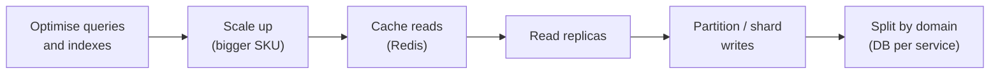
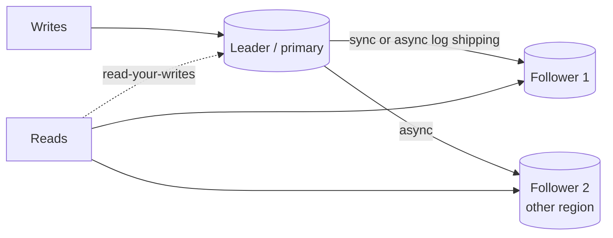
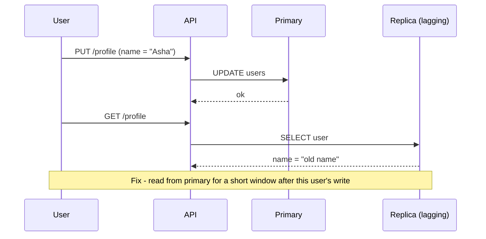
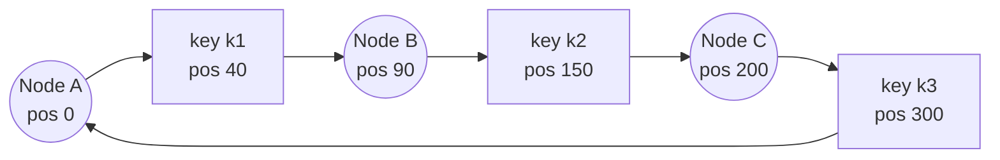

import { Aside } from '@astrojs/starlight/components';
import QuizBlock from '~/components/QuizBlock.astro';

## Why it matters in interviews

The database is usually **what breaks first** when traffic grows, so the deep-dive part of a design round almost always lands here. Expect *"SQL or NoSQL, and why?"*, *"how do read replicas affect consistency?"*, *"how would you shard this table, and what is the shard key?"* and *"explain CAP"*. A .NET developer who has only used one SQL Server database can still answer these well by reasoning from access patterns.

## Core idea

Scale a database in this order, stopping as soon as the requirements are met:



Each step adds operational complexity, so justify it with numbers from your estimates.

### SQL vs NoSQL

| | Relational (Azure SQL, PostgreSQL) | NoSQL (Cosmos DB, MongoDB, Cassandra) |
|---|---|---|
| Model | Tables, joins, fixed schema | Documents, key-value, wide-column, graph |
| Transactions | Multi-row ACID by default | Usually scoped to one item or one partition |
| Scaling writes | Vertical first; sharding is manual work | Built-in horizontal partitioning |
| Queries | Ad hoc, flexible, joins | Designed around known access patterns |
| Consistency | Strong on the primary | Often tunable (Cosmos DB has five levels) |
| Pick when | Relationships, reporting, money, unclear access patterns | Huge scale with simple key-based access, flexible schema, global distribution |

Say it as a decision: *"Orders and payments need transactions and reporting, so Azure SQL (AWS: RDS / Aurora). The activity feed is key-by-user, write-heavy and can be eventually consistent, so Cosmos DB (AWS: DynamoDB)."* Using both is **polyglot persistence**. More detail on store types is in [SQL vs NoSQL](../../data/sql-vs-nosql/).

### Replication

**Leader-follower (primary-replica)**: all writes go to the leader, which streams changes to followers. Reads can go to followers.



- **Synchronous** replication: the leader waits for the follower to confirm. No data loss on failover, higher write latency.
- **Asynchronous**: the leader confirms immediately. Fast, but followers lag and a failover can lose recent writes.
- Common middle ground: one synchronous replica in the same region, async replicas elsewhere.

**Multi-leader**: several nodes accept writes (typically one per region) and replicate to each other. Lower write latency for global users and survives a region outage, but **concurrent writes to the same row conflict** and need a resolution rule (last-writer-wins, merge, or app logic).

**Leaderless** (Cassandra, DynamoDB-style): clients write to and read from several replicas; with N replicas, W write acks and R read acks, `R + W > N` makes reads overlap the latest write.

### Read replicas and replication lag

Read replicas multiply read capacity, but an async replica may be **behind**. The classic bug: a user updates their profile, the next GET hits a lagging replica and shows the old value.



Fixes: read your own writes from the primary (for a few seconds after a write, or for the user's own data), sticky sessions to one replica for monotonic reads, or wait until the replica has caught up to a known log position. Azure SQL offers read scale-out on some tiers via `ApplicationIntent=ReadOnly` in the connection string, plus geo-replication and failover groups (AWS: RDS / Aurora read replicas, Aurora Global Database).

### Sharding (partitioning)

Split rows across multiple databases so each holds a subset and handles a share of writes.

| Strategy | How | Pros | Cons |
|---|---|---|---|
| Range | `user_id` 1-1M on shard A, 1M-2M on B | Range scans are easy | Hot spots (new users all land on the last shard) |
| Hash | `hash(user_id) % N` | Even spread | Range queries hit every shard; changing N moves most keys |
| Directory / lookup | A table maps tenant to shard | Flexible, move tenants individually | Lookup service is a dependency and must be cached |
| Geo | EU users on EU shard | Latency, data residency | Uneven region sizes |

**Choosing the shard key** is the real interview question. A good key has high cardinality, spreads load evenly and matches the main access pattern so most queries hit **one** shard. `user_id` or `tenant_id` are typical. A bad key (country, status, created date) creates hot shards. Cross-shard joins, transactions and unique constraints become application problems.

### Consistent hashing

With `hash(key) % N`, adding a fifth server to four remaps about 80% of keys. **Consistent hashing** places servers and keys on a ring; a key belongs to the next server clockwise. Adding or removing a server only moves keys between it and its neighbour, about `1/N` of the keys.



Reading the ring: k1 belongs to B, k2 to C, and k3 wraps around to A. If node D is added at position 120, only keys between 90 and 120 move from C to D.

**Virtual nodes**: each physical server appears at many points on the ring (for example 100-200), which evens out load and spreads a failed server's keys across all the others instead of one neighbour. Used by Cassandra, DynamoDB-style stores, and many distributed caches.

### CAP and PACELC

**CAP**: when a **network partition** happens, a distributed store must choose between **Consistency** (every read sees the latest write or errors) and **Availability** (every request gets a response, possibly stale). Partitions are not optional in real networks, so the real choice is CP vs AP *during a partition*.

**PACELC** adds the normal case: if **P**artition, choose **A** or **C**; **E**lse, choose **L**atency or **C**onsistency. Even without failures, synchronous replication costs latency.

| System behaviour | Example choice |
|---|---|
| PC/EC: consistent always | Single-primary SQL with synchronous replicas; bank ledger |
| PA/EL: available and fast, eventually consistent | Cassandra, DynamoDB default reads, social feeds |
| Tunable | Cosmos DB consistency levels, DynamoDB strongly consistent reads |

### Consistency models

From strongest to weakest:

- **Strong / linearizable**: reads always see the latest committed write.
- **Bounded staleness**: reads lag by at most K versions or T seconds.
- **Session**: within one client session you read your own writes and never go backwards (read-your-writes, monotonic reads).
- **Consistent prefix**: you never see writes out of order, but may see an old prefix.
- **Eventual**: replicas converge if writes stop; no ordering guarantee.

These are exactly Cosmos DB's five levels; **Session** is its default and fits most user-facing apps.

### Indexes at scale

- Every index speeds reads and **slows every write** (each insert updates every index). Write-heavy tables need few, deliberate indexes.
- Design indexes from access patterns: composite keys in the right order, covering indexes with `INCLUDE` for hot queries (see [indexes](../../data/indexes/)).
- On a sharded store, an index on a non-shard-key column is either **local** (per shard, so queries scatter-gather) or **global** (a separate partitioned index that is updated asynchronously).
- Cosmos DB indexes every property by default; trimming the indexing policy reduces write cost (RUs).
- Very large tables: partition by date for cheap archiving, and keep hot data small.

## Code

Routing reads to a replica in EF Core with two contexts, and a minimal consistent-hash ring:

```csharp
// Read-only context points at the replica (Azure SQL read scale-out uses ApplicationIntent=ReadOnly).
builder.Services.AddDbContext<OrdersDbContext>(o =>
    o.UseSqlServer(builder.Configuration.GetConnectionString("Primary")));
builder.Services.AddDbContext<OrdersReadDbContext>(o =>
    o.UseSqlServer(builder.Configuration.GetConnectionString("ReadReplica"))
     .UseQueryTrackingBehavior(QueryTrackingBehavior.NoTracking));
```

```csharp
public sealed class HashRing
{
    private readonly SortedList<uint, string> _ring = new();

    public HashRing(IEnumerable<string> nodes, int virtualNodes = 150)
    {
        foreach (var node in nodes)
            for (var i = 0; i < virtualNodes; i++)
                _ring[Hash($"{node}#{i}")] = node;
    }

    public string GetNode(string key)
    {
        var h = Hash(key);
        var keys = _ring.Keys;
        if (h > keys[keys.Count - 1]) return _ring.Values[0]; // wrap around the ring
        int lo = 0, hi = keys.Count - 1;
        while (lo < hi)                                     // first position >= h
        {
            var mid = (lo + hi) / 2;
            if (keys[mid] < h) lo = mid + 1; else hi = mid;
        }
        return _ring.Values[lo];
    }

    // MD5 for distribution only, not security.
    private static uint Hash(string s) => BitConverter.ToUInt32(MD5.HashData(Encoding.UTF8.GetBytes(s)));
}
```

## Interview Q&A

<details>
<summary>How do you decide between SQL and NoSQL?</summary>

Start from access patterns and consistency needs. Relational fits relationships, multi-row transactions, ad hoc queries and reporting. NoSQL fits very high scale with simple key-based access, flexible schemas or global multi-region writes. If unsure, default to SQL: it scales further than most products need, and you can add a NoSQL store for a specific workload later.
</details>

<details>
<summary>What is replication lag and how does it show up for users?</summary>

With asynchronous replication, replicas apply changes after the primary commits, so a read from a replica can return old data. Users see it as "I saved my change but it disappeared". Handle it with read-your-writes routing (read from the primary right after a write), session consistency, or by showing the value from the write response instead of re-reading.
</details>

<details>
<summary>How would you shard a multi-tenant SaaS database?</summary>

Shard by `tenant_id` so each tenant's data lives on one shard and most queries hit a single shard. Use a directory (tenant to shard map, cached) so large tenants can be moved or given dedicated shards. Cross-tenant reporting goes to a separate analytics store. Watch for one huge tenant becoming a hot shard.
</details>

<details>
<summary>Why consistent hashing instead of hash mod N?</summary>

With mod N, changing the number of nodes remaps almost every key, which for a cache means a near-total miss storm and for a database means moving most data. Consistent hashing only moves the keys adjacent to the added or removed node, about 1/N of them. Virtual nodes keep the distribution even.
</details>

<details>
<summary>Explain CAP with a concrete example.</summary>

Two replicas in different regions lose connectivity. A user writes to region A. If region B keeps serving reads, it returns stale data (available, not consistent). If B refuses reads until it can confirm the latest value, it is consistent but not available. A shopping cart can choose availability; a bank balance should choose consistency.
</details>

<details>
<summary>What does PACELC add to CAP?</summary>

CAP only describes behaviour during a partition. PACELC says that even when the network is healthy, you trade latency against consistency: waiting for synchronous replication or quorum reads is consistent but slower. It explains why systems like DynamoDB offer both eventually consistent (faster, cheaper) and strongly consistent reads.
</details>

<details>
<summary>Multi-leader replication: when and what is the catch?</summary>

Use it when users in several regions need low-latency writes or each region must accept writes during an outage. The catch is write conflicts: two regions update the same record concurrently. You need a conflict resolution strategy (last-writer-wins loses data; merges or app-level rules are safer) or you avoid conflicts by homing each record to one region.
</details>

<details>
<summary>What problems does sharding introduce?</summary>

Cross-shard queries become scatter-gather, joins and transactions across shards are no longer handled by the database, global unique constraints and auto-increment IDs need a different scheme (GUIDs, Snowflake-style IDs), rebalancing is operationally hard, and a poor shard key creates hot shards. That is why it is the last step, after caching and replicas.
</details>

## Pitfalls

<Aside type="caution" title="Common mistakes">

- **Sharding too early**: a single well-indexed SQL database plus replicas handles more than most interview workloads.
- **Picking a low-cardinality or monotonically increasing shard key** (status, country, timestamp): hot shards.
- **Reading from replicas right after writing**: users see their changes vanish.
- **Saying "CAP: pick two"**: partition tolerance is not optional, the choice is C or A during a partition.
- **Adding an index for every query**: write throughput drops and storage grows.
- **Assuming NoSQL means no schema design**: the partition key and document shape are the schema, and they are harder to change later.

</Aside>

## Related

- [SQL vs NoSQL](../../data/sql-vs-nosql/)
- [Indexes](../../data/indexes/)
- [Caching at scale](../caching/)
- [Data in microservices](../../microservices/data-management/)

## Quick quiz

<QuizBlock section="system-design" topic="databases-at-scale" />
