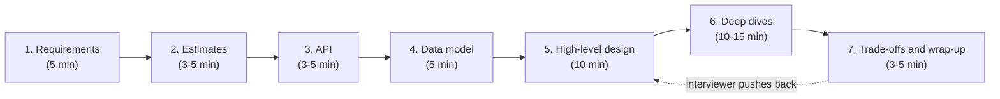
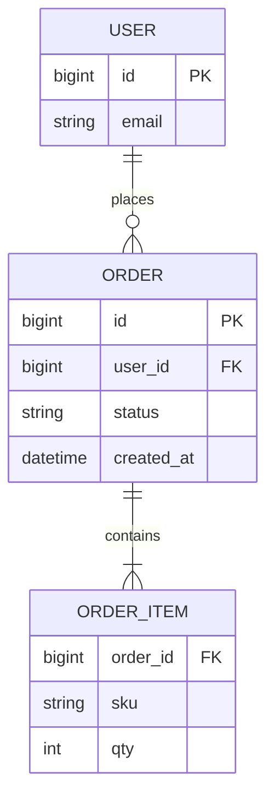
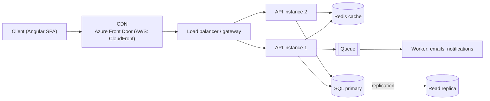

import { Aside } from '@astrojs/starlight/components';
import QuizBlock from '~/components/QuizBlock.astro';

## Why it matters in interviews

At 3-4 years, nobody expects you to have built a global-scale system. What the interviewer scores is **how you drive an ambiguous problem**: do you clarify before drawing, size the problem with numbers, start simple, and justify every box with a trade-off? Candidates with good technical knowledge still fail design rounds because they jump straight to "Kafka + Kubernetes + microservices" in minute two. A repeatable framework fixes that.

## Core idea

Treat the round as a **guided conversation with checkpoints**. You own the structure; the interviewer steers the depth. Say out loud which step you are on so they can redirect you early.



### 1. Requirements (functional and non-functional)

**Functional** requirements are the features: *"users can upload a photo"*, *"followers see it in their feed"*. Pick **3-4 core ones** and explicitly park the rest ("I'll leave comments and search out of scope unless you want them").

**Non-functional** requirements decide the architecture. Ask about each:

| Question to ask | Why it changes the design |
|---|---|
| How many users / requests per day? | Single server vs horizontal scaling, sharding |
| Read-heavy or write-heavy? Ratio? | Caching and read replicas vs write-optimised storage |
| Latency target (p99)? | Caching, CDN, async processing |
| Consistency: is stale data OK? For how long? | Strong vs eventual consistency, CAP choice |
| Availability target (99.9%? 99.99%)? | Redundancy, multi-zone, multi-region |
| Data size and retention? | Storage choice, archiving, partitioning |
| Global or single region? | CDN, geo-replication, data residency |

Write the agreed list in a corner of the board. You will refer back to it when justifying choices.

### 2. Back-of-envelope estimates

The goal is **order of magnitude**, not precision. Round aggressively and state assumptions.

**Numbers to know**

| Quantity | Value to remember |
|---|---|
| Seconds per day | 86,400, round to **~10^5** |
| 1 million requests/day | **~12 req/s** average |
| Peak vs average | Assume **2-5x** average (say which) |
| 2^10 / 2^20 / 2^30 / 2^40 bytes | ~1 KB / 1 MB / 1 GB / 1 TB |
| Main memory reference | ~100 ns |
| Round trip inside one data centre | ~0.5 ms |
| SSD random read | ~0.1 ms (tens to ~150 µs) |
| Cross-continent round trip | ~100-150 ms |
| Availability 99.9% / 99.99% | ~8.8 hours / ~53 minutes of downtime per year |

**Worked example: order-tracking API**

Assume 5M daily active users, each makes 10 reads and 1 write per day, and an order record is about 1 KB.

- Reads: 5M x 10 = 50M/day, divided by 10^5 s ≈ **500 req/s average**, about **1,500-2,500 req/s at peak**.
- Writes: 5M/day ≈ **50-60 writes/s**, so the read:write ratio is about 10:1. Read-heavy, so caching and read replicas pay off.
- Storage: 5M x 1 KB = 5 GB/day, about **1.8 TB/year**. One relational database can hold several years of this; sharding is not needed on day one.
- Bandwidth: 2,000 req/s x ~2 KB response ≈ 4 MB/s. Not a concern.

The conclusion is what you say out loud: *"This fits a single primary SQL database with a cache and a couple of read replicas. I'd only shard if we grow 10-50x."* Estimates exist to drive a decision.

### 3. API

Define 3-5 endpoints for the core features. This forces clarity on inputs and outputs before you draw boxes.

```http
POST /api/v1/orders            { items[], addressId }   -> 201 { orderId }
GET  /api/v1/orders/{id}                                -> 200 { order }
GET  /api/v1/users/{id}/orders?cursor=abc&limit=20      -> 200 { items[], nextCursor }
```

Mention idempotency for writes (an `Idempotency-Key` header), cursor pagination for lists, and auth (a bearer token). See [API design](../api-design-rate-limiting/).

### 4. Data model

List the main entities, their key fields, and the **access patterns**. The access patterns, not the entities, decide SQL vs NoSQL, the partition key and the indexes.



*"Most reads are 'orders for user X, newest first', so I'd index `(user_id, created_at DESC)`, and `user_id` is the natural shard key if we ever shard."*

### 5. High-level design

Draw the simplest design that meets the requirements, then walk one read and one write request through it.



### 6. Deep dives

The interviewer usually picks 1-2 areas, or asks you to. Good candidates **propose** them: *"The interesting parts are the hot-key problem on popular products and how we keep order status consistent with payments. Which would you like first?"* Typical deep dives: caching and invalidation, the sharding key, handling a failed dependency, idempotent retries, rate limiting, and how the system behaves at 10x load.

### 7. Trade-offs and wrap-up

Close by naming what you would monitor, the known bottlenecks, and what you would change at 10x or 100x scale. Use explicit trade-off language: *"I chose eventual consistency for the feed because availability matters more there; for payments I'd keep strong consistency."* See the [trade-offs cheat sheet](../tradeoffs-cheatsheet/).

### What interviewers score

| Signal | Strong candidate | Weak candidate |
|---|---|---|
| Problem scoping | Asks targeted questions, writes requirements down | Starts drawing immediately |
| Estimation | Rough numbers that lead to a decision | Skips it, or spends 10 min on arithmetic |
| Design | Simple first, evolves with load | Over-engineers from the start |
| Trade-offs | Names alternatives and why they were rejected | One option, presented as the only one |
| Depth | Can go deep on 1-2 components | Shallow everywhere |
| Communication | Thinks aloud, checks in with the interviewer | Long silences, or ignores hints |

## Code

The 45 minutes rarely include code, but showing that the API maps to real ASP.NET Core endpoints is a nice touch when the interviewer asks *"how would the endpoint look?"*

```csharp
var orders = app.MapGroup("/api/v1/orders").RequireAuthorization();

orders.MapPost("/", async (CreateOrder cmd, [FromHeader(Name = "Idempotency-Key")] string key,
                           IOrderService svc, CancellationToken ct) =>
{
    var id = await svc.CreateAsync(cmd, key, ct);   // same key -> same result, no duplicate order
    return TypedResults.Created($"/api/v1/orders/{id}", new { id });
});

orders.MapGet("/{id:long}", async Task<Results<Ok<OrderDto>, NotFound>> (long id, IOrderService svc, CancellationToken ct) =>
    await svc.GetAsync(id, ct) is { } order ? TypedResults.Ok(order) : TypedResults.NotFound());
```

## Interview Q&A

<details>
<summary>The interviewer says "Design Instagram". What do you do in the first five minutes?</summary>

Clarify scope and constraints before drawing anything. Pick the core features (post a photo, follow, view feed), confirm what is out of scope, and ask the non-functional questions: number of users, read/write ratio, latency target, consistency needs and global reach. Write them down. Only then estimate and design.
</details>

<details>
<summary>Why do back-of-envelope estimates at all?</summary>

They decide the architecture. 50 req/s fits a single server and database; 50,000 req/s needs caching, horizontal scaling and maybe sharding. Estimates also show you can reason quantitatively. Keep them rough (powers of ten) and always end with the conclusion they lead to.
</details>

<details>
<summary>How do you convert daily active users to requests per second?</summary>

Multiply DAU by the actions per user per day, divide by about 10^5 (seconds in a day) for the average, then multiply by 2-5x for the peak. For example, 10M DAU x 20 requests = 200M/day ≈ 2,000 req/s average and roughly 4,000-10,000 req/s at peak.
</details>

<details>
<summary>Should you start with microservices?</summary>

Usually no. Start with the simplest design that meets the requirements, often a stateless API behind a load balancer with a database and a cache, and split only where load, team ownership or failure isolation justify it. Interviewers reward evolving a design as requirements grow over starting with 12 services.
</details>

<details>
<summary>What do you do if you don't know a specific technology the interviewer mentions?</summary>

Say so briefly and reason from first principles: *"I haven't used Cassandra in production, but as a wide-column store partitioned by key, I'd expect it to fit this write-heavy, key-based access pattern."* Honesty plus sound reasoning scores better than bluffing.
</details>

<details>
<summary>How do you handle the "now we have 100x the traffic" follow-up?</summary>

Find what breaks first. Usually the database: add caching for reads, read replicas, then partitioning or sharding for writes. Move slow work to queues, put static content on a CDN, and make sure the app tier is stateless so it scales horizontally. Name the new bottleneck after each change.
</details>

<details>
<summary>What does "explicit trade-offs" mean in practice?</summary>

For each major decision, name at least one alternative and why you rejected it for *these* requirements. For example: *"Cursor pagination instead of offset because the feed changes constantly and offset would skip or duplicate items; the cost is no jump-to-page."*
</details>

<details>
<summary>How do you use the last five minutes?</summary>

Summarise the design against the requirements, list the bottlenecks and single points of failure, mention monitoring (latency, error rate, queue depth) and what you would do next with more time. It leaves the interviewer with a clear, structured final impression.
</details>

## Pitfalls

<Aside type="caution" title="Common mistakes">

- **Designing before clarifying**: you solve the wrong problem and lose the interviewer early.
- **Over-precise estimates**: spending ten minutes on arithmetic. Round to powers of ten and move on.
- **Buzzword architecture**: Kafka, Kubernetes and five databases without a requirement that needs them.
- **No data model or access patterns**: the database choice then looks arbitrary.
- **Silence**: the interviewer can only score what you say out loud.
- **Ignoring hints**: when the interviewer asks "what about X?", it usually means X matters for scoring.

</Aside>

## Related

- [Scaling fundamentals](../scaling-fundamentals/)
- [Trade-offs cheat sheet](../tradeoffs-cheatsheet/)
- [Case study: URL shortener](../case-url-shortener/)
- [Interview day checklist](../../behavioral/interview-day-checklist/)

## Quick quiz

<QuizBlock section="system-design" topic="interview-framework" />
