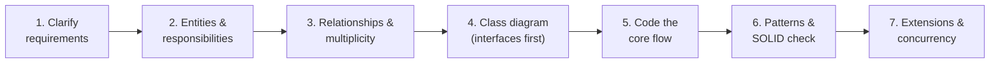
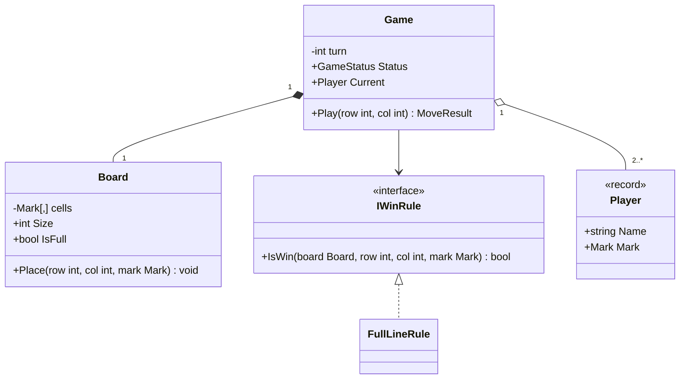

import { Aside } from '@astrojs/starlight/components';
import QuizBlock from '~/components/QuizBlock.astro';

## Why it matters in interviews

A low-level design (LLD) or object-oriented design (OOD) round gives you a vague prompt, *"design a parking lot"*, and 45-60 minutes. The interviewer is not checking whether you have memorised the "right" class list. They are scoring **how you get there**: do you clarify scope, find sensible abstractions, keep responsibilities small, use patterns where they remove a real `if/else` or `switch`, and produce code that actually runs?

At 3-4 years of experience the bar is: a clean class diagram, a working skeleton of the **main flow**, one or two well-justified patterns, and confident answers to "what if we add X?". Candidates usually fail by jumping straight into code, by drawing 25 classes and coding none, or by forcing every GoF pattern they know into the design.

## Core idea

Treat the round as a small, timeboxed project with visible checkpoints. Say each step out loud before you do it, so the interviewer can steer you early.



### Time budget for 45 minutes

| Minutes | Step | Output on the whiteboard / editor |
|---|---|---|
| 0-5 | Clarify requirements | 4-6 functional bullets, explicit **out of scope** list, assumptions |
| 5-10 | Entities & responsibilities | Noun list turned into a table: class, what it knows, what it does |
| 10-17 | Relationships + class diagram | Boxes with key fields/methods, interfaces, arrows with multiplicity |
| 17-35 | Code | Interfaces, core models, the one service that runs the main use case, a tiny demo |
| 35-40 | Patterns & SOLID walk-through | "Strategy here because...", "this class has one reason to change because..." |
| 40-45 | Extensions & questions | How the design absorbs 2-3 new requirements, thread-safety, testing |

For a 60-minute round, give the extra time to code (more flows, validation, a unit test) rather than to a bigger diagram.

### Step 1: requirements

Ask questions that **change the model**, not trivia. Good ones: *Which actors use it (customer, admin, system)? Which operations must work end to end today? Single instance or many (one lot or a chain of lots)? Is concurrency a concern (several gates, several threads)? Is persistence in scope, or is in-memory fine?* Then write down what you will **not** build: payments, UI, authentication, persistence. Interviewers like hearing "I'll keep storage behind an interface and use in-memory for now".

### Step 2: entities via nouns and verbs

Read your requirement bullets: **nouns** become candidate classes (spot, vehicle, ticket), **verbs** become methods or services (park, pay, notify). Then prune:

- A noun with no behaviour and only one value is a **field**, not a class (a colour, a name).
- A noun with data but no identity is a **value object** (`record`): money, address, time slot.
- A verb that involves several entities belongs to a **service / coordinator** (ParkingLotService), not to one of the entities.
- A verb whose **rules vary** (pricing, allocation, splitting, scheduling) is a **Strategy** interface.

### Step 3: relationships

| Relationship | Meaning | Mermaid | C# shape |
|---|---|---|---|
| Inheritance | "is a" | `A <\|-- B` | `class B : A` |
| Realisation | implements a contract | `I <\|.. C` | `class C : I` |
| Composition | owns, part dies with whole | `A *-- B` | A creates and holds B privately |
| Aggregation | has, part lives independently | `A o-- B` | A holds a reference passed in |
| Association | uses / knows about | `A --> B` | field or constructor dependency |
| Dependency | uses temporarily | `A ..> B` | method parameter or local |

Prefer **composition over inheritance**. Inheritance trees like `Car : Vehicle`, `Truck : Vehicle` only earn their place when subclasses have different **behaviour**. If only data differs, an enum plus a property is simpler and easier to extend.

### Step 4: class diagram

Draw interfaces first, then the core entities, then the coordinator. Show only the 2-4 most important members per class. Mark multiplicity (`1`, `*`, `0..1`) on the important associations; it forces you to decide things like "can one ticket cover two spots?".

### Step 5: code the core flow

Write **interfaces and models first**, then the service that runs the main use case, then a 5-line demo. Use modern C#: records for immutable data, primary constructors for dependency injection, file-scoped namespaces, nullable enabled. Inject `TimeProvider` instead of calling `DateTime.Now`, so time-based rules (fines, pricing, TTL) are testable.

### Step 6: patterns and SOLID check

The patterns that come up again and again in LLD rounds:

| Smell in the problem | Pattern | Seen in |
|---|---|---|
| Rule varies by type or config (pricing, split, allocation) | **Strategy** | Parking lot, Splitwise, elevator dispatch |
| Behaviour depends on current mode, transitions matter | **State** | Vending machine, elevator, order status |
| "Notify when X happens" | **Observer** (events) | Library holds, elevator displays, delivery tracking |
| Create the right implementation for a key | **Factory** | Notification channels, vehicle types |
| Pass a request along a pipeline, any step may stop it | **Chain of Responsibility** | Logger, validation, approval flows |
| Add behaviour around an object without changing it | **Decorator** | TTL cache, async log sink, retry wrapper |
| Encapsulate an action to queue/undo it | **Command** | Elevator requests, text editor undo |
| Exactly one shared instance | **Singleton** via DI lifetime | Logger factory, cache, lot registry |

Then run a 60-second SOLID pass aloud: *each class has one reason to change (SRP); new pricing means a new class, not an edited switch (OCP); every strategy is substitutable (LSP); interfaces are small (ISP); the service depends on interfaces passed in through the constructor (DIP).*

### Step 7: extensions and concurrency

Expect 2-3 follow-ups: a new type (EV spot), a new rule (weekend pricing), a new channel, scale (multiple floors, multiple lots), and **"what if two threads call this at once?"**. Answer by pointing at the seam in your diagram: *"that's a new `IPricingStrategy`; nothing else changes"*. For concurrency, identify the shared mutable state and protect the **check-then-act** sequence with one lock (or a concurrent collection plus atomic operations).

## Code

**Worked example: Tic-Tac-Toe in 10 minutes of code.** Requirements: N x N board, two players alternate, win on a full row/column/diagonal, draw when full, reject invalid moves. Entities: Board (cells, placement rules), Player (name, mark), Game (turn order, status), win rule (varies, so a Strategy).



```csharp
namespace TicTacToe;

public enum Mark { Empty, X, O }
public enum GameStatus { InProgress, Won, Draw }
public sealed record Player(string Name, Mark Mark);
public sealed record MoveResult(GameStatus Status, Player? Winner = null);

public sealed class Board(int size)
{
    private readonly Mark[,] _cells = new Mark[size, size];
    public int Size => size;
    public Mark this[int r, int c] => _cells[r, c];
    public bool IsFull => _cells.Cast<Mark>().All(m => m != Mark.Empty);

    public void Place(int r, int c, Mark mark)
    {
        if (r < 0 || c < 0 || r >= size || c >= size) throw new ArgumentOutOfRangeException(nameof(r));
        if (_cells[r, c] != Mark.Empty) throw new InvalidOperationException("Cell taken");
        _cells[r, c] = mark;
    }
}

// Strategy: swap in "4 in a row" or "connect-four gravity" rules without editing Game.
public interface IWinRule { bool IsWin(Board board, int row, int col, Mark mark); }

public sealed class FullLineRule : IWinRule
{
    public bool IsWin(Board b, int r, int c, Mark m) =>
        Enumerable.Range(0, b.Size).All(i => b[r, i] == m) ||
        Enumerable.Range(0, b.Size).All(i => b[i, c] == m) ||
        (r == c && Enumerable.Range(0, b.Size).All(i => b[i, i] == m)) ||
        (r + c == b.Size - 1 && Enumerable.Range(0, b.Size).All(i => b[i, b.Size - 1 - i] == m));
}

public sealed class Game(Board board, IReadOnlyList<Player> players, IWinRule rule)
{
    private int _turn;
    public GameStatus Status { get; private set; } = GameStatus.InProgress;
    public Player Current => players[_turn % players.Count];

    public MoveResult Play(int row, int col)
    {
        if (Status != GameStatus.InProgress) throw new InvalidOperationException("Game over");
        var player = Current;
        board.Place(row, col, player.Mark);
        if (rule.IsWin(board, row, col, player.Mark)) { Status = GameStatus.Won; return new(Status, player); }
        if (board.IsFull) Status = GameStatus.Draw;
        _turn++;
        return new(Status);
    }
}
```

```csharp
using TicTacToe;

var game = new Game(new Board(3), [new Player("Asha", Mark.X), new Player("Ben", Mark.O)], new FullLineRule());
(int r, int c)[] moves = [(0, 0), (1, 1), (0, 1), (2, 2), (0, 2)];
foreach (var (r, c) in moves)
{
    var who = game.Current.Name;
    var result = game.Play(r, c);
    Console.WriteLine($"{who} -> ({r},{c}): {result.Status} {result.Winner?.Name}");
}
```

Talking points while you write it: `Board` validates cells (it owns that invariant), `Game` owns turn order, and the win check is O(N) because it only inspects the row, column and diagonals through the last move instead of scanning the whole board.

### Talking through it

- Narrate decisions, not keystrokes: *"I'm making pricing an interface because the prompt says rates differ by vehicle type and probably by time."*
- Check in at each checkpoint: *"Here is my entity list, anything you'd like me to add before I draw the diagram?"*
- When you skip something, say so: *"I'll assume in-memory storage; in production this is a repository."*
- Keep a visible **TODO / extensions** list on the side so ideas aren't lost and you don't derail the main flow.

## Interview Q&A

<details>
<summary>How do you decide between an abstract class and an interface in an LLD round?</summary>

Default to an **interface** for seams you want to swap or mock (strategies, repositories, notifiers). Use an **abstract class** when subclasses share real code or invariants, for example a `LogHandler` base that implements the "call next" logic of a chain. C# classes inherit from one base only, so interfaces keep the design flexible.
</details>

<details>
<summary>When should a concept be a `record` instead of a class?</summary>

When it is an immutable value defined by its data: `Ticket`, `Money`, `Split`, `HallCall`. Records give value equality, `with` copies and concise syntax. Entities with identity and changing state (a parking spot that becomes occupied, a loan that gets closed) are better as classes with controlled setters.
</details>

<details>
<summary>The interviewer says "you have too many classes". How do you respond?</summary>

Collapse classes that have no behaviour: an inheritance hierarchy where subclasses differ only by data becomes an enum plus a property. Keep the classes that are real seams (strategies, the coordinator, entities with invariants). Explain the trade-off: fewer classes now, a clear extension point where change is likely.
</details>

<details>
<summary>How do you handle concurrency in an LLD answer without overdoing it?</summary>

Name the shared mutable state (spots, inventory, cache map) and the operations that must be atomic (find-free-spot-and-assign, check-stock-and-decrement). Protect them with one lock in the coordinator, and say how you would scale it: finer-grained locks per floor, `ConcurrentDictionary`, optimistic concurrency in a database, or a single-writer queue.
</details>

<details>
<summary>Should you use design patterns by name in the interview?</summary>

Yes, but only after the problem calls for them. Say *"pricing varies by vehicle type, so I'll use the Strategy pattern"*, not *"let me add a Factory, a Singleton and a Builder"*. One or two well-motivated patterns beat five decorative ones.
</details>

<details>
<summary>How is LLD different from HLD (system design)?</summary>

HLD is about services, data stores, queues, scaling and trade-offs across machines. LLD is about classes, interfaces, responsibilities and code inside one service. In LLD you are expected to write compilable code; in HLD you draw boxes and estimate load.
</details>

<details>
<summary>What do you do if you run out of time before finishing the code?</summary>

Make sure the **main flow** compiles end to end first, with stubs for secondary features. Then describe the remaining pieces against the diagram. Interviewers prefer a working happy path plus a clear plan over many half-written classes.
</details>

## Pitfalls

<Aside type="caution" title="Common mistakes">

- **Coding before clarifying**: you build the wrong thing and spend the last 15 minutes rewriting.
- **God class**: one `ParkingLot` class that allocates, prices, prints tickets and sends emails. Split by reason to change.
- **Deep inheritance for data differences** (`SmallSpot`, `MediumSpot`, `LargeSpot` with no different behaviour).
- **`switch` on type everywhere**: every new type edits several files. That is the cue for Strategy or polymorphism.
- **`DateTime.Now` inside domain logic**: untestable fines, pricing and expiry. Inject `TimeProvider`.
- **Ignoring check-then-act races** when the prompt mentions multiple gates, users or threads.
- **Diagram and code disagree**. Keep names identical so the interviewer can follow.

</Aside>

## Related

- [How to run a design interview (HLD)](../interview-framework/)
- [SOLID principles](../../patterns/solid/)
- [Behavioral patterns](../../patterns/behavioral-patterns/)
- [OOP concepts](../../fundamentals/oop-concepts/)
- [LLD: Parking Lot](../lld-parking-lot/)

## Quick quiz

<QuizBlock section="system-design" topic="lld-approach" />
