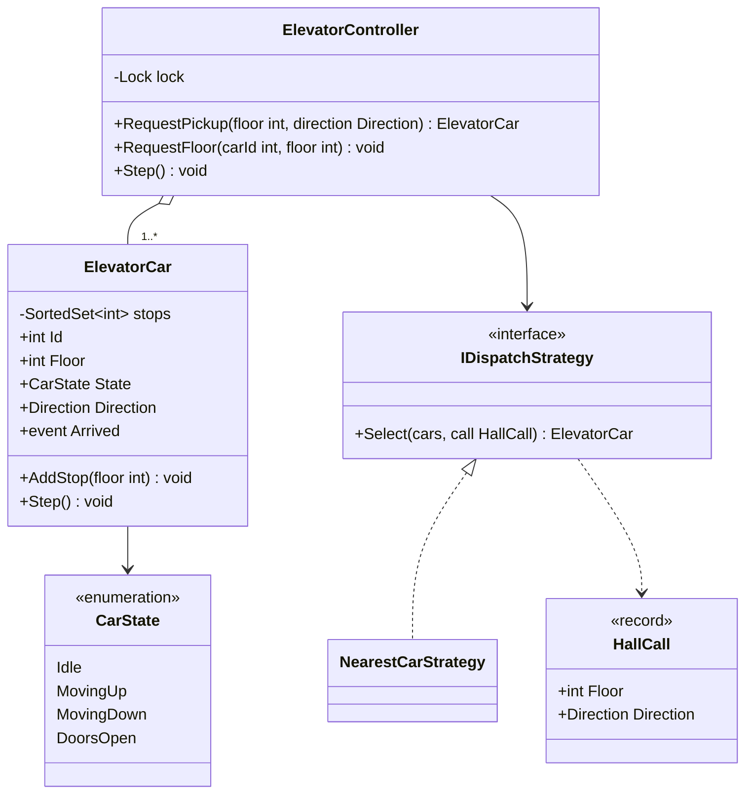
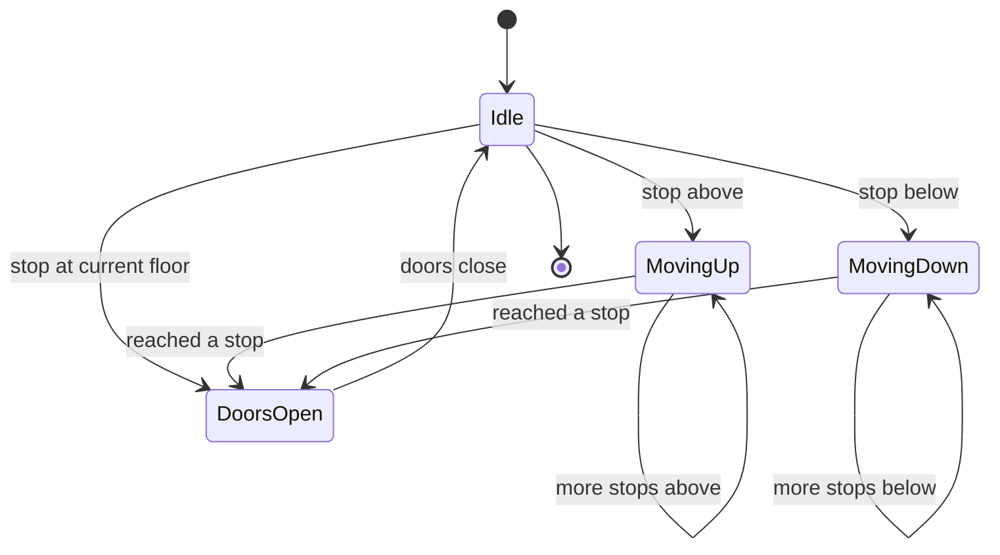
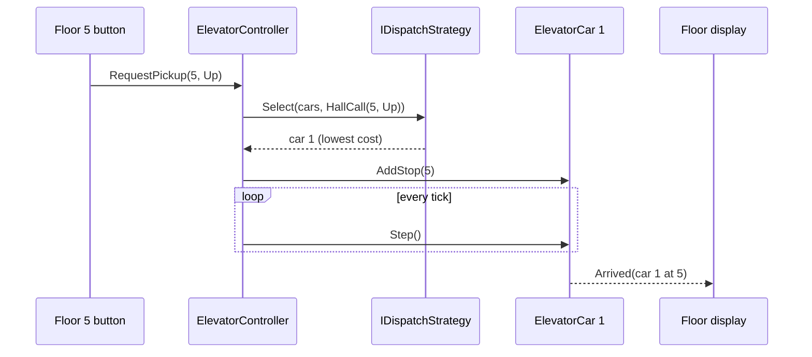

import { Aside } from '@astrojs/starlight/components';
import QuizBlock from '~/components/QuizBlock.astro';

## Why it matters in interviews

The elevator problem tests whether you can separate **two different decisions**: *which car* should answer a hall call (dispatching, across cars) and *in which order* a single car serves its stops (scheduling, inside one car). It is also state-heavy: idle, moving up, moving down, doors open. Candidates who mix all of it into one `ElevatorSystem` class with nested `if`s struggle when asked "how would you change the algorithm?".

## Requirements

**Functional**

- A building has floors `minFloor..maxFloor` and N elevator cars.
- **Hall call**: a person on a floor presses Up or Down; the system assigns a car.
- **Car call**: a passenger inside a car presses a destination floor.
- A car serves its stops efficiently (no ping-pong), opens doors at each stop, and goes idle when it has no work.
- Observers (floor displays) learn when a car arrives.

**Assumptions / out of scope:** no capacity/weight limit, no emergency or maintenance mode (extension), time is simulated in ticks (one floor or one door action per tick) so the design is deterministic and testable.

**Clarifying questions worth asking**

- How many cars and floors? (Decides whether a simple cost function is enough.)
- Should the dispatcher optimise wait time, travel time or energy? (Different strategies.)
- Can a hall call be re-assigned if a better car becomes free? (Here: no, keep it simple.)
- Do we need express elevators serving only some floors? (Extension: per-car served-floor set.)

## Entities & responsibilities

| Class | Knows | Does |
|---|---|---|
| `ElevatorCar` | current floor, direction, state, pending stops | adds stops, moves one step at a time using LOOK, raises `Arrived` |
| `HallCall` (record) | floor, direction | the request from a floor button |
| `IDispatchStrategy` | | chooses the best car for a hall call |
| `NearestCarStrategy` | | cost = distance, penalised if the car is moving away |
| `ElevatorController` | all cars, strategy | entry point for buttons, assigns hall calls, drives the clock tick |
| Displays / loggers | | subscribe to `Arrived` (Observer) |

## Class diagram



## Key flows

The car is a small state machine. Every tick it either closes its doors, opens them at a requested floor, idles, or moves one floor.



A hall call goes through the dispatcher; a car call goes straight to its car:



### Scheduling inside one car: LOOK

**FCFS** (serve stops in request order) makes the car zig-zag. **SCAN** (the classic disk-arm algorithm) sweeps to the end of the building and back. **LOOK** sweeps only as far as the furthest pending stop in the current direction, then reverses. That is what real elevators approximate and what the skeleton implements: keep the current direction while there are stops ahead; otherwise turn around.

## C# implementation

**The car.** A `SortedSet` keeps stops ordered, so "is there anything above me?" is a comparison with `Max`. `Arrived` is a plain C# event (Observer).

```csharp
namespace Elevator;

public enum Direction { None, Up, Down }
public enum CarState { Idle, MovingUp, MovingDown, DoorsOpen }
public sealed record HallCall(int Floor, Direction Direction);

public sealed class ElevatorCar(int id, int minFloor, int maxFloor)
{
    private readonly SortedSet<int> _stops = [];
    public int Id => id;
    public int MinFloor { get; } = minFloor;
    public int MaxFloor { get; } = maxFloor;
    public int Floor { get; private set; } = minFloor;
    public CarState State { get; private set; } = CarState.Idle;
    public Direction Direction { get; private set; } = Direction.None;
    public event Action<ElevatorCar>? Arrived; // observers: floor displays, logging

    public void AddStop(int floor)
    {
        ArgumentOutOfRangeException.ThrowIfLessThan(floor, MinFloor);
        ArgumentOutOfRangeException.ThrowIfGreaterThan(floor, MaxFloor);
        _stops.Add(floor);
    }

    // One simulation tick. LOOK algorithm: keep going while stops lie ahead, then reverse.
    public void Step()
    {
        if (State == CarState.DoorsOpen) { State = CarState.Idle; return; } // doors close
        if (_stops.Remove(Floor)) { State = CarState.DoorsOpen; Arrived?.Invoke(this); return; }
        if (_stops.Count == 0) { Direction = Direction.None; State = CarState.Idle; return; }

        Direction = NextDirection();
        Floor += Direction == Direction.Up ? 1 : -1;
        State = Direction == Direction.Up ? CarState.MovingUp : CarState.MovingDown;
    }

    private Direction NextDirection()
    {
        bool above = _stops.Max > Floor, below = _stops.Min < Floor;
        return Direction switch
        {
            Direction.Up when above => Direction.Up,
            Direction.Down when below => Direction.Down,
            _ => above ? Direction.Up : Direction.Down,
        };
    }
}
```

**Dispatching and the controller.** The strategy is the only place that knows how cars are chosen.

```csharp
namespace Elevator;

public interface IDispatchStrategy
{
    ElevatorCar Select(IReadOnlyList<ElevatorCar> cars, HallCall call);
}

// Prefer an idle car or one already heading towards the caller in the same direction.
public sealed class NearestCarStrategy : IDispatchStrategy
{
    public ElevatorCar Select(IReadOnlyList<ElevatorCar> cars, HallCall call) =>
        cars.MinBy(car => Cost(car, call))!;

    private static int Cost(ElevatorCar car, HallCall call)
    {
        int distance = Math.Abs(car.Floor - call.Floor);
        bool onTheWay = car.Direction switch
        {
            Direction.None => true,
            Direction.Up => call.Direction == Direction.Up && call.Floor >= car.Floor,
            Direction.Down => call.Direction == Direction.Down && call.Floor <= car.Floor,
            _ => false,
        };
        // A car moving away must finish its sweep first: penalise by a full building height.
        return onTheWay ? distance : distance + (car.MaxFloor - car.MinFloor);
    }
}

public sealed class ElevatorController(IReadOnlyList<ElevatorCar> cars, IDispatchStrategy strategy)
{
    private readonly Lock _lock = new(); // hall buttons are pressed concurrently

    public ElevatorCar RequestPickup(int floor, Direction direction)
    {
        lock (_lock)
        {
            var car = strategy.Select(cars, new HallCall(floor, direction));
            car.AddStop(floor);
            return car;
        }
    }

    public void RequestFloor(int carId, int floor)
    {
        lock (_lock) cars.Single(c => c.Id == carId).AddStop(floor);
    }

    public void Step()
    {
        lock (_lock) foreach (var car in cars) car.Step();
    }
}
```

**Demo.**

```csharp
using Elevator;

var cars = new[] { new ElevatorCar(1, 0, 10), new ElevatorCar(2, 0, 10) };
var controller = new ElevatorController(cars, new NearestCarStrategy());
foreach (var c in cars) c.Arrived += car => Console.WriteLine($"  car {car.Id} doors open at {car.Floor}");

var a = controller.RequestPickup(5, Direction.Up);
Console.WriteLine($"Hall call 5 Up -> car {a.Id}");
for (int t = 0; t < 6; t++) controller.Step();
controller.RequestFloor(a.Id, 9);              // passenger presses 9 inside

var b = controller.RequestPickup(3, Direction.Down); // car 1 is moving up and away
Console.WriteLine($"Hall call 3 Down -> car {b.Id}");
for (int t = 0; t < 12; t++) controller.Step();

foreach (var c in cars) Console.WriteLine($"car {c.Id}: floor {c.Floor}, {c.State}");
```

Car 1 takes the call at 5 (both idle, it is first), picks up a passenger who presses 9, and keeps moving up. The call at 3 going Down goes to car 2, because car 1 is moving up and away and gets the penalty.

## Patterns & SOLID used

| Where | Pattern / principle | Why |
|---|---|---|
| `IDispatchStrategy` | Strategy | Nearest car, zone-based, least-loaded or energy-saving are interchangeable |
| `CarState` + `Step()` | State machine | Transitions are explicit and testable; a full State pattern (one class per state) is an option if states gain more behaviour |
| `Arrived` event | Observer | Displays, logging, analytics subscribe without the car knowing them |
| `ElevatorController` | Facade / coordinator | Buttons talk to one entry point |
| Car vs controller | SRP | Ordering stops (car) and choosing cars (dispatch) change independently |
| Tick-based `Step()` | Testability | Deterministic simulation instead of threads and `Thread.Sleep` |

## Extensions the interviewer may ask

- **Different algorithms per time of day** (morning up-peak sends idle cars to the lobby): swap the `IDispatchStrategy` at runtime, or a composite strategy that picks one by time.
- **Capacity and weight**: give the car a `Load` and make `Cost` return infinity when full. Only the strategy changes.
- **Maintenance / emergency mode**: add `OutOfService` and `Emergency` states; the dispatcher skips cars not in a serviceable state; emergency clears stops and goes to the nearest floor.
- **Full State pattern**: if each state needs its own rules (door timers, overload buzzer), move to `IElevatorState` classes like the [vending machine](../lld-vending-machine/).
- **Requests as Commands**: model hall and car calls as command objects to queue, log, replay and cancel them.
- **Real time instead of ticks**: a `BackgroundService` or `PeriodicTimer` calls `Step()` every N ms; the lock in the controller already serialises button presses and ticks.

## Interview Q&A

<details>
<summary>What is the difference between dispatching and scheduling in this problem?</summary>

Dispatching picks **which car** answers a hall call; it is a decision across cars and lives in `IDispatchStrategy`. Scheduling decides **in which order one car** visits its stops; it lives inside the car (LOOK). Keeping them separate lets you change either one without touching the other.
</details>

<details>
<summary>Why LOOK instead of first-come-first-served?</summary>

FCFS makes the car change direction for every request, so total travel and average wait grow badly under load. LOOK serves every stop in the current direction first, then reverses, which bounds travel per sweep and avoids starvation, because every stop is reached within at most two sweeps.
</details>

<details>
<summary>How does the nearest-car cost function avoid a bad assignment?</summary>

Plain distance would pick a car that is close but moving away. The cost adds a full building height when the car is not "on the way" (idle, or moving towards the caller in the requested direction). Real systems add more terms: number of pending stops, load, and estimated time to arrival.
</details>

<details>
<summary>Where do you need thread-safety?</summary>

Buttons are pressed concurrently from many floors while the tick loop moves cars. All of them mutate the stop sets, so the controller serialises `RequestPickup`, `RequestFloor` and `Step` with one lock. Per-car locks would allow more concurrency but make "choose a car and add the stop" harder to keep atomic.
</details>

<details>
<summary>Why model state with an enum here but with classes in the vending machine?</summary>

The car has few states and the transition logic is a handful of lines, so an enum plus a `Step()` method is readable. When each state has many operations with different rules, the State pattern removes the growing `switch`. Say this trade-off out loud; interviewers like hearing why you did not add a pattern.
</details>

<details>
<summary>How would you test the scheduling?</summary>

Because time is a tick, a test can create a car, add stops, call `Step()` N times and assert the floor sequence recorded through the `Arrived` event. No sleeps, no threads, fully deterministic.
</details>

<details>
<summary>How would you prevent starvation of a floor?</summary>

LOOK already guarantees each stop is served within two sweeps for one car. For dispatching, track how long each hall call has waited and add an ageing term to the cost, or re-assign calls that exceed a threshold to the next available car.
</details>

## Pitfalls

<Aside type="caution" title="Common mistakes">

- **One class does everything**: dispatching, scheduling, doors and displays in a single `ElevatorSystem`.
- **Using threads and `Thread.Sleep` to simulate movement**: flaky, slow, hard to test. Use ticks.
- **Ignoring direction for hall calls**: assigning a car that is going down to a person who wants to go up.
- **Not handling a stop at the current floor**: the car should open doors, not move away and come back.
- **Mutating stop sets from button threads without a lock** while the tick loop iterates them.

</Aside>

## Related

- [How to approach LLD](../lld-approach/)
- [LLD: Vending Machine (State pattern)](../lld-vending-machine/)
- [Behavioral patterns](../../patterns/behavioral-patterns/)
- [Collections & generics (`SortedSet`)](../../csharp/collections-generics/)

## Quick quiz

<QuizBlock section="system-design" topic="lld-elevator" />
