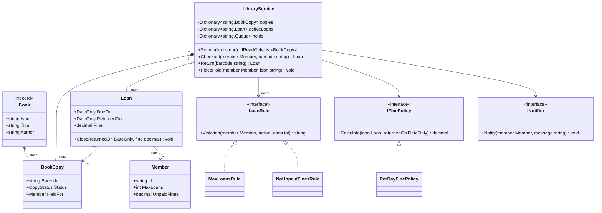
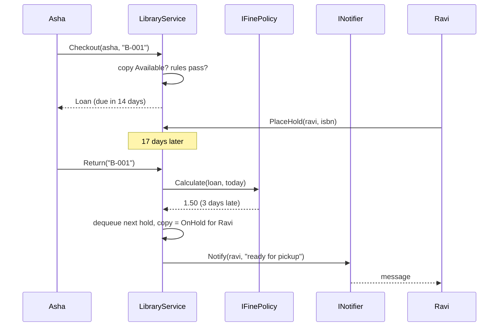

import { Aside } from '@astrojs/starlight/components';
import QuizBlock from '~/components/QuizBlock.astro';

## Why it matters in interviews

Library management looks like CRUD, which is exactly the trap. The interviewer wants to see you separate the **catalogue entry** (a `Book`, identified by ISBN) from the **physical copy** (a `BookCopy` with a barcode), turn borrowing **rules** into pluggable objects instead of a growing `if` chain, keep the **fine calculation** testable, and model **holds** (reservations) with a notification when a book comes back.

## Requirements

**Functional**

- Search the catalogue by title or author.
- A member borrows a specific copy for 14 days and returns it.
- Borrowing rules: at most 5 active loans; no borrowing while fines are unpaid.
- Late returns incur a fine per day, capped at a maximum.
- A member can place a hold on a title; when a copy is returned, the next member in the queue is notified and the copy is held for them.

**Assumptions / out of scope:** a single branch; payments of fines are recorded elsewhere; librarians and members use the same service API; in-memory storage.

**Clarifying questions worth asking**

- Do different member types (student, faculty) have different limits and loan periods? (Yes in many variants: drives the rule and policy objects.)
- Is the hold per title or per copy? (Per title: any copy will do.)
- How long is a held copy kept before it goes to the next person? (Extension: hold expiry.)
- Which channels for notifications: email, SMS? (Behind an `INotifier` interface.)

## Entities & responsibilities

| Class | Knows | Does |
|---|---|---|
| `Book` (record) | ISBN, title, author | catalogue entry, shared by all copies |
| `BookCopy` | barcode, book, status, held-for member | the physical item that is lent |
| `Member` | id, name, loan limit, unpaid fines | the borrower |
| `Loan` | copy, member, borrowed/due/returned dates, fine | the lending transaction; closed on return |
| `ILoanRule` | | one borrowing rule each (`MaxLoansRule`, `NoUnpaidFinesRule`) |
| `IFinePolicy` | rates | fine for a loan at return time |
| `INotifier` | | tells a member something (Observer target) |
| `LibraryService` | copies, active loans, hold queues | checkout, return, holds, search |

## Class diagram



## Key flows



A copy moves through a small life cycle: `Available → OnLoan → (OnHold for a member | Available)`, with `Lost` reachable from `OnLoan`.

## C# implementation

**Models.** `Book` and `BookCopy` are separate: a library owns 3 copies of one title.

```csharp
namespace Library;

public sealed record Book(string Isbn, string Title, string Author);

public enum CopyStatus { Available, OnLoan, OnHold, Lost }

// The catalogue has one Book; the shelf has many physical copies of it.
public sealed class BookCopy(string barcode, Book book)
{
    public string Barcode => barcode;
    public Book Book => book;
    public CopyStatus Status { get; set; } = CopyStatus.Available;
    public Member? HeldFor { get; set; }
}

public sealed class Member(string id, string name, int maxLoans = 5)
{
    public string Id => id;
    public string Name => name;
    public int MaxLoans => maxLoans;
    public decimal UnpaidFines { get; set; }
}

public sealed class Loan(BookCopy copy, Member member, DateOnly borrowedOn, DateOnly dueOn)
{
    public BookCopy Copy => copy;
    public Member Member => member;
    public DateOnly BorrowedOn => borrowedOn;
    public DateOnly DueOn => dueOn;
    public DateOnly? ReturnedOn { get; private set; }
    public decimal Fine { get; private set; }

    public void Close(DateOnly returnedOn, decimal fine) => (ReturnedOn, Fine) = (returnedOn, fine);
}
```

**Policies, rules and notifier.** Each borrowing rule is a small class; a rule returns an error message or `null`.

```csharp
namespace Library;

public interface IFinePolicy
{
    decimal Calculate(Loan loan, DateOnly returnedOn);
}

public sealed class PerDayFinePolicy(decimal perDay, decimal cap) : IFinePolicy
{
    public decimal Calculate(Loan loan, DateOnly returnedOn)
    {
        int daysLate = returnedOn.DayNumber - loan.DueOn.DayNumber;
        return daysLate <= 0 ? 0 : Math.Min(daysLate * perDay, cap);
    }
}

// Each borrowing rule is its own class: add a rule without touching LibraryService (OCP).
public interface ILoanRule
{
    string? Violation(Member member, int activeLoans);
}

public sealed class MaxLoansRule : ILoanRule
{
    public string? Violation(Member m, int activeLoans) =>
        activeLoans >= m.MaxLoans ? $"{m.Name} already has {activeLoans} books" : null;
}

public sealed class NoUnpaidFinesRule : ILoanRule
{
    public string? Violation(Member m, int activeLoans) =>
        m.UnpaidFines > 0 ? $"{m.Name} owes {m.UnpaidFines:C}" : null;
}

public interface INotifier
{
    void Notify(Member member, string message);
}

public sealed class ConsoleNotifier : INotifier
{
    public void Notify(Member member, string message) => Console.WriteLine($"  [to {member.Name}] {message}");
}
```

**Service, part 1: search and checkout.**

```csharp
namespace Library;

public sealed class LibraryService(IFinePolicy finePolicy, IEnumerable<ILoanRule> rules,
    INotifier notifier, TimeProvider clock, int loanDays = 14)
{
    private readonly Dictionary<string, BookCopy> _copies = [];
    private readonly Dictionary<string, Loan> _activeLoans = [];      // by barcode
    private readonly Dictionary<string, Queue<Member>> _holds = [];  // by ISBN, FIFO
    private readonly Lock _lock = new();
    private DateOnly Today => DateOnly.FromDateTime(clock.GetUtcNow().UtcDateTime);

    public void AddCopy(BookCopy copy) { lock (_lock) _copies.Add(copy.Barcode, copy); }

    public IReadOnlyList<BookCopy> Search(string text)
    {
        bool Has(string s) => s.Contains(text, StringComparison.OrdinalIgnoreCase);
        lock (_lock) return [.. _copies.Values.Where(c => Has(c.Book.Title) || Has(c.Book.Author))];
    }

    public Loan Checkout(Member member, string barcode)
    {
        lock (_lock)
        {
            var copy = _copies[barcode];
            bool mayTake = copy.Status == CopyStatus.Available
                || (copy.Status == CopyStatus.OnHold && copy.HeldFor == member);
            if (!mayTake) throw new InvalidOperationException($"{barcode} is {copy.Status}");

            int active = _activeLoans.Values.Count(l => l.Member == member);
            var violation = rules.Select(r => r.Violation(member, active)).FirstOrDefault(v => v is not null);
            if (violation is not null) throw new InvalidOperationException(violation);

            (copy.Status, copy.HeldFor) = (CopyStatus.OnLoan, null);
            var loan = new Loan(copy, member, Today, Today.AddDays(loanDays));
            _activeLoans[barcode] = loan;
            return loan;
        }
    }
```

**Service, part 2: holds and return** (same class, continued).

```csharp
    public void PlaceHold(Member member, string isbn)
    {
        lock (_lock)
        {
            if (!_holds.TryGetValue(isbn, out var queue)) _holds[isbn] = queue = new Queue<Member>();
            queue.Enqueue(member);
        }
    }

    public Loan Return(string barcode)
    {
        lock (_lock)
        {
            if (!_activeLoans.Remove(barcode, out var loan)) throw new KeyNotFoundException(barcode);
            var fine = finePolicy.Calculate(loan, Today);
            loan.Close(Today, fine);
            loan.Member.UnpaidFines += fine;

            var copy = loan.Copy;
            if (_holds.TryGetValue(copy.Book.Isbn, out var queue) && queue.TryDequeue(out var next))
            {
                (copy.Status, copy.HeldFor) = (CopyStatus.OnHold, next);
                notifier.Notify(next, $"'{copy.Book.Title}' is ready for pickup");
            }
            else copy.Status = CopyStatus.Available;
            return loan;
        }
    }
}
```

**Demo.**

```csharp
using Library;

var clock = new FakeClock();
var library = new LibraryService(new PerDayFinePolicy(0.5m, 10m),
    [new MaxLoansRule(), new NoUnpaidFinesRule()], new ConsoleNotifier(), clock);

var ddd = new Book("978-0321125217", "Domain-Driven Design", "Eric Evans");
library.AddCopy(new BookCopy("B-001", ddd));
var asha = new Member("M1", "Asha");
var ravi = new Member("M2", "Ravi");

var loan = library.Checkout(asha, "B-001");
Console.WriteLine($"Asha borrowed {loan.Copy.Book.Title}, due {loan.DueOn}");
library.PlaceHold(ravi, ddd.Isbn);

clock.Advance(TimeSpan.FromDays(17));                     // 3 days late
var closed = library.Return("B-001");
Console.WriteLine($"Returned, fine {closed.Fine:C}");

try { library.Checkout(asha, "B-001"); }
catch (InvalidOperationException ex) { Console.WriteLine($"Asha again: {ex.Message}"); }
Console.WriteLine($"Ravi picks up: due {library.Checkout(ravi, "B-001").DueOn}");
Console.WriteLine($"Search 'evans': {library.Search("evans").Count} copy");

sealed class FakeClock : TimeProvider
{
    private DateTimeOffset _now = new(2026, 3, 1, 10, 0, 0, TimeSpan.Zero);
    public override DateTimeOffset GetUtcNow() => _now;
    public void Advance(TimeSpan by) => _now += by;
}
```

Asha borrows the only copy, Ravi places a hold, Asha returns 3 days late (fine 1.50), Ravi is notified, Asha can't re-borrow (the copy is on hold for Ravi), and Ravi checks it out.

## Patterns & SOLID used

| Where | Pattern / principle | Why |
|---|---|---|
| `ILoanRule` list | Specification-style rules / OCP | New rule (no reference books, max 2 DVDs) = new class + registration |
| `IFinePolicy` | Strategy | Different fines for students, faculty, DVDs, holidays |
| `INotifier` | Observer / DIP | Email, SMS or push without the service knowing |
| `Book` vs `BookCopy` | Correct modelling | Search works on titles; lending works on physical items |
| `Loan` as its own entity | SRP + history | Keeps borrowing history, due dates and fines out of `Member` and `BookCopy` |
| `TimeProvider` | Testability | Late returns are tested by advancing a fake clock |

## Extensions the interviewer may ask

- **Member types with different limits and loan periods**: give `Member` a `MembershipPlan` (max loans, loan days, fine policy); the service reads from the plan.
- **Hold expiry**: store `HeldUntil` on the copy; a scheduled job (or a check on the next checkout) releases expired holds to the next in queue.
- **Renewals**: `Renew(barcode)` extends `DueOn` if no one is waiting in the hold queue and a renewal limit isn't exceeded; that is just another rule object.
- **Due-date reminders**: a daily background job queries loans due tomorrow and calls `INotifier`; the domain stays the same.
- **Multiple branches and transfers**: add `Branch` to `BookCopy`; holds can request a transfer.
- **Persistence and concurrency**: two librarians checking out the same copy is a race; in a database use a row version on `BookCopy` (optimistic concurrency) instead of the in-process lock.

## Interview Q&A

<details>
<summary>Why separate `Book` and `BookCopy`?</summary>

They have different identities and life cycles. A `Book` (ISBN) is catalogue data shared by every copy and is what members search and hold. A `BookCopy` (barcode) is a physical item with a status that is borrowed, returned or lost. Merging them makes "3 copies of the same title" impossible to model cleanly.
</details>

<details>
<summary>How do you add a new borrowing rule without modifying `LibraryService`?</summary>

Implement `ILoanRule` (for example `NoReferenceBooksRule`) and register it in the rule list passed to the constructor. The service just evaluates all rules. This is the Open/Closed Principle; the list of rules works like a set of specifications.
</details>

<details>
<summary>Where should the fine be calculated and stored?</summary>

Calculated by an `IFinePolicy` at return time (policy varies by member type or item type), stored on the `Loan` (history: how much this loan cost) and added to the member's unpaid balance. The `BookCopy` should not know about money.
</details>

<details>
<summary>How do holds work when several members want the same title?</summary>

A FIFO `Queue` per ISBN. On return, the service dequeues the next member, marks the copy `OnHold` for them and notifies them. Checkout of an `OnHold` copy succeeds only for that member.
</details>

<details>
<summary>Why does the rule interface return an error string instead of throwing?</summary>

Rules are evaluated as data: the service can collect all violations, show them to a librarian, or stop at the first one. Throwing from each rule mixes control flow with validation. In a larger codebase, a `Result` type is the cleaner version of the same idea.
</details>

<details>
<summary>What would you change for a real database-backed system?</summary>

Repositories for books, copies, members and loans; the checkout becomes a transaction that updates the copy status with a concurrency token (row version) and inserts the loan. Notifications are published through an outbox so a failed email does not roll back the return.
</details>

## Pitfalls

<Aside type="caution" title="Common mistakes">

- **Book and copy merged into one class**, so availability is a counter that drifts out of sync.
- **Rules hard-coded as nested `if`s** in `Checkout`, so every new rule edits the service.
- **Fines computed with `DateTime.Now`** and no way to test lateness.
- **Notifying inside the lock with slow I/O** in production code. Collect notifications and send after releasing the lock, or publish to a queue.
- **Forgetting the hold** when the original borrower tries to take the copy again after returning it.

</Aside>

## Related

- [How to approach LLD](../lld-approach/)
- [LLD: Notification Dispatcher](../lld-notification-dispatcher/)
- [Enterprise patterns (Repository, Specification)](../../patterns/enterprise-patterns/)
- [SOLID principles](../../patterns/solid/)

## Quick quiz

<QuizBlock section="system-design" topic="lld-library" />
