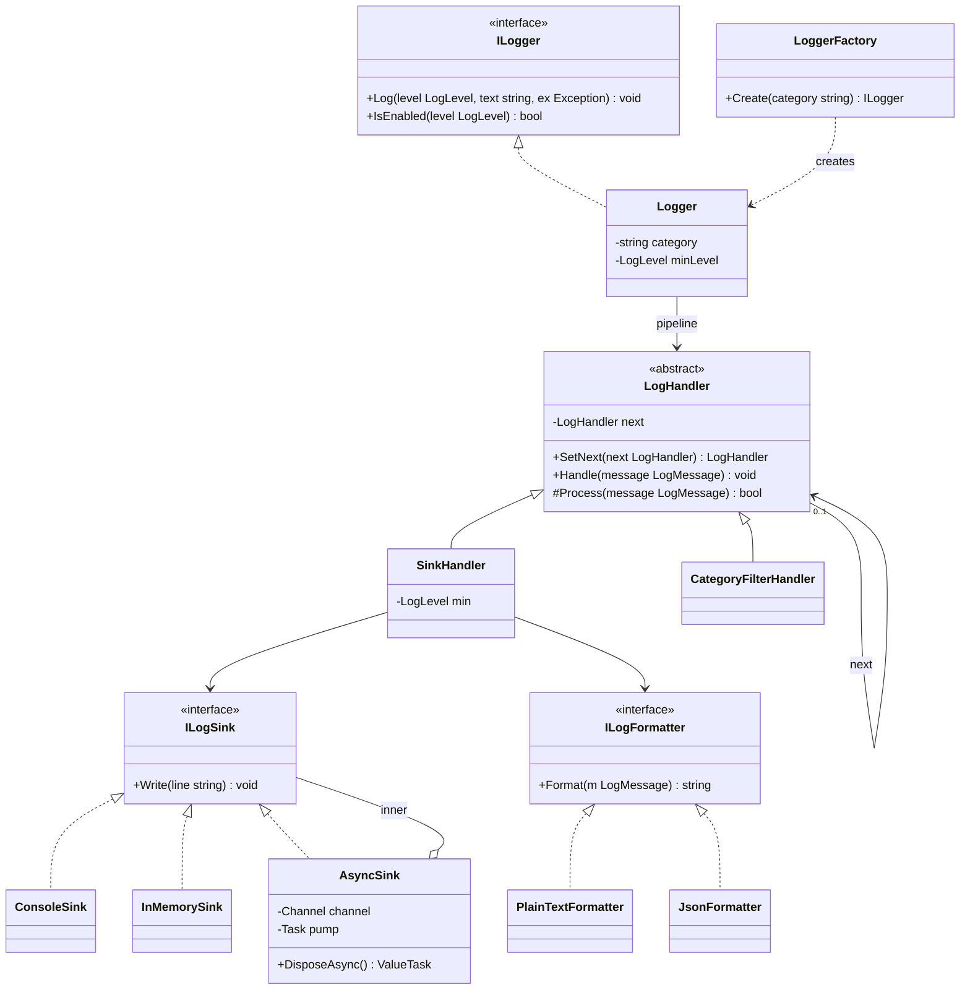
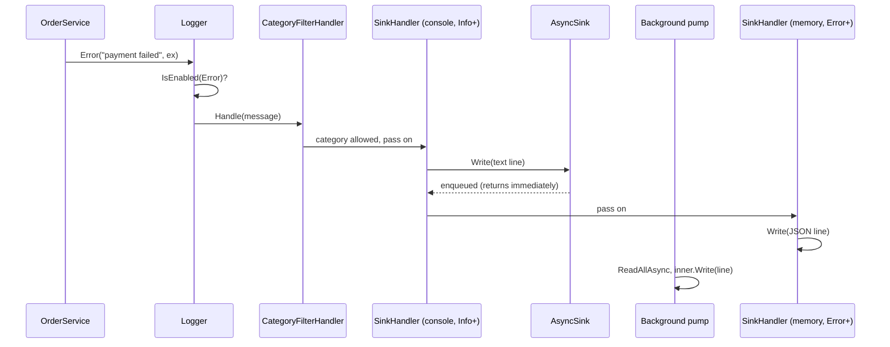

import { Aside } from '@astrojs/starlight/components';
import QuizBlock from '~/components/QuizBlock.astro';

## Why it matters in interviews

"Design a logger" checks whether you can split a familiar tool into clean, swappable parts: **what** to log (level, category), **how** it looks (formatter), **where** it goes (sink/appender), and **how it flows** (a pipeline where each step may stop the message). Then the interesting follow-up: *"logging to a file is slow and the API is now slower, what do you do?"* The answer is asynchronous buffering with back-pressure, and knowing what to drop when the buffer is full.

You use `Microsoft.Extensions.Logging` daily; this is the chance to show you know how such a library is built.

## Requirements

**Functional**

- Levels Trace → Fatal; a message below the configured minimum is ignored cheaply.
- Each logger has a **category** (usually the class name).
- Multiple destinations (console, file, in-memory for tests), each with its **own minimum level** and **own format** (text, JSON).
- Filter rules, e.g. "Microsoft.* only Warning and above".
- Logging must not block or crash the application, even if a sink is slow.

**Assumptions / out of scope:** structured logging templates (`{OrderId}` placeholders) and log rotation are extensions; a single process.

**Clarifying questions worth asking**

- Must every message be written, or can we drop under pressure? (Audit logs: never drop; debug logs: dropping oldest is fine.)
- Synchronous or asynchronous writes? (Async, but then flush on shutdown.)
- Should configuration change at runtime? (Then levels must be read per call, not baked in.)
- Is ordering across threads required? (A single consumer preserves enqueue order.)

## Entities & responsibilities

| Class | Knows | Does |
|---|---|---|
| `LogLevel` (enum) | | severity ordering |
| `LogMessage` (record) | timestamp, level, category, text, exception | the immutable event |
| `ILogger` / `Logger` | category, min level, pipeline | builds the message and hands it to the pipeline |
| `LoggerFactory` | shared pipeline, defaults | creates a logger per category |
| `LogHandler` (abstract) | next handler | Chain of Responsibility: process, then pass on or stop |
| `CategoryFilterHandler`, `SinkHandler` | rules / sink + formatter + level | concrete steps of the chain |
| `ILogFormatter` | | message → string (plain text, JSON) |
| `ILogSink` | | writes a line (console, file, memory) |
| `AsyncSink` (decorator) | bounded channel, background task | makes any sink non-blocking |

## Class diagram



## Key flows



The application thread only formats and enqueues; the slow console or file I/O happens on the background pump.

## C# implementation

**Levels, message and formatters.**

```csharp
using System.Text.Json;

namespace Logging;

public enum LogLevel { Trace, Debug, Info, Warning, Error, Fatal }

public sealed record LogMessage(DateTimeOffset Timestamp, LogLevel Level, string Category,
    string Text, Exception? Exception = null);

public interface ILogFormatter
{
    string Format(LogMessage m);
}

public sealed class PlainTextFormatter : ILogFormatter
{
    public string Format(LogMessage m) =>
        $"{m.Timestamp:HH:mm:ss.fff} [{m.Level.ToString().ToUpperInvariant()}] {m.Category}: {m.Text}"
        + (m.Exception is null ? "" : $" | {m.Exception.GetType().Name}: {m.Exception.Message}");
}

public sealed class JsonFormatter : ILogFormatter
{
    public string Format(LogMessage m) => JsonSerializer.Serialize(new
    {
        ts = m.Timestamp, level = m.Level.ToString(), category = m.Category,
        message = m.Text, error = m.Exception?.Message,
    });
}
```

**Sinks, including the async decorator.** A **bounded** channel with `DropOldest` keeps memory flat when the sink can't keep up; `DisposeAsync` completes the writer and waits for the pump to drain, so nothing queued is lost on a clean shutdown.

```csharp
using System.Threading.Channels;

namespace Logging;

public interface ILogSink
{
    void Write(string line);
}

public sealed class ConsoleSink : ILogSink
{
    public void Write(string line) => Console.WriteLine(line);
}

public sealed class InMemorySink : ILogSink   // handy in tests
{
    private readonly List<string> _lines = [];
    private readonly Lock _lock = new();
    public void Write(string line) { lock (_lock) _lines.Add(line); }
    public IReadOnlyList<string> Lines { get { lock (_lock) return [.. _lines]; } }
}

// Decorator: callers enqueue and return immediately; one background task does the slow I/O.
public sealed class AsyncSink : ILogSink, IAsyncDisposable
{
    private readonly Channel<string> _channel;
    private readonly Task _pump;

    public AsyncSink(ILogSink inner, int capacity = 10_000)
    {
        _channel = Channel.CreateBounded<string>(new BoundedChannelOptions(capacity)
        {
            FullMode = BoundedChannelFullMode.DropOldest, // never block the app because of logging
            SingleReader = true,
        });
        _pump = Task.Run(async () =>
        {
            await foreach (var line in _channel.Reader.ReadAllAsync()) inner.Write(line);
        });
    }

    public void Write(string line) => _channel.Writer.TryWrite(line);

    public async ValueTask DisposeAsync()   // flush on shutdown
    {
        _channel.Writer.TryComplete();
        await _pump;
    }
}
```

**The chain.** The base class owns the "call next" mechanics (Template Method); subclasses only decide what to do.

```csharp
namespace Logging;

// Chain of Responsibility: each handler decides whether to act, then passes the message on.
public abstract class LogHandler
{
    private LogHandler? _next;

    public LogHandler SetNext(LogHandler next) => _next = next; // returns next for fluent chaining

    public void Handle(LogMessage message)
    {
        if (!Process(message)) return;   // false = stop the chain
        _next?.Handle(message);
    }

    protected abstract bool Process(LogMessage message);
}

// Drops noisy categories (e.g. "Microsoft.*" below Warning) before any sink sees them.
public sealed class CategoryFilterHandler(string prefix, LogLevel min) : LogHandler
{
    protected override bool Process(LogMessage m) =>
        !m.Category.StartsWith(prefix, StringComparison.Ordinal) || m.Level >= min;
}

// Writes to one sink if the level is high enough, and always lets the chain continue.
public sealed class SinkHandler(ILogSink sink, ILogFormatter formatter, LogLevel min) : LogHandler
{
    protected override bool Process(LogMessage m)
    {
        if (m.Level >= min) sink.Write(formatter.Format(m));
        return true;
    }
}
```

**Logger and factory.**

```csharp
namespace Logging;

public interface ILogger
{
    void Log(LogLevel level, string text, Exception? ex = null);
    bool IsEnabled(LogLevel level);
}

public sealed class Logger(string category, LogLevel minLevel, LogHandler pipeline, TimeProvider clock) : ILogger
{
    public bool IsEnabled(LogLevel level) => level >= minLevel;

    public void Log(LogLevel level, string text, Exception? ex = null)
    {
        if (!IsEnabled(level)) return;   // cheap early exit before allocating a message
        pipeline.Handle(new LogMessage(clock.GetUtcNow(), level, category, text, ex));
    }
}

public static class LoggerExtensions
{
    public static void Info(this ILogger log, string text) => log.Log(LogLevel.Info, text);
    public static void Warn(this ILogger log, string text) => log.Log(LogLevel.Warning, text);
    public static void Error(this ILogger log, string text, Exception? ex = null) => log.Log(LogLevel.Error, text, ex);
}

// One pipeline shared by all loggers; a logger per category. Register as a DI singleton.
public sealed class LoggerFactory(LogHandler pipeline, LogLevel minLevel, TimeProvider? clock = null)
{
    public ILogger Create(string category) => new Logger(category, minLevel, pipeline, clock ?? TimeProvider.System);
    public ILogger Create<T>() => Create(typeof(T).FullName!);
}
```

**Demo.**

```csharp
using Logging;

var memory = new InMemorySink();
await using var asyncConsole = new AsyncSink(new ConsoleSink());

// filter -> console (Info+, text) -> memory (Error+, JSON)
var pipeline = new CategoryFilterHandler("Microsoft.", LogLevel.Warning);
pipeline.SetNext(new SinkHandler(asyncConsole, new PlainTextFormatter(), LogLevel.Info))
        .SetNext(new SinkHandler(memory, new JsonFormatter(), LogLevel.Error));

var factory = new LoggerFactory(pipeline, LogLevel.Debug);
var orders = factory.Create("Shop.Orders");
var efCore = factory.Create("Microsoft.EntityFrameworkCore");

orders.Log(LogLevel.Debug, "cart loaded");                 // passes min level, below console's Info
orders.Info("order 42 placed");
efCore.Info("executed DbCommand (3ms)");                   // filtered by category
orders.Error("payment failed", new TimeoutException("gateway timed out"));

await asyncConsole.DisposeAsync();                         // flush before reading output
Console.WriteLine($"memory sink has {memory.Lines.Count} line(s): {memory.Lines[0]}");
```

Debug passes the logger's minimum but is below the console's Info threshold; the EF Core Info message is dropped by the category filter; the error reaches both the console (text) and the memory sink (JSON).

## Patterns & SOLID used

| Where | Pattern / principle | Why |
|---|---|---|
| `LogHandler` chain | Chain of Responsibility | Filters and sinks are steps; add, remove or reorder without changing the logger |
| `LogHandler.Handle` | Template Method | Base class fixes the algorithm (process, then next); subclasses fill in `Process` |
| `AsyncSink` | Decorator | Adds buffering to any sink; console and file sinks stay simple and synchronous |
| `ILogFormatter` | Strategy | Text, JSON, or logfmt per sink |
| `LoggerFactory` | Factory + shared singleton pipeline | One configuration, one logger per category; register as a DI singleton |
| Small interfaces | ISP | A sink only writes lines; it doesn't know about levels or formats |

## Extensions the interviewer may ask

- **File sink with rolling**: a `RollingFileSink` that opens a new file per day or size limit. It plugs in behind `AsyncSink`, so the app never waits for disk.
- **Structured logging**: accept a template plus arguments (`"Order {OrderId} placed", 42`), keep properties as a dictionary on `LogMessage`, and let the JSON formatter emit them as fields. That is what Serilog and `ILogger` message templates do.
- **Scopes / correlation id**: an `AsyncLocal` stack of properties (request id, user id) that the logger copies onto each message.
- **Runtime level changes**: read the level from an `IOptionsMonitor`-style source per call instead of a constructor value.
- **Never drop audit logs**: use `BoundedChannelFullMode.Wait` for that sink (back-pressure on the caller) or a durable queue; keep `DropOldest` for debug noise.
- **Sink failure**: wrap each sink call in try/catch inside the pump, count failures, and fall back to stderr; logging must never take down the app.

## Interview Q&A

<details>
<summary>Why a Chain of Responsibility instead of a list of sinks in the logger?</summary>

A list only supports "write to all". A chain lets each step decide whether to continue: a filter can stop noisy categories before any sink sees them, a sampler can drop 99% of Debug messages, an enricher can add properties. New steps are new classes; the logger and other steps stay unchanged.
</details>

<details>
<summary>How do you keep logging from slowing down requests?</summary>

Do only cheap work on the caller's thread: an `IsEnabled` check before building the message, then enqueue to an in-memory channel. A single background consumer does the slow I/O. The channel is bounded so memory can't grow forever, and the full-mode policy decides what happens under pressure.
</details>

<details>
<summary>What happens to queued messages when the app shuts down?</summary>

They are lost unless you flush. `AsyncSink.DisposeAsync` completes the channel writer, then awaits the pump task, which drains the remaining items. In ASP.NET Core this is wired to host shutdown by registering the sink as a disposable singleton.
</details>

<details>
<summary>Bounded or unbounded channel? Which full mode?</summary>

Bounded, so a slow sink can't exhaust memory. `DropOldest` (or `DropWrite`) for diagnostic logs: losing some lines under extreme load is better than blocking requests. `Wait` for audit logs that must not be lost, accepting back-pressure on callers.
</details>

<details>
<summary>Is the logger thread-safe?</summary>

`Logger` and the handlers are immutable after setup, so they are safe to share. Sinks must be safe for concurrent `Write` calls: `InMemorySink` uses a lock, and `AsyncSink` relies on the channel (many writers, one reader) so the inner sink is only ever called from the single pump.
</details>

<details>
<summary>Why check `IsEnabled` before creating the message?</summary>

Most Debug and Trace calls are disabled in production. Checking first avoids allocating the message, formatting strings and capturing timestamps for something that will be discarded. `Microsoft.Extensions.Logging` source-generated `LoggerMessage` methods take this further by avoiding boxing too.
</details>

<details>
<summary>How does this map to `Microsoft.Extensions.Logging`?</summary>

`ILoggerFactory` creates `ILogger` per category; `ILoggerProvider` is roughly a sink plus formatter; filter rules in configuration are the category filter; the console provider already writes through a background queue. Serilog adds the enricher/sink pipeline and structured templates.
</details>

## Pitfalls

<Aside type="caution" title="Common mistakes">

- **Writing to the file synchronously on the request thread.**
- **Unbounded queues**: a stuck sink grows memory until the process dies.
- **Not flushing on shutdown**, so the last (most interesting) lines before a crash are lost.
- **Throwing from a sink** into application code. Catch and report sink failures internally.
- **Building expensive messages before the level check** (string interpolation of large objects).
- **A static global logger** instead of a factory registered in DI, which makes testing and configuration hard.

</Aside>

## Related

- [Behavioral patterns (Chain of Responsibility, Template Method)](../../patterns/behavioral-patterns/)
- [Structural patterns (Decorator)](../../patterns/structural-patterns/)
- [Threading & synchronization (`Channel<T>`)](../../csharp/threading/)
- [Observability & cross-cutting concerns](../../microservices/observability-cross-cutting/)

## Quick quiz

<QuizBlock section="system-design" topic="lld-logger" />
