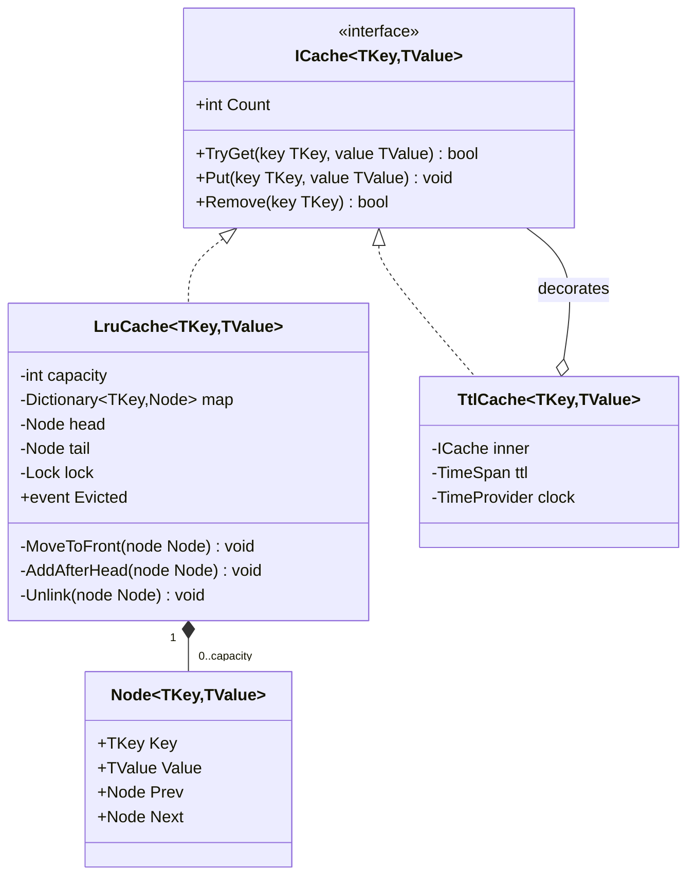
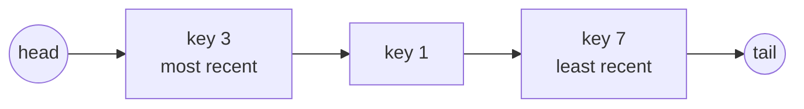
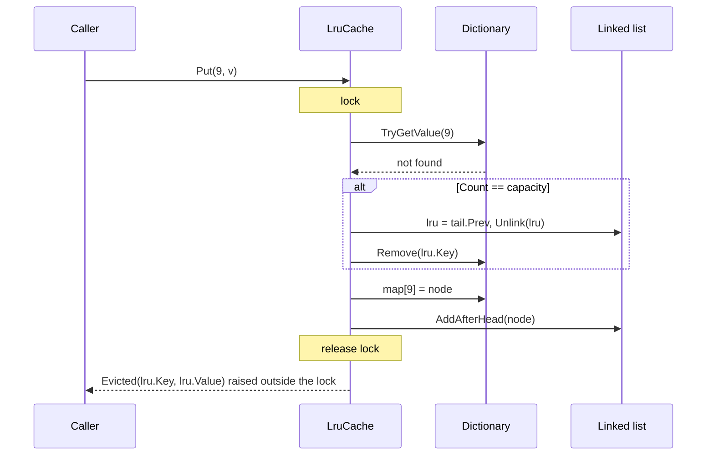

import { Aside } from '@astrojs/starlight/components';
import QuizBlock from '~/components/QuizBlock.astro';

## Why it matters in interviews

"Design an LRU cache" sits on the border of DSA and LLD, which is why it is asked so often. The DSA part is the **O(1) design**: a hash map for lookup plus a doubly linked list for recency. The LLD part is everything the LeetCode version skips: a **generic** interface, **thread-safety**, an **eviction callback**, and **"now add TTL"**. Expect to write the linked-list manipulation by hand; many interviewers do not accept `LinkedList<T>` without a discussion.

## Requirements

**Functional**

- `TryGet(key)` returns the value and marks the key as most recently used.
- `Put(key, value)` inserts or updates; when full, evicts the **least recently used** entry.
- `Remove(key)` and `Count`.
- Fixed capacity set at construction; both operations O(1).
- Notify a listener when an entry is evicted (metrics, write-back, disposal).

**Assumptions:** in-process cache (not distributed); keys are non-null; values can be anything; multiple threads use the cache concurrently.

**Clarifying questions worth asking**

- Does a read count as a "use"? (Yes for LRU; that is why `TryGet` mutates the list.)
- Should `Put` on an existing key refresh recency? (Yes.)
- Is capacity in entries or in bytes? (Entries here; bytes needs a size function per value.)
- Do entries expire by time as well? (TTL extension below.)
- How much contention is expected? (Decides one lock vs sharding.)

## Entities & responsibilities

| Class | Knows | Does |
|---|---|---|
| `ICache` interface | | the contract callers depend on: `TryGet`, `Put`, `Remove`, `Count` |
| `Node` | key, value, prev, next | one entry in the recency list (stores the key so eviction can remove it from the map) |
| `LruCache` | capacity, map key → node, head/tail sentinels, lock | O(1) operations, eviction, `Evicted` event |
| `TtlCache` (decorator) | inner cache, TTL, clock | adds expiry to any `ICache` |
| `Timed` (record struct) | value, expiry time | what the TTL decorator stores in the inner cache |

## Class diagram



## Key flows

The list is ordered by recency. Sentinel `head` and `tail` nodes mean every real node always has a non-null neighbour on both sides, so there are no special cases for the first or last element.





### Why O(1)

| Operation | Map | List | Total |
|---|---|---|---|
| `TryGet` hit | O(1) lookup | unlink + add at head: O(1) | O(1) |
| `Put` new key | O(1) insert | add at head: O(1) | O(1) |
| `Put` when full | O(1) remove | tail.Prev is the LRU: O(1) | O(1) |
| `Remove` | O(1) | unlink: O(1) | O(1) |

A singly linked list would make unlinking O(n) (you need the previous node). A plain list or array would make "move to front" O(n). A `SortedDictionary` by last-access time gives O(log n). The map + doubly linked list pair is what gives O(1) everywhere (average case for the hash map). Space is O(capacity).

## C# implementation

**Contract and node.**

```csharp
namespace Caching;

public interface ICache<TKey, TValue> where TKey : notnull
{
    bool TryGet(TKey key, out TValue value);
    void Put(TKey key, TValue value);
    bool Remove(TKey key);
    int Count { get; }
}

// Doubly linked list node. Head side = most recently used, tail side = least.
internal sealed class Node<TKey, TValue>(TKey key, TValue value)
{
    public TKey Key { get; } = key;
    public TValue Value { get; set; } = value;
    public Node<TKey, TValue>? Prev { get; set; }
    public Node<TKey, TValue>? Next { get; set; }
}
```

**The cache, part 1: fields, constructor, `TryGet`, `Remove`.**

```csharp
namespace Caching;

public sealed class LruCache<TKey, TValue> : ICache<TKey, TValue> where TKey : notnull
{
    private readonly int _capacity;
    private readonly Dictionary<TKey, Node<TKey, TValue>> _map;
    private readonly Node<TKey, TValue> _head = new(default!, default!); // sentinels: no null checks
    private readonly Node<TKey, TValue> _tail = new(default!, default!);
    private readonly Lock _lock = new();

    public event Action<TKey, TValue>? Evicted;

    public LruCache(int capacity)
    {
        ArgumentOutOfRangeException.ThrowIfNegativeOrZero(capacity);
        _capacity = capacity;
        _map = new Dictionary<TKey, Node<TKey, TValue>>(capacity);
        (_head.Next, _tail.Prev) = (_tail, _head);
    }

    public int Count { get { lock (_lock) return _map.Count; } }

    public bool TryGet(TKey key, out TValue value)
    {
        lock (_lock)
        {
            if (!_map.TryGetValue(key, out var node)) { value = default!; return false; }
            MoveToFront(node);   // a read is a "use"
            value = node.Value;
            return true;
        }
    }

    public bool Remove(TKey key)
    {
        lock (_lock)
        {
            if (!_map.Remove(key, out var node)) return false;
            Unlink(node);
            return true;
        }
    }
```

**Part 2: `Put` and the list helpers** (same class, continued). The eviction event is raised **outside** the lock so a slow or re-entrant handler cannot block or deadlock the cache.

```csharp
    public void Put(TKey key, TValue value)
    {
        (TKey Key, TValue Value)? evicted = null;
        lock (_lock)
        {
            if (_map.TryGetValue(key, out var existing))
            {
                existing.Value = value;
                MoveToFront(existing);
                return;
            }
            if (_map.Count == _capacity)
            {
                var lru = _tail.Prev!;            // least recently used
                Unlink(lru);
                _map.Remove(lru.Key);
                evicted = (lru.Key, lru.Value);
            }
            var node = new Node<TKey, TValue>(key, value);
            _map[key] = node;
            AddAfterHead(node);
        }
        if (evicted is { } e) Evicted?.Invoke(e.Key, e.Value); // raise outside the lock
    }

    private void MoveToFront(Node<TKey, TValue> node) { Unlink(node); AddAfterHead(node); }

    private void AddAfterHead(Node<TKey, TValue> node)
    {
        (node.Prev, node.Next) = (_head, _head.Next);
        _head.Next!.Prev = node;
        _head.Next = node;
    }

    private static void Unlink(Node<TKey, TValue> node)
    {
        node.Prev!.Next = node.Next;
        node.Next!.Prev = node.Prev;
        (node.Prev, node.Next) = (null, null);
    }
}
```

**TTL as a decorator.** Expiry is added without touching `LruCache` (Open/Closed).

```csharp
namespace Caching;

public readonly record struct Timed<TValue>(TValue Value, DateTimeOffset ExpiresAt);

// Decorator: adds expiry to ANY ICache without touching LruCache (Open/Closed).
public sealed class TtlCache<TKey, TValue>(ICache<TKey, Timed<TValue>> inner, TimeSpan ttl, TimeProvider clock)
    : ICache<TKey, TValue> where TKey : notnull
{
    public int Count => inner.Count;

    public void Put(TKey key, TValue value) => inner.Put(key, new(value, clock.GetUtcNow() + ttl));

    public bool TryGet(TKey key, out TValue value)
    {
        if (inner.TryGet(key, out var timed) && timed.ExpiresAt > clock.GetUtcNow())
        {
            value = timed.Value;
            return true;
        }
        inner.Remove(key);   // lazy expiry: an expired entry is dropped when it is read
        value = default!;
        return false;
    }

    public bool Remove(TKey key) => inner.Remove(key);
}
```

**Demo.**

```csharp
using Caching;

var cache = new LruCache<int, string>(capacity: 2);
cache.Evicted += (k, v) => Console.WriteLine($"  evicted {k}={v}");

cache.Put(1, "one");
cache.Put(2, "two");
cache.TryGet(1, out _);          // 1 becomes most recent, so 2 is now LRU
cache.Put(3, "three");           // evicts 2
Console.WriteLine($"has 2? {cache.TryGet(2, out _)}, has 1? {cache.TryGet(1, out var one)} ({one})");

// Concurrency smoke test: 8 threads hammering a 100-entry cache.
var shared = new LruCache<int, int>(100);
Parallel.For(0, 100_000, i => { shared.Put(i % 500, i); shared.TryGet(i % 250, out _); });
Console.WriteLine($"after parallel load: Count = {shared.Count}");

// TTL decorator
var clock = new FakeClock();
var ttl = new TtlCache<string, string>(new LruCache<string, Timed<string>>(10), TimeSpan.FromMinutes(5), clock);
ttl.Put("token", "abc");
Console.WriteLine($"token at t+0: {ttl.TryGet("token", out _)}");
clock.Advance(TimeSpan.FromMinutes(6));
Console.WriteLine($"token at t+6m: {ttl.TryGet("token", out _)}, count {ttl.Count}");

sealed class FakeClock : TimeProvider
{
    private DateTimeOffset _now = DateTimeOffset.UnixEpoch;
    public override DateTimeOffset GetUtcNow() => _now;
    public void Advance(TimeSpan by) => _now += by;
}
```

Key 2 is evicted because reading key 1 made it more recent; 100,000 parallel operations leave exactly 100 entries; the token expires after the fake clock moves 6 minutes.

## Patterns & SOLID used

| Where | Pattern / principle | Why |
|---|---|---|
| `ICache` | DIP / ISP | Callers depend on a small interface; LRU, LFU or a distributed cache can sit behind it |
| `TtlCache` | Decorator | Adds expiry to any cache without modifying it |
| `Evicted` event | Observer | Metrics, write-back to a store, or disposing evicted values |
| Sentinel nodes | Null Object idea | Removes edge cases from linking code |
| `Lock` around each operation | Monitor | Even reads mutate the list, so a reader-writer lock does not help |
| Eviction policy | Strategy (extension) | Extract `IEvictionPolicy` if you must support LRU, LFU and FIFO in one cache |

## Extensions the interviewer may ask

- **TTL**: the decorator above does lazy expiry (checked on read). Expired-but-unread entries still use capacity until evicted; add a periodic sweep or a min-heap by expiry time if memory matters.
- **High contention**: shard the cache into N independent `LruCache` instances by `hash(key) % N`, each with its own lock. Recency becomes approximate across shards, which is acceptable in practice.
- **LFU**: map key → node plus a map frequency → doubly linked list and a `minFrequency` pointer, still O(1).
- **Size-based capacity**: track total bytes with a size function per value and evict until under the limit.
- **Cache stampede**: when many threads miss the same key, use a `GetOrAdd(key, factory)` that lets only one thread compute the value (for example with `Lazy<T>` per key).
- **In production**: `IMemoryCache` (size limits, absolute and sliding expiration, eviction callbacks) or `HybridCache` in .NET 9+, plus Redis for distributed scenarios; see [caching at scale](../caching/).

## Interview Q&A

<details>
<summary>Why do you need both a hash map and a doubly linked list?</summary>

The map gives O(1) lookup by key but has no order. The list keeps recency order and can move or remove a node in O(1) **if you already have the node**. The map stores the node, so you get both: find in O(1), reorder in O(1).
</details>

<details>
<summary>Why does the node store the key?</summary>

On eviction you start from the list (`tail.Prev`) and must also delete the entry from the map. Without the key in the node, you would have to search the map for it, which is O(n).
</details>

<details>
<summary>Why is a `ReaderWriterLockSlim` not a good fit?</summary>

In an LRU cache a read (`TryGet`) moves the node to the front, so it is a write to the list. Every operation needs exclusive access, and a reader-writer lock adds overhead with no concurrency gain. For more throughput, shard the cache or use approximate LRU (sampled eviction, like Redis).
</details>

<details>
<summary>Could you use `ConcurrentDictionary` and `LinkedList` without a lock?</summary>

No. `LinkedList<T>` is not thread-safe at all, and even if both structures were, an LRU operation updates them **together**. Between the map update and the list update another thread can observe or evict an inconsistent state. The two structures must change atomically, which needs one lock around both.
</details>

<details>
<summary>Why raise the `Evicted` event outside the lock?</summary>

Handlers are foreign code. If a handler is slow, it would block every cache call; if it calls back into the cache on another thread and waits, it can deadlock. Capture what you need inside the lock, release it, then invoke.
</details>

<details>
<summary>How would you add TTL, and what are the trade-offs of lazy expiry?</summary>

Store the expiry time with the value and check it on read (lazy). It is O(1) and simple, but expired entries occupy capacity until read or evicted. Active expiry uses a background sweep or a priority queue by expiry time, at the cost of extra memory and a timer. Redis combines both.
</details>

<details>
<summary>`LinkedList<T>` vs your own node class?</summary>

.NET's `LinkedList<T>` is a doubly linked list and `LinkedListNode<T>` can be stored in the map, giving the same O(1) operations with less code. Interviewers often ask for a hand-written list to see pointer manipulation; mention that you would use the built-in one in production.
</details>

## Pitfalls

<Aside type="caution" title="Common mistakes">

- **Forgetting to move the node to the front on `TryGet`**, which turns LRU into FIFO.
- **Updating an existing key by inserting a second node** instead of updating the value and moving it.
- **Evicting before checking whether the key already exists**, which evicts an entry unnecessarily on updates.
- **Not removing the evicted key from the map**, leaving a dangling node and wrong `Count`.
- **Locking only the map** or using separate locks for map and list.
- **Invoking callbacks inside the lock.**

</Aside>

## Related

- [Linked lists (LRU with `LinkedList<T>`)](../../dsa/linked-lists/)
- [Caching at scale](../caching/)
- [Structural patterns (Decorator)](../../patterns/structural-patterns/)
- [Threading & synchronization](../../csharp/threading/)

## Quick quiz

<QuizBlock section="system-design" topic="lld-lru-cache" />
