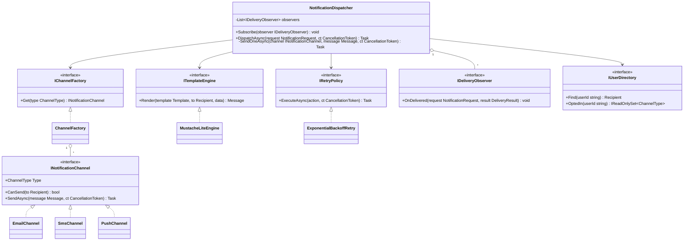
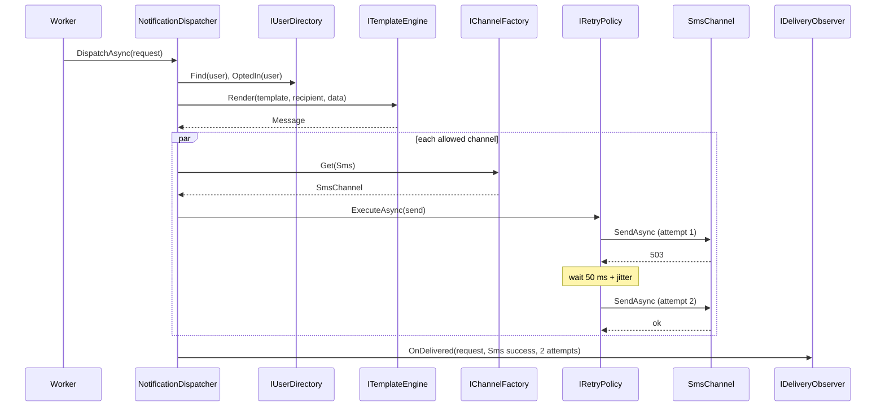

import { Aside } from '@astrojs/starlight/components';
import QuizBlock from '~/components/QuizBlock.astro';

## Why it matters in interviews

The notification dispatcher is the LLD sibling of the [notification system case study](../case-notification-system/): instead of queues and services, the interviewer wants the **classes inside one service**. It is a natural fit for three patterns at once (**Strategy** for channels, **Factory** to pick a channel, **Observer** for delivery tracking) plus two practical concerns every .NET developer meets at work: **templating** and **retries**. It is also where interviewers probe Open/Closed directly: *"add WhatsApp; what changes?"*

## Requirements

**Functional**

- Send a notification to a user from a template (`order-shipped`) with data (`name`, `orderId`).
- Channels: Email, SMS, Push. A request names the channels it wants.
- Respect user preferences: only send on channels the user opted in to, and only if the user has an address for it.
- Retry transient failures with exponential backoff; give up after N attempts and report the failure.
- Channels are independent: one failing channel must not block the others.
- Let other components observe delivery results (metrics, audit, dashboards).

**Assumptions / out of scope:** the dispatcher runs inside a worker that already took the request from a queue; providers (SMTP, Twilio, FCM) sit behind the channel classes; rate limiting and deduplication are extensions.

**Clarifying questions worth asking**

- Is delivery at-least-once acceptable, or do we need idempotency keys per provider? (Retries can duplicate a send.)
- Should channels be tried in parallel, or as a fallback chain (push, then SMS if push fails)? (Different orchestration.)
- Where do templates live and are they localised? (Template store keyed by id + locale.)
- Do we need quiet hours or per-user rate limits? (A rule before dispatch.)

## Entities & responsibilities

| Class | Knows | Does |
|---|---|---|
| `NotificationRequest` (record) | user, template id, data, requested channels | the input |
| `Template`, `ITemplateEngine` | subject/body with placeholders | renders a `Message` for a recipient |
| `IUserDirectory` | contacts, opt-ins | looks up the recipient and preferences |
| `INotificationChannel` | provider details | Strategy: `CanSend` and `SendAsync` for one channel |
| `IChannelFactory` | registered channels | Factory: returns the channel for a `ChannelType` |
| `IRetryPolicy` | max attempts, base delay | runs an action with exponential backoff and jitter |
| `IDeliveryObserver` | | Observer: told about every `DeliveryResult` |
| `NotificationDispatcher` | all of the above | orchestrates render → filter → send in parallel → notify observers |

## Class diagram



## Key flows



## C# implementation

**Models, templating and preferences.** `GeneratedRegex` compiles the placeholder pattern at build time.

```csharp
using System.Text.RegularExpressions;

namespace Notifications;

public enum ChannelType { Email, Sms, Push }

public sealed record Recipient(string UserId, string? Email, string? Phone, string? DeviceToken);
public sealed record Template(string Id, string Subject, string Body);
public sealed record NotificationRequest(string UserId, string TemplateId,
    IReadOnlyDictionary<string, string> Data, IReadOnlySet<ChannelType> Channels);
public sealed record Message(Recipient To, string Subject, string Body);
public sealed record DeliveryResult(ChannelType Channel, bool Success, int Attempts, string? Error = null);

public interface ITemplateEngine
{
    Message Render(Template template, Recipient to, IReadOnlyDictionary<string, string> data);
}

// Replaces {{name}} placeholders; unknown keys are left visible so bugs are obvious.
public sealed partial class MustacheLiteEngine : ITemplateEngine
{
    [GeneratedRegex(@"\{\{(\w+)\}\}")] private static partial Regex Placeholder();

    public Message Render(Template t, Recipient to, IReadOnlyDictionary<string, string> data)
    {
        string Fill(string s) => Placeholder().Replace(s, m => data.GetValueOrDefault(m.Groups[1].Value, m.Value));
        return new Message(to, Fill(t.Subject), Fill(t.Body));
    }
}

public interface IUserDirectory
{
    Recipient Find(string userId);
    IReadOnlySet<ChannelType> OptedIn(string userId);   // user preferences
}
```

**Channels (Strategy).** Each channel knows what address it needs and how to talk to its provider.

```csharp
namespace Notifications;

// Strategy: one implementation per channel, all interchangeable behind the same interface.
public interface INotificationChannel
{
    ChannelType Type { get; }
    bool CanSend(Recipient to);
    Task SendAsync(Message message, CancellationToken ct);
}

public sealed class EmailChannel : INotificationChannel
{
    public ChannelType Type => ChannelType.Email;
    public bool CanSend(Recipient to) => to.Email is not null;
    public Task SendAsync(Message m, CancellationToken ct)
    {
        Console.WriteLine($"  EMAIL to {m.To.Email}: {m.Subject}"); // real: SMTP, SendGrid, Azure Communication Services
        return Task.CompletedTask;
    }
}

public sealed class SmsChannel(Func<bool> providerIsUp) : INotificationChannel
{
    public ChannelType Type => ChannelType.Sms;
    public bool CanSend(Recipient to) => to.Phone is not null;
    public async Task SendAsync(Message m, CancellationToken ct)
    {
        await Task.Delay(10, ct);
        if (!providerIsUp()) throw new HttpRequestException("SMS provider 503");
        Console.WriteLine($"  SMS to {m.To.Phone}: {m.Body}");
    }
}

public sealed class PushChannel : INotificationChannel
{
    public ChannelType Type => ChannelType.Push;
    public bool CanSend(Recipient to) => to.DeviceToken is not null;
    public Task SendAsync(Message m, CancellationToken ct)
    {
        Console.WriteLine($"  PUSH to {m.To.DeviceToken}: {m.Subject}"); // real: FCM, APNs, Azure Notification Hubs
        return Task.CompletedTask;
    }
}
```

**The factory.** Adding WhatsApp is one new class registered in DI; the factory builds its lookup from whatever channels are registered.

```csharp
// Factory: resolves the strategy for a channel type. New channel = new class + DI registration.
public interface IChannelFactory
{
    INotificationChannel Get(ChannelType type);
}

public sealed class ChannelFactory(IEnumerable<INotificationChannel> channels) : IChannelFactory
{
    private readonly Dictionary<ChannelType, INotificationChannel> _byType = channels.ToDictionary(c => c.Type);

    public INotificationChannel Get(ChannelType type) =>
        _byType.TryGetValue(type, out var c) ? c : throw new NotSupportedException($"No channel for {type}");
}
```

**Retry policy and observer contract.** The exception filter rethrows on the last attempt, so the caller sees the real error.

```csharp
namespace Notifications;

public interface IRetryPolicy
{
    Task ExecuteAsync(Func<CancellationToken, Task> action, CancellationToken ct);
}

public sealed class ExponentialBackoffRetry(int maxAttempts, TimeSpan baseDelay) : IRetryPolicy
{
    public async Task ExecuteAsync(Func<CancellationToken, Task> action, CancellationToken ct)
    {
        for (int attempt = 1; ; attempt++)
        {
            try
            {
                await action(ct);
                return;
            }
            catch (Exception) when (attempt < maxAttempts && !ct.IsCancellationRequested)
            {
                // 1x, 2x, 4x ... plus jitter so many failing senders don't retry in lockstep
                var jitter = TimeSpan.FromMilliseconds(Random.Shared.Next(0, 20));
                await Task.Delay(baseDelay * Math.Pow(2, attempt - 1) + jitter, ct);
            }
        }
    }
}

// Observer: anything that wants to know about deliveries (metrics, audit log, dashboard).
public interface IDeliveryObserver
{
    void OnDelivered(NotificationRequest request, DeliveryResult result);
}
```

**The dispatcher.**

```csharp
namespace Notifications;

public sealed class NotificationDispatcher(
    IReadOnlyDictionary<string, Template> templates,
    IUserDirectory users,
    ITemplateEngine engine,
    IChannelFactory channels,
    IRetryPolicy retry)
{
    private readonly List<IDeliveryObserver> _observers = [];
    public void Subscribe(IDeliveryObserver observer) => _observers.Add(observer);

    public async Task<DeliveryResult[]> DispatchAsync(NotificationRequest request, CancellationToken ct = default)
    {
        var recipient = users.Find(request.UserId);
        var message = engine.Render(templates[request.TemplateId], recipient, request.Data);
        var allowed = request.Channels.Intersect(users.OptedIn(request.UserId));

        // Channels are independent: send in parallel, one failure must not block the others.
        var results = await Task.WhenAll(allowed.Select(type => SendOneAsync(channels.Get(type), message, ct)));
        foreach (var result in results)
            foreach (var observer in _observers) observer.OnDelivered(request, result);
        return results;
    }

    private async Task<DeliveryResult> SendOneAsync(INotificationChannel channel, Message message, CancellationToken ct)
    {
        if (!channel.CanSend(message.To)) return new(channel.Type, false, 0, "No address for channel");
        int attempts = 0;
        try
        {
            await retry.ExecuteAsync(t => { attempts++; return channel.SendAsync(message, t); }, ct);
            return new(channel.Type, true, attempts);
        }
        catch (Exception ex) when (ex is not OperationCanceledException)
        {
            return new(channel.Type, false, attempts, ex.Message);   // caller may dead-letter this
        }
    }
}
```

**Demo.** The SMS provider fails once, so SMS succeeds on attempt 2; Push is requested but the user did not opt in.

```csharp
using Notifications;

int smsCalls = 0; // the SMS provider fails on the first call
var factory = new ChannelFactory([new EmailChannel(), new SmsChannel(() => ++smsCalls >= 2), new PushChannel()]);
var templates = new Dictionary<string, Template>
{
    ["order-shipped"] = new("order-shipped", "Order {{orderId}} shipped", "Hi {{name}}, order {{orderId}} is on its way."),
};
var dispatcher = new NotificationDispatcher(templates, new FakeDirectory(), new MustacheLiteEngine(),
    factory, new ExponentialBackoffRetry(maxAttempts: 3, baseDelay: TimeSpan.FromMilliseconds(50)));
dispatcher.Subscribe(new ConsoleTracker());

var request = new NotificationRequest("u1", "order-shipped",
    new Dictionary<string, string> { ["name"] = "Asha", ["orderId"] = "A-1001" },
    new HashSet<ChannelType> { ChannelType.Email, ChannelType.Sms, ChannelType.Push });
await dispatcher.DispatchAsync(request);   // Push is skipped: the user did not opt in

sealed class FakeDirectory : IUserDirectory
{
    public Recipient Find(string userId) => new(userId, "asha@example.com", "+91-90000-00000", null);
    public IReadOnlySet<ChannelType> OptedIn(string userId) => new HashSet<ChannelType> { ChannelType.Email, ChannelType.Sms };
}

sealed class ConsoleTracker : IDeliveryObserver
{
    public void OnDelivered(NotificationRequest r, DeliveryResult d) =>
        Console.WriteLine($"tracked {d.Channel}: success={d.Success}, attempts={d.Attempts} {d.Error}");
}
```

In a real app the same wiring is DI registration: `AddSingleton<INotificationChannel, EmailChannel>()` per channel, `AddSingleton<IChannelFactory, ChannelFactory>()`, and the dispatcher runs inside a `BackgroundService` consuming a queue. In production, Polly / `Microsoft.Extensions.Resilience` replaces the hand-written retry.

## Patterns & SOLID used

| Where | Pattern / principle | Why |
|---|---|---|
| `INotificationChannel` | Strategy | Each channel's sending logic is interchangeable behind one interface |
| `ChannelFactory` | Factory (registry style) | Maps `ChannelType` to the implementation; built from DI so it never changes when channels are added |
| `IDeliveryObserver` | Observer | Metrics, audit log, read-model updates subscribe without the dispatcher knowing them |
| `IRetryPolicy` | Strategy / policy object | Backoff, circuit breaker or "no retry" are configuration, not code changes |
| `ITemplateEngine` | DIP | Swap the toy engine for Scriban, Razor or Handlebars |
| Dispatcher depends only on interfaces | DIP + OCP | WhatsApp, Slack or webhooks are new classes; the dispatcher is closed for modification |

## Extensions the interviewer may ask

- **New channel (WhatsApp, Slack)**: implement `INotificationChannel`, add an enum value, register it. Nothing else changes.
- **Fallback chain** ("push, else SMS, else email"): a `FallbackChannel` composite that tries inner channels in order (Chain of Responsibility), selected per template or priority.
- **Idempotency / dedup**: give each request an id; the dispatcher records `(requestId, channel)` before sending and skips duplicates. Providers that accept idempotency keys get the same id.
- **Rate limiting and quiet hours**: a pre-dispatch rule pipeline (`INotificationRule`) that can drop or delay a request.
- **Priority**: separate queues per priority so OTPs are never stuck behind a marketing blast.
- **Dead-lettering**: when the result is a failure after all retries, publish it to a dead-letter queue for inspection and replay.
- **Localisation**: template lookup by `(templateId, locale)` from the user's profile.

## Interview Q&A

<details>
<summary>Where exactly are Strategy, Factory and Observer in this design?</summary>

**Strategy**: each `INotificationChannel` is an interchangeable algorithm for "deliver this message". **Factory**: `ChannelFactory.Get(type)` returns the right strategy for a channel type, hiding construction and lookup. **Observer**: `IDeliveryObserver` subscribers are notified of every delivery result without the dispatcher depending on them.
</details>

<details>
<summary>What changes when the business adds a WhatsApp channel?</summary>

A new `WhatsAppChannel : INotificationChannel`, a new enum value, and one DI registration. The factory discovers it from the injected collection; the dispatcher, templates and retry logic are untouched. That is Open/Closed in practice.
</details>

<details>
<summary>Why add jitter to exponential backoff?</summary>

When a provider has an outage, thousands of sends fail at the same moment. Pure exponential backoff makes them all retry at exactly the same times, hammering the provider in waves (thundering herd). Random jitter spreads the retries out.
</details>

<details>
<summary>Which errors should be retried?</summary>

Transient ones: timeouts, HTTP 429/503, connection resets. Not permanent ones: invalid phone number, 400 Bad Request, unsubscribed user. A production policy filters by exception type or status code; retrying permanent errors only wastes time and quota.
</details>

<details>
<summary>Why send channels in parallel with `Task.WhenAll`, and what is the risk?</summary>

Channels are independent, so total latency is the slowest channel instead of the sum. Each channel's send is wrapped so it returns a result instead of throwing, which means one failure can't abort the others. The risk is bursty load on providers, which per-channel rate limiting handles.
</details>

<details>
<summary>Retries can send the same SMS twice. How do you prevent that?</summary>

A timeout doesn't tell you whether the provider sent the message. Use the provider's idempotency key if it has one; otherwise record a dedup entry `(requestId, channel)` and accept that at-least-once delivery is the realistic guarantee. Exactly-once delivery to a phone is not achievable end to end.
</details>

<details>
<summary>Why is `CanSend` part of the channel interface?</summary>

Only the channel knows what it needs: email needs an address, push needs a device token. Putting the check in the dispatcher would mean a `switch` on channel type there, which breaks Open/Closed.
</details>

## Pitfalls

<Aside type="caution" title="Common mistakes">

- **A `switch` on channel type inside the dispatcher** for sending, validation or construction.
- **Retrying non-transient errors**, or retrying without backoff and jitter.
- **Sequential sends where one exception aborts all remaining channels.**
- **Ignoring user preferences** or unsubscribes (also a legal issue for marketing messages).
- **Swallowing `OperationCanceledException`** during shutdown, so the worker never stops.
- **Rendering templates per channel inside the retry loop**, repeating work and risking different output on retries.

</Aside>

## Related

- [Case study: Notification system (HLD)](../case-notification-system/)
- [Creational patterns (Factory)](../../patterns/creational-patterns/)
- [Behavioral patterns (Strategy, Observer)](../../patterns/behavioral-patterns/)
- [Outbox, saga & resilience (retries, Polly)](../../microservices/reliability-patterns/)

## Quick quiz

<QuizBlock section="system-design" topic="lld-notification-dispatcher" />
