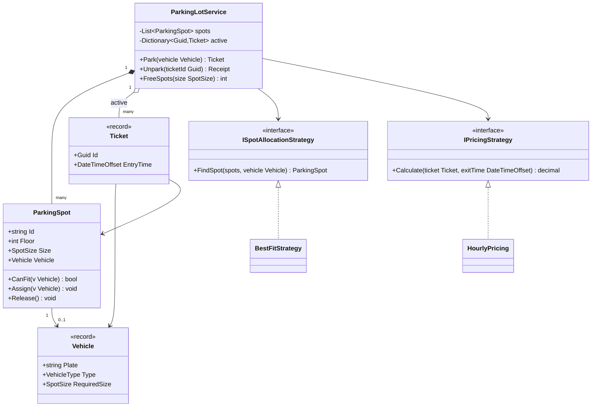
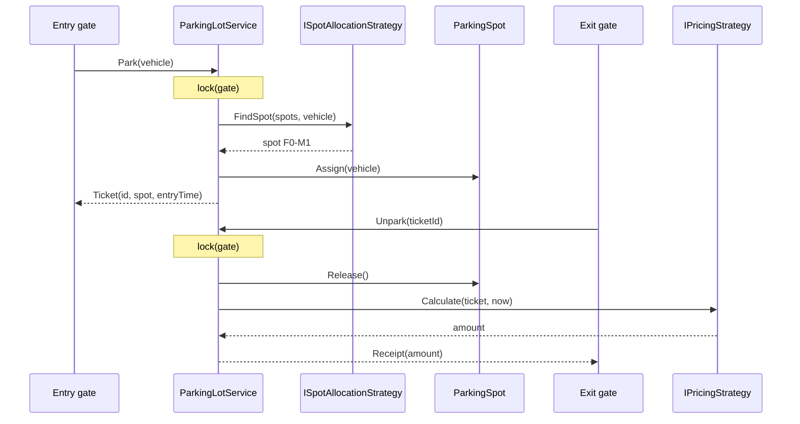

import { Aside } from '@astrojs/starlight/components';
import QuizBlock from '~/components/QuizBlock.astro';

## Why it matters in interviews

The parking lot is the "hello world" of LLD rounds and is asked everywhere because it is small enough to finish but has three real design decisions: **how to model vehicles and spots** (inheritance or data), **how to choose a spot** (a strategy that will change), and **how to price** (another strategy). A good follow-up from the interviewer is always concurrency: *"two cars arrive at two gates at the same moment, can they get the same spot?"*

## Requirements

**Functional**

- The lot has multiple floors; each floor has spots of size Small, Medium, Large.
- Vehicles are Motorcycle, Car, Truck. A vehicle can park in a spot of its size **or larger**.
- On entry the system assigns a spot and issues a ticket; on exit it frees the spot and computes the fee.
- Show free spot counts per size (for the display board at the entrance).
- Pricing is per started hour and differs by vehicle type.

**Assumptions / out of scope:** a single lot; payment is a call to an external gateway (not modelled); no reservations; all state in memory.

**Clarifying questions worth asking**

- Can a motorcycle take a car spot when small spots run out? (Here: yes, best fit first.)
- Is there more than one entry gate? (Yes, so allocation must be thread-safe.)
- Flat hourly rate, or different rates for weekends / first hour free? (Drives the pricing abstraction.)
- Do we need EV charging spots or handicapped spots? (Good extension; keep the spot model open.)

## Entities & responsibilities

| Class | Knows | Does |
|---|---|---|
| `Vehicle` (record) | plate, type | maps its type to the spot size it needs |
| `ParkingSpot` | id, floor, size, current vehicle | checks fit, assign, release (owns the "one vehicle per spot" invariant) |
| `Ticket` / `Receipt` (records) | vehicle, spot, entry time / exit time, amount | immutable proof of entry and payment |
| `ISpotAllocationStrategy` | | picks a spot for a vehicle (nearest, best fit, per-floor balancing) |
| `IPricingStrategy` | rates | computes the fee for a ticket at exit time |
| `ParkingLotService` | spots, active tickets | coordinates park / unpark, guards concurrency |
| `TimeProvider` | current time | injected so pricing is testable |

Vehicle types are an **enum plus a property**, not a class hierarchy: `Car` and `Truck` don't behave differently, they only need different spot sizes. If a future requirement adds behaviour (EVs need a charger), that is when a subtype or a capability flag earns its place.

## Class diagram



## Key flows



## C# implementation

**Models.** The spot owns its invariant (a taken spot cannot be assigned again).

```csharp
namespace ParkingLot;

public enum VehicleType { Motorcycle, Car, Truck }
public enum SpotSize { Small = 1, Medium = 2, Large = 3 }

public sealed record Vehicle(string Plate, VehicleType Type)
{
    public SpotSize RequiredSize => Type switch
    {
        VehicleType.Motorcycle => SpotSize.Small,
        VehicleType.Car => SpotSize.Medium,
        _ => SpotSize.Large,
    };
}

public sealed class ParkingSpot(string id, int floor, SpotSize size)
{
    public string Id => id;
    public int Floor => floor;
    public SpotSize Size => size;
    public Vehicle? Vehicle { get; private set; }
    public bool IsFree => Vehicle is null;

    // A smaller vehicle may use a bigger spot, never the other way round.
    public bool CanFit(Vehicle v) => IsFree && size >= v.RequiredSize;
    public void Assign(Vehicle v) => Vehicle = IsFree ? v : throw new InvalidOperationException($"Spot {id} is taken");
    public void Release() => Vehicle = null;
}

public sealed record Ticket(Guid Id, Vehicle Vehicle, ParkingSpot Spot, DateTimeOffset EntryTime);
public sealed record Receipt(Ticket Ticket, DateTimeOffset ExitTime, decimal Amount);
```

**Strategies.** Both rules that are likely to change sit behind interfaces.

```csharp
namespace ParkingLot;

public interface ISpotAllocationStrategy
{
    ParkingSpot? FindSpot(IReadOnlyList<ParkingSpot> spots, Vehicle vehicle);
}

// Best fit: smallest spot that fits, then the lowest floor (closest to the exit).
public sealed class BestFitStrategy : ISpotAllocationStrategy
{
    public ParkingSpot? FindSpot(IReadOnlyList<ParkingSpot> spots, Vehicle vehicle) =>
        spots.Where(s => s.CanFit(vehicle))
             .OrderBy(s => s.Size)
             .ThenBy(s => s.Floor)
             .FirstOrDefault();
}

public interface IPricingStrategy
{
    decimal Calculate(Ticket ticket, DateTimeOffset exitTime);
}

// Every started hour is billed, minimum one hour.
public sealed class HourlyPricing(IReadOnlyDictionary<VehicleType, decimal> ratePerHour) : IPricingStrategy
{
    public decimal Calculate(Ticket ticket, DateTimeOffset exitTime)
    {
        var hours = Math.Max(1, (int)Math.Ceiling((exitTime - ticket.EntryTime).TotalHours));
        return hours * ratePerHour[ticket.Vehicle.Type];
    }
}
```

**The coordinator.** One lock makes "find a free spot, then assign it" atomic. Without it, two gates can both see `F0-M1` as free and both assign it.

```csharp
namespace ParkingLot;

public sealed class ParkingLotService(
    IEnumerable<ParkingSpot> spots,
    ISpotAllocationStrategy allocation,
    IPricingStrategy pricing,
    TimeProvider clock)
{
    private readonly List<ParkingSpot> _spots = [.. spots];
    private readonly Dictionary<Guid, Ticket> _active = [];
    private readonly Lock _gate = new(); // two entry gates must not grab the same spot

    public Ticket Park(Vehicle vehicle)
    {
        lock (_gate)
        {
            var spot = allocation.FindSpot(_spots, vehicle)
                       ?? throw new InvalidOperationException($"No spot for {vehicle.Type}");
            spot.Assign(vehicle);
            var ticket = new Ticket(Guid.NewGuid(), vehicle, spot, clock.GetUtcNow());
            _active[ticket.Id] = ticket;
            return ticket;
        }
    }

    public Receipt Unpark(Guid ticketId)
    {
        lock (_gate)
        {
            if (!_active.Remove(ticketId, out var ticket))
                throw new KeyNotFoundException("Unknown or already used ticket");
            var exit = clock.GetUtcNow();
            ticket.Spot.Release();
            return new Receipt(ticket, exit, pricing.Calculate(ticket, exit));
        }
    }

    public int FreeSpots(SpotSize size)
    {
        lock (_gate) return _spots.Count(s => s.IsFree && s.Size == size);
    }
}
```

**Demo.** A fake `TimeProvider` makes the fee deterministic.

```csharp
using ParkingLot;

var clock = new FakeClock();
var spots = new[]
{
    new ParkingSpot("F0-S1", 0, SpotSize.Small),
    new ParkingSpot("F0-M1", 0, SpotSize.Medium),
    new ParkingSpot("F1-M1", 1, SpotSize.Medium),
    new ParkingSpot("F1-L1", 1, SpotSize.Large),
};
var rates = new Dictionary<VehicleType, decimal>
{
    [VehicleType.Motorcycle] = 1m, [VehicleType.Car] = 2.5m, [VehicleType.Truck] = 5m,
};
var lot = new ParkingLotService(spots, new BestFitStrategy(), new HourlyPricing(rates), clock);

var car = lot.Park(new Vehicle("KA-01-1234", VehicleType.Car));
var bike = lot.Park(new Vehicle("KA-02-9999", VehicleType.Motorcycle));
Console.WriteLine($"Car -> {car.Spot.Id}, bike -> {bike.Spot.Id}, free medium: {lot.FreeSpots(SpotSize.Medium)}");

clock.Advance(TimeSpan.FromMinutes(135));
var receipt = lot.Unpark(car.Id);
Console.WriteLine($"Car paid {receipt.Amount:C} for 2h15m");

try { lot.Park(new Vehicle("T-1", VehicleType.Truck)); lot.Park(new Vehicle("T-2", VehicleType.Truck)); }
catch (InvalidOperationException ex) { Console.WriteLine($"Second truck: {ex.Message}"); }

sealed class FakeClock : TimeProvider
{
    private DateTimeOffset _now = new(2026, 1, 1, 9, 0, 0, TimeSpan.Zero);
    public override DateTimeOffset GetUtcNow() => _now;
    public void Advance(TimeSpan by) => _now += by;
}
```

Output: the car gets `F0-M1` (best fit, lowest floor), the bike gets `F0-S1`, the car pays 3 hours x 2.50 for 2h15m, and the second truck is rejected because the only large spot is taken.

## Patterns & SOLID used

| Where | Pattern / principle | Why |
|---|---|---|
| `ISpotAllocationStrategy` | Strategy | Nearest-to-exit, best-fit, fill-floor-by-floor can be swapped per lot or per time of day |
| `IPricingStrategy` | Strategy | Hourly, flat-day, weekend, first-hour-free are new classes, not edits (OCP) |
| `ParkingSpot.Assign` | Information expert / encapsulation | The spot guards its own invariant |
| `ParkingLotService` constructor | Dependency inversion | Depends on abstractions; tests pass fakes |
| `Vehicle` enum + property | Composition over inheritance | No subclass zoo for types that don't differ in behaviour |
| Separate service, spot, ticket | SRP | Allocation, pricing and bookkeeping change for different reasons |

## Extensions the interviewer may ask

- **Multiple entry gates at scale.** One lock is fine for one lot (thousands of operations per minute). For much higher contention, keep a free-spot queue per size (`ConcurrentQueue`) so `TryDequeue` is the atomic claim, or lock per floor.
- **EV charging spots.** Add a `Features` flag set on the spot (`Charger`, `Accessible`) and a requirement on the vehicle; `CanFit` checks both. The strategy and service don't change.
- **Display boards.** Raise a `SpotChanged` event (Observer) from the service after park/unpark; each board subscribes and updates its counts.
- **New pricing (weekend, first hour free, monthly pass).** New `IPricingStrategy`; compose them with a decorator (`FirstHourFree(inner)`) if rules stack.
- **Payment.** Add an `IPaymentGateway` called on exit; the receipt is issued only after a successful charge. Keep the ticket active if payment fails.
- **Multiple lots / persistence.** Put spots and tickets behind `ISpotRepository` / `ITicketRepository`; in a database, use a conditional update (`UPDATE ... WHERE VehicleId IS NULL`) or a row version as the atomic claim instead of the in-process lock.

## Interview Q&A

<details>
<summary>Why not create `Car`, `Truck` and `Motorcycle` subclasses?</summary>

They would only differ in data (which spot size they need). Subclasses are worth it when behaviour differs. An enum plus a computed `RequiredSize` is simpler, and adding a type is one enum value plus one switch arm in a single place. If types later gain behaviour (EV charging), introduce a capability rather than a deep hierarchy.
</details>

<details>
<summary>Two cars enter at two gates at the same time. What can go wrong and how do you fix it?</summary>

Both threads run `FindSpot` and see the same free spot, then both call `Assign`. That is a **check-then-act race**. The fix is to make find-and-assign atomic: a single lock around both steps (as in the skeleton), a per-floor lock, or a concurrent free-list where `TryDequeue` claims a spot atomically. `Assign` also throws if the spot is taken, as a second line of defence.
</details>

<details>
<summary>How would you add "first hour free on weekends" without touching existing pricing code?</summary>

Write a decorator `WeekendFirstHourFree(IPricingStrategy inner) : IPricingStrategy` that subtracts one hour's charge on weekends and delegates the rest to `inner`. Wire it in at composition time. That is Open/Closed: new behaviour, no edits to `HourlyPricing`.
</details>

<details>
<summary>Where does the fee calculation belong: Ticket, ParkingSpot or a separate class?</summary>

In a separate pricing strategy. The ticket is data; the spot shouldn't know about money. Pricing changes for business reasons (promotions, regulation) that are unrelated to how spots or tickets work, so SRP puts it in its own class.
</details>

<details>
<summary>How do you make pricing testable?</summary>

Inject `TimeProvider` (built into .NET 8+) into the service instead of calling `DateTime.UtcNow`. Tests pass a fake provider and advance time, as the demo does. The pricing strategy itself is a pure function of ticket and exit time.
</details>

<details>
<summary>What is the complexity of `Park` in your design and how could you improve it?</summary>

`BestFitStrategy` scans all spots and sorts candidates: O(n log n) per park. For a few thousand spots this is fine. To get O(1) or O(log n), keep free spots indexed by size (one queue or sorted set per size and floor) and update the index on park/unpark.
</details>

<details>
<summary>How would you model a parking chain with many lots?</summary>

Add a `ParkingLot` aggregate (id, address, floors) and a `ParkingLotRegistry` or lookup service. Each lot keeps its own lock and strategies, so contention stays per lot. Tickets carry the lot id. Persistence moves behind repositories.
</details>

## Pitfalls

<Aside type="caution" title="Common mistakes">

- A **god `ParkingLot` class** that allocates, prices, prints tickets and handles payment.
- **Locking only inside `Assign`**: the race is between finding and assigning, so the lock must cover both.
- **`DateTime.Now` inside pricing**: untestable and timezone-dependent. Use `TimeProvider` and UTC.
- **Using a ticket twice**: remove it from the active map on exit, as `Unpark` does.
- **Forgetting the "smaller vehicle in a bigger spot" rule**, or letting a truck into a small spot.
- **Not freeing the spot when payment fails**, or freeing it before payment succeeds. Decide the order explicitly.

</Aside>

## Related

- [How to approach LLD](../lld-approach/)
- [Behavioral patterns (Strategy, Observer)](../../patterns/behavioral-patterns/)
- [SOLID principles](../../patterns/solid/)
- [Threading & synchronization](../../csharp/threading/)

## Quick quiz

<QuizBlock section="system-design" topic="lld-parking-lot" />
