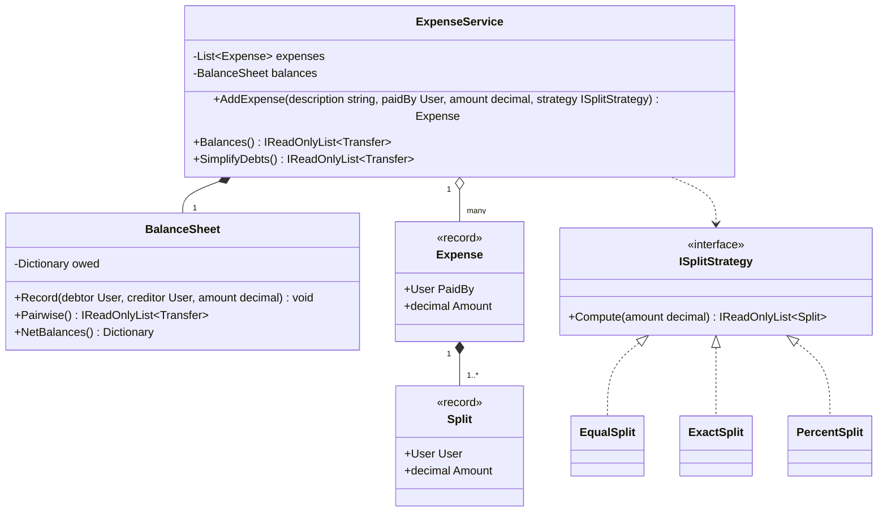
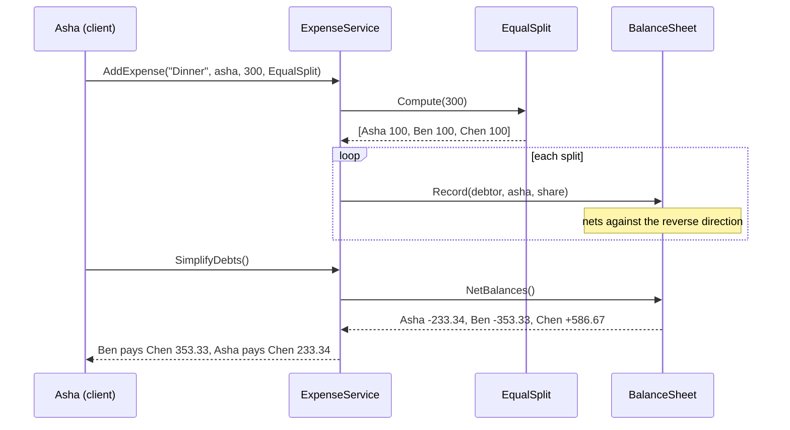

import { Aside } from '@astrojs/starlight/components';
import QuizBlock from '~/components/QuizBlock.astro';

## Why it matters in interviews

Splitwise is popular because it mixes OOP with a little algorithm work. The interviewer checks three things: do you model **split types as a Strategy** instead of a `switch`, do you handle **money correctly** (`decimal`, rounding that never loses a cent), and can you explain **simplify debts** (turning many pairwise IOUs into the fewest payments) along with its complexity and limits.

## Requirements

**Functional**

- Users add an expense: who paid, total amount, and how it is split among participants.
- Split types: **equal**, **exact amounts**, **percentages**.
- Show balances: who owes whom and how much (pairwise, netted).
- Simplify debts: produce a short list of payments that settles everyone.

**Assumptions / out of scope:** a single currency; groups and friends lists are just a way to choose participants; settle-up payments are recorded like expenses; no persistence.

**Clarifying questions worth asking**

- How should 100 split three ways be rounded? (33.34 + 33.33 + 33.33; the total must stay exact.)
- Should balances be per group or global? (Here: global; per group is a dictionary keyed by group.)
- Must simplification only use existing relationships (A pays C only if they share a group)? (Changes the algorithm; usually no.)
- Multi-currency? (Extension: convert at expense time and store the rate.)

## Entities & responsibilities

| Class | Knows | Does |
|---|---|---|
| `User` (record) | id, name | participant |
| `Expense` (record) | payer, amount, splits | immutable record of what happened |
| `Split` (record) | user, amount | one participant's share |
| `ISplitStrategy` | its own inputs (participants, amounts, percents) | turns a total into splits, validates them |
| `BalanceSheet` | pairwise netted debts | records debts, nets opposite directions, computes net balance per user |
| `ExpenseService` | expenses, balance sheet | add expense, show balances, simplify debts |
| `Transfer` (record) | from, to, amount | one payment in the result |

## Class diagram



## Key flows



### Simplify debts

Only each user's **net balance** matters: positive means the group owes them, negative means they owe the group. The greedy algorithm repeatedly matches the **largest debtor with the largest creditor**, pays the smaller of the two amounts, and puts the remainder back. Each step settles at least one person, so it produces at most `n - 1` transfers in O(n log n) with two heaps.

Finding the true **minimum** number of transfers is NP-hard (it reduces to partitioning users into the most zero-sum subgroups), so production apps use greedy. Mention this; interviewers like hearing that you know where the easy version stops being optimal.

## C# implementation

**Models and split strategies.** Each strategy owns its inputs and validation. Money is `decimal`; equal splits work in cents so the shares add back to the total exactly.

```csharp
namespace Splitwise;

public sealed record User(string Id, string Name);
public sealed record Split(User User, decimal Amount);
public sealed record Transfer(User From, User To, decimal Amount)
{
    public override string ToString() => $"{From.Name} pays {To.Name} {Amount:0.00}";
}

public sealed record Expense(Guid Id, string Description, User PaidBy, decimal Amount, IReadOnlyList<Split> Splits);

public interface ISplitStrategy
{
    IReadOnlyList<Split> Compute(decimal amount);
}

public sealed class EqualSplit(IReadOnlyList<User> users) : ISplitStrategy
{
    // Work in cents so 100 / 3 becomes 33.34 + 33.33 + 33.33, never 99.99.
    public IReadOnlyList<Split> Compute(decimal amount)
    {
        long cents = (long)(amount * 100), share = cents / users.Count, extra = cents % users.Count;
        return [.. users.Select((u, i) => new Split(u, (share + (i < extra ? 1 : 0)) / 100m))];
    }
}

public sealed class ExactSplit(IReadOnlyDictionary<User, decimal> amounts) : ISplitStrategy
{
    public IReadOnlyList<Split> Compute(decimal amount) =>
        amounts.Values.Sum() == amount
            ? [.. amounts.Select(kv => new Split(kv.Key, kv.Value))]
            : throw new ArgumentException("Exact amounts must add up to the total");
}

public sealed class PercentSplit(IReadOnlyDictionary<User, decimal> percents) : ISplitStrategy
{
    public IReadOnlyList<Split> Compute(decimal amount)
    {
        if (percents.Values.Sum() != 100m) throw new ArgumentException("Percents must add up to 100");
        var splits = percents.Select(kv => new Split(kv.Key, Math.Round(amount * kv.Value / 100m, 2))).ToList();
        var drift = amount - splits.Sum(s => s.Amount);              // rounding leftover
        splits[0] = splits[0] with { Amount = splits[0].Amount + drift };
        return splits;
    }
}
```

**Balance sheet.** Recording "Ben owes Asha 30" when Asha already owes Ben 50 leaves a single entry: Asha owes Ben 20.

```csharp
namespace Splitwise;

public sealed class BalanceSheet
{
    // (debtor, creditor) -> amount. Only one direction per pair is ever non-zero.
    private readonly Dictionary<(User Debtor, User Creditor), decimal> _owed = [];

    public void Record(User debtor, User creditor, decimal amount)
    {
        if (debtor == creditor || amount == 0) return;
        decimal reverse = _owed.GetValueOrDefault((creditor, debtor));
        decimal net = _owed.GetValueOrDefault((debtor, creditor)) + amount - reverse;
        _owed.Remove((creditor, debtor));
        _owed.Remove((debtor, creditor));
        if (net > 0) _owed[(debtor, creditor)] = net;
        else if (net < 0) _owed[(creditor, debtor)] = -net;
    }

    public IReadOnlyList<Transfer> Pairwise() =>
        [.. _owed.Select(kv => new Transfer(kv.Key.Debtor, kv.Key.Creditor, kv.Value))];

    // Positive = the group owes this user money.
    public Dictionary<User, decimal> NetBalances()
    {
        var net = new Dictionary<User, decimal>();
        foreach (var ((debtor, creditor), amount) in _owed)
        {
            net[creditor] = net.GetValueOrDefault(creditor) + amount;
            net[debtor] = net.GetValueOrDefault(debtor) - amount;
        }
        return net;
    }
}
```

**Service with simplify debts.** `PriorityQueue` is a min-heap, so priorities are negated to pop the largest first.

```csharp
namespace Splitwise;

public sealed class ExpenseService
{
    private readonly List<Expense> _expenses = [];
    private readonly BalanceSheet _balances = new();
    private readonly Lock _lock = new();

    public Expense AddExpense(string description, User paidBy, decimal amount, ISplitStrategy strategy)
    {
        ArgumentOutOfRangeException.ThrowIfNegativeOrZero(amount);
        var splits = strategy.Compute(amount);
        var expense = new Expense(Guid.NewGuid(), description, paidBy, amount, splits);
        lock (_lock)
        {
            _expenses.Add(expense);
            foreach (var split in splits) _balances.Record(split.User, paidBy, split.Amount);
        }
        return expense;
    }

    public IReadOnlyList<Transfer> Balances() { lock (_lock) return _balances.Pairwise(); }

    // Greedy: biggest debtor pays biggest creditor. At most n-1 transfers.
    public IReadOnlyList<Transfer> SimplifyDebts()
    {
        Dictionary<User, decimal> net;
        lock (_lock) net = _balances.NetBalances();
        var creditors = new PriorityQueue<User, decimal>();
        var debtors = new PriorityQueue<User, decimal>();
        foreach (var (user, amount) in net)
        {
            if (amount > 0) creditors.Enqueue(user, -amount);    // min-heap, so negate for max
            else if (amount < 0) debtors.Enqueue(user, amount);
        }

        var result = new List<Transfer>();
        while (creditors.TryDequeue(out var creditor, out var credit) &&
               debtors.TryDequeue(out var debtor, out var debt))
        {
            decimal pay = Math.Min(-credit, -debt);
            result.Add(new Transfer(debtor, creditor, pay));
            if (-credit > pay) creditors.Enqueue(creditor, credit + pay);
            if (-debt > pay) debtors.Enqueue(debtor, debt + pay);
        }
        return result;
    }
}
```

**Demo.**

```csharp
using Splitwise;

User a = new("u1", "Asha"), b = new("u2", "Ben"), c = new("u3", "Chen");
var service = new ExpenseService();

service.AddExpense("Dinner", a, 300m, new EqualSplit([a, b, c]));
service.AddExpense("Cab", b, 100m, new ExactSplit(new Dictionary<User, decimal> { [b] = 20m, [c] = 80m }));
service.AddExpense("Hotel", c, 1000m, new PercentSplit(new Dictionary<User, decimal> { [a] = 50m, [b] = 30m, [c] = 20m }));
service.AddExpense("Snacks", a, 100m, new EqualSplit([a, b, c]));

Console.WriteLine("Pairwise balances:");
foreach (var t in service.Balances()) Console.WriteLine($"  {t}");
Console.WriteLine("Simplified:");
foreach (var t in service.SimplifyDebts()) Console.WriteLine($"  {t}");
```

Pairwise, there are three IOUs (Ben → Asha 133.33, Asha → Chen 366.67, Ben → Chen 220.00). Simplified, two payments settle everything: Ben pays Chen 353.33 and Asha pays Chen 233.34.

## Patterns & SOLID used

| Where | Pattern / principle | Why |
|---|---|---|
| `ISplitStrategy` | Strategy | Equal, exact, percent, shares, adjustment are separate classes; adding one edits nothing |
| Strategy holds its own inputs | ISP / cohesion | Avoids one method with optional parameters that only some split types use |
| `BalanceSheet` | SRP | Debt bookkeeping is separate from expense history and from the simplification algorithm |
| Records for `Expense`, `Split`, `Transfer` | Immutability | History cannot be edited by accident; corrections are new expenses |
| Validation in strategies | Fail fast | Percentages must sum to 100 and exact amounts to the total before anything is recorded |

## Extensions the interviewer may ask

- **Groups**: key the balance sheet by group id (`Dictionary` of group to `BalanceSheet`); simplify per group.
- **Shares split** ("Asha 2 shares, Ben 1 share"): a new `ShareSplit` strategy, which is percent split with weights.
- **Edit or delete an expense**: record a reversing expense (negative splits) rather than mutating history; balances stay consistent and auditable.
- **Multi-currency**: store the original currency and the conversion rate on the expense, keep balances in one base currency (or one balance sheet per currency).
- **Settle up**: a payment from A to B is recorded as an expense paid by A with an exact split of 100% to B.
- **Notifications**: raise an `ExpenseAdded` event and let an observer notify participants.
- **Concurrency**: the service lock makes "add expense + update balances" atomic; in a database this is one transaction.

## Interview Q&A

<details>
<summary>Why `decimal` and not `double` for money?</summary>

`double` is binary floating point; values like 0.1 cannot be represented exactly, so sums drift (0.1 + 0.2 != 0.3). `decimal` is base-10 with 28-29 significant digits, so currency arithmetic is exact to the cent. Still, division (100 / 3) needs an explicit rounding rule.
</details>

<details>
<summary>How do you split 100 among three people without losing a cent?</summary>

Convert to cents (10000), divide (3333 each), and give the remainder (1 cent) to the first participants: 33.34, 33.33, 33.33. The sum equals the total exactly. For percentages, round each share and add the rounding drift to one participant.
</details>

<details>
<summary>Explain the simplify debts algorithm and its complexity.</summary>

Compute each user's net balance. Put creditors in a max-heap and debtors in another. Pop the largest of each, transfer the smaller amount, push back whatever remains. Each iteration zeroes at least one user, so there are at most n - 1 transfers and the cost is O(n log n). It is a heuristic: the optimal minimum is NP-hard.
</details>

<details>
<summary>Why is each split type a separate class instead of an enum with a `switch`?</summary>

Each type has different inputs (nothing, amounts, percentages, shares) and different validation. A `switch` inside the service would need all those inputs as optional parameters and would change every time a type is added. With Strategy the service calls `Compute(amount)` and is closed for modification.
</details>

<details>
<summary>What is the difference between pairwise balances and net balances?</summary>

Pairwise balances keep "who owes whom" (A owes B 20, B owes C 30); the UI needs them for "you owe Ben". Net balances keep only one number per user (B is +20 - 30 = -10) and are what the simplification works on. The balance sheet stores pairwise and derives net.
</details>

<details>
<summary>How would you guarantee balances stay correct if two expenses are added concurrently?</summary>

Make "append expense + update all affected balances" a single atomic unit: a lock in memory, or one database transaction. Alternatively store only the immutable expense log and compute balances from it (event sourcing style), caching the result.
</details>

## Pitfalls

<Aside type="caution" title="Common mistakes">

- **Using `double` for money**, or rounding each share independently so the total is off by a cent.
- **A `switch` on split type in the service**, with optional parameters for amounts and percents.
- **Storing both A owes B and B owes A** instead of netting them into one direction.
- **Claiming greedy gives the minimum number of transfers**. It gives at most n - 1, not always the minimum.
- **Mutating past expenses** instead of recording corrections, which breaks history and auditability.

</Aside>

## Related

- [How to approach LLD](../lld-approach/)
- [Heaps & priority queues](../../dsa/heaps/)
- [Behavioral patterns (Strategy)](../../patterns/behavioral-patterns/)
- [Value vs reference types (`decimal`, records)](../../csharp/value-reference-types/)

## Quick quiz

<QuizBlock section="system-design" topic="lld-splitwise" />
