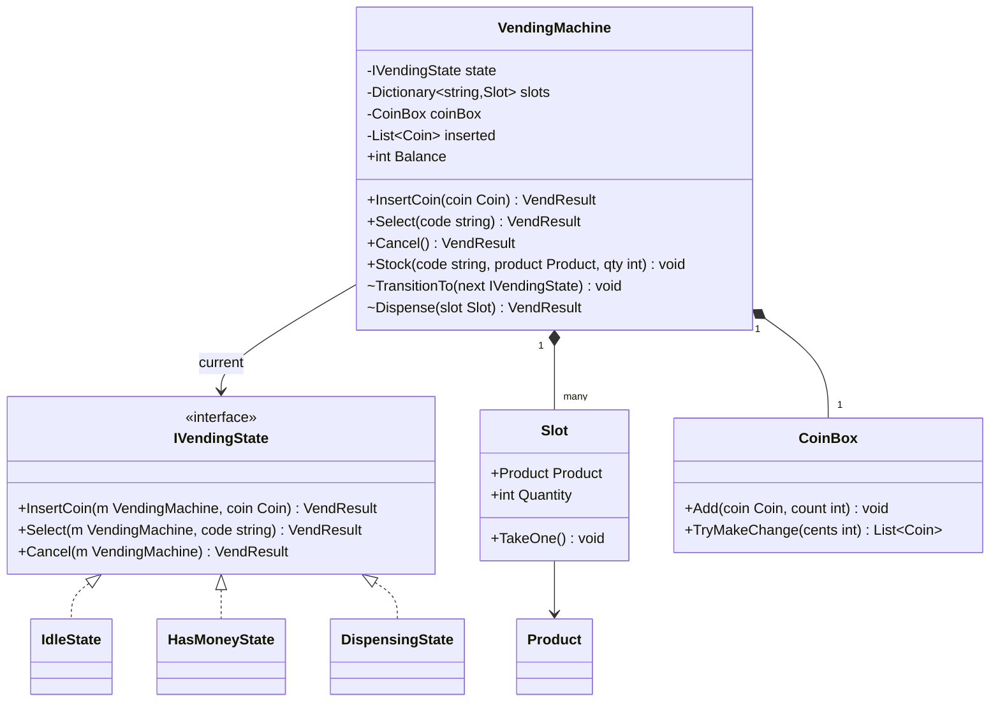
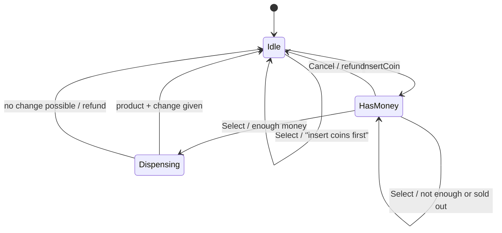
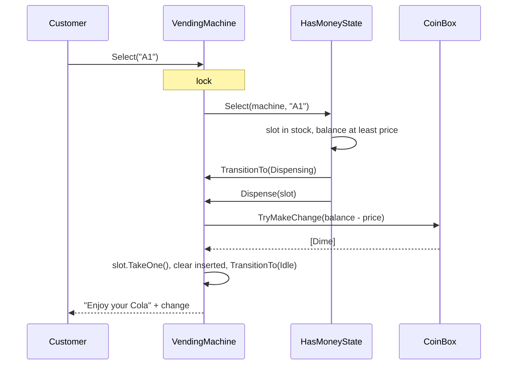

import { Aside } from '@astrojs/starlight/components';
import QuizBlock from '~/components/QuizBlock.astro';

## Why it matters in interviews

The vending machine is **the** State pattern question. The same button (`Select`) must do different things depending on whether money has been inserted, whether the machine is busy dispensing, or whether it is out of service. A naive answer puts a `switch (state)` in every method; the interviewer then adds one state ("maintenance mode") and watches you edit four methods. The State pattern turns each state into a class, so a new state is a new class.

## Requirements

**Functional**

- Products sit in slots (code `A1`, `B2`), each with a price and a quantity.
- The customer inserts coins (5, 10, 25, 100 cents), selects a product, and gets the product plus change.
- If the balance is too low, show how much more is needed; if the slot is empty, say sold out.
- The customer can cancel and get the inserted coins back.
- If exact change cannot be given, refund instead of short-changing.
- An operator restocks products and loads coins for change.

**Assumptions / out of scope:** coins only (cards are an extension), one customer at a time at the physical keypad, but the API is thread-safe because an operator console or telemetry may call it concurrently.

**Clarifying questions worth asking**

- Can the customer buy several items with one balance? (Here: no, change is returned after one item.)
- What happens when the machine can't make change? (Refund, or show "exact change only" up front.)
- Do we need a maintenance / out-of-service mode? (Classic extension: a new state.)
- Card or mobile payments? (Extension: a payment strategy instead of coins.)

## Entities & responsibilities

| Class | Knows | Does |
|---|---|---|
| `VendingMachine` (context) | slots, coin box, inserted coins, current state | public API, delegates every call to the current state under a lock |
| `IVendingState` | | `InsertCoin`, `Select`, `Cancel` behaviour for one state |
| `IdleState`, `HasMoneyState`, `DispensingState` | | the rules of each state and which state comes next |
| `Slot` | product, quantity | take one, refill |
| `Product` (record) | name, price | |
| `CoinBox` | coin counts | accepts coins, makes change greedily, refunds |
| `VendResult` (record) | message, product, change | what the customer sees and receives |

## Class diagram



## Key flows





## C# implementation

**Models and coin box.** Greedy change making is correct for canonical coin sets like 5/10/25/100. `TryMakeChange` only removes coins when it succeeds.

```csharp
namespace Vending;

public enum Coin { Nickel = 5, Dime = 10, Quarter = 25, Dollar = 100 } // value in cents

public sealed record Product(string Name, int PriceCents);

public sealed class Slot(Product product, int quantity)
{
    public Product Product => product;
    public int Quantity { get; private set; } = quantity;
    public void TakeOne() => Quantity = Quantity > 0 ? Quantity - 1 : throw new InvalidOperationException("Empty");
    public void Refill(int count) => Quantity += count;
}

public sealed record VendResult(string Message, Product? Product = null, IReadOnlyList<Coin>? Change = null);

// Coins available for change. Greedy works for canonical coin sets like 5/10/25/100.
public sealed class CoinBox
{
    private readonly SortedDictionary<Coin, int> _coins = new(Comparer<Coin>.Create((x, y) => y.CompareTo(x)));

    public void Add(Coin coin, int count = 1) => _coins[coin] = _coins.GetValueOrDefault(coin) + count;

    // Returns null when exact change cannot be made; the box is untouched in that case.
    public List<Coin>? TryMakeChange(int cents)
    {
        var picked = new List<Coin>();
        foreach (var (coin, available) in _coins)
            for (int n = 0; n < available && cents >= (int)coin; n++) { picked.Add(coin); cents -= (int)coin; }
        if (cents != 0) return null;
        foreach (var coin in picked) _coins[coin]--;
        return picked;
    }

    public List<Coin> Remove(IEnumerable<Coin> coins)
    {
        var list = coins.ToList();
        foreach (var coin in list) _coins[coin]--;
        return list;
    }
}
```

**States.** Each state is small and only knows its own rules. `DispensingState` rejects everything, which matters if the motor is slow and a second call arrives.

```csharp
namespace Vending;

public interface IVendingState
{
    VendResult InsertCoin(VendingMachine m, Coin coin);
    VendResult Select(VendingMachine m, string code);
    VendResult Cancel(VendingMachine m);
}

public sealed class IdleState : IVendingState
{
    public VendResult InsertCoin(VendingMachine m, Coin coin)
    {
        m.Accept(coin);
        m.TransitionTo(m.HasMoney);
        return new($"Balance {m.Balance}c");
    }
    public VendResult Select(VendingMachine m, string code) => new("Insert coins first");
    public VendResult Cancel(VendingMachine m) => new("Nothing to cancel");
}

public sealed class HasMoneyState : IVendingState
{
    public VendResult InsertCoin(VendingMachine m, Coin coin) { m.Accept(coin); return new($"Balance {m.Balance}c"); }

    public VendResult Select(VendingMachine m, string code)
    {
        if (!m.TryGetSlot(code, out var slot) || slot.Quantity == 0) return new($"{code} is sold out");
        if (m.Balance < slot.Product.PriceCents) return new($"Insert {slot.Product.PriceCents - m.Balance}c more");
        m.TransitionTo(m.Dispensing);
        return m.Dispense(slot);   // Dispense moves the machine back to Idle
    }

    public VendResult Cancel(VendingMachine m)
    {
        var refund = m.RefundAll();
        m.TransitionTo(m.Idle);
        return new("Cancelled", Change: refund);
    }
}

// Transient while the motor runs; every input is rejected.
public sealed class DispensingState : IVendingState
{
    public VendResult InsertCoin(VendingMachine m, Coin coin) => new("Busy, coin returned", Change: [coin]);
    public VendResult Select(VendingMachine m, string code) => new("Busy");
    public VendResult Cancel(VendingMachine m) => new("Busy");
}
```

**The context.** The public API takes the lock and delegates to the current state; the `internal` helpers are what states use to change the machine.

```csharp
namespace Vending;

public sealed class VendingMachine
{
    private readonly Dictionary<string, Slot> _slots = [];
    private readonly CoinBox _coinBox = new();
    private readonly List<Coin> _inserted = [];
    private readonly Lock _lock = new();
    private IVendingState _state;

    public VendingMachine() => _state = Idle;

    public IVendingState Idle { get; } = new IdleState();
    public IVendingState HasMoney { get; } = new HasMoneyState();
    public IVendingState Dispensing { get; } = new DispensingState();
    public int Balance => _inserted.Sum(c => (int)c);
    public string StateName => _state.GetType().Name;

    // Public API: delegate to the current state under one lock.
    public VendResult InsertCoin(Coin coin) { lock (_lock) return _state.InsertCoin(this, coin); }
    public VendResult Select(string code) { lock (_lock) return _state.Select(this, code); }
    public VendResult Cancel() { lock (_lock) return _state.Cancel(this); }

    // Operator actions
    public void Stock(string code, Product product, int qty) { lock (_lock) _slots[code] = new Slot(product, qty); }
    public void LoadChange(Coin coin, int count) { lock (_lock) _coinBox.Add(coin, count); }

    // Used by the states (internal helpers, not called by customers).
    internal void TransitionTo(IVendingState next) => _state = next;
    internal bool TryGetSlot(string code, out Slot slot) => _slots.TryGetValue(code, out slot!);
    internal void Accept(Coin coin) { _inserted.Add(coin); _coinBox.Add(coin); }

    internal List<Coin> RefundAll()
    {
        var refund = _coinBox.Remove(_inserted);
        _inserted.Clear();
        return refund;
    }

    internal VendResult Dispense(Slot slot)
    {
        var change = _coinBox.TryMakeChange(Balance - slot.Product.PriceCents);
        if (change is null)
        {
            TransitionTo(Idle);
            return new("Exact change only, refunded", Change: RefundAll());
        }
        slot.TakeOne();
        _inserted.Clear();
        TransitionTo(Idle);
        return new($"Enjoy your {slot.Product.Name}", slot.Product, change);
    }
}
```

**Demo.**

```csharp
using Vending;

var vm = new VendingMachine();
vm.Stock("A1", new Product("Cola", 65), 1);
vm.Stock("B2", new Product("Chips", 50), 5);
vm.LoadChange(Coin.Dime, 5);
vm.LoadChange(Coin.Nickel, 5);

Print(vm.Select("A1"));                    // Idle: insert coins first
Print(vm.InsertCoin(Coin.Quarter));
Print(vm.InsertCoin(Coin.Quarter));
Print(vm.Select("A1"));                    // 50c < 65c
Print(vm.InsertCoin(Coin.Quarter));
Print(vm.Select("A1"));                    // dispense + 10c change
Print(vm.InsertCoin(Coin.Dollar));
Print(vm.Select("A1"));                    // sold out
Print(vm.Cancel());                        // refund the dollar

void Print(VendResult r) => Console.WriteLine(
    $"[{vm.StateName,-14}] {r.Message}" + (r.Change is { Count: > 0 } c ? $" | change: {string.Join(", ", c)}" : ""));
```

Output walks through every transition: selecting with no money, a partial balance, a successful purchase with a dime of change, a sold-out slot, and a cancel that refunds the dollar.

## Patterns & SOLID used

| Where | Pattern / principle | Why |
|---|---|---|
| `IVendingState` + 3 states | State | No `switch (state)` in every method; each state class has one reason to change |
| States are stateless singletons | Flyweight-style sharing | State data lives in the context, so one instance per state is enough |
| `VendingMachine` public API | Facade + thread-safety | One lock around "current state handles the input" keeps transitions atomic |
| `CoinBox` | SRP | Change making can be swapped (dynamic programming for non-canonical coins) without touching states |
| `VendResult` record | Immutable result | The UI renders the message and dispenses product/change without querying internals |

## Extensions the interviewer may ask

- **Maintenance / out-of-service state**: add `OutOfServiceState` that rejects coins (returns them) and selections; the operator calls `machine.SetMaintenance(true)`. No existing state changes except where you transition into it.
- **Card or mobile payment**: introduce `IPaymentMethod` (Strategy); `HasMoneyState` becomes "has credit" and asks the payment method to authorise the price instead of counting coins.
- **Non-canonical coins** (e.g. 1, 3, 4): greedy fails (6 = 4 + 1 + 1 instead of 3 + 3). Swap `CoinBox.TryMakeChange` for a bounded coin-change DP.
- **Multiple items per transaction**: `HasMoneyState.Select` keeps the remaining balance and stays in `HasMoney` instead of returning change.
- **Low-stock alerts and telemetry**: raise events from `Dispense` (Observer) so a monitoring service can schedule restocking.
- **Timeouts**: if no input for 60 seconds in `HasMoney`, auto-cancel and refund. A timer calls `Cancel()`, which is safe because of the lock.

## Interview Q&A

<details>
<summary>Why use the State pattern instead of an enum and a `switch`?</summary>

With an enum, every operation (`InsertCoin`, `Select`, `Cancel`, `Refill`) has a `switch` over all states, so adding one state edits every method, and the rules of one state are scattered across them. With State, each state's rules are in one class and adding a state means adding a class plus the transitions into it. For two or three trivial states, an enum is fine; say so.
</details>

<details>
<summary>Who decides the next state: the context or the state?</summary>

Here the **states** decide (they call `TransitionTo`), because the next state depends on rules only that state knows. The alternative is a transition table in the context. State-driven transitions are more flexible; a table is easier to visualise and validate. Both are acceptable if you are consistent.
</details>

<details>
<summary>Why can the state objects be shared singletons?</summary>

They hold no data: balance, inventory and coins all live in the machine (the context), which is passed into every call. Stateless state objects can be created once per machine (or even once per process) with no allocation per transition.
</details>

<details>
<summary>What can go wrong with change making?</summary>

The machine may not have the coins to give change. The code tries to make change **before** committing the sale and refunds if it can't. Greedy is correct only for canonical coin systems; for others use dynamic programming over the available coin counts.
</details>

<details>
<summary>How do you make the machine thread-safe?</summary>

All public methods take the same lock, so "read current state, apply the input, transition" is atomic. Without it, two concurrent `Select` calls in `HasMoney` could both see enough balance and dispense two products for one payment.
</details>

<details>
<summary>What does `DispensingState` protect against?</summary>

In real hardware dispensing takes seconds. Any coin or selection that arrives meanwhile must be rejected (coins returned) rather than applied to a half-finished transaction. In the single-threaded demo it is transient, but the state documents the rule and makes it testable.
</details>

<details>
<summary>How would you test this design?</summary>

Unit-test each state in isolation with a machine set up in a known state, and test sequences through the public API asserting messages, change and the state name. Because there is no hardware or clock dependency, tests are fast and deterministic.
</details>

## Pitfalls

<Aside type="caution" title="Common mistakes">

- **`switch (state)` in every method**, then adding a state edits all of them.
- **Decrementing stock before checking change**: the customer gets the product but not the change, or stock goes wrong after a refund.
- **States holding data** (balance in `HasMoneyState`), which breaks when states are shared.
- **Public setters for the state** so callers can bypass the rules; keep `TransitionTo` internal.
- **Floating-point money**: use integer cents or `decimal`.

</Aside>

## Related

- [Behavioral patterns (State)](../../patterns/behavioral-patterns/)
- [LLD: Elevator System](../lld-elevator/)
- [How to approach LLD](../lld-approach/)
- [Dynamic programming (coin change)](../../dsa/dynamic-programming/)

## Quick quiz

<QuizBlock section="system-design" topic="lld-vending-machine" />
