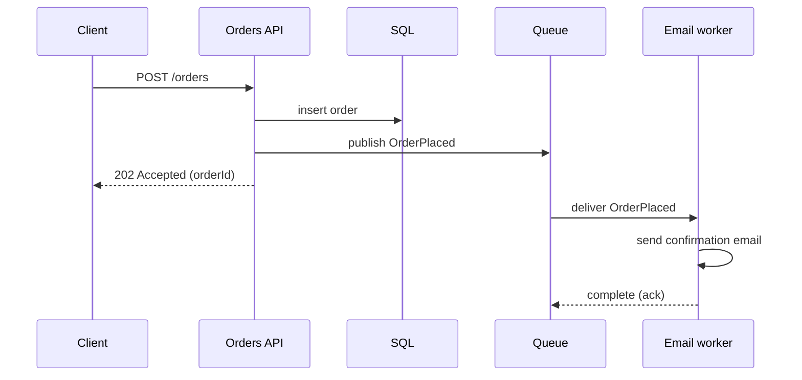
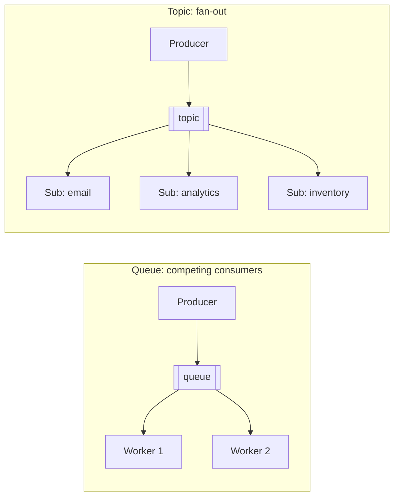

import { Aside } from '@astrojs/starlight/components';
import QuizBlock from '~/components/QuizBlock.astro';

## Why it matters in interviews

Nearly every HLD has a step that should not happen inside the HTTP request: sending emails, generating thumbnails, updating a search index, notifying other services. Interviewers want to see you **move that work behind a queue** and explain why. This page covers the vocabulary you need in an HLD round; brokers, delivery guarantees, outbox and sagas are covered in depth in the [microservices section](../../microservices/message-brokers/).

## Core idea

### Why go asynchronous

| Benefit | What it means |
|---|---|
| Faster responses | The API acknowledges in milliseconds; slow work happens later |
| Load levelling | A spike fills the queue instead of overwhelming the database; workers drain it at a steady rate |
| Resilience | If the email provider is down, messages wait and are retried instead of failing the order |
| Decoupling | The producer does not know who consumes or how many consumers there are |
| Independent scaling | Scale workers on queue length, separately from the API |

The cost: **eventual consistency** (the result is not ready when the response returns), duplicate messages to handle, ordering questions, and another component to run and monitor.



Publishing to the queue *after* the DB commit can fail halfway; the robust fix is the transactional outbox (see [outbox and saga](../../microservices/reliability-patterns/)).

### Queue vs topic (point-to-point vs pub/sub)



| | Queue | Topic (pub/sub) |
|---|---|---|
| Each message goes to | **One** consumer (workers compete) | **Every** subscription gets a copy |
| Used for | Commands, work distribution: "resize this image" | Events: "order placed", several parties interested |
| Scaling | Add workers to the same queue | Each subscription scales its own workers |
| Azure (AWS) | Service Bus queues, Storage Queues (SQS) | Service Bus topics, Event Grid (SNS, EventBridge) |

Event streaming platforms such as Azure Event Hubs or Kafka (AWS: Kinesis Data Streams, MSK) are a third model: an append-only, partitioned log that consumers read at their own offset and can **replay**. Use them for high-volume telemetry and event streams, not simple job queues. The comparison is in [RabbitMQ vs Kafka vs Service Bus](../../microservices/message-brokers/).

### Back-pressure

Back-pressure is how a system **slows producers down** when consumers cannot keep up, instead of growing memory or latency without limit.

- **Bounded buffers**: in-process, a bounded `Channel<T>` makes writers wait when full.
- **Queue depth as a signal**: alert on it and autoscale consumers on it (KEDA, Container Apps scale rules).
- **Reject or shed load** at the edge: return 429 or 503 when the backlog is too deep.
- **Limit consumer concurrency** so workers do not overwhelm the database they write to.

A queue absorbs bursts but is not infinite: if producers are faster than consumers **on average**, the backlog grows forever. Either add consumer capacity or reduce producer rate.

### Fan-out

One event, many reactions. Prefer **one topic with several subscriptions** over the producer calling each consumer: adding a new consumer then needs no producer change. For very large fan-out (one message to millions of user inboxes), the fan-out itself becomes a job processed in batches by workers; see the [notification system](../case-notification-system/) and [news feed](../case-news-feed/) case studies.

### Delivery guarantees in one paragraph

Most brokers give **at-least-once** delivery: a consumer that crashes before acknowledging gets the message again. So consumers must be **idempotent** (processing twice has the same effect as once), usually by recording processed message IDs. Messages that keep failing go to a **dead-letter queue** for inspection. Details: [delivery guarantees and idempotency](../../microservices/delivery-guarantees/).

## Code

In-process back-pressure with a bounded channel: the producer awaits when 1,000 items are buffered instead of growing memory.

```csharp
var channel = Channel.CreateBounded<ResizeJob>(new BoundedChannelOptions(1_000)
{
    FullMode = BoundedChannelFullMode.Wait,   // producer waits when full = back-pressure
    SingleReader = false
});

// Producer (e.g. an endpoint)
await channel.Writer.WriteAsync(new ResizeJob(blobName), ct);

// Consumers: limited concurrency protects downstream resources
var workers = Enumerable.Range(0, 4).Select(_ => Task.Run(async () =>
{
    await foreach (var job in channel.Reader.ReadAllAsync(ct))
        await resizer.ProcessAsync(job, ct);
}));
await Task.WhenAll(workers);
```

An in-memory channel is lost on restart; for durable work use Azure Service Bus (AWS: SQS) consumed by a `BackgroundService` or an Azure Function (AWS: Lambda). See [messaging in .NET](../../microservices/dotnet-messaging/).

## Interview Q&A

<details>
<summary>When would you put a queue between the API and the work?</summary>

When the work is slow, unreliable (third-party calls), bursty, or not needed for the response: emails, PDFs, image processing, search indexing, notifications to other services. Return 202 Accepted with an ID the client can poll or be notified about. Keep work the user needs immediately (validating and saving the order) synchronous.
</details>

<details>
<summary>Queue vs topic?</summary>

A queue delivers each message to one of several competing consumers, which is for distributing work. A topic delivers a copy to every subscription, which is for broadcasting events to independent consumers. In Azure Service Bus both exist; on AWS the usual pairing is SNS topics fanning out to SQS queues.
</details>

<details>
<summary>What is back-pressure and how do you apply it?</summary>

It is a mechanism that slows producers when consumers are saturated, so the system degrades gracefully instead of running out of memory. Examples: bounded channels or buffers, rejecting requests with 429/503 when queue depth is too high, limiting consumer concurrency, and autoscaling consumers on queue length.
</details>

<details>
<summary>The queue backlog keeps growing. What do you check?</summary>

Compare the arrival rate with the processing rate. Then look for slow or failing consumers (poison messages being retried, a slow downstream dependency, low concurrency), and whether consumers can scale out or are bottlenecked on a shared database. Fix by scaling consumers, batching, removing the bottleneck, or shedding non-critical work.
</details>

<details>
<summary>Does a message queue guarantee exactly-once processing?</summary>

Generally no. Practical systems deliver at least once, so the same message can arrive twice (after a timeout, a crash before ack, or a retry). Design consumers to be idempotent, for example by storing processed message IDs in the same transaction as the side effect.
</details>

<details>
<summary>How does a queue improve availability?</summary>

The producer only depends on the queue, not on the consumer. If the email service or a downstream API is down, the order is still accepted, and messages wait until the consumer recovers. It turns a hard runtime dependency into a delayed one.
</details>

## Pitfalls

<Aside type="caution" title="Common mistakes">

- **Using a queue for work the user needs in the response**: you add latency and polling for no gain.
- **Non-idempotent consumers**: at-least-once delivery means duplicates will happen, so duplicate emails or double charges follow.
- **Publishing after the DB commit without an outbox**: a crash in between loses the event.
- **No dead-letter monitoring**: failed messages pile up silently.
- **Unbounded in-memory queues**: a spike becomes an out-of-memory crash instead of back-pressure.

</Aside>

## Related

- [RabbitMQ vs Kafka vs Azure Service Bus](../../microservices/message-brokers/)
- [Delivery guarantees and idempotency](../../microservices/delivery-guarantees/)
- [Outbox, saga and resilience](../../microservices/reliability-patterns/)
- [Background services](../../aspnet/background-services/)

## Quick quiz

<QuizBlock section="system-design" topic="messaging-basics" />
