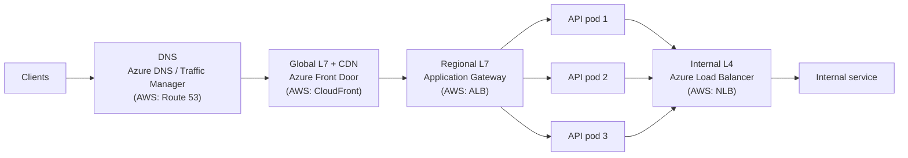
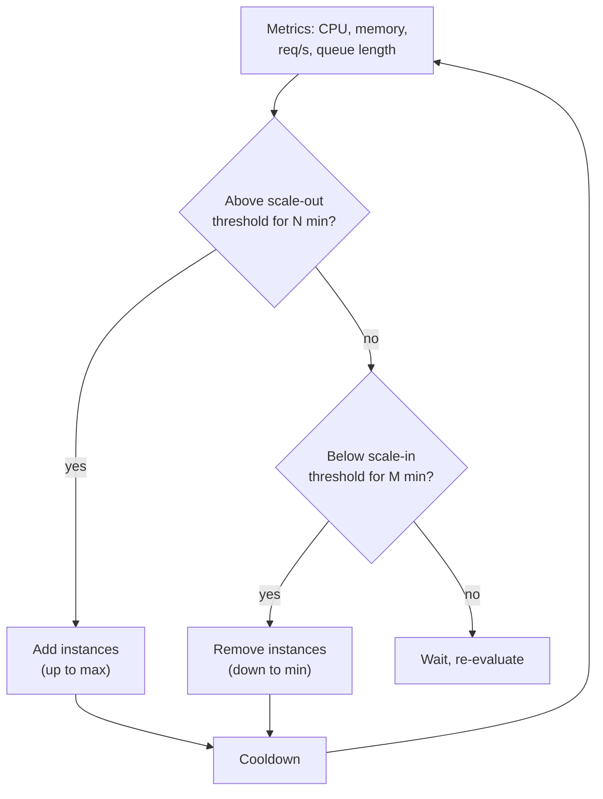

import { Aside } from '@astrojs/starlight/components';
import QuizBlock from '~/components/QuizBlock.astro';

## Why it matters in interviews

Every design round eventually asks *"how does this handle 10x traffic?"*. The expected answer starts with the basics on this page: make the app tier stateless, put it behind a load balancer, scale out, push static content to a CDN, and know what each layer does. Interviewers also ask direct questions like *"L4 vs L7 load balancer?"* or *"why are sticky sessions a problem?"*.

## Core idea

### Vertical vs horizontal scaling

| | Vertical (scale up) | Horizontal (scale out) |
|---|---|---|
| How | Bigger machine: more CPU, RAM, faster disk | More machines behind a load balancer |
| Code changes | None | App must be **stateless** (or state externalised) |
| Limit | Largest available SKU, and cost grows faster than capacity | Practically unbounded for stateless tiers |
| Failure | Single point of failure | One instance dies, others carry on |
| Downtime to resize | Often a restart | Add/remove instances live |
| Good for | Databases (first step), quick wins | Web/API tiers, workers |

A practical rule: **scale the app tier out, scale the database up first**, then add read replicas, then partition. Databases are stateful, so scaling them out is the hard part (see [databases at scale](../databases-at-scale/)).

### Stateless services

An instance is stateless when **any instance can serve any request**. Anything that must survive between requests lives outside the process:

| State | Where it goes |
|---|---|
| User session | Token (JWT) carried by the client, or a shared store such as Redis |
| Cache | Distributed cache (Redis) or accept per-instance caches |
| Uploaded files | Blob storage, never the local disk |
| ASP.NET Core Data Protection keys | Shared store (Redis, Blob, DB) so cookies and antiforgery tokens work on every instance |
| Background job progress | Database or queue |

**Sticky sessions** (session affinity) pin a user to one instance. They work around in-memory session state, but they unbalance load, break when that instance dies, and complicate deployments. Treat them as a migration crutch, not a design.

### Load balancers



| | L4 (transport) | L7 (application) |
|---|---|---|
| Sees | IP addresses, ports, TCP/UDP | HTTP: path, host, headers, cookies |
| Routing | Per connection | Per request (`/api/*` to API, `/img/*` to storage) |
| TLS | Usually passes through | Can terminate TLS, then re-encrypt or not |
| Features | Very fast, protocol-agnostic | WAF, path routing, header rewrites, cookie affinity |
| Azure (AWS) | Azure Load Balancer (NLB) | Application Gateway (ALB), Front Door for global |

**Algorithms**

| Algorithm | How | Use when |
|---|---|---|
| Round robin | Next server in turn | Similar instances, similar requests |
| Weighted round robin | Bigger servers get more turns | Mixed instance sizes, canary releases |
| Least connections | Server with fewest open connections | Long-lived or uneven requests (WebSockets) |
| Least response time | Fastest recent responses | Latency-sensitive, heterogeneous backends |
| IP hash / consistent hash | Hash of client IP or key picks the server | Affinity without cookies, cache locality |

Load balancers also run **health checks** and stop sending traffic to failing instances. In ASP.NET Core, expose a health endpoint and point the probe at it (see [health checks](../../aspnet/rate-limiting-health-checks/)).

### Reverse proxy, API gateway and CDN

- **Reverse proxy** (nginx, YARP, Application Gateway): sits in front of servers, terminates TLS, compresses, routes and hides internal topology. A load balancer is a reverse proxy that spreads load.
- **API gateway** (Azure API Management (AWS: API Gateway)): a reverse proxy with API concerns: auth, rate limits, quotas, versioning, request transformation.
- **CDN** (Azure Front Door (AWS: CloudFront)): caches static and cacheable content at edge locations close to users. It cuts latency and offloads origin servers. Angular bundles, images and videos belong here. See [blob storage and CDN](../storage-files-cdn/).

### DNS

DNS turns a name into an IP. In design rounds it matters for **global routing and failover**:

- **TTL** controls how long resolvers cache an answer. Low TTL = faster failover, more DNS queries.
- **Geo / latency-based routing** sends users to the nearest region: Azure Traffic Manager (AWS: Route 53 routing policies).
- DNS failover is only as fast as clients respect the TTL; some cache longer. Anycast-based global load balancers (Front Door) fail over without waiting for DNS caches.

### Autoscaling



Azure options: App Service autoscale rules, VM Scale Sets (AWS: EC2 Auto Scaling groups), AKS Horizontal Pod Autoscaler and cluster autoscaler (AWS: EKS with HPA and Cluster Autoscaler or Karpenter), Container Apps scale rules, which are KEDA-based and can scale on queue length (AWS: ECS service auto scaling).

Points to say in an interview: autoscaling **reacts with a delay** (new instances need minutes to start and warm up), so keep a minimum warm capacity for spikes, scale out faster than you scale in, and remember the database does not autoscale with the app tier. More app instances can mean more DB connections and a **connection-pool storm**.

### Latency numbers to know

| Operation | Rough latency |
|---|---|
| L1 cache reference | ~1 ns |
| Main memory reference | ~100 ns |
| Redis GET inside the same region | ~0.5-1 ms (mostly the network round trip) |
| Round trip within a data centre | ~0.5 ms |
| SSD random read | ~0.1 ms |
| Simple indexed SQL query | ~1-5 ms |
| HDD seek | ~10 ms |
| Round trip between continents | ~100-150 ms |

The lesson: **network hops and disk dominate**. Memory is about 1,000x faster than a network round trip; a cross-region call costs as much as hundreds of local cache reads.

## Code

The minimum to make an ASP.NET Core API safe to scale out behind a load balancer:

```csharp
var builder = WebApplication.CreateBuilder(args);
var redis = ConnectionMultiplexer.Connect(builder.Configuration.GetConnectionString("Redis")!);

// Shared cache instead of per-instance memory for data every instance must agree on.
builder.Services.AddStackExchangeRedisCache(o =>
    o.ConnectionMultiplexerFactory = () => Task.FromResult<IConnectionMultiplexer>(redis));

// Shared Data Protection keys: auth cookies issued by instance A must decrypt on instance B.
builder.Services.AddDataProtection()
    .SetApplicationName("orders-api")
    .PersistKeysToStackExchangeRedis(redis, "DataProtection-Keys");

// Trust X-Forwarded-For / X-Forwarded-Proto from the proxy so scheme and client IP are correct.
// In production, also restrict which proxies are trusted (KnownProxies / known networks).
builder.Services.Configure<ForwardedHeadersOptions>(o =>
    o.ForwardedHeaders = ForwardedHeaders.XForwardedFor | ForwardedHeaders.XForwardedProto);

builder.Services.AddHealthChecks().AddRedis(redis);   // AspNetCore.HealthChecks.Redis package

var app = builder.Build();
app.UseForwardedHeaders();
app.MapHealthChecks("/healthz");   // load balancer probe target
app.Run();
```

## Interview Q&A

<details>
<summary>Vertical or horizontal scaling: which do you choose?</summary>

Both, at different tiers. The stateless app tier scales horizontally because it is cheap and adds redundancy. The database usually scales vertically first because scaling a stateful store out (sharding) is complex. Vertical scaling hits a hardware ceiling and keeps a single point of failure, so it is a first step, not the end state.
</details>

<details>
<summary>What does it take to make an ASP.NET Core API stateless?</summary>

No in-process session or cache that must be shared, files go to blob storage, authentication uses tokens or cookies whose Data Protection keys are in a shared store, and background work goes through a queue. Then any instance can serve any request and the load balancer can route freely.
</details>

<details>
<summary>L4 vs L7 load balancer?</summary>

L4 works on TCP/UDP connections (IP and port): very fast and protocol-agnostic, but it cannot see URLs or headers. L7 understands HTTP, so it can route by path or host, terminate TLS, apply a WAF and do cookie affinity, at slightly higher cost. Azure Load Balancer (AWS: NLB) is L4; Application Gateway (AWS: ALB) is L7.
</details>

<details>
<summary>Why are sticky sessions a problem?</summary>

They pin users to an instance, so load becomes uneven, scaling in or deploying drops those users' sessions, and an instance failure loses state. They hide the real problem, in-memory state. Externalise the state (Redis, tokens) and turn affinity off.
</details>

<details>
<summary>Which load-balancing algorithm for WebSocket connections?</summary>

Least connections. WebSocket connections are long-lived, so round robin can leave one instance with many more open connections than another. For SignalR scale-out you also need a backplane or Azure SignalR Service so messages reach clients connected to other instances.
</details>

<details>
<summary>What is the difference between a CDN and a load balancer?</summary>

A load balancer spreads requests across your servers in one place (region). A CDN caches responses at many edge locations close to users, so cacheable requests never reach your servers. They are complementary: the CDN sits in front, the load balancer distributes cache misses and dynamic requests.
</details>

<details>
<summary>Autoscaling is configured, but a flash sale still caused errors. Why?</summary>

New instances take minutes to provision and warm up, so a sudden spike outruns reactive scaling. The database or a downstream dependency may also be the bottleneck, and more app instances can exhaust its connections. Fixes: scheduled pre-scaling, a higher minimum instance count, queue-based load levelling, caching, and rate limiting.
</details>

<details>
<summary>How would you do failover across two regions?</summary>

Run the app in both regions, replicate data (geo-replication or failover groups), and put a global entry point in front: Azure Front Door or Traffic Manager (AWS: CloudFront / Route 53 failover routing) with health probes. Be explicit about the data trade-off: async geo-replication means a failover can lose the last few seconds of writes.
</details>

## Pitfalls

<Aside type="caution" title="Common mistakes">

- **Saving uploads to the local disk** of an instance. The next request lands on another instance.
- **Forgetting Data Protection keys** when scaling out: users get logged out or antiforgery validation fails at random.
- **Scaling the app tier without checking the database**: 20 instances x 100 pooled connections can exceed the DB's connection limit.
- **Assuming DNS failover is instant**: clients and resolvers cache answers for at least the TTL.
- **Ignoring forwarded headers** behind a proxy: wrong scheme in redirects and wrong client IP in logs and rate limits.
- **Health checks that check everything**: a liveness probe that fails when the DB is down restarts every instance at once.

</Aside>

## Related

- [How to run a design interview](../interview-framework/)
- [Caching at scale](../caching/)
- [Networking basics](../../fundamentals/networking/)
- [Kubernetes in practice](../../testing-devops/kubernetes-operations/)

## Quick quiz

<QuizBlock section="system-design" topic="scaling-fundamentals" />
