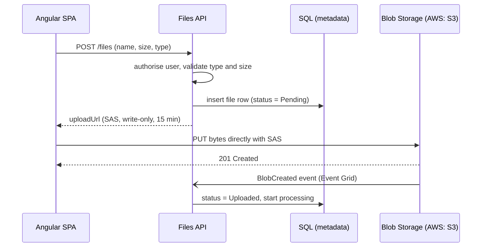
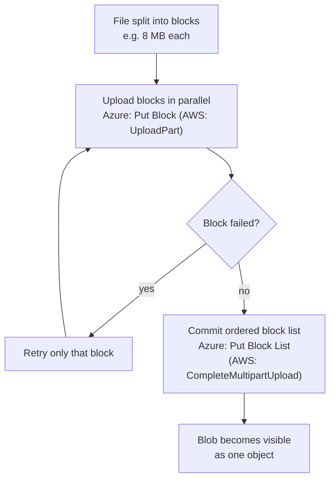
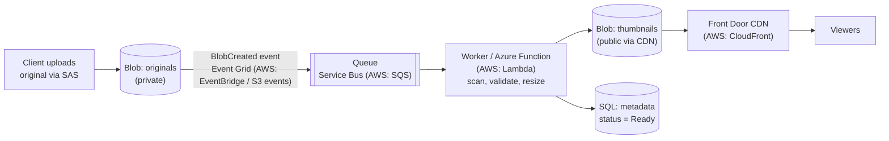

import { Tabs, TabItem, Aside } from '@astrojs/starlight/components';
import QuizBlock from '~/components/QuizBlock.astro';

## Why it matters in interviews

Any design with user content (profile pictures, documents, videos) needs a file story, and the naive answer, "upload to the API and save to disk", fails at scale. Interviewers look for three ideas: **files go to object storage, not the database or the web server**, **clients upload and download directly using short-lived signed URLs**, and **a CDN serves the reads**. Questions like *"how do you upload a 2 GB file?"* or *"how do you make thumbnails?"* follow.

## Core idea

### Object (blob) storage

Azure Blob Storage (AWS: S3) stores unstructured objects in containers (buckets) addressed by name. It is cheap per GB, very durable thanks to built-in replication, scales without capacity planning, and serves files over HTTPS.

| Store | What goes there |
|---|---|
| Blob / S3 | The file bytes: images, PDFs, videos, exports, backups |
| Database | Metadata: owner, file name, size, content type, blob path, status, checksums |
| CDN | Cached copies of public or frequently read files at the edge |

Never store large files as `varbinary` in SQL: it bloats backups, wastes expensive DB I/O and buffer memory, and every download passes through the API.

**Access tiers** trade storage cost against access cost and latency: Hot, Cool, Cold and Archive on Azure (AWS: S3 Standard, Standard-IA, Glacier classes). Archive needs rehydration before reading (hours). **Lifecycle policies** move old blobs to cheaper tiers or delete them automatically.

**Redundancy options** on Azure: LRS (copies in one data centre), ZRS (across availability zones), GRS / GZRS (also to a paired region). On AWS, standard S3 classes store data across multiple AZs; cross-region replication is configured separately.

### Signed URLs: SAS and pre-signed URLs

The API should not proxy file bytes. Instead it **authorises the operation** and hands back a URL that grants limited access for a short time:

- Azure: **SAS (Shared Access Signature)**. Prefer a **user delegation SAS**, signed with an Entra ID credential (for example the API's managed identity), over an account-key SAS. Scope it to one blob, minimal permissions, minutes of validity.
- AWS: **pre-signed URL**, signed with the IAM role's credentials.



The API never handles the bytes, so it stays small and fast and upload bandwidth goes straight to storage. Remember **CORS** on the storage account for browser uploads, and do not trust the client: verify size and type after upload.

### Chunked and resumable uploads

Large files over flaky networks need chunking: upload pieces independently, retry only the failed piece, and commit at the end.



- **Azure block blobs**: upload blocks with IDs, then commit the list; the blob only exists after the commit. Up to 50,000 blocks per blob.
- **AWS S3 multipart upload**: start an upload, send parts (at least 5 MiB each except the last, up to 10,000 parts), then complete it. Configure a lifecycle rule to abort incomplete multipart uploads, otherwise orphaned parts keep costing money.
- **Resume**: the client keeps which blocks succeeded (or asks the server/storage for the uncommitted block list) and continues from there after a reconnect.
- The Azure SDK (`BlobClient.UploadAsync` with `StorageTransferOptions`) and the AWS SDK transfer utilities do the chunking and parallelism for you.

### CDN caching and invalidation

Azure Front Door (AWS: CloudFront) caches files at edge locations. The origin can be Blob Storage, a static website, or your API.

| Concern | Approach |
|---|---|
| What to cache | Static assets, public images, video segments, cacheable public API responses |
| How long | `Cache-Control: public, max-age=...` from the origin; long for immutable files |
| Updating content | **Versioned file names** (`logo.3f9a2c.png`, Angular's hashed bundles) so new content gets a new URL; set `max-age=31536000, immutable` |
| Emergency invalidation | **Purge** the path on the CDN; it is slower and less reliable than versioning, and browsers may still hold a copy |
| Private files | Do not cache publicly. Serve via short-lived SAS / pre-signed URLs, or through an authenticated endpoint. CloudFront also supports signed URLs and signed cookies |
| `index.html` of the SPA | `no-cache` (revalidate) so users pick up new deployments |

Numbers to know: if one 2 MB image is viewed 10M times a day, that is 20 TB/day of egress. A CDN with a 95% hit ratio sends only about 1 TB/day to the origin, and users get the bytes from a nearby edge.

### Image processing pipeline



Design points: keep originals private and immutable, generate fixed sizes (thumbnail, medium, large) or WebP/AVIF variants, make the worker **idempotent** (events can be delivered twice; deterministic output names make reprocessing safe), scan for malware before publishing (Microsoft Defender for Storage malware scanning (AWS: GuardDuty Malware Protection for S3), or your own scanner), and update the status so the UI can show "processing".

## Code

<Tabs syncKey="lang">
  <TabItem label="C#">

```csharp
// Issue a write-only user delegation SAS for one blob. The API's managed identity
// needs a data-plane role such as "Storage Blob Data Contributor".
public sealed class UploadUrlService(BlobServiceClient blobService)
{
    public async Task<Uri> CreateUploadUrlAsync(string blobName, CancellationToken ct)
    {
        var expires = DateTimeOffset.UtcNow.AddMinutes(15);
        var key = await blobService.GetUserDelegationKeyAsync(DateTimeOffset.UtcNow, expires, ct);

        var blob = blobService.GetBlobContainerClient("uploads").GetBlobClient(blobName);
        var sas = new BlobSasBuilder
        {
            BlobContainerName = "uploads",
            BlobName = blobName,
            Resource = "b",                 // a single blob
            ExpiresOn = expires
        };
        sas.SetPermissions(BlobSasPermissions.Create | BlobSasPermissions.Write);

        return new BlobUriBuilder(blob.Uri)
        {
            Sas = sas.ToSasQueryParameters(key.Value, blobService.AccountName)
        }.ToUri();
    }
}
// Registration: new BlobServiceClient(new Uri(accountUrl), new DefaultAzureCredential())
```

  </TabItem>
  <TabItem label="TypeScript">

```ts
// Angular: get a SAS URL from the API, then PUT the file straight to Blob Storage.
export class FileUploadService {
  private http = inject(HttpClient);

  async upload(file: File): Promise<string> {
    const { fileId, uploadUrl } = await firstValueFrom(
      this.http.post<{ fileId: string; uploadUrl: string }>('/api/files', {
        name: file.name, size: file.size, contentType: file.type,
      }),
    );
    // The auth interceptor must NOT add the bearer token to this cross-origin URL.
    await firstValueFrom(
      this.http.put(uploadUrl, file, {
        headers: { 'x-ms-blob-type': 'BlockBlob', 'Content-Type': file.type },
      }),
    );
    return fileId;
  }
}
```

  </TabItem>
</Tabs>

A single `PUT` suits files up to a few hundred MB; for larger files use the block APIs (or the Azure Storage JS SDK, which chunks for you).

## Interview Q&A

<details>
<summary>Why not upload files through the API?</summary>

Every byte would pass through your app servers, tying up connections, memory and bandwidth, and you would pay to scale the API for file traffic. Direct-to-storage uploads with a short-lived SAS or pre-signed URL keep the API doing only authorisation and metadata, while storage handles the bandwidth. Proxying is acceptable only for small files or when you must inspect the stream inline.
</details>

<details>
<summary>How do you secure a SAS / pre-signed URL?</summary>

Scope it to a single blob, grant only the needed permission (write for upload, read for download), keep validity short (minutes), use HTTPS only, and prefer user delegation SAS (backed by Entra ID, revocable by revoking the delegation key) over account-key SAS. Generate the blob name on the server so clients cannot overwrite other files.
</details>

<details>
<summary>How do you upload a 5 GB video reliably?</summary>

Split it into blocks or parts, upload them in parallel with retries per block, and commit the block list at the end (Azure Put Block / Put Block List, AWS S3 multipart upload). Track uploaded blocks so the client can resume after a disconnect. Clean up uncommitted uploads with lifecycle rules.
</details>

<details>
<summary>How do you update an image that is cached on the CDN?</summary>

Prefer versioned URLs: upload the new image under a new name (content hash or version) and update the reference, so caches never serve stale content and old URLs can stay cached for a year. Purging the CDN path works for emergencies, but it takes time to propagate and does not clear browser caches.
</details>

<details>
<summary>Where should file metadata live?</summary>

In the database: owner, original name, size, content type, blob path, checksum, status (Pending, Uploaded, Ready, Rejected) and timestamps. The blob holds only bytes. Queries such as "my files", permissions and sharing all run against the metadata table.
</details>

<details>
<summary>How would you design thumbnail generation?</summary>

Upload originals to a private container; a BlobCreated event goes through a queue to a worker (Azure Function or container) that validates, scans and resizes into fixed sizes, writes them to a public container behind the CDN, and marks the file Ready. The queue absorbs bursts, retries failures and dead-letters poison files. Output names are deterministic so reprocessing is idempotent.
</details>

<details>
<summary>How do you serve private files to authorised users only?</summary>

The client asks the API for the file; the API checks permissions and returns a short-lived read SAS (or pre-signed URL), or redirects to it. Do not put private files behind a public CDN cache. If private files need edge caching, use a CDN feature built for it, such as CloudFront signed URLs or cookies, with short expiries.
</details>

## Pitfalls

<Aside type="caution" title="Common mistakes">

- **Long-lived or account-wide SAS tokens** shared with clients: equivalent to handing out the storage key.
- **Trusting client-supplied file names and content types**: generate blob names server-side and verify content after upload.
- **Sending the app's bearer token to the storage URL** via an Angular interceptor: leaks the token to another origin and breaks the request.
- **Purging the CDN on every change** instead of versioning file names.
- **Forgetting CORS on the storage account** for browser uploads.
- **Leaving incomplete multipart uploads and orphaned blobs** that silently keep costing money.

</Aside>

## Related

- [Case study: file upload and sharing](../case-file-upload/)
- [Scaling fundamentals](../scaling-fundamentals/)
- [Auth in system design](../auth-in-design/)
- [Deploying to Azure (and AWS)](../../testing-devops/cloud-deployment/)

## Quick quiz

<QuizBlock section="system-design" topic="storage-files-cdn" />
