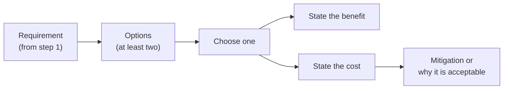

import { Aside } from '@astrojs/starlight/components';
import QuizBlock from '~/components/QuizBlock.astro';

## Why it matters in interviews

"It depends" is only a good answer when it is followed by **what it depends on**. Interviewers score trade-off reasoning more than technology choice: two candidates can draw the same diagram, and the one who says *"I chose X over Y because of requirement Z, and the cost is W"* gets the higher rating. This page is a revision sheet of the pairs that come up most, with wording you can reuse.

## Core idea

Every decision trades something. Use one sentence structure:

> **"Given [requirement], I'd choose [option] over [alternative], because [benefit]. The cost is [downside], which is acceptable because [reason] / which I'd mitigate with [technique]."**



### Data and consistency

| Trade-off | Choose the first when | Choose the second when | Phrase to say |
|---|---|---|---|
| **Consistency vs availability** (during a partition) | Money, inventory, bookings: a wrong answer is worse than no answer | Feeds, likes, catalogue, presence: stale is fine, down is not | "For the balance I'd rather return an error than a wrong number; the feed can be a few seconds stale." |
| **Strong vs eventual consistency** | Read-after-write is a user expectation (my own profile, my order) | High scale, multi-region, counters | "Session consistency gives each user read-your-writes without paying for global strong consistency." |
| **Normalisation vs denormalisation** | Write-heavy, data integrity, many update paths | Read-heavy, known query shapes, joins are the bottleneck | "I'd keep the source of truth normalised and build a denormalised read model for the hot query." |
| **SQL vs NoSQL** | Relationships, transactions, ad hoc queries | Massive key-based scale, flexible schema, global writes | "Access patterns are key-by-user and the volume is huge, so a partitioned NoSQL store fits; reporting goes to SQL." |
| **Accuracy vs speed / cost** | Billing, compliance | Analytics, unique-visitor counts, trending | "HyperLogLog gives about 1% error in a few KB; exact counts aren't worth the memory here." |

### Performance and scale

| Trade-off | Choose the first when | Choose the second when | Phrase to say |
|---|---|---|---|
| **Latency vs throughput** | Interactive requests: per-request speed matters | Batch jobs, ingestion: total work per second matters | "Batching writes raises throughput but adds up to 100 ms delay, fine for analytics, not for checkout." |
| **Caching: freshness vs load** | Data must be current (stock at checkout) | Read-heavy, tolerates staleness | "A 60-second TTL cuts DB reads by ~95%; for the final checkout step I read from the DB." |
| **Vertical vs horizontal scaling** | Quick win, stateful DB, small scale | Stateless tier, need redundancy, large scale | "Scale the API out; scale the DB up first, then replicas, and only then shard." |
| **Read-optimised vs write-optimised** | Few writes, many reads: more indexes, precomputed views | Write-heavy: few indexes, append-only, LSM-tree stores | "Every extra index slows inserts, so on the events table I'd keep only the primary key and one lookup index." |
| **Precompute vs compute on read** | Expensive result read often (feed, leaderboard) | Cheap to compute or rarely read | "Fan-out on write precomputes feeds; celebrities with millions of followers are merged at read time." |

### Communication

| Trade-off | Choose the first when | Choose the second when | Phrase to say |
|---|---|---|---|
| **Sync vs async** | Caller needs the result now; simple flows | Slow, unreliable or non-essential work; spikes | "Payment authorisation is synchronous; receipts and analytics go on a queue." |
| **Push vs pull** | Low-latency updates, few changes, online clients | Clients control pace, bursty producers, simplicity | "Workers pull from the queue so they never get more than they can handle; users get push notifications." |
| **Polling vs WebSockets / SSE** | Infrequent updates, simple infra, caching-friendly | Real-time, frequent updates | "Order status changes a few times an hour, so polling every 30 s is simpler than holding open sockets." |
| **REST vs gRPC** | Public, browser, cacheable | Internal, low-latency, streaming | "REST at the edge, gRPC between internal services." |
| **At-least-once vs at-most-once** | Losing a message is unacceptable (with idempotent consumers) | Duplicates are worse than loss (rare) or data is disposable (metrics) | "At-least-once with an idempotency key is effectively-once for the business." |

### Architecture and operations

| Trade-off | Choose the first when | Choose the second when | Phrase to say |
|---|---|---|---|
| **Monolith vs microservices** | Small team, unclear boundaries, early product | Independent scaling and deployment, many teams, clear domains | "Start as a modular monolith; extract a service when a module has its own scaling or team need." |
| **Stateless vs stateful** | Almost always for the app tier | Connection-heavy features (WebSockets, game sessions) | "The API is stateless; WebSocket connections use Azure SignalR Service so instances stay disposable." |
| **Build vs buy (managed)** | Core differentiator, special needs | Commodity: auth, queues, search, email | "I'd use Entra ID instead of building login; identity isn't our differentiator." |
| **Cost vs availability** | Internal tool, tolerable downtime | Revenue-critical, SLA-bound | "Multi-region doubles cost; single region with zone redundancy meets a 99.9% target." |
| **Simplicity vs flexibility** | Requirements are stable | Requirements genuinely vary (multi-tenant config) | "I'd hard-code two providers behind an interface rather than build a plugin system we don't need yet." |

### Numbers that justify trade-offs

| Fact | Use it to argue |
|---|---|
| Memory read ~100 ns vs same-region network round trip ~0.5 ms | In-process caching for hot keys |
| Cross-region round trip ~100 ms | Avoid synchronous cross-region calls in a request |
| 99.9% = ~8.8 h/year down, 99.99% = ~53 min/year | Whether multi-region is worth the cost |
| Two serial dependencies at 99.9% each give ~99.8% | Fewer synchronous hops, or async decoupling |
| 1M requests/day ≈ 12 req/s | Most "big" numbers fit one database |

## Code

Trade-offs show up in code too. The same read path, choosing freshness or load per call site:

```csharp
public sealed class StockService(HybridCache cache, StockRepository repo)
{
    // Product page: tolerate 30 s staleness, protect the DB (latency and load win).
    public ValueTask<int> GetDisplayStockAsync(string sku, CancellationToken ct) =>
        cache.GetOrCreateAsync($"stock:{sku}", async t => await repo.GetStockAsync(sku, t),
            new HybridCacheEntryOptions { Expiration = TimeSpan.FromSeconds(30) },
            cancellationToken: ct);

    // Checkout: must be correct, so bypass the cache (consistency wins).
    public Task<int> GetStockForCheckoutAsync(string sku, CancellationToken ct) =>
        repo.GetStockAsync(sku, ct);
}
```

## Interview Q&A

<details>
<summary>The interviewer asks "SQL or NoSQL?" How do you answer without saying just "it depends"?</summary>

Name the deciding factors and apply them: *"Orders need multi-row transactions and ad hoc reporting, and 500 writes/s fits one SQL primary, so SQL. If we needed millions of writes per second with key-only access, I'd choose a partitioned NoSQL store and accept giving up joins."*
</details>

<details>
<summary>When is denormalisation the right call?</summary>

When reads vastly outnumber writes, the query shape is known and joins are the measured bottleneck. Keep a normalised source of truth and maintain the denormalised copy (read model, materialised view, cache) through events or triggers, accepting that it can lag and that updates touch more places.
</details>

<details>
<summary>Push or pull for delivering work to workers?</summary>

Pull (workers fetch from a queue) gives natural back-pressure: a busy worker simply does not take more, and adding workers scales throughput. Push gives lower latency but needs the sender to track consumer capacity and handle slow consumers. Most queue-based systems let consumers pull; real-time user updates are pushed.
</details>

<details>
<summary>What is the trade-off between latency and throughput?</summary>

Techniques that raise throughput (batching, buffering, queueing, bigger pages) usually add latency per item, and minimising per-request latency (processing each item immediately) costs throughput and resources. Choose by workload: interactive APIs optimise p99 latency; ingestion pipelines optimise throughput.
</details>

<details>
<summary>Why does adding more synchronous service calls hurt availability?</summary>

Availabilities multiply. A request that needs five services each at 99.9% succeeds about 99.5% of the time, and the latencies add up. Mitigate with fewer hops, caching, async messaging for non-essential steps, timeouts, circuit breakers and fallbacks.
</details>

<details>
<summary>Fan-out on write or fan-out on read for a news feed?</summary>

Fan-out on write precomputes each follower's feed, making reads fast at the cost of heavy writes, which become a problem for users with millions of followers. Fan-out on read builds the feed at request time: cheap writes, slower reads. A hybrid is the usual answer: write-time fan-out for normal users, read-time merge for celebrities.
</details>

<details>
<summary>How do you argue for a simpler design when the interviewer hints at scale?</summary>

Use numbers. Show the estimate, state the current design's limit, and describe the trigger and the next step: *"This handles about 2,000 req/s; at around 10x I'd add read replicas, and if writes exceed what one primary can take, I'd shard by user ID."* That shows you can scale without over-building on day one.
</details>

## Pitfalls

<Aside type="caution" title="Common mistakes">

- **"It depends" with no follow-up**: always say on what, then pick.
- **Only listing benefits**: every choice has a cost; name it before the interviewer does.
- **Choosing consistency or availability globally**: different parts of the same system usually need different answers.
- **Arguing from popularity** ("Netflix uses it") instead of from requirements.
- **Not revisiting trade-offs** when the interviewer changes a requirement mid-way.

</Aside>

## Related

- [How to run a design interview](../interview-framework/)
- [Databases at scale](../databases-at-scale/)
- [Caching at scale](../caching/)
- [Case study: news feed](../case-news-feed/)

## Quick quiz

<QuizBlock section="system-design" topic="tradeoffs-cheatsheet" />
