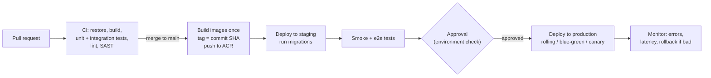
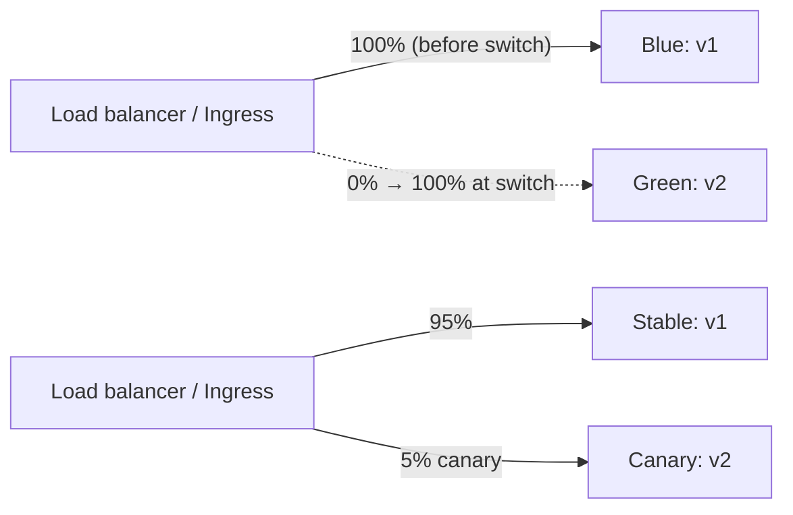

import { Tabs, TabItem, Aside } from '@astrojs/starlight/components';
import QuizBlock from '~/components/QuizBlock.astro';

## Why it matters in interviews

*"Walk me through how your code gets from a pull request to production"* is one of the most common project-discussion questions. Interviewers listen for build-once-deploy-many, automated tests as quality gates, environments with approvals, how secrets are handled, how database migrations run, and how you roll back. You may also be asked to read or write a pipeline YAML on the spot.

## Core idea

| Term | Meaning | Production release |
|---|---|---|
| **Continuous Integration (CI)** | Every push / PR is built and tested automatically; developers merge to the main branch often (at least daily) | Not involved |
| **Continuous Delivery** | Every change that passes the pipeline is **deployable**; production deploy is one click / approval away | Manual approval |
| **Continuous Deployment** | Every change that passes the pipeline **goes to production automatically** | Automatic |



### Principles that interviewers look for

- **Build once, deploy many.** The same image (or artifact) tested in staging is promoted to production. Only configuration differs per environment. Rebuilding for production means you ship something you never tested.
- **Immutable, traceable versions.** Tag images with the commit SHA or build number, not `latest`.
- **Fast feedback on PRs.** Unit tests, build and lint in minutes; slower suites (e2e, load) after merge or nightly.
- **Quality gates:** tests, code coverage floor, static analysis (CodeQL, SonarQube), dependency scanning (Dependabot), container image scanning (Trivy, Microsoft Defender for Containers).
- **Branch protection:** required reviews and green checks before merge. Trunk-based development with short-lived branches keeps integration continuous.
- **Database migrations as a pipeline step**: generate an idempotent script (`dotnet ef migrations script --idempotent`) or a migration bundle (`dotnet ef migrations bundle`) and run it before the new app version goes live. Keep migrations **backward compatible** (expand, then contract) so the old version still runs during a rolling deploy.

### Environments, approvals and secrets

| | GitHub Actions | Azure DevOps |
|---|---|---|
| Environments | `environment: production` on a job | `deployment` job with `environment: prod` |
| Approvals | Environment protection rules: required reviewers, wait timer, branch rules | Environment **checks**: approvals, business hours, Azure Monitor gates (configured in the UI, not YAML) |
| Secrets | Repository / environment **secrets**, non-secret **vars** | Secret pipeline variables, **variable groups** linked to Key Vault |
| Cloud login | **OIDC** federated credentials (`id-token: write`), no stored password | Workload identity federation service connections |
| Reusable logic | Reusable workflows, composite actions | Templates (`template:`), task groups |

**Secrets rules:** never commit them, never `echo` them (both platforms mask known secrets in logs but not derived values), prefer **OIDC / workload identity federation** over long-lived client secrets, and keep application secrets in **Azure Key Vault** (AWS: Secrets Manager / SSM Parameter Store), read at runtime by the app's managed identity rather than baked into the image.

## Code

### GitHub Actions: build and test the API and Angular app

```yaml
# .github/workflows/ci-cd.yml
name: ci-cd
on:
  push:
    branches: [main]
  pull_request:
    branches: [main]

permissions:
  contents: read
  id-token: write          # needed for OIDC login to Azure

env:
  IMAGE_API: shopacr.azurecr.io/orders-api
  IMAGE_WEB: shopacr.azurecr.io/shop-web

jobs:
  api:
    runs-on: ubuntu-latest
    steps:
      - uses: actions/checkout@v4
      - uses: actions/setup-dotnet@v4
        with: { dotnet-version: 10.0.x }
      - run: dotnet restore
      - run: dotnet build --no-restore -c Release
      - run: dotnet test --no-build -c Release   # Testcontainers works: Docker is on ubuntu runners

  web:
    runs-on: ubuntu-latest
    defaults:
      run: { working-directory: web }
    steps:
      - uses: actions/checkout@v4
      - uses: actions/setup-node@v4
        with: { node-version: 22, cache: npm, cache-dependency-path: web/package-lock.json }
      - run: npm ci
      - run: npm run lint
      - run: npm test -- --watch=false
      - run: npx ng build --configuration production
```

### GitHub Actions: push images and deploy with approvals

```yaml
  images:
    needs: [api, web]
    if: github.ref == 'refs/heads/main'
    runs-on: ubuntu-latest
    steps:
      - uses: actions/checkout@v4
      - uses: azure/login@v2
        with:
          client-id: ${{ vars.AZURE_CLIENT_ID }}
          tenant-id: ${{ vars.AZURE_TENANT_ID }}
          subscription-id: ${{ vars.AZURE_SUBSCRIPTION_ID }}
      - run: az acr login --name shopacr
      - uses: docker/setup-buildx-action@v3
      - uses: docker/build-push-action@v6
        with:
          context: .
          file: src/Orders.Api/Dockerfile
          push: true
          tags: ${{ env.IMAGE_API }}:${{ github.sha }}
          cache-from: type=gha
          cache-to: type=gha,mode=max
      # same step again for web/Dockerfile -> IMAGE_WEB

  deploy-staging:
    needs: images
    runs-on: ubuntu-latest
    environment: staging
    steps:
      - uses: azure/login@v2
        with:
          client-id: ${{ vars.AZURE_CLIENT_ID }}
          tenant-id: ${{ vars.AZURE_TENANT_ID }}
          subscription-id: ${{ vars.AZURE_SUBSCRIPTION_ID }}
      - uses: azure/aks-set-context@v4
        with: { resource-group: rg-shop-staging, cluster-name: aks-shop-staging }
      - run: |
          kubectl -n shop set image deployment/orders-api api=${{ env.IMAGE_API }}:${{ github.sha }}
          kubectl -n shop rollout status deployment/orders-api --timeout=5m

  # deploy-production: same steps, needs: deploy-staging,
  # environment: production  <- required reviewers configured on this environment
```

### Azure DevOps: multi-stage pipeline

```yaml
# azure-pipelines.yml
trigger:
  branches: { include: [main] }
pr:
  branches: { include: [main] }

variables:
  buildConfiguration: Release
  tag: $(Build.BuildId)

stages:
  - stage: Build
    jobs:
      - job: api
        pool: { vmImage: ubuntu-latest }
        steps:
          - task: UseDotNet@2
            inputs: { packageType: sdk, version: 10.0.x }
          - script: dotnet build -c $(buildConfiguration)
          - script: dotnet test -c $(buildConfiguration) --no-build --logger trx --results-directory $(Agent.TempDirectory)
          - task: PublishTestResults@2
            condition: succeededOrFailed()
            inputs: { testResultsFormat: VSTest, testResultsFiles: '$(Agent.TempDirectory)/**/*.trx' }
          - task: Docker@2
            condition: and(succeeded(), eq(variables['Build.SourceBranch'], 'refs/heads/main'))
            inputs:
              command: buildAndPush
              containerRegistry: shop-acr          # service connection
              repository: orders-api
              Dockerfile: src/Orders.Api/Dockerfile
              buildContext: .
              tags: $(tag)
          - publish: k8s                           # manifests folder as a pipeline artifact
            artifact: manifests
```

```yaml
  - stage: DeployStaging
    dependsOn: Build
    condition: and(succeeded(), eq(variables['Build.SourceBranch'], 'refs/heads/main'))
    jobs:
      - deployment: deploy
        environment: shop-staging          # checks/approvals live on the environment
        pool: { vmImage: ubuntu-latest }
        strategy:
          runOnce:
            deploy:
              steps:                         # pipeline artifacts are downloaded automatically
                - task: KubernetesManifest@1
                  inputs:
                    action: deploy
                    connectionType: kubernetesServiceConnection
                    kubernetesServiceConnection: aks-staging
                    namespace: shop
                    manifests: $(Pipeline.Workspace)/manifests/*.yaml
                    containers: shopacr.azurecr.io/orders-api:$(tag)

  - stage: DeployProd
    dependsOn: DeployStaging
    jobs:
      - deployment: deploy
        environment: shop-prod             # approval check configured here
        pool: { vmImage: ubuntu-latest }
        strategy:
          runOnce:
            deploy:
              steps:
                - script: echo "same KubernetesManifest step against aks-prod"
```

The `--logger trx` flag applies to the VSTest-based `dotnet test`; projects using Microsoft.Testing.Platform use that platform's report options instead.

### Release strategies



| Strategy | How | Rollback | Cost / risk |
|---|---|---|---|
| **Recreate** | Stop v1, start v2 | Redeploy v1 | Downtime |
| **Rolling** | Replace instances a few at a time (Kubernetes default) | `kubectl rollout undo` | v1 and v2 run side by side briefly |
| **Blue-green** | Deploy v2 next to v1, test it, switch all traffic | Switch back instantly | Double capacity during release. App Service **slots** swap is blue-green |
| **Canary** | Send a small % of traffic to v2, watch metrics, increase | Route 0% to v2 | Needs traffic splitting: Container Apps revisions, service mesh, Argo Rollouts / Flagger |
| **Feature flags** | Ship code dark, enable per user / % | Turn the flag off | Flag debt; Azure App Configuration, LaunchDarkly |

## Interview Q&A

<details>
<summary>What is the difference between continuous delivery and continuous deployment?</summary>

Both automate build, test and deployment to pre-production. With continuous **delivery** every passing build is releasable but a human approves the production deploy. With continuous **deployment** every passing build goes to production automatically, which requires strong automated tests, monitoring and fast rollback.
</details>

<details>
<summary>Why "build once, deploy many"?</summary>

So production runs exactly the binary/image that passed tests in staging. Rebuilding per environment can pull different package versions or base images and ships something untested. Promote the same image tag (or digest) and inject environment-specific configuration at deploy time.
</details>

<details>
<summary>How do you handle secrets in a pipeline?</summary>

Store them in the platform's secret store (GitHub environment secrets, Azure DevOps variable groups linked to Key Vault), never in YAML. Use OIDC / workload identity federation to log in to Azure so no long-lived credential exists. Application secrets live in Key Vault and are read at runtime through managed identity, not baked into images.
</details>

<details>
<summary>How do database migrations fit into a zero-downtime deployment?</summary>

Run migrations as a separate pipeline step before deploying the app, using an idempotent script or EF Core migration bundle, not `Database.Migrate()` at app startup with many replicas racing. Make schema changes backward compatible (expand/contract): add the new column, deploy code that writes both, backfill, then remove the old column in a later release.
</details>

<details>
<summary>Blue-green vs canary?</summary>

Blue-green runs two full environments and switches all traffic at once, which gives instant rollback but needs double capacity. Canary sends a small percentage of real traffic to the new version and increases it while watching error rate and latency, limiting the blast radius but requiring traffic-splitting infrastructure and good metrics.
</details>

<details>
<summary>How do you add a manual approval before production?</summary>

GitHub Actions: put the job in `environment: production` and configure required reviewers on that environment. Azure DevOps: use a `deployment` job targeting an environment and add an Approvals check on the environment in the UI. Approvals are not declared in YAML in either case, which stops a PR from removing them.
</details>

<details>
<summary>A production deployment went bad. What do you do?</summary>

Roll back first, investigate second: `kubectl rollout undo`, swap App Service slots back, or redeploy the previous image tag. Then check dashboards and traces to find the cause, write a failing test, fix forward through the normal pipeline, and hold a blameless post-mortem.
</details>

## Pitfalls

<Aside type="caution" title="Common mistakes">

- **Tagging images `latest`** and deploying "latest": you cannot tell what is running or roll back reliably.
- **Rebuilding for each environment** instead of promoting one artifact.
- **Secrets in YAML**, in Dockerfiles, or printed in logs.
- **Long-lived service principal secrets** when OIDC / workload identity federation is available.
- **Running EF Core migrations at startup** from every replica.
- **Slow PR pipelines** (30+ minutes) so people batch changes and CI stops being continuous.
- **No rollback plan**, or a rollback that needs a new build.
- **Approvals defined only by convention** rather than enforced on the environment.

</Aside>

## Related

- [Dockerising .NET & Angular](../docker-dotnet-angular/)
- [Kubernetes in practice](../kubernetes-operations/)
- [Deploying to Azure (and AWS)](../cloud-deployment/)
- [Git](../../fundamentals/git/)

## Quick quiz

<QuizBlock section="testing-devops" topic="ci-cd" />
