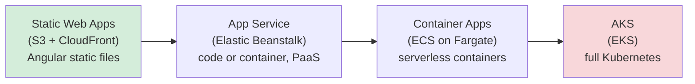
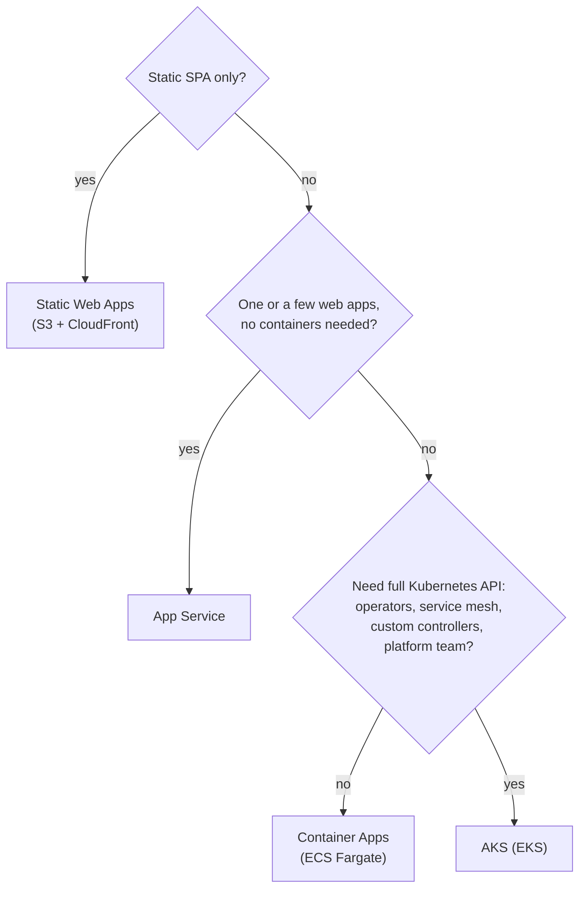

import { Tabs, TabItem, Aside } from '@astrojs/starlight/components';
import QuizBlock from '~/components/QuizBlock.astro';

## Why it matters in interviews

*"Where and how is your app hosted?"* and *"would you use Kubernetes for this?"* test judgement more than trivia. Good answers pick the **simplest platform that meets the requirements**, explain the trade-off (control vs operational effort vs cost), and describe how releases happen without downtime. Product companies on AWS will expect you to map Azure terms to AWS ones.

## Core idea

The hosting options form a spectrum from "you manage almost nothing" to "you manage a cluster":



Left to right: **more control and flexibility, more operational work**.

| | Azure **App Service** | Azure **Container Apps** | **AKS** | **Static Web Apps** |
|---|---|---|---|---|
| AWS equivalent | Elastic Beanstalk | ECS on Fargate, ECS Express Mode | EKS | S3 + CloudFront, Amplify Hosting |
| Deploys | Code (zip) or a container | Containers | Containers + K8s manifests / Helm | Static files (+ optional managed Functions API) |
| Scaling | Plan scale-up/out, autoscale rules | KEDA rules: HTTP, CPU, queues; **scale to zero** | HPA, KEDA, cluster autoscaler | Global CDN, automatic |
| Zero-downtime releases | **Deployment slots** + swap | **Revisions** with traffic splitting | Rolling, blue-green, canary | Atomic deploys, preview environments per PR |
| Ops effort | Low | Low to medium | High (upgrades, networking, policies) | Very low |
| Good for | Single API or a few apps, teams new to cloud | Several microservices, event-driven workers, no K8s skills needed | Many services, need for K8s ecosystem, platform team available | Angular / React SPAs |

### Choosing



A typical answer for a .NET API + Angular app with a small team: **Angular on Static Web Apps** (or the nginx image next to the API), **API on App Service or Container Apps**, **Azure SQL** and **Azure Managed Redis / Azure Cache for Redis**, secrets in **Key Vault** via managed identity, telemetry in **Application Insights**. Reach for AKS when you have many services, a platform team, or need Kubernetes-specific capabilities. "Kubernetes because it is on my CV" is a red flag.

### Azure services in one line each (AWS in brackets)

- **App Service** (Elastic Beanstalk): managed web hosting for .NET, Node, Java or containers on an App Service plan. Built-in TLS, custom domains, slots, autoscale, Easy Auth.
- **Container Apps** (ECS on Fargate, ECS Express Mode): run containers without managing a cluster; built on Kubernetes, KEDA and Envoy under the hood, with optional Dapr. Revisions, jobs, scale to zero.

> **Note:** AWS App Runner, often quoted as the AWS equivalent, stopped accepting new customers on 30 April 2026. AWS recommends ECS Express Mode instead. Existing App Runner customers can keep using it.
- **AKS** (EKS): managed Kubernetes control plane; you manage node pools and everything in the cluster.
- **Static Web Apps** (S3 + CloudFront, Amplify Hosting): global hosting for static front ends, free SSL, staging environments per pull request, routing rules and auth.
- **Azure Container Registry** (ECR): private image registry, geo-replication, image scanning via Defender.
- **Azure Functions** (Lambda): event-driven functions; good for glue and background jobs.
- **Key Vault** (Secrets Manager / KMS), **Managed Identity** (IAM roles), **Application Insights / Azure Monitor** (CloudWatch, X-Ray), **Front Door** (CloudFront + global load balancing), **Application Gateway** (ALB with WAF).

### Zero-downtime releases

**App Service deployment slots** are live apps with their own hostnames (`shop-api-staging.azurewebsites.net`) on the same plan:

1. Deploy the new build to the **staging** slot.
2. Warm it up and smoke test it (App Service can hit a warm-up path before swapping).
3. **Swap** staging and production: App Service swaps the routing, so the warmed-up instances start taking production traffic with no cold start.
4. Problem? **Swap back**: the previous version is still warm in the staging slot.

Settings marked as **deployment slot settings** (sticky) stay with the slot, for example a staging connection string, so they do not follow the code during a swap.

**Container Apps revisions:** every change to the template creates an immutable revision. In multiple-revision mode you split traffic by weight (90/10 canary, or 0/100 blue-green) and roll back by moving the weight.

**AKS:** rolling updates by default; blue-green or canary through two Deployments behind a switchable Service / Ingress, a service mesh, or progressive delivery tools (Argo Rollouts, Flagger). See [Kubernetes in practice](../kubernetes-operations/).

## Code

App Service slot deploy and swap with the Azure CLI:

```bash
az webapp deployment slot create -g rg-shop -n shop-api --slot staging
az webapp deploy -g rg-shop -n shop-api --slot staging --src-path api.zip --type zip
# smoke test https://shop-api-staging.azurewebsites.net/health/ready, then:
az webapp deployment slot swap -g rg-shop -n shop-api --slot staging --target-slot production
# rollback = run the same swap again
```

Container Apps: create from an ACR image, then canary a new revision:

```bash
az containerapp create -n orders-api -g rg-shop --environment shop-env \
  --image shopacr.azurecr.io/orders-api:1.4.2 --target-port 8080 --ingress external \
  --registry-server shopacr.azurecr.io --registry-identity system \
  --min-replicas 1 --max-replicas 10

az containerapp revision set-mode -n orders-api -g rg-shop --mode multiple
az containerapp update -n orders-api -g rg-shop --image shopacr.azurecr.io/orders-api:1.5.0
az containerapp ingress traffic set -n orders-api -g rg-shop \
  --revision-weight orders-api--v14=90 orders-api--v15=10     # revision names from 'revision list'
```

Static Web Apps routing for Angular (`staticwebapp.config.json` in the build output):

```json
{
  "navigationFallback": {
    "rewrite": "/index.html",
    "exclude": ["/assets/*", "*.{css,js,png,svg,ico,woff2}"]
  },
  "globalHeaders": {
    "X-Content-Type-Options": "nosniff"
  }
}
```

The AWS equivalent for an Angular SPA: upload `dist/<project>/browser` to an S3 bucket (private, accessed through CloudFront Origin Access Control), and configure CloudFront to return `index.html` for 403/404 errors so deep links work. Invalidate `index.html` on each release; hashed bundles can be cached forever.

Infrastructure should be code: **Bicep** or **Terraform** on Azure (AWS: CloudFormation, CDK or Terraform), deployed by the same pipeline as the app. See [CI/CD pipelines](../ci-cd/).

## Interview Q&A

<details>
<summary>App Service vs Container Apps vs AKS for a .NET API?</summary>

App Service for one or a few web apps: least effort, slots for zero-downtime swaps, can run code or a container. Container Apps when you have several containerised services or background workers that should scale on events (including to zero) without operating Kubernetes. AKS when you need the full Kubernetes API, many services, custom networking or operators, and have people to run it. Choose the simplest one that meets the requirements.
</details>

<details>
<summary>How do deployment slots give zero downtime?</summary>

You deploy to a non-production slot, warm it up and test it while production keeps serving. Swapping switches routing between the slots, so the already-warm new version takes traffic immediately. The old version stays in the other slot, so rollback is another swap. Slot-specific (sticky) settings stay with their slot.
</details>

<details>
<summary>How would you host the Angular front end?</summary>

As static files on a CDN-backed host: Azure Static Web Apps (AWS: S3 + CloudFront or Amplify Hosting), with a navigation fallback to `index.html` for client-side routes and long cache headers for hashed bundles. Alternatively an nginx container next to the API when everything runs on Kubernetes or Container Apps.
</details>

<details>
<summary>What are the AWS equivalents of App Service, Container Apps, AKS and ACR?</summary>

App Service ≈ Elastic Beanstalk; Container Apps ≈ ECS on Fargate (ECS Express Mode for the simplest setup); AKS ≈ EKS; ACR ≈ ECR; Static Web Apps ≈ S3 + CloudFront or Amplify Hosting; Key Vault ≈ Secrets Manager; Application Insights ≈ CloudWatch + X-Ray; Managed Identity ≈ IAM roles for the service.
</details>

<details>
<summary>How does the app get secrets in Azure without storing passwords?</summary>

Enable a managed identity on the App Service / Container App / AKS workload, grant it access to Key Vault (and to Azure SQL using Entra authentication), and use `DefaultAzureCredential` in code or Key Vault references in app settings. No secret is stored in config or the pipeline. On AWS the same idea is an IAM role attached to the task or service.
</details>

<details>
<summary>Your App Service API is slow under load. What are your scaling options?</summary>

Scale up (bigger plan tier: more CPU and memory per instance) or scale out (more instances, manually or with autoscale rules on CPU, memory or HTTP queue length). Before that, check Application Insights for the real bottleneck: often it is the database, a missing cache, or sync-over-async thread starvation, which more instances will not fix.
</details>

## Pitfalls

<Aside type="caution" title="Common mistakes">

- **Choosing AKS by default** for a single API and a small team.
- **Deploying straight to the production slot**, so every release has a cold start and no instant rollback.
- **Forgetting sticky slot settings**, so a staging connection string swaps into production.
- **No SPA navigation fallback** on Static Web Apps or CloudFront, so deep links 404.
- **Secrets in app settings or pipeline variables** instead of Key Vault with managed identity.
- **ClickOps infrastructure** that nobody can recreate; use Bicep or Terraform.
- **Scale-to-zero for latency-sensitive APIs** without accounting for cold starts.

</Aside>

## Related

- [CI/CD pipelines](../ci-cd/)
- [Kubernetes in practice](../kubernetes-operations/)
- [Azure ↔ AWS mapping](../../system-design/azure-aws-mapping/)
- [Configuration & options pattern](../../aspnet/configuration-options/)

## Quick quiz

<QuizBlock section="testing-devops" topic="cloud-deployment" />
