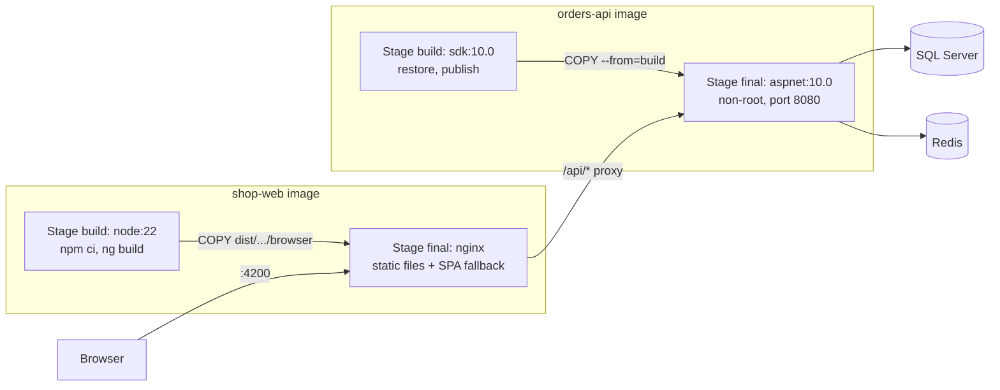

import { Tabs, TabItem, Aside } from '@astrojs/starlight/components';
import QuizBlock from '~/components/QuizBlock.astro';

## Why it matters in interviews

For a .NET + Angular developer, "do you know Docker?" quickly turns into *"write the Dockerfile for your API"*, *"how do you serve the Angular app in a container, and why do deep links return 404?"*, *"how does the API container find SQL Server?"* and *"how do you pass the connection string?"*. This page gives you production-quality files you can explain line by line.

## Core idea



### Facts about .NET container images

- Images live on **MCR**: `mcr.microsoft.com/dotnet/sdk:10.0` (build), `aspnet:10.0` (ASP.NET Core runtime), `runtime:10.0` (console apps), `runtime-deps:10.0` (self-contained and Native AOT apps).
- Since **.NET 8**, ASP.NET Core images listen on **port 8080** (set through `ASPNETCORE_HTTP_PORTS=8080`), not 80, so the app can run without root privileges.
- Since .NET 8 the images include a **non-root `app` user**; its UID is in the `APP_UID` environment variable, so `USER $APP_UID` switches to it.
- For .NET 10, the default Linux tags (`10.0`) are based on **Ubuntu 24.04 "Noble"**. Alpine (`10.0-alpine`) and Azure Linux variants are also published.
- **Chiseled** images (`10.0-noble-chiseled`) are Ubuntu-based, distroless-style: no shell, no package manager, only the libraries .NET needs, and they **run as non-root by default**. `-extra` variants add ICU and time zone data for apps that need globalization.

| Base image | Contains | Shell | Use when |
|---|---|---|---|
| `sdk:10.0` | SDK, compilers, NuGet | Yes | Build stage only |
| `aspnet:10.0` | ASP.NET Core + .NET runtime on Ubuntu | Yes | Default runtime, easy to debug |
| `aspnet:10.0-alpine` | Same on Alpine (musl) | Yes | Smaller; test globalization and native dependencies |
| `aspnet:10.0-noble-chiseled` | Minimal runtime, non-root | **No** | Production hardening, fewer CVEs |
| `aspnet:10.0-noble-chiseled-extra` | Chiseled + ICU + tzdata | No | Chiseled with culture-aware formatting |
| `runtime-deps:10.0-noble-chiseled` | Only native dependencies | No | Self-contained or Native AOT publish |

## Code

### ASP.NET Core 10: multi-stage Dockerfile

```dockerfile
# syntax=docker/dockerfile:1
FROM --platform=$BUILDPLATFORM mcr.microsoft.com/dotnet/sdk:10.0 AS build
ARG TARGETARCH
WORKDIR /src

# 1) Restore: copy only project files so this layer stays cached until dependencies change
COPY Directory.Packages.props ./
COPY src/Orders.Api/Orders.Api.csproj src/Orders.Api/
COPY src/Orders.Application/Orders.Application.csproj src/Orders.Application/
COPY src/Orders.Infrastructure/Orders.Infrastructure.csproj src/Orders.Infrastructure/
RUN --mount=type=cache,id=nuget,target=/root/.nuget/packages \
    dotnet restore src/Orders.Api/Orders.Api.csproj -a $TARGETARCH

# 2) Publish: copy the source and publish without restoring again
COPY src/ src/
RUN --mount=type=cache,id=nuget,target=/root/.nuget/packages \
    dotnet publish src/Orders.Api/Orders.Api.csproj -c Release -a $TARGETARCH \
      --no-restore -o /app/publish /p:UseAppHost=false

# 3) Runtime: small image, no SDK, no source code
FROM mcr.microsoft.com/dotnet/aspnet:10.0 AS final
WORKDIR /app
EXPOSE 8080
COPY --from=build /app/publish .
USER $APP_UID
ENTRYPOINT ["dotnet", "Orders.Api.dll"]
```

What each part buys you:
- `--platform=$BUILDPLATFORM` + `TARGETARCH`: the SDK runs natively on the build machine and cross-targets `amd64` or `arm64` (`docker buildx build --platform linux/arm64 ...`), avoiding slow emulation.
- The **cache mount** keeps the NuGet package folder between builds without putting it in a layer.
- `COPY` of `.csproj` files before the source keeps `restore` cached across code changes.
- `USER $APP_UID` runs the app as the built-in non-root user.

**Chiseled variant** (only the final stage changes; no `USER` needed because it already defaults to the non-root user):

```dockerfile
FROM mcr.microsoft.com/dotnet/aspnet:10.0-noble-chiseled AS final
WORKDIR /app
COPY --from=build /app/publish .
ENTRYPOINT ["dotnet", "Orders.Api.dll"]
```

No shell means `docker exec -it api sh` and `HEALTHCHECK CMD curl ...` do not work. Rely on Kubernetes probes or the platform's health checks, and debug with ephemeral debug containers (`kubectl debug`). If the app formats dates or currencies per culture, use `-chiseled-extra` or set `<InvariantGlobalization>true</InvariantGlobalization>` deliberately.

### Without a Dockerfile: `dotnet publish` container support

Since .NET 8 the SDK can build an OCI image directly, no Dockerfile required. Web projects support it out of the box; console and worker projects set `<EnableSdkContainerSupport>true</EnableSdkContainerSupport>`.

```bash
# Build an image into the local Docker/Podman daemon
dotnet publish src/Orders.Api -c Release --os linux --arch x64 /t:PublishContainer \
  -p ContainerRepository=orders-api -p ContainerImageTag=1.4.2

# Use a chiseled base and push straight to Azure Container Registry (no Docker daemon needed)
dotnet publish src/Orders.Api -c Release --os linux --arch x64 /t:PublishContainer \
  -p ContainerFamily=noble-chiseled \
  -p ContainerRegistry=shopacr.azurecr.io -p ContainerRepository=orders-api \
  -p ContainerImageTags='"1.4.2;latest"'
```

| | Dockerfile | `dotnet publish /t:PublishContainer` |
|---|---|---|
| Control | Full: extra packages, files, multi-project builds | Limited to MSBuild properties |
| Non-root, port 8080 | You write it | Defaults applied |
| Needs Docker to build | Yes (or BuildKit) | No for remote registry push |
| Non-.NET steps (e.g. apt packages) | Easy | Not supported; use a custom `ContainerBaseImage` |

### Angular: build with Node, serve with nginx

```dockerfile
# syntax=docker/dockerfile:1
FROM node:22-alpine AS build
WORKDIR /app
COPY package.json package-lock.json ./
RUN npm ci
COPY . .
RUN npx ng build --configuration production

# nginx-unprivileged runs as a non-root user and listens on 8080
FROM nginxinc/nginx-unprivileged:stable-alpine AS final
COPY nginx/default.conf /etc/nginx/conf.d/default.conf
COPY --from=build /app/dist/shop-web/browser /usr/share/nginx/html
EXPOSE 8080
```

With the Angular `application` builder (Angular 17+), output lands in `dist/<project>/browser`. The final image contains **only static files and nginx**; Node and `node_modules` never ship.

```nginx
server {
    listen 8080;
    root /usr/share/nginx/html;
    index index.html;
    gzip on;
    gzip_types text/css application/javascript application/json image/svg+xml;

    # Hashed bundles (main-ABC123.js) never change: cache for a year
    location ~* \.(?:js|css|woff2?|svg|png|jpg|jpeg|webp|ico)$ {
        expires 1y;
        add_header Cache-Control "public, immutable";
        try_files $uri =404;
    }

    # Same-origin API: no CORS, and the SPA needs no API URL
    location /api/ {
        proxy_pass http://api:8080;
        proxy_set_header Host $host;
        proxy_set_header X-Forwarded-For $proxy_add_x_forwarded_for;
        proxy_set_header X-Forwarded-Proto $scheme;
    }

    # SPA fallback: /orders/42 is an Angular route, not a file, so serve index.html
    location / {
        try_files $uri $uri/ /index.html;
        add_header Cache-Control "no-cache";
    }
}
```

Without the `try_files ... /index.html` fallback, refreshing the browser on `/orders/42` returns **nginx 404**, because no such file exists on disk.

**Runtime configuration for Angular.** `environment.ts` values are compiled into the bundle, which breaks build-once-deploy-many. Options: proxy `/api` on the same origin (above, or through the Kubernetes Ingress) so no URL is needed; or load a `config.json` at startup that is mounted per environment (ConfigMap, volume) or generated at container start.

```ts
// app.config.ts: load /config.json before the app starts
export const appConfig: ApplicationConfig = {
  providers: [
    provideHttpClient(),
    provideAppInitializer(() => inject(ConfigService).load()),
  ],
};

@Injectable({ providedIn: 'root' })
export class ConfigService {
  private readonly http = inject(HttpClient);
  readonly config = signal<{ apiUrl: string } | null>(null);

  async load() {
    this.config.set(await firstValueFrom(this.http.get<{ apiUrl: string }>('/config.json')));
  }
}
```

### docker-compose: API + SQL Server + Redis + Angular

```yaml
# compose.yaml   (run: docker compose up -d --build)
services:
  sql:
    image: mcr.microsoft.com/mssql/server:2022-latest
    environment:
      ACCEPT_EULA: "Y"
      MSSQL_SA_PASSWORD: ${SA_PASSWORD:?set SA_PASSWORD in .env}
    ports: ["1433:1433"]                 # only so SSMS on the host can connect
    volumes: [sqldata:/var/opt/mssql]
    healthcheck:
      test: ["CMD-SHELL", "/opt/mssql-tools18/bin/sqlcmd -S localhost -U sa -P \"$${MSSQL_SA_PASSWORD}\" -C -Q 'SELECT 1' || exit 1"]
      interval: 10s
      timeout: 5s
      retries: 10
      start_period: 30s

  redis:
    image: redis:7-alpine
    healthcheck:
      test: ["CMD", "redis-cli", "ping"]
      interval: 5s
      retries: 5

  api:
    build:
      context: .
      dockerfile: src/Orders.Api/Dockerfile
    environment:
      ASPNETCORE_ENVIRONMENT: Development
      ConnectionStrings__Sql: "Server=sql,1433;Database=Orders;User Id=sa;Password=${SA_PASSWORD};TrustServerCertificate=True"
      ConnectionStrings__Redis: "redis:6379"
    ports: ["5000:8080"]
    depends_on:
      sql: { condition: service_healthy }
      redis: { condition: service_healthy }

  web:
    build: ./web
    ports: ["4200:8080"]
    depends_on: [api]

volumes:
  sqldata:
```

Key points:
- Services reach each other **by service name** on the Compose network: `Server=sql,1433`, `redis:6379`, `proxy_pass http://api:8080`.
- `ConnectionStrings__Sql`: the **double underscore** maps to the `:` separator in .NET configuration, so it overrides `ConnectionStrings:Sql` from `appsettings.json`.
- `depends_on` with `condition: service_healthy` waits for the health check; plain `depends_on` only waits for the container to **start**, not for SQL Server to accept connections. The app should still retry (EF Core `EnableRetryOnFailure`).
- `$$` escapes `$` so the variable is expanded inside the container, not by Compose. Secrets come from a git-ignored `.env` file.
- The top-level `version:` key is obsolete in the current Compose specification; omit it.
- SQL Server Linux images are published for x64 only; on Apple Silicon they run under emulation.

```bash
docker compose up -d --build          # build images and start everything
docker compose ps                     # status and health
docker compose logs -f api            # follow API logs
docker compose exec sql /opt/mssql-tools18/bin/sqlcmd -S localhost -U sa -C
docker compose down                   # stop and remove containers (volume kept)
docker compose down -v                # ...and delete the SQL data volume
```

### Image size and build speed tips

| Tip | Effect |
|---|---|
| Multi-stage build, runtime base image | Removes SDK / Node from the final image (the biggest win) |
| Chiseled, Alpine or `runtime-deps` + Native AOT | Smaller base and fewer packages to patch |
| `.dockerignore` with `bin/`, `obj/`, `node_modules/`, `.git` | Smaller build context, faster builds, no stale binaries |
| Copy `.csproj` / `package.json` first, then restore | Dependency layer cached across code changes |
| BuildKit cache mounts, `cache-from: type=gha` in CI | Reuses package caches between CI runs |
| `/p:UseAppHost=false` | Skips the native launcher you do not need with `dotnet App.dll` |
| Check `docker image history` | Find the fat layer |

## Interview Q&A

<details>
<summary>Walk me through your API Dockerfile.</summary>

A multi-stage build. Stage one uses the SDK image, copies only the `.csproj` files and runs `dotnet restore` so that layer is cached, then copies the source and runs `dotnet publish -c Release`. Stage two starts from the much smaller `aspnet:10.0` runtime image, copies only the publish output, switches to the non-root `app` user with `USER $APP_UID`, and starts the app with an exec-form `ENTRYPOINT`. The container listens on 8080.
</details>

<details>
<summary>Why does my container listen on 8080 instead of 80 after upgrading to .NET 8+?</summary>

Microsoft changed the default in the .NET 8 images (`ASPNETCORE_HTTP_PORTS=8080`) so the app can run as a non-root user, which cannot bind ports below 1024 by default. Update `-p 5000:8080`, Kubernetes `containerPort` and probes, or override the variable if you must.
</details>

<details>
<summary>What is a chiseled image and what is the trade-off?</summary>

An Ubuntu-based, distroless-style image with only the files .NET needs: no shell, no package manager, non-root by default. Smaller, fewer CVEs, smaller attack surface. Trade-off: you cannot `exec` a shell into it or add packages, ICU is missing unless you use the `-extra` variant, and debugging needs ephemeral debug containers.
</details>

<details>
<summary>Refreshing an Angular route in the nginx container returns 404. Why?</summary>

nginx looks for a file `/orders/42` on disk, finds nothing and returns 404. Client-side routes need a fallback: `try_files $uri $uri/ /index.html;` so unknown paths serve `index.html` and the Angular router handles the URL. Static Web Apps and App Service need the equivalent navigation fallback rule.
</details>

<details>
<summary>How do you pass configuration and secrets to the API container?</summary>

Environment variables using the double-underscore convention (`ConnectionStrings__Sql`), which override `appsettings.json`. Locally from Compose and a git-ignored `.env`; in Kubernetes from ConfigMaps and Secrets; in Azure ideally from Key Vault via managed identity. Never bake secrets into the image with `ENV` or copied files.
</details>

<details>
<summary>`depends_on` is set but the API still fails to connect to SQL Server on startup. Why?</summary>

Plain `depends_on` only orders container start; SQL Server takes several seconds to accept connections. Add a health check on the `sql` service and `condition: service_healthy`, and make the app resilient anyway with EF Core connection retries, because in production dependencies also restart.
</details>

<details>
<summary>When would you use `dotnet publish /t:PublishContainer` instead of a Dockerfile?</summary>

For straightforward services where the defaults are right: it produces a non-root, correctly configured image with no Dockerfile to maintain and can push to a registry without a Docker daemon (handy in CI). Use a Dockerfile when you need OS packages, custom files, or a single file that also builds non-.NET parts.
</details>

<details>
<summary>How do you make an Angular image deployable to several environments without rebuilding?</summary>

Do not put environment-specific URLs in `environment.ts`. Either serve the API on the same origin under `/api` (nginx proxy or Ingress path routing), or load a `config.json` at startup through `provideAppInitializer`, supplied per environment by a mounted ConfigMap or generated at container start.
</details>

## Pitfalls

<Aside type="caution" title="Common mistakes">

- **Mapping `-p 5000:80`** for a .NET 8+ image that listens on 8080.
- **No SPA fallback** in nginx, so deep links 404 on refresh.
- **Shipping `node_modules` or the SDK** in the final image.
- **`localhost` in connection strings** inside Compose; use the service name.
- **Relying on plain `depends_on`** for database readiness.
- **Chiseled image plus a `HEALTHCHECK` using `curl`**: there is no curl or shell.
- **Culture bugs on chiseled or Alpine** images without ICU (or with invariant globalization switched on unknowingly).
- **Secrets in `compose.yaml`** committed to git instead of a `.env` file or secret store.

</Aside>

## Related

- [Docker fundamentals](../docker-fundamentals/)
- [Kubernetes in practice](../kubernetes-operations/)
- [Configuration & options pattern](../../aspnet/configuration-options/)
- [Hosting model & Program.cs](../../aspnet/hosting-startup/)

## Quick quiz

<QuizBlock section="testing-devops" topic="docker-dotnet-angular" />
