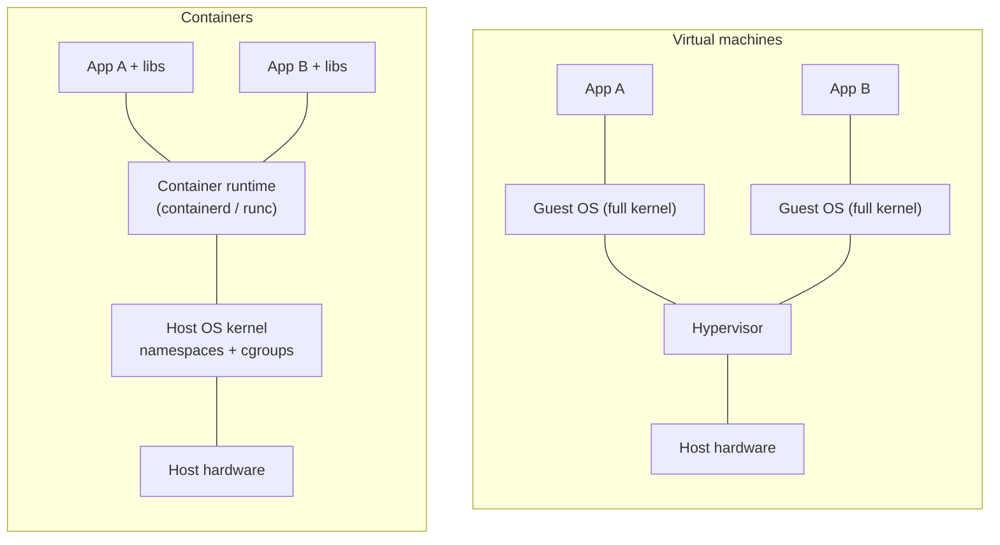
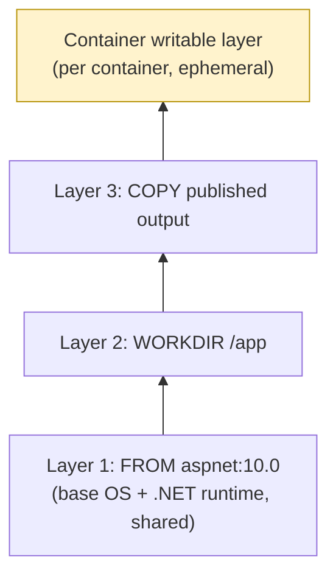

import { Tabs, TabItem, Aside } from '@astrojs/starlight/components';
import QuizBlock from '~/components/QuizBlock.astro';

## Why it matters in interviews

Docker appears on nearly every backend job description now. Interviewers start with *"container vs VM?"* and *"image vs container?"*, then move to *"why is our image 1.5 GB?"*, *"why does every build reinstall all packages?"*, *"how do two containers talk to each other?"* and *"why shouldn't the container run as root?"*. You should be able to read a Dockerfile line by line and explain what each instruction does to the image.

## Core idea

A **container** is an ordinary process on the host that the kernel isolates with **namespaces** (its own view of PIDs, network, mounts, hostname, users) and limits with **cgroups** (CPU, memory). It shares the host's kernel. An **image** is the read-only template (filesystem layers + metadata such as the entrypoint, environment and exposed ports) that a container is started from.

### Containers vs virtual machines



| | Virtual machine | Container |
|---|---|---|
| Isolation | Hardware-level, separate kernel | Process-level, **shared kernel** |
| Boot time | Tens of seconds to minutes | Milliseconds to seconds |
| Size | GBs (full OS) | MBs (app + userland libs) |
| Density | Tens per host | Hundreds per host |
| OS | Any OS on any host | Linux containers need a Linux kernel (Docker Desktop on Windows/macOS runs a small Linux VM) |
| Security boundary | Strong | Weaker; harden with non-root, seccomp, minimal images, or sandboxed runtimes |

Containers do not replace VMs everywhere: in the cloud, your containers usually run **on** VMs (AKS node pools, EKS worker nodes).

### Images, layers and the build cache

Each filesystem-changing instruction in a Dockerfile (`FROM`, `COPY`, `ADD`, `RUN`) produces a **layer**: a tarball of file changes. Layers are content-addressed, stacked with a union filesystem (overlayfs), and **shared** between images that have the same base. A running container adds one thin **writable layer** on top; it disappears when the container is removed.



**Build cache rule:** BuildKit reuses a cached layer if the instruction **and its inputs** (for `COPY`, the file checksums) are unchanged. Once one layer misses, **every layer after it is rebuilt**. So order instructions from **least to most frequently changing**: copy the project files and restore packages first, copy the source code later.

Deleting files in a later layer does **not** shrink the image; the bytes still live in the earlier layer. Clean up in the same `RUN` that created the files, or use **multi-stage builds** so build tools never reach the final image.

### Registries, tags and digests

Images are stored in **registries**: Docker Hub, GitHub Container Registry (ghcr.io), **Azure Container Registry** (AWS: ECR). A reference looks like `shopacr.azurecr.io/orders-api:1.4.2`.

- A **tag** (`1.4.2`, `latest`) is a movable pointer. `latest` is just a default name, not "the newest".
- A **digest** (`@sha256:...`) is immutable. Pin base images or deployments by digest when you need reproducibility.
- Images follow the **OCI** standard, so Docker, Podman, containerd and Kubernetes all understand them.

### Dockerfile instructions

| Instruction | Purpose | Notes |
|---|---|---|
| `FROM image AS name` | Base image, starts a build stage | Several `FROM`s = multi-stage build |
| `WORKDIR /app` | Set working directory (creates it) | Prefer over `RUN cd` |
| `COPY src dest` | Copy from build context (or `--from=stage`) | Prefer `COPY` |
| `ADD` | Like `COPY`, plus remote URLs and auto-extracting local tar files | Use only when you need those features |
| `RUN cmd` | Execute at **build** time, creates a layer | Chain and clean up in one `RUN` |
| `ENV KEY=value` | Environment variable, persists into the running container | Not for secrets |
| `ARG NAME` | Build-time variable only | Visible in image history; not for secrets either |
| `EXPOSE 8080` | **Documents** the port | Does not publish it; `-p` does |
| `USER app` | Run following instructions and the container as this user | Use a non-root user |
| `ENTRYPOINT ["dotnet","Api.dll"]` | The executable | Exec (JSON) form so the app is PID 1 and gets `SIGTERM` |
| `CMD [...]` | Default arguments (or default command) | Overridden by `docker run image args` |
| `HEALTHCHECK` | Command Docker runs to check health | Ignored by Kubernetes, which uses probes |
| `.dockerignore` | Excludes files from the build context | Exclude `bin/`, `obj/`, `node_modules/`, `.git`, secrets |

**Shell form vs exec form:** `ENTRYPOINT dotnet Api.dll` runs `/bin/sh -c "dotnet Api.dll"`, so the shell is PID 1 and may not forward `SIGTERM`; the app gets killed after the timeout instead of shutting down gracefully. Use the JSON exec form.

### Volumes and bind mounts

The writable layer is lost when the container is removed, so persistent data must live outside it.

| Type | Example | Use for |
|---|---|---|
| **Named volume** | `-v sqldata:/var/opt/mssql` | Database files; managed by Docker, survives container removal |
| **Bind mount** | `-v ./src:/app/src` | Local development (hot reload), config files |
| **tmpfs** | `--tmpfs /tmp` | Scratch data in memory |

### Networks

| Driver | Behaviour |
|---|---|
| **bridge** (default) | Private network on the host; publish ports with `-p host:container` |
| **user-defined bridge** | Same, plus **DNS by container/service name** (`Server=sql`). Docker Compose creates one per project |
| **host** | Shares the host's network stack (Linux) |
| **none** | No networking |

Inside a container, `localhost` means **the container itself**, not your machine. Containers on the same user-defined network reach each other by name on the **container** port, not the published host port.

## Code

Everyday commands:

```bash
docker build -t orders-api:dev .                 # build from ./Dockerfile
docker run -d --name api -p 5000:8080 \
  -e ASPNETCORE_ENVIRONMENT=Development orders-api:dev
docker ps                                        # running containers (-a for all)
docker logs -f api                               # follow stdout/stderr
docker exec -it api sh                           # shell inside (not in chiseled images)
docker inspect api                               # config, IP, mounts, env
docker image history orders-api:dev              # layers and their sizes
docker stop api && docker rm api
docker network create shop && docker volume create sqldata
docker system df                                 # disk usage; prune with care:
docker system prune                              # removes stopped containers, dangling images, unused networks
docker tag orders-api:dev shopacr.azurecr.io/orders-api:1.4.2
docker push shopacr.azurecr.io/orders-api:1.4.2
```

A cache-friendly, multi-stage Dockerfile skeleton (the full .NET and Angular versions are on [Dockerising .NET & Angular](../docker-dotnet-angular/)):

```dockerfile
# syntax=docker/dockerfile:1
FROM mcr.microsoft.com/dotnet/sdk:10.0 AS build
WORKDIR /src
COPY Orders.Api/Orders.Api.csproj Orders.Api/
# cached until the .csproj changes
RUN dotnet restore Orders.Api/Orders.Api.csproj
COPY . .
RUN dotnet publish Orders.Api/Orders.Api.csproj -c Release -o /app --no-restore

FROM mcr.microsoft.com/dotnet/aspnet:10.0 AS final
WORKDIR /app
COPY --from=build /app .
# non-root user built into .NET 8+ images
USER $APP_UID
ENTRYPOINT ["dotnet", "Orders.Api.dll"]
```

```text
# .dockerignore
**/bin/
**/obj/
**/node_modules/
.git
.vs
**/*.user
**/appsettings.*.local.json
.env
```

### What is wrong with this Dockerfile?

```dockerfile
FROM mcr.microsoft.com/dotnet/sdk:10.0
WORKDIR /app
COPY . .
RUN dotnet restore
RUN dotnet publish -c Release -o out
ENV ConnectionStrings__Sql="Server=prod;User Id=sa;Password=P@ssw0rd!"
ENTRYPOINT dotnet out/Orders.Api.dll
```

1. **Single stage on the SDK image**: ships compilers and source code, roughly 3-4 times bigger than the runtime image, and a larger attack surface.
2. **`COPY . .` before restore**: any source change invalidates the restore layer, so packages download on every build.
3. **Secret in `ENV`**: baked into the image metadata, visible to anyone with `docker inspect` or the registry.
4. **Shell-form `ENTRYPOINT`**: the shell is PID 1, so graceful shutdown on `SIGTERM` may not reach the app.
5. **No `USER`**: the SDK image runs as root by default.
6. **`COPY . .` without a `.dockerignore`** also sends local `bin/`, `obj/` and `.git` into the build, which is slow and can leak files.

### Security basics

- **Run as non-root.** .NET 8+ images include an `app` user (exposed as `$APP_UID`); chiseled images default to it. In Kubernetes also set `runAsNonRoot: true`.
- **Minimal base images**: runtime-only, Alpine, chiseled or distroless images have fewer packages and fewer CVEs; no shell means no easy foothold.
- **Scan images** in CI (Trivy, Docker Scout, Microsoft Defender for Containers) and **rebuild regularly** to pick up patched base images.
- **No secrets in images**: use BuildKit secret mounts (`RUN --mount=type=secret,id=nuget ...`) for build-time credentials, and runtime injection (Key Vault, Kubernetes Secrets) for app secrets.
- **Pin versions** (`aspnet:10.0` or a digest), avoid `latest`, use trusted publishers.
- **Read-only root filesystem and dropped Linux capabilities** at runtime where possible.

## Interview Q&A

<details>
<summary>What is the difference between an image and a container?</summary>

An image is an immutable, layered template: filesystem plus metadata. A container is a running (or stopped) instance of an image with its own writable layer, process, network namespace and resource limits. One image can start many containers, like a class and its objects.
</details>

<details>
<summary>How is a container different from a VM?</summary>

A VM virtualises hardware and runs a full guest OS with its own kernel on a hypervisor. A container is an isolated process sharing the host kernel, isolated by namespaces and limited by cgroups. Containers are smaller and start in milliseconds; VMs give stronger isolation and can run a different OS kernel.
</details>

<details>
<summary>Why does the order of instructions in a Dockerfile matter?</summary>

Because of layer caching: when an instruction or its inputs change, that layer and every layer after it are rebuilt. Put rarely changing steps first (base image, copying `.csproj` / `package.json` and restoring packages), and frequently changing source code last, so a code change does not re-download dependencies.
</details>

<details>
<summary>`CMD` vs `ENTRYPOINT`?</summary>

`ENTRYPOINT` defines the executable that always runs; `CMD` provides default arguments (or a default command if there is no entrypoint). `docker run image foo` replaces `CMD` but keeps `ENTRYPOINT`. A common pattern is `ENTRYPOINT ["dotnet", "Api.dll"]` with optional `CMD` args. Always use the exec (JSON array) form.
</details>

<details>
<summary>Does `EXPOSE` make a port reachable from the host?</summary>

No. `EXPOSE` is documentation and metadata. To reach the port from the host you publish it with `docker run -p 5000:8080` (host:container) or `ports:` in Compose. Containers on the same user-defined network can reach any listening port without publishing.
</details>

<details>
<summary>Two containers need to talk. How?</summary>

Put them on the same user-defined bridge network (Compose does this automatically) and use the service or container name as the hostname with the **container** port, for example `Server=sql,1433`. Never use `localhost`, which points at the calling container itself.
</details>

<details>
<summary>How do you persist SQL Server data in Docker?</summary>

Mount a named volume at the data directory: `-v sqldata:/var/opt/mssql`. The container can be removed and recreated with a new image version while the volume keeps the data. Bind mounts work too but have permission and performance quirks, especially on Windows and macOS.
</details>

<details>
<summary>How do you reduce image size?</summary>

Multi-stage builds (SDK only in the build stage), a small runtime base (`aspnet`, Alpine, chiseled), a good `.dockerignore`, combining `RUN` steps and cleaning caches in the same layer, and for .NET optionally trimming or Native AOT with the `runtime-deps` base image. Check with `docker image history`.
</details>

## Pitfalls

<Aside type="caution" title="Common mistakes">

- **Using `localhost`** to reach another container.
- **Storing data in the container's writable layer**, then losing it on `docker rm`.
- **Secrets in `ENV`, `ARG` or copied files**: they stay in the image layers and history forever.
- **`COPY . .` before restoring packages**, killing the cache.
- **`latest` tags** in production deployments.
- **Shell-form `ENTRYPOINT`**, so `SIGTERM` does not reach the app and shutdown is not graceful.
- **Running as root** "because it works".
- **Assuming Linux and Windows containers are interchangeable**: they need a matching kernel.

</Aside>

## Related

- [Dockerising .NET & Angular](../docker-dotnet-angular/)
- [Kubernetes core concepts](../kubernetes-core/)
- [Operating systems](../../fundamentals/operating-systems/)
- [Networking](../../fundamentals/networking/)

## Quick quiz

<QuizBlock section="testing-devops" topic="docker-fundamentals" />
