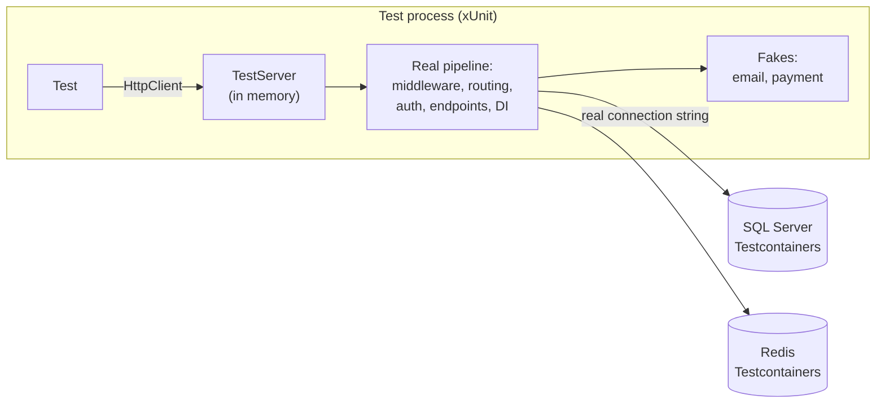

import { Tabs, TabItem, Aside } from '@astrojs/starlight/components';
import QuizBlock from '~/components/QuizBlock.astro';

## Why it matters in interviews

Unit tests with mocks cannot tell you that your EF Core mapping, SQL, JSON serialization, middleware order or authorization policy actually work. Interviewers ask *"how do you test an API end to end without deploying it?"* and expect `WebApplicationFactory`, a real database in a container, and a clean way to reset data between tests. Knowing why the EF Core in-memory provider is a poor substitute is a common follow-up.

## Core idea

`WebApplicationFactory<TEntryPoint>` (package `Microsoft.AspNetCore.Mvc.Testing`) boots your **real** `Program.cs` in memory on a **`TestServer`**. `CreateClient()` returns an `HttpClient` whose requests go straight into the ASP.NET Core pipeline with no network socket: routing, model binding, filters, auth, DI and EF Core all run for real.

Around that you swap only what you must:
- **Infrastructure** (SQL Server, Redis) runs in throwaway Docker containers via **Testcontainers**.
- **External side effects** (SMTP, payment gateway, third-party HTTP APIs) are replaced with fakes in `ConfigureTestServices`.
- **Authentication** is replaced with a test scheme so tests can act as any user.



### Why not the EF Core in-memory provider?

| Option | Realism | Speed | Notes |
|---|---|---|---|
| EF Core **InMemory** provider | Low | Very fast | Not relational: no transactions, no constraints, no raw SQL, different LINQ translation. Microsoft discourages it for testing |
| **SQLite** in-memory | Medium | Fast | Relational, but a different SQL dialect from SQL Server |
| **SQL Server in Testcontainers** | High | Seconds to start, then fast | Same engine as production. Needs Docker on dev machines and CI agents |
| Shared dev database | High | Fast | Shared state, flaky, tests interfere with each other |

The usual answer today: **Testcontainers with the real engine**, started once per test class or collection, and reset between tests.

### Resetting data: Respawn

Recreating the database per test is slow. **Respawn** inspects foreign keys once, then deletes rows from every table in the right order (ignoring tables you list, such as `__EFMigrationsHistory`). Reset takes milliseconds. Alternatives: wrap each test in a transaction that is rolled back (does not work if the code under test commits its own transaction or uses several connections), or give every test unique data.

### Sharing the expensive bits

| xUnit feature | Lifetime | Use for |
|---|---|---|
| Constructor / `IAsyncLifetime` on the test class | Per test | Resetting the database |
| `IClassFixture<ApiFactory>` | Per test class | One factory and containers per class |
| `[Collection]` + `ICollectionFixture<ApiFactory>` | Shared by all classes in the collection (run serially) | One set of containers for the whole suite |

## Code

The API exposes `public partial class Program;` at the bottom of `Program.cs` so the test project can reference the entry point type. The factory starts containers, points the app at them, swaps the email sender and adds a test auth scheme:

```csharp
public sealed class ApiFactory : WebApplicationFactory<Program>, IAsyncLifetime
{
    private readonly MsSqlContainer _sql =
        new MsSqlBuilder("mcr.microsoft.com/mssql/server:2022-latest").Build();
    private readonly RedisContainer _redis = new RedisBuilder("redis:7-alpine").Build();
    private Respawner _respawner = default!;
    public FakeEmailSender Emails { get; } = new();

    public async ValueTask InitializeAsync()
    {
        await Task.WhenAll(_sql.StartAsync(), _redis.StartAsync());
        using var scope = Services.CreateScope();                 // builds the host
        await scope.ServiceProvider.GetRequiredService<AppDbContext>()
            .Database.EnsureCreatedAsync();                       // or MigrateAsync()

        await using var conn = new SqlConnection(_sql.GetConnectionString());
        await conn.OpenAsync();
        _respawner = await Respawner.CreateAsync(conn, new RespawnerOptions
        {
            DbAdapter = DbAdapter.SqlServer,
            TablesToIgnore = ["__EFMigrationsHistory"],
        });
    }

    public async Task ResetDatabaseAsync()
    {
        await using var conn = new SqlConnection(_sql.GetConnectionString());
        await conn.OpenAsync();
        await _respawner.ResetAsync(conn);
    }
```

```csharp
    protected override void ConfigureWebHost(IWebHostBuilder builder)
    {
        builder.UseEnvironment("Testing");
        builder.UseSetting("ConnectionStrings:Sql", _sql.GetConnectionString());
        builder.UseSetting("ConnectionStrings:Redis", _redis.GetConnectionString());

        builder.ConfigureTestServices(services =>  // runs AFTER Program.cs registrations
        {
            services.RemoveAll<IEmailSender>();
            services.AddSingleton<IEmailSender>(Emails);

            services.AddAuthentication(TestAuthHandler.SchemeName) // make "Test" the default
                .AddScheme<AuthenticationSchemeOptions, TestAuthHandler>(TestAuthHandler.SchemeName, _ => { });
        });
    }

    public override async ValueTask DisposeAsync()
    {
        await base.DisposeAsync();
        await _sql.DisposeAsync();
        await _redis.DisposeAsync();
    }
}
```

A test authentication handler: requests with an `X-Test-User` header are authenticated, others are anonymous, so you can test both 200 and 401 paths:

```csharp
public sealed class TestAuthHandler(
    IOptionsMonitor<AuthenticationSchemeOptions> options, ILoggerFactory logger, UrlEncoder encoder)
    : AuthenticationHandler<AuthenticationSchemeOptions>(options, logger, encoder)
{
    public const string SchemeName = "Test";
    public const string UserHeader = "X-Test-User";

    protected override Task<AuthenticateResult> HandleAuthenticateAsync()
    {
        if (!Request.Headers.TryGetValue(UserHeader, out var user))
            return Task.FromResult(AuthenticateResult.NoResult());

        Claim[] claims = [new(ClaimTypes.Name, user.ToString()), new(ClaimTypes.Role, "Admin")];
        var principal = new ClaimsPrincipal(new ClaimsIdentity(claims, SchemeName));
        return Task.FromResult(AuthenticateResult.Success(new AuthenticationTicket(principal, SchemeName)));
    }
}
```

The tests themselves read like API documentation:

```csharp
public class OrdersApiTests(ApiFactory factory) : IClassFixture<ApiFactory>, IAsyncLifetime
{
    public async ValueTask InitializeAsync() => await factory.ResetDatabaseAsync(); // clean DB per test
    public ValueTask DisposeAsync() => ValueTask.CompletedTask;

    [Fact]
    public async Task Post_then_get_returns_the_created_order()
    {
        var ct = TestContext.Current.CancellationToken;
        var client = factory.CreateClient();
        client.DefaultRequestHeaders.Add(TestAuthHandler.UserHeader, "alice");

        var post = await client.PostAsJsonAsync("/api/orders", new CreateOrder("a@b.com", 120m), ct);

        Assert.Equal(HttpStatusCode.Created, post.StatusCode);
        var created = await post.Content.ReadFromJsonAsync<OrderDto>(ct);
        var fetched = await client.GetFromJsonAsync<OrderDto>($"/api/orders/{created!.Id}", ct);
        Assert.Equal(120m, fetched!.Total);
    }

    [Fact]
    public async Task Get_without_user_returns_401()
    {
        var response = await factory.CreateClient()
            .GetAsync("/api/orders/1", TestContext.Current.CancellationToken);
        Assert.Equal(HttpStatusCode.Unauthorized, response.StatusCode);
    }
}
```

In CI, Testcontainers needs a Docker daemon. GitHub-hosted **Ubuntu** runners and Microsoft-hosted `ubuntu-latest` Azure DevOps agents have Docker preinstalled, so `dotnet test` just works there. Windows agents generally cannot run Linux containers.

### Contract tests

When another team consumes your API (or you consume theirs), **consumer-driven contract tests** (Pact, PactNet in .NET) let the consumer publish the requests and responses it relies on; the provider's pipeline verifies it still honours them. A lighter option is to generate the OpenAPI document in CI and fail the build on breaking changes with an OpenAPI diff tool.

## Interview Q&A

<details>
<summary>What does `WebApplicationFactory` actually do?</summary>

It finds the entry point assembly, runs your `Program` with a `TestServer` instead of Kestrel, and gives you an `HttpClient` wired directly into the pipeline (no real sockets). You can override configuration, environment and services through `ConfigureWebHost`. It also sets the content root so `appsettings.json` is loaded as in production.
</details>

<details>
<summary>`ConfigureServices` vs `ConfigureTestServices` in the factory?</summary>

`ConfigureTestServices` is documented to run **after** the application's own registrations in `Program.cs`, so your replacements win. That makes it the safe, explicit place for overrides. To replace a service, remove the original (`RemoveAll<T>()`) and add the fake there; for "last registration wins" services you can also just add, but removing makes intent clear and avoids `IEnumerable<T>` surprises.
</details>

<details>
<summary>Why not use the EF Core in-memory provider for integration tests?</summary>

It is not a relational database: no transactions, no foreign keys or unique constraints, no raw SQL, and LINQ queries that would fail to translate on SQL Server may succeed. Tests pass while production fails. Use SQL Server in Testcontainers (or at least SQLite) instead.
</details>

<details>
<summary>How do you keep tests isolated when they share one database container?</summary>

Reset data before each test with Respawn (fast deletes in foreign-key order), or create unique data per test (new GUID-based names). Run classes that share a container in one xUnit collection so they do not run in parallel against the same database, or give each collection its own database.
</details>

<details>
<summary>How do you test endpoints protected by JWT?</summary>

Two options. Replace authentication with a test `AuthenticationHandler` that builds a `ClaimsPrincipal` from a header, which keeps tests simple and lets you test roles and policies. Or generate real JWTs signed with a test key and configure `JwtBearerOptions` to trust it, which also exercises token validation. Always include a test that an anonymous call returns 401 and a wrong role returns 403.
</details>

<details>
<summary>What is a contract test and when is it worth it?</summary>

It verifies that a provider still satisfies what its consumers rely on, without running both systems together. It pays off with several teams and independently deployed services (microservices), where e2e environments are slow and shared. For a single team owning both sides, integration tests plus an OpenAPI breaking-change check are usually enough.
</details>

<details>
<summary>The integration tests are slow. How do you speed them up?</summary>

Start containers once per collection instead of per class, reset with Respawn instead of recreating databases, apply migrations once, run independent collections in parallel with separate databases, and keep pure logic in unit tests. Testcontainers also supports reusing containers between local runs.
</details>

## Pitfalls

<Aside type="caution" title="Common mistakes">

- **Forgetting `public partial class Program;`**, so the test project cannot reference `WebApplicationFactory<Program>`.
- **Adding a fake without removing the original**: code that resolves `IEnumerable<T>` (or `TryAdd` registrations) still sees the real service.
- **Reading configuration eagerly in `Program.cs`** (a value captured into a local before services are built) may not see the factory's overrides. Read it lazily inside the registration lambda or use the options pattern.
- **One container per test**: correct but painfully slow.
- **Tests depending on execution order** or on data left by earlier tests.
- **Calling real third-party APIs** (payments, email) from integration tests.
- **Running Linux containers on Windows CI agents** that do not support them.

</Aside>

## Related

- [Unit testing in .NET](../dotnet-unit-testing/)
- [Docker fundamentals](../docker-fundamentals/)
- [Authentication & authorization](../../aspnet/authentication-authorization/)
- [EF Core architecture](../../data/efcore-architecture/)

## Quick quiz

<QuizBlock section="testing-devops" topic="dotnet-integration-testing" />
