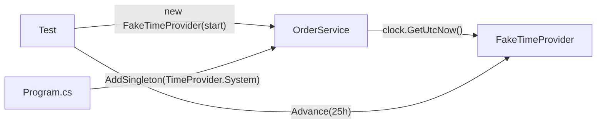

import { Tabs, TabItem, Aside } from '@astrojs/starlight/components';
import QuizBlock from '~/components/QuizBlock.astro';

## Why it matters in interviews

Service-company interviews often include *"write a unit test for this service"* on a shared screen, and product companies ask how you would test a class that depends on a repository, an email sender and the current time. You need to write a clean xUnit test from memory, mock dependencies with Moq or NSubstitute, test async code and exceptions properly, and explain why `DateTime.Now` makes code untestable.

## Core idea

A unit test runs one unit of behaviour **in memory, in milliseconds**, with slow or non-deterministic dependencies (database, HTTP, clock) replaced by test doubles. Design for testability comes first: **depend on interfaces injected through the constructor**, and inject `TimeProvider` instead of reading the clock.

### xUnit vs NUnit vs MSTest

| | xUnit | NUnit | MSTest |
|---|---|---|---|
| Test attribute | `[Fact]` | `[Test]` | `[TestMethod]` (class needs `[TestClass]`) |
| Parameterised | `[Theory]` + `[InlineData]`, `[MemberData]`, `[ClassData]` | `[TestCase]`, `[TestCaseSource]` | `[DataRow]`, `[DynamicData]` |
| Setup / teardown | Constructor / `Dispose` (or `IAsyncLifetime`) | `[SetUp]` / `[TearDown]` | `[TestInitialize]` / `[TestCleanup]` |
| Shared context | `IClassFixture<T>`, `ICollectionFixture<T>`, assembly fixtures (v3) | `[OneTimeSetUp]` | `[ClassInitialize]` |
| Instance per test | **Yes**, always | No, one instance per fixture by default | Yes |
| Typical use | Default in new .NET projects and ASP.NET Core docs | Long-lived enterprise suites | Microsoft-centric shops |

**xUnit v3** is the current major version. Notable changes: test projects are **executables** (`OutputType` `Exe`), `IAsyncLifetime` methods return `ValueTask`, `TestContext.Current` gives you the test's `CancellationToken` and output helper, and it supports the newer **Microsoft.Testing.Platform** runner as well as VSTest. Analyzer rule xUnit1051 nudges you to pass `TestContext.Current.CancellationToken` into async calls.

### Moq vs NSubstitute

| | Moq | NSubstitute |
|---|---|---|
| Create | `var repo = new Mock<IRepo>();` then `repo.Object` | `var repo = Substitute.For<IRepo>();` (it **is** the interface) |
| Stub | `repo.Setup(r => r.Get(1)).ReturnsAsync(x)` | `repo.Get(1).Returns(x)` |
| Any argument | `It.IsAny<int>()` | `Arg.Any<int>()` |
| Verify | `repo.Verify(r => r.Save(x), Times.Once)` | `repo.Received(1).Save(x)` |
| Throw | `.ThrowsAsync(new Exception())` | `.ThrowsAsync(...)` (`NSubstitute.ExceptionExtensions`) |
| Strict mode | `MockBehavior.Strict` | Not built in |

Both are fine. Moq had a controversy in 2023 (version 4.20.0 bundled SponsorLink, which read a hash of the developer's git email during builds; it was removed shortly after), which pushed some teams to NSubstitute. Mention it only if asked. Both libraries can only mock **interfaces and virtual members**, not sealed classes or static methods.

### Assertions: FluentAssertions and alternatives

**FluentAssertions v8** moved to a **commercial licence** for commercial use (the 7.x line remains under Apache 2.0). Options for a team:

- Stay on **FluentAssertions 7.x**, or buy a licence for v8.
- **Shouldly** (`result.ShouldBe(5)`), open source and similar style.
- **AwesomeAssertions**, a community fork of FluentAssertions 7 under Apache 2.0.
- Plain **`Assert`** from the framework: no dependency, perfectly fine.

### What to test in an async method

- **Await** the call inside an `async Task` test. Never `async void` tests and never `.Result`.
- Use **`Assert.ThrowsAsync<T>`** and **await it**. Forgetting the `await` makes the test pass without checking anything (the analyzers warn about this).
- Pass a `CancellationToken` and test the cancelled path when it matters.

### Testing time

`DateTime.Now` and `DateTime.UtcNow` are hidden dependencies. Since .NET 8, the BCL has **`TimeProvider`**: register `TimeProvider.System` in DI and use `FakeTimeProvider` (package `Microsoft.Extensions.TimeProvider.Testing`) in tests. `FakeTimeProvider.Advance(...)` moves time forward instantly, and it also drives timers and `Task.Delay(TimeSpan, TimeProvider)` overloads.



## Code

The class under test:

```csharp
public class OrderService(IOrderRepository repo, INotifier notifier, TimeProvider clock)
{
    public static readonly TimeSpan CancelWindow = TimeSpan.FromHours(24);

    public async Task CancelAsync(int id, CancellationToken ct = default)
    {
        var order = await repo.FindAsync(id, ct)
                    ?? throw new KeyNotFoundException($"Order {id} not found");

        if (clock.GetUtcNow() - order.CreatedAt > CancelWindow)
            throw new InvalidOperationException("Orders can only be cancelled within 24 hours");

        order.Status = OrderStatus.Cancelled;
        await repo.SaveAsync(order, ct);
        await notifier.SendAsync(order.CustomerEmail, "Order cancelled", ct);
    }

    public static decimal DiscountRate(decimal total) => total switch
    {
        >= 1000m => 0.10m,
        >= 500m => 0.05m,
        _ => 0m,
    };
}
```

Tests with **Moq** and **FakeTimeProvider** (xUnit v3):

```csharp
public class OrderServiceTests
{
    private readonly Mock<IOrderRepository> _repo = new();
    private readonly Mock<INotifier> _notifier = new();
    private readonly FakeTimeProvider _clock = new(new DateTimeOffset(2026, 1, 10, 12, 0, 0, TimeSpan.Zero));
    private OrderService CreateSut() => new(_repo.Object, _notifier.Object, _clock);

    [Fact]
    public async Task CancelAsync_WithinWindow_CancelsAndNotifies()
    {
        var ct = TestContext.Current.CancellationToken;
        var order = new ShopOrder(1, "a@b.com", _clock.GetUtcNow().AddHours(-2));
        _repo.Setup(r => r.FindAsync(1, It.IsAny<CancellationToken>())).ReturnsAsync(order);

        await CreateSut().CancelAsync(1, ct);

        Assert.Equal(OrderStatus.Cancelled, order.Status);
        _repo.Verify(r => r.SaveAsync(order, It.IsAny<CancellationToken>()), Times.Once);
        _notifier.Verify(n => n.SendAsync("a@b.com", "Order cancelled", It.IsAny<CancellationToken>()), Times.Once);
    }

    [Fact]
    public async Task CancelAsync_AfterWindow_ThrowsAndDoesNotNotify()
    {
        var order = new ShopOrder(1, "a@b.com", _clock.GetUtcNow());
        _repo.Setup(r => r.FindAsync(1, It.IsAny<CancellationToken>())).ReturnsAsync(order);
        _clock.Advance(TimeSpan.FromHours(25)); // no sleeping

        var ex = await Assert.ThrowsAsync<InvalidOperationException>(
            () => CreateSut().CancelAsync(1, TestContext.Current.CancellationToken));

        Assert.Contains("24 hours", ex.Message);
        _notifier.VerifyNoOtherCalls();
    }
}
```

**Theories** (data-driven tests). xUnit converts the `double` literals in `InlineData` to the `decimal` parameters; `TheoryData` gives you type safety:

```csharp
[Theory]
[InlineData(100, 0)]
[InlineData(500, 0.05)]
[InlineData(1500, 0.10)]
public void DiscountRate_InlineData(decimal total, decimal expected) =>
    Assert.Equal(expected, OrderService.DiscountRate(total));

public static TheoryData<decimal, decimal> DiscountCases => new()
{
    { 0m, 0m },
    { 499.99m, 0m },
    { 500m, 0.05m },
    { 1000m, 0.10m },
};

[Theory]
[MemberData(nameof(DiscountCases))]
public void DiscountRate_ReturnsTier(decimal total, decimal expected) =>
    OrderService.DiscountRate(total).ShouldBe(expected); // Shouldly
```

The same test with **NSubstitute**, including a dependency that throws:

```csharp
public class OrderServiceNSubstituteTests
{
    [Fact]
    public async Task CancelAsync_RepositoryFails_PropagatesAndSkipsNotify()
    {
        var ct = TestContext.Current.CancellationToken;
        var repo = Substitute.For<IOrderRepository>();
        var notifier = Substitute.For<INotifier>();
        repo.FindAsync(1, Arg.Any<CancellationToken>()).ThrowsAsync(new TimeoutException("db down"));
        var sut = new OrderService(repo, notifier, TimeProvider.System);

        await Should.ThrowAsync<TimeoutException>(() => sut.CancelAsync(1, ct));

        await notifier.DidNotReceiveWithAnyArgs().SendAsync(default!, default!, default);
    }
}
```

Running tests from the CLI:

```bash
dotnet test                                    # build + run (VSTest or MTP, depending on setup)
dotnet test --filter "FullyQualifiedName~OrderService"
dotnet test --collect:"XPlat Code Coverage"     # coverlet collector, Cobertura XML
```

On the .NET 10 SDK, xUnit v3 projects that use **Microsoft.Testing.Platform** need the new `dotnet test` mode enabled in `global.json` (a `"test": { "runner": "Microsoft.Testing.Platform" }` entry); otherwise keep the VSTest adapter (`xunit.runner.visualstudio`). You can always run an xUnit v3 test project directly with `dotnet run`.

## Interview Q&A

<details>
<summary>Why does xUnit create a new instance of the test class for every test?</summary>

To isolate tests: fields initialised in the constructor are fresh for each test, so one test cannot leak state into another. Expensive shared setup goes into a class fixture (`IClassFixture<T>`) or collection fixture, which xUnit creates once and injects into the constructor.
</details>

<details>
<summary>How do you unit test code that uses `DateTime.Now`?</summary>

Refactor it to take a `TimeProvider` (built into .NET 8+) and call `GetUtcNow()`. Register `TimeProvider.System` in DI. In tests, pass a `FakeTimeProvider` and call `Advance` or `SetUtcNow` to control time precisely, including timers and delays. Before .NET 8, teams wrote their own `IClock` interface.
</details>

<details>
<summary>How do you test that an async method throws?</summary>

`var ex = await Assert.ThrowsAsync<InvalidOperationException>(() => sut.DoAsync());` and then assert on `ex.Message` or properties. The `await` is essential: without it the returned task is ignored and the test can pass even if no exception is thrown. NUnit's equivalent is `Assert.ThrowsAsync`, Shouldly has `Should.ThrowAsync`.
</details>

<details>
<summary>Moq or NSubstitute: which would you pick?</summary>

Both mock interfaces and virtual members. NSubstitute has terser syntax (the substitute is the interface itself, no `.Object`), Moq has strict mocks and is very widespread. I would follow the codebase. If starting fresh, many teams pick NSubstitute since the 2023 SponsorLink episode in Moq 4.20.0.
</details>

<details>
<summary>How do you mock `HttpClient`?</summary>

You do not mock `HttpClient` itself. Either inject a typed client whose `HttpMessageHandler` is a fake that returns canned `HttpResponseMessage`s, or wrap the call in your own interface (`IPricingClient`) and mock that. For integration tests, use WireMock.Net to stand up a fake HTTP server.
</details>

<details>
<summary>Can you mock a static method or a sealed class?</summary>

Not with Moq or NSubstitute: they generate proxies through Castle DynamicProxy, which only overrides interfaces and virtual members. Wrap the static call behind an interface, or use `TimeProvider`-style abstractions. Commercial tools (JustMock, Microsoft Fakes) can do it, but needing them is usually a design smell.
</details>

<details>
<summary>What is the difference between `[Fact]` and `[Theory]`?</summary>

A fact is a single test with no parameters that should always be true. A theory is a parameterised test that runs once per data row from `[InlineData]`, `[MemberData]` or `[ClassData]`. Each row shows as a separate test case in the runner.
</details>

<details>
<summary>What happened with FluentAssertions?</summary>

From v8 (early 2025) FluentAssertions requires a paid licence for commercial use; v7 stays under Apache 2.0. Teams either pin v7, buy licences, switch to Shouldly or AwesomeAssertions, or use plain `Assert`. It is a good example of supply-chain and licence risk in dependencies.
</details>

## Pitfalls

<Aside type="caution" title="Common mistakes">

- **`async void` test methods** or `.Result` inside tests. Use `async Task`.
- **Forgetting `await` on `Assert.ThrowsAsync`**, so the test checks nothing.
- **Over-mocking**: mocking value objects, DTOs or the class under test.
- **Verifying every call** on a dependency, which locks in implementation details.
- **`It.IsAny<T>()` everywhere** in setups, so the test never proves the right argument was passed.
- **Logic in tests** (loops, ifs). Use theories instead.
- **Upgrading to FluentAssertions 8** without checking the licence.
- **Shared static state** (static caches, singletons) leaking between tests.

</Aside>

## Related

- [Testing strategy](../testing-strategy/)
- [Integration testing in .NET](../dotnet-integration-testing/)
- [Dependency injection](../../aspnet/dependency-injection/)
- [Async/await deep dive](../../csharp/async-await/)

## Quick quiz

<QuizBlock section="testing-devops" topic="dotnet-unit-testing" />
