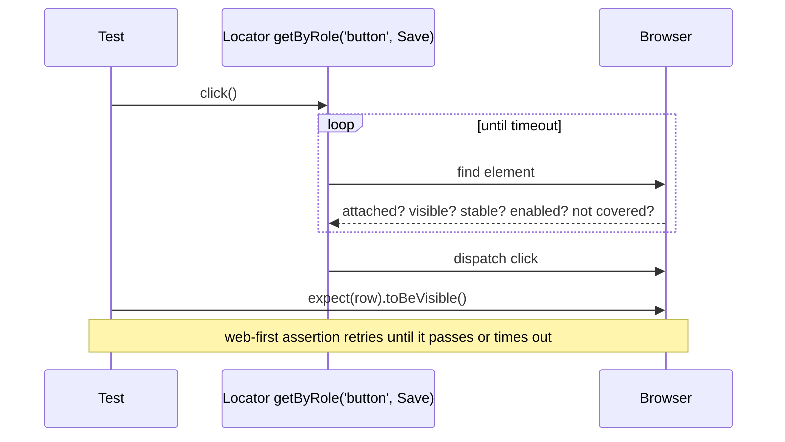

import { Tabs, TabItem, Aside } from '@astrojs/starlight/components';
import QuizBlock from '~/components/QuizBlock.astro';

## Why it matters in interviews

Full-stack .NET + Angular roles often ask *"how do you test the whole flow, from the Angular UI to the database?"* and *"your e2e tests are flaky, what do you do?"*. Expect to compare Playwright and Cypress, describe the page object pattern, and explain how e2e fits in a CI/CD pipeline without slowing every pull request to a crawl.

## Core idea

An end-to-end (e2e) test drives the **running application through a real browser** the way a user would: navigate, click, type, and assert what is on screen. It catches what unit and integration tests cannot: broken routing, wrong environment config, CORS, auth redirects, a missing API in the deployed environment.

E2E tests are the **slowest and most fragile** layer, so keep them for **critical user journeys** (sign in, search, checkout, create order) and push edge cases down to unit and integration tests.

The Angular CLI no longer ships an e2e framework (Protractor reached end of life in 2023). `ng e2e` asks you to add one; Playwright and Cypress are the common choices.

### Playwright vs Cypress

| | Playwright | Cypress |
|---|---|---|
| Maintainer | Microsoft | Cypress.io |
| Languages | TypeScript/JavaScript, .NET (C#), Java, Python | JavaScript/TypeScript |
| Browsers | Chromium, Firefox, WebKit (Safari engine) | Chromium-family, Firefox; WebKit experimental |
| Architecture | Drives browsers out-of-process over the DevTools / browser protocols | Runs inside the browser alongside the app |
| Multiple tabs, origins, iframes | Native support | Historically limited; improved with `cy.origin` |
| Parallelism | Built in, free (`workers`, sharding) | Parallel runs via Cypress Cloud (paid) or third-party tools |
| Auto-waiting | Locators auto-wait for actionable elements; web-first `expect` retries | Commands retry; assertions retry |
| Debugging | Trace viewer, UI mode, codegen | Excellent time-travel runner UI |
| API testing | `request` fixture | `cy.request` |

Both are good. Playwright has become the default for new projects because of cross-browser coverage, free parallelism and its .NET binding, which suits .NET teams. Cypress has a very friendly interactive runner and a large ecosystem.

### How Playwright avoids flakiness



- **Locators are lazy**: `page.getByRole(...)` describes how to find an element; it is resolved on each action, so re-renders do not cause stale element errors.
- **Actionability checks** before every action replace hand-written waits.
- **Web-first assertions** (`await expect(locator).toHaveText(...)`) retry; a plain `expect(await locator.textContent())` does not.

### Page objects

A **page object** wraps the selectors and actions for one page or component behind intent-revealing methods (`ordersPage.createOrder('Laptop', 2)`). When the markup changes you fix one class, not fifty tests. Keep assertions mostly in tests and avoid deep inheritance between page objects.

### Selectors that survive refactoring

Prefer, in order: **role + accessible name** (`getByRole('button', { name: 'Save' })`), **label** (`getByLabel('Email')`), **text**, then a dedicated **`data-testid`**. Avoid CSS chains like `div > span:nth-child(3)` and Angular-generated classes. Role-based selectors also push you towards accessible markup.

### Test data and authentication

- **Create data through the API**, not the UI, in a `beforeEach` or fixture. It is faster and less flaky.
- **Unique data per test** (append a GUID or timestamp) so parallel workers do not collide.
- **Log in once** in a setup project and save the browser `storageState` (cookies, local storage); tests reuse it instead of typing credentials every time.
- Use a **dedicated test environment** or ephemeral environment per pull request, never production data.

## Code

<Tabs syncKey="lang">
  <TabItem label="TypeScript">
```ts
// playwright.config.ts
import { defineConfig, devices } from '@playwright/test';

export default defineConfig({
  testDir: './e2e',
  fullyParallel: true,
  forbidOnly: !!process.env.CI,          // fail CI if someone left test.only
  retries: process.env.CI ? 2 : 0,       // safety net, still reported as flaky
  workers: process.env.CI ? 2 : undefined,
  reporter: [['html', { open: 'never' }], ['list']],
  use: {
    baseURL: process.env.BASE_URL ?? 'http://localhost:4200',
    trace: 'on-first-retry',             // full trace for failures
    screenshot: 'only-on-failure',
  },
  projects: [
    { name: 'setup', testMatch: /.*\.setup\.ts/ },
    {
      name: 'chromium',
      use: { ...devices['Desktop Chrome'], storageState: 'playwright/.auth/user.json' },
      dependencies: ['setup'],
    },
  ],
  webServer: process.env.CI
    ? undefined
    : { command: 'npm start', url: 'http://localhost:4200', reuseExistingServer: true },
});
```
  </TabItem>
  <TabItem label="C#">
```csharp
// Package Microsoft.Playwright.Xunit.v3 (also .NUnit / .MSTest flavours).
// using Microsoft.Playwright; using Microsoft.Playwright.Xunit.v3;
// PageTest gives each test a fresh Page plus Expect(...).
public class OrdersTests : PageTest
{
    [Fact]
    public async Task Created_order_appears_in_the_list()
    {
        await Page.GotoAsync("http://localhost:4200/orders");
        await Page.GetByRole(AriaRole.Button, new() { Name = "New order" }).ClickAsync();
        await Page.GetByLabel("Product").FillAsync("Laptop");
        await Page.GetByRole(AriaRole.Button, new() { Name = "Save" }).ClickAsync();

        await Expect(Page.GetByRole(AriaRole.Row).Filter(new() { HasText = "Laptop" }))
            .ToBeVisibleAsync();
    }
}
```
  </TabItem>
</Tabs>

Log in once and save the session:

```ts
// e2e/auth.setup.ts
import { test as setup, expect } from '@playwright/test';

setup('authenticate', async ({ page }) => {
  await page.goto('/login');
  await page.getByLabel('Email').fill(process.env.E2E_USER!);
  await page.getByLabel('Password').fill(process.env.E2E_PASSWORD!);
  await page.getByRole('button', { name: 'Sign in' }).click();
  await expect(page.getByRole('heading', { name: 'Orders' })).toBeVisible();
  await page.context().storageState({ path: 'playwright/.auth/user.json' });
});
```

A page object and two tests, one seeding data through the API and one mocking a failing API:

```ts
// e2e/orders.page.ts
import { type Page, type Locator } from '@playwright/test';

export class OrdersPage {
  readonly page: Page;
  readonly newOrder: Locator;

  constructor(page: Page) {
    this.page = page;
    this.newOrder = page.getByRole('button', { name: 'New order' });
  }

  goto() {
    return this.page.goto('/orders');
  }

  async createOrder(product: string, quantity: number) {
    await this.newOrder.click();
    await this.page.getByLabel('Product').fill(product);
    await this.page.getByLabel('Quantity').fill(String(quantity));
    await this.page.getByRole('button', { name: 'Save' }).click();
  }

  row(product: string) {
    return this.page.getByRole('row').filter({ hasText: product });
  }
}
```

```ts
// e2e/orders.spec.ts
import { test, expect } from '@playwright/test';
import { OrdersPage } from './orders.page';

test('created order appears in the list', async ({ page }) => {
  const product = `Laptop-${Date.now()}`;      // unique per run
  const orders = new OrdersPage(page);
  await orders.goto();
  await orders.createOrder(product, 2);
  await expect(orders.row(product)).toBeVisible();
});

test('shows an error banner when the API fails', async ({ page }) => {
  await page.route('**/api/orders', (route) => route.fulfill({ status: 500, body: 'boom' }));
  await new OrdersPage(page).goto();
  await expect(page.getByRole('alert')).toContainText('Could not load orders');
});
```

Running it in GitHub Actions after the app is deployed to a test environment:

```yaml
e2e:
  runs-on: ubuntu-latest
  needs: deploy-test
  steps:
    - uses: actions/checkout@v4
    - uses: actions/setup-node@v4
      with: { node-version: 22, cache: npm, cache-dependency-path: web/package-lock.json }
    - run: npm ci
      working-directory: web
    - run: npx playwright install --with-deps chromium
      working-directory: web
    - run: npx playwright test
      working-directory: web
      env:
        BASE_URL: https://test.shop.example.com
        E2E_USER: ${{ secrets.E2E_USER }}
        E2E_PASSWORD: ${{ secrets.E2E_PASSWORD }}
    - uses: actions/upload-artifact@v4
      if: ${{ !cancelled() }}
      with: { name: playwright-report, path: web/playwright-report/ }
```

### Mitigating flaky e2e tests

| Symptom | Fix |
|---|---|
| Element not found / click intercepted | Use locators and web-first assertions; remove `waitForTimeout` |
| Passes alone, fails in parallel | Unique test data, no shared accounts that change state |
| Depends on previous test | Each test sets up its own state via API |
| Slow third-party widget | Mock it with `page.route` |
| Fails only in CI | Compare traces; check viewport, time zone, slower machine; raise timeouts per action, not globally |
| Random failures nobody fixes | Track flaky tests (retried-then-passed), quarantine with `test.fixme`, fix within the sprint |

## Interview Q&A

<details>
<summary>Playwright or Cypress for a new Angular project?</summary>

I would pick Playwright: it tests Chromium, Firefox and WebKit, parallelises for free, handles multiple tabs and origins natively, and has a .NET binding if the team prefers C#. Cypress is still a good choice if the team already knows it and values its interactive runner.
</details>

<details>
<summary>What is the page object pattern and why use it?</summary>

A class per page or component that exposes user-level actions (`login`, `createOrder`) and locators, hiding selectors from tests. It removes duplication and makes UI changes a one-place fix. Keep it thin: no assertions hidden inside, no deep inheritance trees.
</details>

<details>
<summary>How do you make e2e tests independent of each other?</summary>

Every test creates the data it needs through the API (or a seeding endpoint enabled only in test environments), uses unique names, and never relies on another test's leftovers. Authentication state is created once in a setup project and reused read-only.
</details>

<details>
<summary>How many e2e tests should you have?</summary>

Few: one per critical user journey, maybe tens, not hundreds. Business rules and edge cases belong in unit tests, API behaviour in integration tests. A smoke subset runs after every deployment; the full e2e suite can run nightly or before production.
</details>

<details>
<summary>Why is `page.waitForTimeout(3000)` a bad idea?</summary>

It is either too short on a slow CI agent (flaky) or too long on a fast one (slow suite). Wait for a condition instead: Playwright actions auto-wait for the element to be actionable, and `await expect(locator).toBeVisible()` retries until the condition holds or the timeout expires.
</details>

<details>
<summary>Where do e2e tests run in a CI/CD pipeline?</summary>

After the build is deployed to a test or staging environment (or an ephemeral per-PR environment): deploy, run e2e against that URL, and only then promote to production. Upload the HTML report and traces as artifacts so failures can be debugged without rerunning.
</details>

## Pitfalls

<Aside type="caution" title="Common mistakes">

- **Testing everything through the UI**, including validation rules that a unit test covers in milliseconds.
- **Fixed sleeps** (`waitForTimeout`) instead of waiting for conditions.
- **Brittle CSS / XPath selectors** tied to layout or generated class names.
- **Logging in through the UI in every test** instead of reusing storage state.
- **Shared test accounts** whose state changes as tests run in parallel.
- **Running against production** or with real payment providers.
- **Hiding flakiness with retries** and never looking at the flaky report.

</Aside>

## Related

- [Testing strategy](../testing-strategy/)
- [CI/CD pipelines](../ci-cd/)
- [Angular testing](../../angular/testing/)
- [HTML & accessibility](../../web/html-accessibility/)

## Quick quiz

<QuizBlock section="testing-devops" topic="e2e-testing" />
